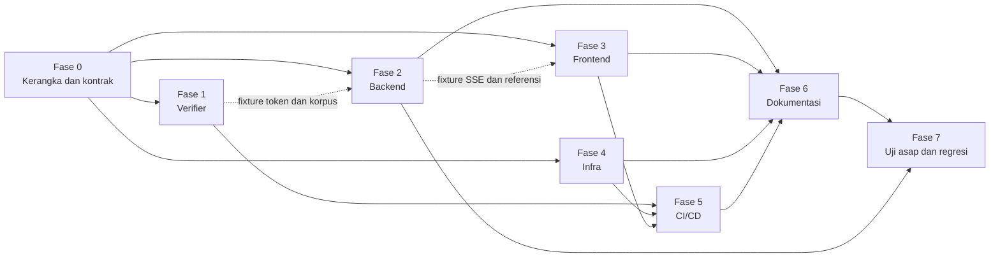

# Implementation Plan: ai-remotion-animation

## Overview

Rencana ini mengimplementasikan jalur animasi kedua pada visual pelajaran LORE: Gemini menulis satu berkas `main.ts` (Remotion), Verifier_Lambda membuktikan berkas itu berjalan (tujuh langkah, perbaikan otomatis maksimal 4 Gemini_Call), berkas yang lolos disimpan immutable di S3, dan frontend mengeksekusi `main.js` di iframe bersandbox pada kanvas Stage. Jalur JSON `visual` yang ada tidak diubah dan menjadi Fallback_Scene untuk setiap kegagalan. Semua flag default mati (`ANIMATION_ENABLED=false`, `NEXT_PUBLIC_ANIMATIONS=off`), sehingga merge kode tidak mengubah perilaku produksi.

Sumber: [requirements.md](./requirements.md) (41 requirement, 618 kriteria) dan [design.md](./design.md) (bagian 1 sampai 16, termasuk Catatan Keselarasan dan 15 Properti Kebenaran). Dokumen ini hanya memuat pekerjaan coding. Langkah operator (bootstrap IAM, apply, isi nilai SSM, rilis, pengukuran RSS di lingkungan nyata, daftar periksa browser) ada di bagian "Langkah operator (di luar tugas coding)" dan tidak berupa checkbox.

Bahasa implementasi: TypeScript (Node 22 untuk verifier; Next 16, React 19, Vitest 3 untuk frontend dan runtime sandbox), Python 3.12 (FastAPI, SQLAlchemy, Alembic, Pytest; skrip CI), HCL (Terraform), bash dan YAML (CI/CD). Properti kebenaran memakai `fast-check` di verifier dan frontend, dan parametrisasi `@pytest.mark.parametrize("seed", range(n))` berbenih (n minimal 40) di backend, tanpa dependensi dev baru (T-11).

### Peta fase

| Fase | Tugas | Isi | Requirement utama |
|---|---|---|---|
| 0 | 1 sampai 2 | Kerangka `animation-verifier/`, `animation-contract.json`, `sync-animation-contract.py`, `check-animation-versions.py`, pin versi | 1, 2, 3 |
| 1 | 3 sampai 10 | Verifier: tokens, diagnostics, pipeline, tujuh langkah, korpus fixture, handler, Worker, Dockerfile, uji RIE | 6 sampai 11, 38 |
| 2 | 11 sampai 19 | Backend: klien Gemini teks, token, prompt, ekstraksi, kontrak cerita, refaktor guard, limiter, registry, S3, klien Lambda, agent LangGraph, SSE, reader, health, logging | 4, 5, 12 sampai 21, 33, 39, 41 |
| 3 | 20 sampai 28 | Frontend: tipe dan Zod, target, klien SSE, loader, tahap `animating`, protokol sandbox, runtime, builder, CSP, `AnimationScene`, integrasi Stage, fallback, flag build | 22 sampai 31, 36, 39 |
| 4 | 29 sampai 32 | Infra: Terraform, variabel, IAM, berkas bootstrap, guardrail biaya dan tag | 34, 35, 36 |
| 5 | 33 sampai 34 | CI/CD: job `verifier` dan `contracts`, `release-verifier.yml`, `verifier-release.sh`, `release-web.yml` | 3, 36, 37 |
| 6 | 35 sampai 36 | Dokumentasi, steering, roadmap, tes dokumen, estimasi biaya | 40, 41 |
| 7 | 37 sampai 38 | Skrip uji asap dan regresi akhir | 33, 38 |

### Diagram dependensi antar fase



Fase 1 sampai 4 dapat berjalan paralel setelah fase 0 selama ketergantungan fixture (garis putus-putus) dipenuhi. Urutan eksekusi yang aman ada di bagian "Task Dependency Graph".

### Aturan yang berlaku untuk setiap tugas

- **Tidak ada commit atau push tanpa permintaan pengguna.** Baris `Commit` di tiap sub-tugas hanya menyatakan apa yang di-commit bila diminta: Conventional Commits dengan scope (`feat(verifier)`, `feat(ai)`, `feat(api)`, `feat(db)`, `feat(stage)`, `feat(state)`, `feat(sandbox)`, `feat(infra)`, `ci(...)`, `docs(infra)`, `test(...)`), kode dan tes di commit terpisah. Sub-tugas bertanda **tests-first** meng-commit tes lebih dulu (merah), lalu kode (hijau).
- **Tiap berkas baru diawali komentar header** (Python: docstring modul dan `from __future__ import annotations`) yang menyatakan tujuan dan alasannya.
- **Hasil berupa union** `{ ok: true, ... } | { ok: false, ... }` (TypeScript) atau dataclass/union terpisah (Python). Tidak ada throw di batas modul. **Zod** (TypeScript) atau **Pydantic** (Python) di setiap batas kepercayaan: request, event SSE, respons Reader, pesan iframe, data project dari IndexedDB.
- **Styling:** hanya kelas token Kit (`bg-ink`, `text-cream`, `border-smoke`, `text-gold`, `bg-ember`, `font-mono`, `font-display`, `text-muted`, `bg-candle`). Tanpa hex, `rounded-*`, `shadow-*`, gradient, blur, emoji, atau kartu pada komponen. Tiap elemen interaktif punya `data-testid`.
- **Python:** ruff `E,F,I,B,UP`, `line-length = 100`. **Migrasi Alembic** ditulis tangan, expand-only, dengan `downgrade` nyata. Migrasi yang sudah ada tidak diedit.
- **Berkas yang tidak boleh diedit manual:** `frontend/package-lock.json`, `animation-verifier/package-lock.json`, `infra/.terraform.lock.hcl`, migrasi Alembic yang ada, `node_modules/`, `.next/`, `.env*`, `*.tfvars`, `*.tfstate*`. Lockfile hanya berubah lewat `npm install --save-exact` atau `npm ci`.
- **Tes lama tidak diubah** (Requirement 38.7, 15.5): setiap tugas yang menyentuh kode yang sudah ada menjalankan seluruh suite lama dan `git diff --stat -- <direktori tes lama>` kosong untuk commit kode.
- **Agen tidak menjalankan** `terraform apply`, `terraform destroy`, skrip `infra/bootstrap/*.sh`, atau perintah `aws` yang mengubah resource (Requirement 35.6). Langkah itu hanya dicatat di bagian operator.
- **Pelaksana.** Setiap sub-tugas menyebut `_Pelaksana:_`. `backend` menulis hanya di `backend/` dan Caddyfile web (tidak diubah di fitur ini). `frontend` menulis hanya di `frontend/src` dan `frontend/tests`. Agen `infra` read-only dan tidak menulis, sehingga semua berkas `infra/**` ditulis oleh `sesi utama` dan agen `infra` hanya meninjau dan menjalankan validasi. Berkas di luar kewenangan agen khusus (`animation-verifier/`, `frontend/sandbox-runtime/`, `frontend/scripts/`, `frontend/next.config.ts`, `frontend/package.json`, `frontend/eslint.config.mjs`, `frontend/Dockerfile`, `frontend/.env.example`, `scripts/`, `.github/`, `infra/`, `docs/`, `.kiro/`, `.gitignore`) ditulis oleh `sesi utama` (temuan T-10).
- **Sub-tugas bertanda `*`** adalah tes properti atau suite tes tambahan dan bersifat opsional. Tes contoh inti untuk perilaku yang dibangun sebuah sub-tugas ada di dalam sub-tugas itu dan tidak opsional. Tiap tes properti dijalankan minimal 100 iterasi (backend: sedikitnya 40 benih) dan diberi komentar `Feature: ai-remotion-animation, Property N: <judul>`.
- **Checkpoint** di akhir tiap fase menjalankan gerbang fase. Satu-satunya tempat yang boleh menyebut bertanya kepada pengguna adalah checkpoint.

### Gerbang per fase

| Gerbang | Dijalankan dari | Perintah |
|---|---|---|
| Verifier | `animation-verifier/` | `npm run lint`, `npx tsc --noEmit`, `npx vitest run`, `docker build --platform linux/amd64 --provenance=false --sbom=false -t lore-verifier:local .` (lewati bila Docker tidak ada dan catat) |
| Backend | `backend/` | `ruff check . --no-cache && ruff format --check .`, `pytest -q` (tes `[PG]` butuh `PGHOST`; tanpa itu tes DB dilewati seperti `tests/test_db.py`) |
| Frontend | `frontend/` | `npm run lint`, `npx next typegen`, `npx tsc --noEmit`, `npx vitest run --testTimeout=60000`, `npm run build` |
| Infra | akar repo | `terraform -chdir=infra fmt -check -recursive`, `terraform -chdir=infra init -backend=false`, `terraform -chdir=infra validate`, `python3 -B scripts/ci/check-cost-static infra`, `python3 -B scripts/ci/test-checkers.py -v`, `shellcheck scripts/ci/*.sh scripts/verify/*.sh` |
| Kontrak | akar repo | `python3 scripts/sync-animation-contract.py --check`, `python3 scripts/ci/check-animation-versions.py` |

Fase 0: Kontrak dan Verifier (lint, tsc, vitest). Fase 1: Verifier penuh. Fase 2: Backend dan Kontrak. Fase 3: Frontend dan Kontrak. Fase 4: Infra. Fase 5: Infra (checker dan shellcheck) ditambah `actionlint` bila terpasang. Fase 6: Backend (`pytest -q tests/test_animation_docs.py`) dan Infra (checker). Fase 7: semua gerbang.

## Tasks

- [ ] 1. Kerangka paket verifier dan kontrak (fase 0)
  - [ ] 1.1 Kerangka paket `animation-verifier/`
    - Buat `animation-verifier/package.json` (`"type": "module"`, `engines.node` 22, skrip `build` = `tsc -p tsconfig.json`, `lint`, `test` = `vitest run`, `typecheck`), `tsconfig.json` (strict, ES2022, `outDir` `dist`), `.nvmrc` berisi `22`, `.dockerignore`, `vitest.config.ts`, dan `eslint.package.config.mjs` (konfigurasi lint untuk kode paket sendiri; `eslint.config.mjs` dicadangkan untuk konfigurasi internal Main_File di tugas 5.2, lihat Catatan N-1).
    - Pasang dependensi dengan `npm install --save-exact` agar semua versi dipin tanpa `^` atau `~` (Requirement 8.13): `typescript`, `esbuild` (0.28.2, sama dengan lockfile frontend), `eslint`, `@eslint/js`, `typescript-eslint`, `jsdom`, `react` 19.3.0, `react-dom` 19.3.0, `remotion` 4.0.543, `@remotion/player` 4.0.543, `zod` 3.x, `@types/react`, `@types/node`, `vitest`, `fast-check`. Lockfile dihasilkan oleh npm, tidak ditulis tangan.
    - Buat `src/types.ts` (`Diagnostic`, `Severity`, `Tool`, `Kind`, `VerifierInput`, `MainMeta`, `CheckSummary`, `VerifierSummary`, `VerifierResult` persis bagian 5.2) dan `src/clock.ts` (`Clock`, `systemClock`, `FakeClock`). Tambah ke `.gitignore`: `animation-verifier/node_modules/`, `animation-verifier/dist/`, `animation-verifier/.corpus-results.json`, `/frontend/public/sandbox/`.
    - Tes: `animation-verifier/tests/clock.test.ts` (FakeClock monotonik dan dapat dimajukan) dan `tests/pins.test.ts` (setiap dependensi di `package.json` tanpa awalan `^`, `~`, `>=`, `*`, atau `latest`). Verifikasi: gerbang Verifier (tanpa docker). Commit: `feat(verifier): scaffold the verifier package`, `test(verifier): clock and pins`.
    - _Requirements: 6.1, 8.13, 32.7_
    - _Design: 3.1, 5 (bagian pembuka), 5.2_
    - _Pelaksana: sesi utama_
  - [ ] 1.2 Sumber kontrak `animation-contract.json` dan pembaca verifier
    - Buat `animation-verifier/contract/animation-contract.json` dengan isi persis bagian 4.2 (20 bidang; `named_colors` 148 nama tanpa `transparent` dan `currentColor`; `diagnostic_code_prefixes` sebelas awalan termasuk `AGENT`; `supported_runtime_contract_versions` `[1]`).
    - Buat `animation-verifier/src/contract.ts`: skema Zod untuk 20 bidang dan `loadContract(raw: unknown): { ok: true; contract: Contract } | { ok: false; reason: string }` dengan pemeriksaan minimum bagian 4.3 (tipe, `contract_version` bilangan bulat >= 1, `supported_runtime_contract_versions` tidak kosong dan memuat `contract_version`, `canvas.*` > 0, `1 <= duration.min <= duration.max`, `limits.*` > 0, `color_tokens` tepat 9, `diagnostic_code_prefixes` tepat 11 dan memuat `AGENT`). Turunkan set cepat (`forbiddenIdentifiers`, `namedColors` huruf kecil, regex kode Diagnostic dari awalan selain `AGENT`).
    - Tes: `tests/contract.test.ts` (kontrak sah diterima; tiap pelanggaran minimum ditolak dengan `reason`; `file_name` sama dengan `main.ts`; 148 nama warna unik tanpa `transparent` dan `currentColor`; `color_keywords` memuat empat kata kunci; regex kode yang dibangun dari awalan selain `AGENT` cocok dengan setiap kode verifier pada tabel 5.12 dan menolak kode berawalan lain) dan `tests/contract-hash.test.ts` (snapshot `{contract_version, sha256}` dari JSON kanonik tanpa `contract_version`, kunci terurut, tanpa spasi; mengubah isi tanpa menaikkan versi menggagalkan tes). Verifikasi: `npx vitest run tests/contract.test.ts tests/contract-hash.test.ts`. Commit: `feat(verifier): animation contract and loader`, `test(verifier): contract`.
    - _Requirements: 1.8, 1.12, 2.1, 2.9, 2.10, 2.11, 2.12, 2.13, 2.16_
    - _Design: 4.1, 4.2, 4.3, 4.5_
    - _Pelaksana: sesi utama_
  - [ ] 1.3 `sync-animation-contract.py` dan salinan kontrak
    - Buat `scripts/sync-animation-contract.py` persis bagian 4.4 (`def main(argv)`, pustaka standar, kode keluar 2 untuk argumen atau sumber salah, 1 untuk drift, 0 selain itu; `--check` tidak menulis; tanpa `--check` membuat direktori tujuan, menulis biner tanpa konversi newline, mencetak satu path relatif per salinan).
    - Jalankan skrip untuk menghasilkan `backend/app/ai/animation/animation-contract.json` dan `frontend/src/lib/animation/animation-contract.json` (byte identik dengan sumber).
    - Tes: kelas `SyncContractTest` di `scripts/ci/test-checkers.py` (`unittest`, direktori sementara): `--check` bersih, `--check` dengan drift (satu path per baris), sumber hilang atau bukan JSON, argumen tak dikenal, `--check` tidak menulis berkas, mode tulis membuat direktori dan menghasilkan salinan identik, prioritas kode keluar 2 > 1 > 0 (Requirement 2.2 sampai 2.5, 2.14). Verifikasi: `python3 -B scripts/ci/test-checkers.py -v` dan `python3 scripts/sync-animation-contract.py --check`. Commit: `feat(scripts): contract sync script and copies`, `test(scripts): contract sync`.
    - _Requirements: 2.2, 2.3, 2.4, 2.5, 2.14_
    - _Design: 4.4, D-6_
    - _Pelaksana: sesi utama_
  - [ ] 1.4 `check-animation-versions.py` dan pin paritas versi
    - Buat `scripts/ci/check-animation-versions.py` (Python 3.12, pustaka standar): baca `react`, `react-dom`, `remotion`, `@remotion/player` dari `animation-verifier/package.json`, `frontend/package.json`, kedua `package-lock.json`. Wajib pin persis di kedua `package.json` dan versi ter-resolve lockfile sama. Kode keluar 1 dengan satu baris per paket berbeda (`<berkas>=<versi>` untuk keempat sumber), paket atau berkas hilang atau JSON rusak (cetak berkas dan paket), entri `node_modules/**/node_modules/<paket>` bersarang berversi lain (cetak path entri), serta pasangan `react`/`react-dom` atau `remotion`/`@remotion/player` berbeda versi. Kode keluar 0 bila semua identik.
    - Pastikan pin keempat paket di `animation-verifier/package.json` identik dengan `frontend/package.json` (react dan react-dom 19.3.0, remotion dan @remotion/player 4.0.543) dan lockfile verifier meresolusinya sama.
    - Tes: kelas `VersionParityTest` di `scripts/ci/test-checkers.py` dengan fixture sementara: versi cocok, satu versi berbeda, penentu rentang (`^`), paket hilang, JSON rusak, entri bersarang, pasangan beda versi (Requirement 3.5, 3.9 sampai 3.11). Verifikasi: `python3 -B scripts/ci/test-checkers.py -v` dan `python3 scripts/ci/check-animation-versions.py` (exit 0). Commit: `feat(ci): version parity check`, `test(ci): version parity check`.
    - _Requirements: 3.1, 3.2, 3.3, 3.4, 3.5, 3.9, 3.10, 3.11_
    - _Design: 8.4 (job `contracts`), 12.1 (rantai pasok)_
    - _Pelaksana: sesi utama_
  - [ ]* 1.5 Tes properti verifier: validasi kontrak total
    - **Property 1: Validasi kontrak total tanpa exception** (sisi verifier, `loadContract`). File `animation-verifier/tests/contract.property.test.ts` dengan `fast-check` (`fc.jsonValue()` dan mutasi kontrak sah: hapus kunci, ganti tipe) minimal 100 iterasi.
    - **Validates: Requirements 2.10, 2.11, 38.3**
    - _Pelaksana: sesi utama_

- [ ] 2. Checkpoint - fase 0
  - Jalankan gerbang Kontrak dan gerbang Verifier (lint, `tsc`, `vitest`) serta `python3 -B scripts/ci/test-checkers.py -v`. Pastikan semua tes lulus; bila ada pertanyaan, tanyakan kepada pengguna.

- [ ] 3. Fondasi verifier: token, diagnostic, orkestrasi (fase 1)
  - [ ] 3.1 Normalisasi token dan fixture bersama **tests-first**
    - Buat fixture bersama `backend/tests/fixtures/animation/token-normalization.json` (sedikitnya 20 vektor `{input, expected}` termasuk U+FEFF, U+200B, `İ`, `ß`, huruf lebar penuh, spasi ECMAScript U+00A0 dan U+3000) dengan nilai `expected` dihitung memakai `normalizeToken` Node.
    - Buat `animation-verifier/src/tokens.ts`: `normalizeToken(s) = s.normalize("NFKC").toLowerCase().replace(/\s/g, "")` dan `containsToken(frameText, token)` (bagian 5.10).
    - Tes: `tests/tokens.test.ts` membaca fixture dan menegaskan hasil sama untuk tiap vektor, plus kasus kosong dan idempotensi. Verifikasi: `npx vitest run tests/tokens.test.ts`. Commit: `test(verifier): token normalization` lalu `feat(verifier): token normalization`.
    - _Requirements: 10.1, 10.9, 10.13_
    - _Design: 5.10, 14.4_
    - _Pelaksana: sesi utama_
  - [ ] 3.2 Builder Diagnostic, urutan, dan pemotongan
    - Buat `animation-verifier/src/diagnostics.ts`: `makeDiagnostic(code, severity, message, loc?)` (menetapkan `tool` dari awalan kode, memotong pesan ke `diagnostic_message_max_chars`), `codeRegex(contract)`, `finalize(diagnostics, limits)` (pembuangan `warning` dahulu sampai total <= 50, lalu urutan error > warning, `line`, `column`; `truncated`), dan `orderForOutput` (urutan langkah, `line` kosong lebih dulu, `column`, `code`; `FIDELITY_*` mengikuti Requirement 10.12).
    - Tes: `tests/diagnostics.test.ts` (51 Diagnostic menyisakan 50 dengan `ok` dihitung sebelum pemotongan; semua warning dibuang dulu; pesan tidak memuat durasi atau id invokasi; setiap kode pada tabel 5.12 cocok regex dan `tool` sesuai awalan; urutan keluaran).
    - Verifikasi: `npx vitest run tests/diagnostics.test.ts`. Commit: `feat(verifier): diagnostics builder` lalu `test(verifier): diagnostics builder`.
    - _Requirements: 6.8, 6.9, 6.15, 6.16, 7.19, 2.13_
    - _Design: 5.3 (butir 5 sampai 7), 5.12_
    - _Pelaksana: sesi utama_
  - [ ] 3.3 Orkestrasi `verify`, handler Lambda, dan `safeVerify`
    - Buat `animation-verifier/src/verify.ts`: `parseInput` (Zod strict lima kunci, token <= 200 elemen dan <= 400 karakter), pemeriksaan `contract_version` (`VERIFIER_CONTRACT_MISMATCH`), daftar langkah terurut yang diisi tugas 4.1 sampai 7.1, deadline berbasis `Clock` (`VERIFIER_DEADLINE`), aturan alir (bagian 5.3 butir 4), `ok` dihitung sebelum pemotongan, `bundle` dan `meta` hanya bila `ok`, `summary` (`verifier_version` dari `package.json`, `runtime_version` dari paket terpasang, `checks`, `truncated`). Jalur keluaran tanpa `Date`, `Math.random`, atau iterasi `Set`/`Map` tak terurut.
    - Buat `animation-verifier/src/handler.ts`: `handler(event, context)` memanggil `safeVerify` (semua exception menjadi satu `VERIFIER_INTERNAL`) dan menulis tepat satu baris JSON ke stdout (`request_id`, `ok`, `checks`, `by_code`; tanpa sumber, token, atau pesan). Contract dimuat dari `dist/animation-contract.json` (Dockerfile) atau `contract/` saat tes.
    - Tes: `tests/handler.test.ts` (event bukan object, kunci hilang, kunci ekstra diabaikan, `kind` salah, token bukan string -> `VERIFIER_BAD_INPUT` dengan `checks=[]`; versi kontrak berbeda -> `VERIFIER_CONTRACT_MISMATCH`; exception injeksi -> `VERIFIER_INTERNAL`; kontrak rusak -> `VERIFIER_INTERNAL`; satu baris log tanpa sentinel). Verifikasi: `npx vitest run tests/handler.test.ts`. Commit: `feat(verifier): pipeline orchestration and lambda handler` lalu `test(verifier): handler`.
    - _Requirements: 6.1, 6.2, 6.3, 6.4, 6.5, 6.6, 6.7, 6.9, 6.10, 6.11, 6.13, 6.14, 11.6, 2.10, 3.7_
    - _Design: 5.3, 5.2_
    - _Pelaksana: sesi utama_
  - [ ] 3.4 Korpus fixture `good/` beserta pendamping
    - Buat sedikitnya 8 Main_File di `animation-verifier/fixtures/good/` (`createElement` tanpa JSX, Kit token saja): satu per jenis `visual` (`vectors`, `plot`, `diagram`, `table`, `formula`) sebagai `lesson`, satu `puzzle` dengan `pauseAtFrame`, satu memakai `Sequence` dan `Series`, satu memakai `interpolate`, `spring`, `Easing`. Berkas `vectors-lesson.ts` juga menjadi contoh lengkap di system prompt (Catatan N-3).
    - Tiap `*.ts` punya pendamping `<nama>.json` berisi `{kind, visual, required_tokens, forbidden_tokens}` (Requirement 38.13) dengan `required_tokens` yang diturunkan dari `visual` menurut aturan Requirement 12.
    - Tes: `tests/corpus-shape.test.ts` (setiap `good/*.ts` punya pendamping valid, jumlah >= 8, kelima jenis `visual` ada, ukuran < 32768 byte). Verifikasi: `npx vitest run tests/corpus-shape.test.ts`. Commit: `test(verifier): good fixtures corpus`.
    - _Requirements: 38.1, 38.13, 1.2, 1.3_
    - _Design: 5.14_
    - _Pelaksana: sesi utama_

- [ ] 4. Langkah 1 dan 2: ukuran dan pemindaian kebijakan AST
  - [ ] 4.1 Langkah 1: ukuran dan encoding
    - Buat `animation-verifier/src/steps/size.ts` (`SIZE_SOURCE_TOO_LARGE` berhenti tanpa memeriksa encoding; `ENCODING_INVALID` untuk NUL, lone surrogate, BOM di indeks 0; file kosong, spasi saja, atau komentar saja lolos) dan daftarkan di `verify.ts`.
    - Tes: `tests/step-size.test.ts` (32768 byte lolos, 32769 gagal, 32769 dengan encoding salah hanya `SIZE_*`, emoji multi-byte dihitung byte UTF-8, BOM, NUL, surrogat tunggal).
    - Verifikasi: `npx vitest run tests/step-size.test.ts`. Commit: `feat(verifier): size and encoding step` lalu `test(verifier): size step`.
    - _Requirements: 7.1, 7.2, 7.18, 6.5, 1.1, 1.12, 38.10_
    - _Design: 5.4_
    - _Pelaksana: sesi utama_
  - [ ] 4.2 Langkah 2 bagian 1: parser, simbol, impor, identifier, anggota, properti
    - Buat `animation-verifier/src/host/ts-host.ts` (CompilerHost virtual `main.ts` di memori, cache `SourceFile`), `src/steps/policy.ts` dan `src/policy/fold.ts` (`foldString` kedalaman <= `fold_depth`, penjumlahan literal, `const` terlipat) dan `src/policy/scope.ts` (referensi nilai versus nama deklarasi, `isAmbient`, `isTypeOnlyDecl`, tabel `mathAliases`). Program kecil dengan `noLib`, `noResolve`, `types: []`.
    - Aturan: `POLICY_JSX_SYNTAX`, `POLICY_IMPORT_DISALLOWED` (modul, nama, `* as`, default, side-effect, `export ... from`), `POLICY_DYNAMIC_IMPORT` (`import()`, `require()`, `import x = require()` hanya kode ini), `POLICY_FORBIDDEN_IDENTIFIER` (tidak lokal; `declare const window` tetap dilaporkan; `const top = 1` dan kunci `{top: 10}` tidak), `POLICY_FORBIDDEN_MEMBER` (`Math.random`, `Math["random"]`, alias, destructuring, `random(null)`), `POLICY_FORBIDDEN_PROPERTY` (`constructor`, `__proto__`, `prototype`, termasuk `x["con"+"structor"]`). Semua temuan dikumpulkan dalam satu lintasan.
    - Tes: `tests/policy-core.test.ts` (satu kasus tolak dan satu kasus lolos per aturan, termasuk kasus 7.5, 7.15, 7.16, 7.17, 7.20) dan fixture bad pertama. Verifikasi: `npx vitest run tests/policy-core.test.ts tests/step-size.test.ts`. Commit: `feat(verifier): policy scan core rules` lalu `test(verifier): policy core rules`.
    - _Requirements: 7.3, 7.4, 7.5, 7.6, 7.12, 7.15, 7.16, 7.17, 7.20, 1.6, 1.10, 1.18_
    - _Design: 5.5 (program kecil, klasifikasi identifier, pelipatan, tabel aturan)_
    - _Pelaksana: sesi utama_
  - [ ] 4.3 Langkah 2 bagian 2: elemen, atribut, URL, warna, meta, ekspor, pause
    - Buat `animation-verifier/src/policy/colors.ts` (token tingkat atas, `var(--color-<token>)` persis, `color_keywords`, penolakan hex, fungsi warna, `named_colors` tanpa membedakan huruf, `var(...)` selain token palet) dan lengkapi `steps/policy.ts`: `POLICY_DYNAMIC_ELEMENT` (alias `createElement`), `POLICY_FORBIDDEN_ELEMENT`, `POLICY_FORBIDDEN_ATTRIBUTE` (kunci `names`, `^on[A-Z]`, `style` berawalan `animation` atau `transition`, spread object literal), `POLICY_URL_LITERAL` (`url(`, skema; aturan `strict_colon`; teks anak langsung `createElement` dikecualikan), `POLICY_COLOR_LITERAL` (G1, G2), `POLICY_META_INVALID` (literal bilangan bulat desimal, kunci, duplikat, rentang), `META_PAUSE_REQUIRED` dan `META_PAUSE_FORBIDDEN`, `POLICY_EXPORT_MISSING`, `POLICY_EXPORT_UNEXPECTED`.
    - Tes: `tests/policy-rest.test.ts` (kasus tolak dan lolos per kode, contoh warna `1px solid var(--color-smoke)` lolos dan `1px solid red`, `fill: "gold"`, `var(--color-ink, red)` ditolak; file kosong menghasilkan `POLICY_META_INVALID` dan `POLICY_EXPORT_MISSING`; `meta` dengan `1_000`, `1e3`, `0x10`, `30.0` ditolak) dan tes parametrik 1.16 (w, h, f, d, p pada -10 sampai 2000: hanya `meta` valid yang lolos langkah 2). Verifikasi: `npx vitest run tests/policy-rest.test.ts tests/policy-core.test.ts`. Commit: `feat(verifier): policy scan elements, urls, colors, meta` lalu `test(verifier): policy rest rules`.
    - _Requirements: 7.7, 7.8, 7.9, 7.10, 7.11, 7.14, 1.2, 1.3, 1.4, 1.5, 1.8, 1.9, 1.11, 1.14, 1.15, 1.16, 1.17, 1.19, 1.20_
    - _Design: 5.5 (tabel aturan, nilai warna per token, aturan lain)_
    - _Pelaksana: sesi utama_
  - [ ]* 4.4 Tes properti verifier: soundness pemindaian kebijakan
    - **Property 3: Soundness pemindaian kebijakan.** File `animation-verifier/tests/policy.property.test.ts`: generator "Main_File dari `fixtures/good` + satu mutasi dari `contract.forbidden`" (menyisipkan satu pemakaian sah tiap item terlarang) menghasilkan sedikitnya satu Diagnostic `error`; korpus bagus tanpa mutasi menghasilkan nol Diagnostic `POLICY_*`.
    - **Validates: Requirements 7.13, 7.14, 38.3**
    - _Pelaksana: sesi utama_

- [ ] 5. Langkah 3 sampai 5: ESLint, tsc, bundle
  - [ ] 5.1 Plugin ESLint lokal `eslint-plugin-lore`
    - Buat `animation-verifier/eslint-plugin-lore/index.ts` dan `rules/{no-module-state,uses-frame,kit-style}.ts` (algoritma bagian 5.6: `let`/`var` level modul, penugasan dan `++` pada akar variabel scope modul, pemanggilan mutator `push|pop|splice|sort|reverse|set|add|delete|clear`; `useCurrentFrame` dari `remotion` termasuk alias, nol pemanggilan dilaporkan di baris 1; `kit-style` warning dari `kit_style_warnings` kontrak).
    - Tes: `tests/eslint-plugin.test.ts` memakai `Linter` ESLint (kasus valid dan tidak valid per aturan; `borderRadius` selain `0`, `"0"`, `"0px"` dan `fontFamily` selain dua variabel font memberi peringatan).
    - Verifikasi: `npx vitest run tests/eslint-plugin.test.ts`. Commit: `feat(verifier): lore eslint plugin` lalu `test(verifier): lore eslint plugin`.
    - _Requirements: 8.11, 8.12, 1.7, 1.13, 1.21_
    - _Design: 5.6 (tabel plugin)_
    - _Pelaksana: sesi utama_
  - [ ] 5.2 Langkah 3: ESLint dan pemindai direktif
    - Buat `animation-verifier/eslint.config.mjs` (konfigurasi flat internal untuk Main_File persis bagian 5.6: `noInlineConfig: true`, tanpa aturan type-aware) dan `src/steps/lint.ts` (`new ESLint({overrideConfigFile: true, overrideConfig, cwd, cache: false})`, `lintText(source, {filePath: "main.ts"})`; kode `ESLINT_` + ruleId huruf besar tanpa `@`, `/` dan `-` menjadi `_`, `ESLINT_PARSE_ERROR` untuk `ruleId === null`; pesan "no effect because noInlineConfig" diabaikan). Pemindai komentar `ts.createScanner` melaporkan `ESLINT_INLINE_DIRECTIVE` untuk `eslint-disable|enable|env|globals|eslint`. Daftarkan di `verify.ts`.
    - Tes: `tests/step-lint.test.ts` (`@typescript-eslint/no-explicit-any` menjadi `ESLINT_TYPESCRIPT_ESLINT_NO_EXPLICIT_ANY`, `ESLINT_PARSE_ERROR`, direktif inline, severity 1 menjadi warning, `tool` `eslint`).
    - Verifikasi: `npx vitest run tests/step-lint.test.ts`. Commit: `feat(verifier): eslint step` lalu `test(verifier): eslint step`.
    - _Requirements: 8.1, 8.2, 8.10, 8.15, 6.15_
    - _Design: 5.6_
    - _Pelaksana: sesi utama_
  - [ ] 5.3 Langkah 4: typecheck
    - Buat `animation-verifier/src/steps/typecheck.ts` (satu `ts.Program` untuk `main.ts` virtual di `${PKG_ROOT}/__virtual__/main.ts`, opsi bagian 5.7, `getPreEmitDiagnostics` menjadi `TSC_<kode>` dengan baris dan kolom basis 1, pesan dipotong 200 karakter, cache `SourceFile` lib pada variabel modul) dan `TSC_SUPPRESSION_DIRECTIVE` dari pemindai komentar. Perluas `host/ts-host.ts` bila perlu. Daftarkan di `verify.ts`.
    - Tes: `tests/step-typecheck.test.ts` (galat tipe memberi `TSC_2322` pada baris dan kolom benar, `@ts-ignore`, `@ts-nocheck`, `@ts-expect-error` memberi `TSC_SUPPRESSION_DIRECTIVE`, invokasi kedua memakai cache).
    - Verifikasi: `npx vitest run tests/step-typecheck.test.ts`. Commit: `feat(verifier): typecheck step` lalu `test(verifier): typecheck step`.
    - _Requirements: 8.3, 8.4, 8.15, 7.3_
    - _Design: 5.7_
    - _Pelaksana: sesi utama_
  - [ ] 5.4 Langkah 5: bundle esbuild
    - Buat `animation-verifier/src/steps/bundle.ts` (`bundleStep(source, maxBytes)` persis bagian 5.8: `format: "cjs"`, `external: ["react","remotion"]`, `write: false`, `absWorkingDir: "/"`, tanpa `sourceMappingURL`; `BUNDLE_TOO_LARGE`, `BUNDLE_UNEXPECTED_REQUIRE`, `BUNDLE_FAILED` pada lokasi galat pertama tanpa melempar). Daftarkan di `verify.ts` dengan `maxBytes` dari kontrak.
    - Tes: `tests/step-bundle.test.ts` (bundle identik untuk dua `cwd` berbeda; `maxBytes` kecil memberi `BUNDLE_TOO_LARGE`; bundle rekayasa memberi `BUNDLE_UNEXPECTED_REQUIRE`; sintaks rusak memberi `BUNDLE_FAILED`; tanpa path absolut).
    - Verifikasi: `npx vitest run tests/step-bundle.test.ts`. Commit: `feat(verifier): bundle step` lalu `test(verifier): bundle step`.
    - _Requirements: 8.5, 8.6, 8.7, 8.8, 8.9, 8.14, 8.15, 6.7_
    - _Design: 5.8, D-5_
    - _Pelaksana: sesi utama_
  - [ ]* 5.5 Tes properti verifier: bundle reproducible
    - **Property 4: Bundle reproducible dan round-trip penyimpanan** (bagian bundle). File `animation-verifier/tests/bundle.property.test.ts`: untuk sumber valid dari korpus dan dua nilai `absWorkingDir`/cwd berbeda, SHA-256 teks bundle sama.
    - **Validates: Requirements 8.9, 8.14**
    - _Pelaksana: sesi utama_

- [ ] 6. Langkah 6: uji render di Worker
  - [ ] 6.1 Shim `require` dan Worker render
    - Buat `animation-verifier/src/shim.ts` (`createRequireShim(contract)`: objek beku hanya berisi nama di `allowed_imports`, id lain melempar) dan `src/steps/render-worker.ts` persis bagian 5.9 ("Di dalam Worker"): `JSDOM`, global dipasang, `XMLHttpRequest`/`WebSocket`/`fetch`/`EventSource` dihapus, console ditangkap (hitung `error` dan `warn`, buang teks), `vm.createContext` dengan `codeGeneration: {strings: false, wasm: false}`, validasi `meta` deep-equal `staticMeta`, render `Thumbnail` per frame dengan `flushSync`, pesan `progress` sebelum dan sesudah evaluasi dan tiap frame, lintasan kedua menurun untuk determinisme.
    - Tes: `tests/render-worker.test.ts` memakai fungsi inti Worker secara langsung (tanpa spawn): shim menolak id lain, console tertangkap, frame dirender, `typeof process/Buffer/fs/fetch/XMLHttpRequest/WebSocket/EventSource/Worker/WebAssembly` bernilai `undefined` di konteks bundle (Requirement 11.12).
    - Verifikasi: `npx vitest run tests/render-worker.test.ts`. Commit: `feat(verifier): render worker and require shim` lalu `test(verifier): render worker`.
    - _Requirements: 9.1, 9.3, 9.11, 11.1, 11.2, 11.8, 11.11, 11.12, 9.4_
    - _Design: 5.9, D-14_
    - _Pelaksana: sesi utama_
  - [ ] 6.2 Sisi induk langkah 6: Worker, watchdog, RSS, sampel frame
    - Buat `animation-verifier/src/steps/render.ts`: `sampleFrames(d, p?)` (`{0, floor(d/4), floor(d/2), floor(3d/4), d-1}` ditambah `{p}`; untuk `puzzle` juga `floor(p/2)` dan `p-1`; terurut tanpa duplikat), antarmuka `RenderHost` (implementasi nyata memakai `new Worker(url, { resourceLimits: { maxOldGenerationSizeMb: 512, maxYoungGenerationSizeMb: 64, stackSizeMb: 4 }, env: {}, stdout: true, stderr: true })` dengan stdout/stderr dibuang) beserta `FakeRenderHost` untuk tes, watchdog 2000 ms yang di-reset tiap `progress`, pemeriksa RSS tiap 50 ms (> 1200 MB), `ERR_WORKER_OUT_OF_MEMORY`, terminate dengan hasil dalam 1000 ms, Worker dan `vm.Context` baru per invokasi. Terjemahkan hasil ke kode `RENDER_*` (satu per kode per frame, `frame=<n>`, `count=<n>`), `RENDER_META_MISMATCH`, `RENDER_NONDETERMINISTIC` (dilewati untuk frame bergalat), `VERIFIER_DEADLINE`. Daftarkan di `verify.ts`.
    - Tes: `tests/step-render.test.ts` dengan `FakeRenderHost` dan `FakeClock`: tiap kode `RENDER_*`, `RENDER_CONSOLE_WARN` memberi `ok` true, himpunan sampel (puzzle, `p` kecil, `d=30`), deadline tengah langkah.
    - Verifikasi: `npx vitest run tests/step-render.test.ts`. Commit: `feat(verifier): render step host side` lalu `test(verifier): render step`.
    - _Requirements: 9.2, 9.4, 9.5, 9.6, 9.7, 9.8, 9.9, 9.10, 9.12, 9.13, 9.14, 11.3, 11.7, 11.8, 11.9, 6.7, 6.12_
    - _Design: 5.9_
    - _Pelaksana: sesi utama_
  - [ ] 6.3 Tes render nyata dan isolasi
    - Tes `animation-verifier/tests/render-real.test.ts` memakai Worker nyata dan Main_File dari korpus: render sukses dalam waktu wajar, `summary.runtime_version.react` dan `.remotion` sama dengan `node_modules/<paket>/package.json` dan pin di `package.json` (Requirement 3.12), `createElement.constructor` tidak memberi akses ke `process.env` (hasil 0 atau `RENDER_EXCEPTION`, Requirement 11.10), 1000 `console.log` tidak mencapai stdout proses (11.11), loop sinkron tak berujung memberi `RENDER_FRAME_TIMEOUT` dalam batas, `new Uint8Array(1.4e9)` memberi `RENDER_RESOURCE_LIMIT`, dan total `ms` di `summary.checks` tidak melebihi 30000 pada korpus bagus (Requirement 9.15).
    - Verifikasi: `npx vitest run tests/render-real.test.ts --testTimeout=60000`. Commit: `test(verifier): real worker render and isolation`.
    - _Requirements: 3.12, 9.15, 11.1, 11.3, 11.10, 11.11, 11.12, 32.13_
    - _Design: 5.9, 12.1, 14.1_
    - _Pelaksana: sesi utama_

- [ ] 7. Langkah 7: kesetiaan data dan pipeline lengkap
  - [ ] 7.1 Langkah 7: gerbang kesetiaan data dan ekstraksi teks frame
    - Buat `animation-verifier/src/steps/fidelity.ts` (algoritma bagian 5.10: abaikan token kosong, pembuangan Forbidden_Token yang beririsan Required (`FIDELITY_FORBIDDEN_OVERLAPS_REQUIRED` warning), `FIDELITY_TOKEN_MISSING` satu per token di frame `d-1` dan untuk `puzzle` juga di `p`, `FIDELITY_FORBIDDEN_TOKEN_VISIBLE` untuk frame sampel <= `p` dengan penghapusan Required_Token terpanjang dulu bila Forbidden adalah substring-nya, frame setelah `p` tidak diperiksa) dan ekstraksi teks frame (bagian 5.11: lewati `title`, `desc`, `style`, `script`, `display: none`, `visibility: hidden`, `opacity: 0`; gabungkan node teks tanpa pemisah). Daftarkan di `verify.ts` dan perluas `render-worker.ts` bila perlu untuk `text` per frame.
    - Tes: `tests/step-fidelity.test.ts` (matriks `lesson` dan `puzzle`, token hilang di kedua frame menjadi satu Diagnostic, urutan Diagnostic menurut kode lalu urutan token masukan, subtree tersembunyi, token di judul SVG tidak dihitung, tes properti kecil 10.7 dengan `fast-check`: untuk daftar Required_Token tak kosong, unik, tanpa overlap, DOM yang memuat semuanya menghasilkan nol `FIDELITY_*`).
    - Verifikasi: `npx vitest run tests/step-fidelity.test.ts`. Commit: `feat(verifier): fidelity gate` lalu `test(verifier): fidelity gate`.
    - _Requirements: 10.2, 10.3, 10.4, 10.5, 10.6, 10.7, 10.8, 10.9, 10.10, 10.11, 10.12, 6.7_
    - _Design: 5.10, 5.11_
    - _Pelaksana: sesi utama_
  - [ ] 7.2 Pipeline lengkap: aturan alir, urutan, ringkasan
    - Lengkapi `verify.ts` agar ketujuh langkah terhubung sesuai bagian 5.3 butir 4 sampai 8: langkah 1 galat berhenti; langkah 2, 3, 4 bersama; 5 hanya bila 1 sampai 4 tanpa galat; 6 hanya bila 5 sukses; 7 hanya bila 6 tanpa galat; `summary.checks[].name` sama dengan `tool` langkah; `frame=<n>` pada pesan `RENDER_*` dan `FIDELITY_*`.
    - Tes: `tests/verify-flow.test.ts` (semua cabang aturan alir dengan langkah palsu, `ok` dihitung sebelum pemotongan, `bundle` dan `meta` hanya saat `ok`, urutan keluaran, `checks` hanya memuat langkah yang berjalan, `VERIFIER_DEADLINE` menghentikan sisa langkah).
    - Verifikasi: `npx vitest run tests/verify-flow.test.ts` lalu gerbang Verifier (lint, `tsc`, `vitest`). Commit: `feat(verifier): complete pipeline flow` lalu `test(verifier): pipeline flow`.
    - _Requirements: 6.4, 6.5, 6.6, 6.7, 6.9, 6.10, 6.11, 6.16, 6.17, 9.10_
    - _Design: 5.3_
    - _Pelaksana: sesi utama_
  - [ ]* 7.3 Tes properti verifier: determinisme
    - **Property 2: Determinisme verifier.** File `animation-verifier/tests/verify.property.test.ts`: untuk Main_File dari korpus bagus dan mutasi kecil (selain yang memicu `RENDER_FRAME_TIMEOUT`, `RENDER_RESOURCE_LIMIT`, `VERIFIER_DEADLINE`, `VERIFIER_INTERNAL`), dua panggilan `verify()` menghasilkan `ok`, `diagnostics`, `bundle`, `meta`, `summary` identik selain `ms`.
    - **Validates: Requirements 6.12, 38.3**
    - _Pelaksana: sesi utama_
  - [ ]* 7.4 Tes paritas normalisasi token (sisi TypeScript)
    - **Property 11: Paritas normalisasi token Python dan TypeScript** (separuh TypeScript). File `animation-verifier/tests/tokens.property.test.ts`: tiap vektor fixture bersama dan, dengan `fast-check`, idempotensi `normalizeToken` serta kesetaraan dengan `NFKC + lowercase + hapus \s` pada string acak. Separuh Python ada di tugas 11.6.
    - **Validates: Requirements 10.13**
    - _Pelaksana: sesi utama_

- [ ] 8. Korpus bad/warn, tes batas, dan tes handler
  - [ ] 8.1 Korpus `bad/` dan `expected.json`
    - Buat sedikitnya satu berkas per kode di Requirement 38.2 di `animation-verifier/fixtures/bad/` (sedikitnya 31 berkas; kode yang tidak dapat dicapai lewat sumber valid, yaitu `BUNDLE_TOO_LARGE`, `BUNDLE_UNEXPECTED_REQUIRE`, `VERIFIER_DEADLINE`, `RENDER_META_MISMATCH` murni, tetap diuji langsung di tugas 5.4, 6.2, dan 3.3) dan `expected.json` `{ "<berkas>": ["KODE", ...] }` (kode minimal).
    - Buat `fixtures/warn/*.ts` dengan `expected.json` untuk `RENDER_CONSOLE_WARN`, `ESLINT_LORE_KIT_STYLE`, dan `FIDELITY_FORBIDDEN_OVERLAPS_REQUIRED` (`ok` true).
    - Verifikasi: `npx vitest run tests/corpus-shape.test.ts` (diperluas untuk memeriksa jumlah dan pendamping). Commit: `test(verifier): bad and warn fixtures`.
    - _Requirements: 38.2, 38.11_
    - _Design: 5.14_
    - _Pelaksana: sesi utama_
  - [ ] 8.2 Tes korpus dan `.corpus-results.json`
    - Buat `animation-verifier/tests/corpus.test.ts`: setiap `good/` menghasilkan `ok` true tanpa Diagnostic `error`; setiap `bad/` menghasilkan `ok` false dan semua kode pada `expected.json`; setiap `warn/` menghasilkan `ok` true dengan peringatan yang diharapkan. Tulis hasil per berkas (`ok` dan daftar kode terurut-unik) ke `animation-verifier/.corpus-results.json` (dibaca skrip RIE). Buat `animation-verifier/fixtures/release-smoke.json` (satu fixture bagus dan satu buruk beserta kode yang diharapkan, dipakai `verifier-release.sh`).
    - Verifikasi: `npx vitest run tests/corpus.test.ts --testTimeout=60000`. Commit: `test(verifier): corpus test and release smoke descriptor`.
    - _Requirements: 38.1, 38.2, 38.11, 37.6_
    - _Design: 5.14, 8.4_
    - _Pelaksana: sesi utama_
  - [ ]* 8.3 Tes batas, sentinel, dan handler tambahan
    - File `animation-verifier/tests/boundaries.test.ts`: nilai batas Requirement 38.10 (32768 lolos dan 32769 `SIZE_SOURCE_TOO_LARGE`; `durationInFrames` 30, 900, 29, 901; 600 dan 601 elemen DOM; `pauseAtFrame` sama dengan `d-1` lolos dan `d` gagal; token 80 karakter), tes sentinel (string sentinel di `source`, token, dan pesan tidak muncul di baris log handler, Requirement 32.13), tes `ms` dan jumlah `checks` (Requirement 9.15), dan `VERIFIER_CRASH` bukan keluaran verifier.
    - **Validates: Requirements 32.13, 32.14, 38.10, 38.11**
    - _Pelaksana: sesi utama_

- [ ] 9. Image Lambda dan uji RIE
  - [ ] 9.1 Dockerfile verifier
    - Buat `animation-verifier/Dockerfile` persis bagian 5.13 (multi-stage `node:22-bookworm-slim` lalu `public.ecr.aws/lambda/nodejs:22`, `npm ci`, `npm run build`, `npm prune --omit=dev`, salin `contract/animation-contract.json` ke `dist/`, `CMD ["dist/handler.handler"]`) dan perbarui `.dockerignore` (tanpa `tests/`, `fixtures/`, `node_modules/`, `.corpus-results.json`). Pastikan `eslint.config.mjs`, `eslint-plugin-lore` (terkompilasi) ikut dalam image dan `NODE_ENV` tidak diset.
    - Verifikasi: `docker build --platform linux/amd64 --provenance=false --sbom=false -t lore-verifier:local animation-verifier` (lewati dan catat bila Docker tidak ada; CI menjalankannya di tugas 33.3). Commit: `feat(verifier): lambda container image`.
    - _Requirements: 6.1, 8.13, 11.4, 37.13, 34.6_
    - _Design: 5.13_
    - _Pelaksana: sesi utama_
  - [ ] 9.2 Skrip `verifier-rie-check.sh` dan uji RIE lokal
    - Buat `scripts/ci/verifier-rie-check.sh <image> <pkgdir>` (bagian 8.4: `docker run -d --memory 1536m --read-only --tmpfs /tmp -p 9000:8080`, tunggu siap, untuk tiap `fixtures/good/*.ts` dan `fixtures/bad/*.ts` bangun payload dengan `jq` dan `curl --max-time 60`, bandingkan `ok` dan daftar kode terurut-unik dengan `.corpus-results.json`, `fail()` dan keluar 1 bila berbeda, hentikan container pada `trap`). Lolos `shellcheck`.
    - Jalankan lokal bila Docker tersedia (setelah 8.2 menghasilkan `.corpus-results.json`). Bila tidak, catat "dilewati: Docker tidak tersedia" di ringkasan tugas; CI yang membuktikannya.
    - Verifikasi: `shellcheck scripts/ci/verifier-rie-check.sh`. Commit: `ci(verifier): RIE parity check script`.
    - _Requirements: 37.1, 38.8, 11.4_
    - _Design: 8.4_
    - _Pelaksana: sesi utama_

- [ ] 10. Checkpoint - fase 1
  - Jalankan gerbang Verifier penuh (lint, `tsc`, `vitest` termasuk korpus, build image, `verifier-rie-check.sh` bila Docker tersedia). Pastikan semua tes lulus; bila ada pertanyaan, tanyakan kepada pengguna.


- [ ] 11. Fondasi backend: dependensi, kontrak, model, token, hash (fase 2)
  - [ ] 11.1 Dependensi dan pembaca kontrak backend
    - Tambah ke `backend/requirements.txt` dengan `==` versi persis (cari versi stabil terbaru yang cocok dengan Python 3.12 lewat `pip index versions` di `backend/.venv`, jangan menebak): `langgraph`, `boto3`. Jangan menambah `google-genai`, `google-generativeai`, `google-ai-generativelanguage`, atau `langchain-google-genai`. Pasang ke `.venv` untuk tes.
    - Buat `backend/app/ai/animation/__init__.py` (docstring saja, tanpa impor berat, Requirement 41.1) dan `backend/app/ai/animation/contract.py`: `AnimationContract` (Pydantic, 20 bidang), `load_contract() -> ContractResult` (union `{ok: True, contract} | {ok: False, reason}`, di-cache per proses, membaca `animation-contract.json` di direktori modul) dengan pemeriksaan minimum yang sama dengan verifier (bagian 4.3), dan `diagnostic_code_pattern(contract)` yang membangun regex dari awalan selain `AGENT`.
    - Tes: `backend/tests/test_animation_contract.py` (kontrak sah diterima; setiap pelanggaran minimum ditolak dengan `reason`; salinan di `app/ai/animation/` byte identik dengan `animation-verifier/contract/animation-contract.json`; berkas JSON ikut `COPY app ./app` dan tidak dikecualikan `backend/.dockerignore`). Verifikasi: `pytest -q tests/test_animation_contract.py`. Commit: `feat(ai): animation contract loader and dependencies` lalu `test(ai): animation contract loader`.
    - _Requirements: 2.2, 2.10, 2.11, 2.12, 32.7, 39.12_
    - _Design: 4.3, 6.1, 6.11 (dependensi), 3.2 (`requirements.txt`)_
    - _Pelaksana: backend_
  - [ ] 11.2 Model Pydantic dan fixture bersama lintas bahasa
    - Buat `backend/app/ai/animation/models.py`: `js_trim`, `CreateAnimationRequest` (panjang diukur unit UTF-16 lewat `utf16_length` dari `app.ai.contracts.requests`, tolak surrogat tunggal pada kunci dan nilai, `visual` lewat `parse_lesson_visual`, `lesson` dengan `forbidden_tokens` ditolak), `AnimationReference` (UUID huruf kecil, SHA 64 hex, `width/height/fps` divalidasi terhadap kontrak, `WholeInt`, `pause_at_frame <= duration_in_frames - 1`, dump `exclude_none`; `_whole_number` ditulis ulang lokal, Catatan K-5), `Diagnostic`, `VerifierSummary`, `MainMeta`, `VerifierResult` (validator bentuk: `ok` true wajib `bundle` dan `meta`), `AnimationManifest`, `AnimationRow` (dataclass frozen), dan model event SSE (`StartedEvent`, `StageEvent`, `DiagnosticsEvent`, `DoneEvent`, `ErrorEvent`).
    - Buat fixture bersama di `backend/tests/fixtures/animation/`: `reference-valid-*.json` dan `reference-invalid-*.json` (UUID huruf besar, SHA salah panjang, `pause_at_frame` melebihi durasi, `duration_in_frames` 30.5, kunci tak dikenal), `request-valid-*` dan `request-invalid-*` (emoji tepat di batas 200 dan 80 unit UTF-16, surrogat tunggal `\ud800`, `lesson` dengan `forbidden_tokens`), `verifier-result-*.json`, `manifest-valid.json`, `reader-response.json`. Fixture ini dibaca juga oleh Vitest (tugas 20.3, 20.4).
    - Tes: `backend/tests/test_animation_models.py` memakai semua fixture; `title` `"  x  "` di-trim, `"\u00a0"` saja ditolak, `30.0` diterima dan `30.5` ditolak.
    - Verifikasi: `pytest -q tests/test_animation_models.py`. Commit: `feat(ai): animation request, reference and verifier models` lalu `test(ai): animation models and shared fixtures`.
    - _Requirements: 15.2, 15.3, 15.12, 15.13, 18.10, 22.2, 22.10, 22.11, 22.12, 38.4, 6.8_
    - _Design: 6.2, 5.2, 10.2, 10.3, 14.4_
    - _Pelaksana: backend_
  - [ ] 11.3 Required_Tokens dan Forbidden_Tokens efektif **tests-first**
    - Tulis tes `backend/tests/test_animation_tokens.py` lebih dulu (merah): fixture emas lima jenis `visual` (urutan `title`, `caption`, lalu field menurut jenis seperti bagian 6.3), koordinat numerik tidak diambil, string kosong setelah normalisasi dan duplikat dibuang, `skipped` untuk hex, `rgb(`, `hsl(`, dan skema URL terlarang (G2), batas 68 string, contoh `["  ","Ya","ya"]` menjadi `["Ya"]` dan `["4"]` dengan judul `Pick 4 items` menjadi `[]`, tanpa mutasi request, dan pengujian 40 benih untuk `effective_forbidden_tokens`.
    - Lalu buat `backend/app/ai/animation/tokens.py`: `normalize_token`, `TokenSet`, `derive_tokens`, `required_tokens`, `effective_forbidden_tokens`, `url_scheme_prefix` (aturan `strict_colon` dari kontrak).
    - Verifikasi: `pytest -q tests/test_animation_tokens.py`. Commit: `test(ai): animation token derivation` lalu `feat(ai): animation token derivation`.
    - _Requirements: 12.1, 12.2, 12.3, 12.4, 12.5, 12.7, 12.8, 12.9, 12.10, 12.11, 10.1_
    - _Design: 6.3_
    - _Pelaksana: backend_
  - [ ] 11.4 `canonical_hash` dan fixture Request_Hash **tests-first**
    - Buat fixture `backend/tests/fixtures/ai/animation-request-hash.json` (sedikitnya 6 vektor: bidang opsional hilang sama dengan `[]`, `forbidden_tokens` tak berurutan dan duplikat, `2.0` versus `2`, `true` versus `1`, `-0.0`, `é` U+00E9 versus `e` + U+0301 yang berbeda hash) dan tes `backend/tests/test_animation_hash.py` lebih dulu.
    - Tambahkan `canonical_json` dan `canonical_hash(req, contract_version)` ke `backend/app/ai/animation/models.py` (Catatan N-2): isi persis bagian 10.5 (`contract_version`, `kind`, `title` ter-trim, `text`, `concepts` berurutan, `visual.dump()`, `language`, `forbidden_tokens` terurut dan unik; JSON kanonik `sort_keys`, `separators=(",", ":")`, `ensure_ascii=False`; float bernilai bulat menjadi int; tanpa normalisasi Unicode).
    - Verifikasi: `pytest -q tests/test_animation_hash.py`. Commit: `test(ai): animation request hash` lalu `feat(ai): animation request hash`.
    - _Requirements: 18.1, 18.2, 18.11_
    - _Design: 10.5, D-9_
    - _Pelaksana: backend_
  - [ ]* 11.5 Tes properti backend: validasi kontrak total
    - **Property 1: Validasi kontrak total tanpa exception** (sisi backend, `load_contract`). File `backend/tests/test_animation_contract_property.py`: sedikitnya 40 benih (generator acak berbenih: nilai JSON sembarang dan mutasi kontrak sah) selalu menghasilkan `{ok: ...}` tanpa exception.
    - **Validates: Requirements 2.10, 2.11, 38.3**
    - _Pelaksana: backend_
  - [ ]* 11.6 Tes paritas normalisasi token (sisi Python)
    - **Property 11: Paritas normalisasi token Python dan TypeScript** (separuh Python). File `backend/tests/test_animation_token_parity.py`: tiap vektor `token-normalization.json` menghasilkan string yang sama dengan `expected` (dihitung Node di tugas 3.1), ditambah idempotensi pada 40 benih.
    - **Validates: Requirements 10.13**
    - _Pelaksana: backend_
  - [ ]* 11.7 Tes properti backend: cakupan Required_Tokens dan Skipped_Tokens
    - **Property 12: Cakupan Required_Tokens dan Skipped_Tokens.** File `backend/tests/test_animation_token_coverage.py` (40 benih; generator request dengan `visual` valid untuk lima jenis): setiap string tak kosong setelah normalisasi pada `title` dan field sumber `visual` memiliki bentuk ternormalisasi yang sama dengan sedikitnya satu elemen `required` atau `skipped`.
    - **Validates: Requirements 12.6**
    - _Pelaksana: backend_
  - [ ]* 11.8 Tes properti backend: stabilitas dan sensitivitas Request_Hash
    - **Property 5: Stabilitas dan sensitivitas Request_Hash.** File `backend/tests/test_animation_hash_property.py` (40 benih): mengacak urutan kunci JSON dan urutan serta duplikat `forbidden_tokens` tidak mengubah hash; mengubah isi himpunan `forbidden_tokens`, `contract_version`, urutan `concepts`, atau field lain mengubah hash.
    - **Validates: Requirements 18.2**
    - _Pelaksana: backend_

- [ ] 12. Klien Gemini mode teks, limiter, dan envelope
  - [ ] 12.1 Mode teks pada `gemini_client.py` **tests-first**
    - Tulis `backend/tests/test_animation_gemini_text.py` lebih dulu: tes paritas berparameter pada `httpx2.MockTransport` yang membandingkan `generate_json` sebelum dan sesudah perubahan (body request byte-identik pada mode default, jumlah POST, argumen `sleep`, `code` kegagalan; Requirement 4.12), `generate_text` (`responseMimeType: text/plain`, bagian non-thought digabung apa adanya tanpa trim, `finish_reason` `MAX_TOKENS` tetap sukses, teks kosong dicoba ulang, semua percobaan gagal menghasilkan `GeminiFailure` dengan `code` yang ada, `OUTPUT_PARSE_FAILED` tidak pernah muncul), dan tes sentinel: API key palsu tidak muncul di hasil, detail, pesan exception, atau log (Requirement 4.13). Tes tambahan: string `generativelanguage.googleapis.com` hanya ada di `gemini_client.py` di bawah `backend/app` (Requirement 4.8).
    - Ubah `backend/app/ai/gemini_client.py`: `GeminiRequest.response_format: Literal["json","text"] = "json"` sebagai field terakhir, `_attempt_once` memilih `responseMimeType` dan melewati `parse_json_text` pada mode teks, `_Attempt` mendapat `text` dan `finish_reason`, `GeminiTextOk`, `GeminiTextResult`, dan `generate_text` yang berbagi `_generate`. Ubah `backend/app/ai/runtime.py` (`AiContext.generate_text`) dan `backend/app/ai/settings.py` (`animation_models_from_env`: `AI_ANIMATION_MODEL`, lalu `AI_MODEL`, lalu `DEFAULT_MODELS`; entri di-trim dan kosong dibuang). `generate_json`, `GeminiOk`, `gemini_config_from_env`, dan `ai_provider_ready` tidak berubah.
    - Verifikasi: `pytest -q tests/test_animation_gemini_text.py tests/test_ai_gemini_client.py tests/test_ai_settings.py` (dua berkas terakhir tanpa diubah). Commit: `test(ai): gemini text mode parity` lalu `feat(ai): gemini text generation mode`.
    - _Requirements: 4.1, 4.2, 4.3, 4.4, 4.5, 4.6, 4.8, 4.9, 4.10, 4.11, 4.12, 4.13, 39.1, 39.9_
    - _Design: 6.5, 3.2 (`gemini_client.py`, `runtime.py`, `settings.py`)_
    - _Pelaksana: backend_
  - [ ] 12.2 Konfigurasi dan limiter animasi
    - Buat `backend/app/ai/animation/limits.py`: `AnimationEnv` (enabled, bucket, verifier function, region, `max_attempts`, `deadline_ms`), parser env berbasis `re.fullmatch(r"[0-9]+", raw.strip())` (bukan `_positive_int`, Catatan K-1), `animation_env_from_env(env)`, `animation_limiter_from_env(env) -> AiLimiter` (batas per menit owner sama dengan per IP; default 4, 30, 1, 2), `AnimationLimits(owner_max_animations: int = 200)` (dataclass frozen) dan `config_ready(env, engine_ok, contract_ok)`. Tambah `ANIMATION_BODY_BYTES = 65536` di `backend/app/ai/limits.py` tanpa mengubah `AiLimiter`.
    - Tes: `backend/tests/test_animation_limits.py`: `+5`, `1_0`, digit Arab-Indic, `0`, kosong, spasi `" 4 "` untuk tiap env; `ANIMATION_MAX_ATTEMPTS` 1..4 apa adanya, 5 dan 99 menjadi 4, tak sah menjadi 4; `ANIMATION_DEADLINE_MS` dijepit ke 1..240000 dan tak sah menjadi 240000; `ANIMATION_ENABLED` true hanya untuk `true` tanpa memperhatikan huruf besar-kecil; limiter dengan jam injeksi (Requirement 16.10) dan terpisah dari limiter AI JSON.
    - Verifikasi: `pytest -q tests/test_animation_limits.py tests/test_ai_infra.py`. Commit: `feat(ai): animation env and limiter` lalu `test(ai): animation env and limiter`.
    - _Requirements: 16.1, 16.2, 16.3, 16.10, 16.13, 16.15, 13.4, 13.5, 39.3, 39.10, 15.14_
    - _Design: 6.11, D-12, 6.9 (`AnimationLimits`)_
    - _Pelaksana: backend_
  - [ ] 12.3 Kode galat baru di `envelope.py`
    - Tambah ke `_UNPROCESSABLE`: `ANIMATION_QUOTA_EXCEEDED`, `ANIMATION_VERIFICATION_FAILED`; ke `_UNAVAILABLE`: `ANIMATION_NOT_CONFIGURED`, `ANIMATION_TIMEOUT`, `ANIMATION_VERIFIER_UNAVAILABLE`, `ANIMATION_STORAGE_FAILED`.
    - Tes: `backend/tests/test_animation_envelope.py` (enam kode ke status 422 dan 503, `to_response` memberi `Cache-Control: no-store`; tes envelope yang ada tidak diubah dan lulus).
    - Verifikasi: `pytest -q tests/test_animation_envelope.py tests/test_ai_infra.py`. Commit: `feat(ai): animation error codes` lalu `test(ai): animation error codes`.
    - _Requirements: 16.6, 17.10, 15.5_
    - _Design: 6.13, 11.1_
    - _Pelaksana: backend_

- [ ] 13. Prompt dan ekstraksi kode
  - [ ] 13.1 Prompt generate dan repair
    - Buat `backend/app/ai/animation/prompts.py`: `build_generate_prompt(req, contract) -> (system, prompt)`, `build_repair_prompt(req, previous_source, diagnostics, contract)`, `choose_boundary(*texts)` (kandidat `LORE_DATA_<12 hex sha256>` deterministik, tidak terkandung di blok mana pun), `render_block`, konstanta `GENERATE_MAX_TOKENS = 12_000`, `GENERATE_TEMPERATURE = 0.3`, `REPAIR_TEMPERATURE = 0.2`. System prompt dirender dari kontrak (delapan bagian bagian 6.4 ditambah satu contoh berkas lengkap yang disalin ke konstanta modul dari `animation-verifier/fixtures/good/vectors-lesson.ts`, Catatan N-3). Prompt repair memuat ulang semua data prompt generate (Required_Tokens dan Forbidden_Tokens efektif dihitung ulang dengan fungsi yang sama), sumber sebelumnya (atau kalimat "tidak ada sumber sebelumnya" bila kosong), dan sampai 50 baris Diagnostic dengan `message` dipotong 200 karakter.
    - Tes: `backend/tests/test_animation_prompts.py`: setiap identifier, impor, batas ukuran, dan token palet dari kontrak muncul di system prompt (dan mengubah entri kontrak mengubah prompt, Requirement 2.7); penanda batas dinetralkan bila teks materi memuatnya; tepat satu `BEGIN` dan satu `END` per blok; konstanta contoh sama dengan berkas fixture; bagian token prompt generate dan repair identik; `max_output_tokens` dan temperatur.
    - Verifikasi: `pytest -q tests/test_animation_prompts.py`. Commit: `feat(ai): animation prompts` lalu `test(ai): animation prompts`.
    - _Requirements: 5.1, 5.2, 5.3, 5.4, 5.5, 5.6, 5.7, 5.8, 5.13, 5.14, 5.15, 5.16, 2.6, 2.7, 32.3, 32.12_
    - _Design: 6.4_
    - _Pelaksana: backend_
  - [ ] 13.2 `extract_main_ts` dan `normalize_source` **tests-first**
    - Tulis tabel kasus lebih dulu di `backend/tests/test_animation_extract.py`: blok `ts` dan `typescript` (huruf besar-kecil diabaikan), blok berlabel lain dilewati, blok tidak tertutup atau kosong gagal, tanpa pagar tetapi diawali `import`, `export`, `//`, atau `/*` diterima, selain itu `AGENT_EXTRACT_NO_CODE`, BOM, CRLF dan CR menjadi LF, akhiran satu newline, sumber > 32768 byte tidak dipotong, surrogat tunggal dari Gemini dibersihkan.
    - Lalu tambahkan `extract_main_ts`, `ExtractOk`, `ExtractFail`, `normalize_source` ke `prompts.py`.
    - Verifikasi: `pytest -q tests/test_animation_extract.py`. Commit: `test(ai): animation code extraction` lalu `feat(ai): animation code extraction`.
    - _Requirements: 5.9, 5.10, 5.11, 5.12_
    - _Design: 6.4 (Ekstraksi)_
    - _Pelaksana: backend_
  - [ ]* 13.3 Tes properti backend: idempotensi normalisasi dan round-trip ekstraksi
    - **Property 15: Idempotensi normalisasi dan round-trip ekstraksi.** File `backend/tests/test_animation_extract_property.py` (40 benih): `normalize_source(normalize_source(s)) == normalize_source(s)`; untuk `s` bukan spasi putih tanpa tiga backtick, `extract_main_ts` atas `s` yang dibungkus pagar `ts` mengembalikan `{ok: True}` dengan sumber sama dengan `normalize_source(s)`.
    - **Validates: Requirements 5.11**
    - _Pelaksana: backend_

- [ ] 14. Refaktor Entry_Guard, kontrak cerita, dan prefix Owner
  - [ ] 14.1 Ekstrak `entry_guard` dari `pipeline.py` tanpa mengubah perilaku **tests-first**
    - Tulis `backend/tests/test_animation_entry_guard.py` lebih dulu: dengan `monkeypatch`/spy pada `pipeline.entry_guard`, handler JSON (`_handle`) dan handler streaming memanggil fungsi yang sama dengan `limiter`, `request_model`, `body_limit` berbeda; urutan rate -> body 413 -> JSON 400 -> model 400 -> provider 503 (Requirement 15.4, 15.6); limiter yang diberikan pemanggil dipakai (15.14).
    - Ubah `backend/app/ai/pipeline.py`: dataclass `Accepted[M]` dan `async def entry_guard(request, *, limiter, request_model, body_limit)`; `_handle` memanggilnya, lalu `try_acquire`, `check_daily`, `endpoint.run`, `release` persis seperti sekarang. Tidak ada perubahan respons, status, atau header.
    - Verifikasi: `pytest -q` untuk seluruh berkas `tests/test_ai_*.py` dan `tests/test_animation_entry_guard.py` (berkas lama tanpa diubah; `git diff --stat -- backend/tests/test_ai_*.py` kosong). Commit: `test(ai): entry guard shared by both handlers` lalu `refactor(ai): extract the shared entry guard`.
    - _Requirements: 15.4, 15.5, 15.6, 15.14, 39.2, 38.7_
    - _Design: 6.10 (Entry_Guard), 3.2 (`pipeline.py`)_
    - _Pelaksana: backend_
  - [ ] 14.2 Field `animation` pada kontrak cerita Pydantic
    - Ubah `backend/app/ai/contracts/story.py`: `LearningContent.animation` (validator `_lesson_animation_or_none`: bukan object atau ada `pause_at_frame` menjadi `None`) dan `Puzzle.animation` (`_puzzle_animation_or_none`: tanpa `pause_at_frame` menjadi `None`), nilai tidak valid atau `null` dibuang tanpa menjatuhkan cerita, kunci tak dikenal dibuang, `dump()` membuang `None` sehingga cerita lama identik.
    - Tes: `backend/tests/test_animation_contracts.py` membaca fixture `reference-*.json` (sama dengan Vitest), `generate-story` tidak mengeluarkan `animation` walau Gemini mengirimnya (Requirement 22.13), cerita tanpa kunci `animation` tidak mendapat kunci itu, fixture dan snapshot AI yang ada tanpa diubah.
    - Verifikasi: `pytest -q tests/test_animation_contracts.py tests/test_ai_contracts.py tests/test_ai_generate_story.py tests/test_ai_story_parity.py`. Commit: `feat(ai): animation reference on lesson and puzzle contracts` lalu `test(ai): animation reference contracts`.
    - _Requirements: 22.1, 22.3, 22.4, 22.5, 22.6, 22.7, 22.13, 22.15, 38.4_
    - _Design: 7.1 (padanan Pydantic), 3.2_
    - _Pelaksana: backend_
  - [ ] 14.3 `PROTECTED_PREFIXES` untuk `/api/v1/animations`
    - Ubah `backend/app/owner.py`: tambah `"/api/v1/animations"` ke `PROTECTED_PREFIXES`. Fungsi `device_token_middleware` tidak berubah.
    - Tes: `backend/tests/test_animation_owner.py` (cookie `lore_device` terbit dan terbaca pada `/api/v1/animations/<id>`, tidak pada `/api/v1/animationsx`; `test_owner.py` yang ada tanpa diubah).
    - Verifikasi: `pytest -q tests/test_animation_owner.py tests/test_owner.py`. Commit: `feat(api): protect the animations prefix with the device token` lalu `test(api): animations prefix cookie`.
    - _Requirements: 15.11, 21.1_
    - _Design: 3.2 (`owner.py`), T-15_
    - _Pelaksana: backend_

- [ ] 15. Registry dan migrasi
  - [ ] 15.1 Migrasi Alembic `animations` `[PG]`
    - Buat `backend/alembic/versions/<rev>_animations.py` (`<rev>` 12 heksadesimal baru, `down_revision = "7c1d9e4a52b8"`, SQL tulis tangan lewat `op.execute`, expand-only; DDL persis bagian 10.1 termasuk CHECK UUID, SHA, `s3_prefix`, `kind`, `attempts 1..4`, `source_bytes`, `bundle_bytes`, `UNIQUE (owner_id, request_hash)`, indeks `idx_animations_owner_created`). `downgrade()` menjatuhkan indeks lalu tabel.
    - Tes: `backend/tests/test_animation_migration.py` (`upgrade head`, kolom dan `NOT NULL` lewat `information_schema`, CHECK menolak id huruf besar dan `s3_prefix` salah, `downgrade -1` mengembalikan `alembic_version` ke `7c1d9e4a52b8` dan tabel `projects` tetap ada, `upgrade head` lagi). Lewati tanpa `PGHOST` seperti tes DB yang ada.
    - Verifikasi: `pytest -q tests/test_animation_migration.py tests/test_db.py tests/test_projects_migration.py` (dua berkas terakhir tanpa diubah). Commit: `feat(db): add the animations table` lalu `test(db): animations migration`.
    - _Requirements: 20.1, 20.2, 20.3, 20.6, 20.11, 39.6_
    - _Design: 10.1, D-11_
    - _Pelaksana: backend_
  - [ ] 15.2 `registry.py` `[PG]`
    - Buat `backend/app/ai/animation/registry.py` (SQLAlchemy Core `text(...)`, sinkron): `find`, `count`, `get`, `register(engine, row, limits) -> Registered | QuotaExceeded` dalam satu transaksi (`pg_advisory_xact_lock(hashtextextended(owner, 0))`, pencarian idempoten tanpa pemeriksaan kuota, hitung >= `owner_max_animations` menjadi `QuotaExceeded`, `INSERT ... ON CONFLICT (owner_id, request_hash) DO NOTHING RETURNING *` dengan baca ulang), `RegistryError` untuk `SQLAlchemyError`. `created_at` memakai milidetik epoch.
    - Tes: `backend/tests/test_animation_registry.py` (idempotensi, kuota dengan `owner_max_animations` diganti 1, kuota tidak berlaku pada Idempotent_Hit, dua request identik bersamaan menghasilkan satu baris dan `animation_id` sama, dua request berbeda pada owner dengan 199 baris tepat satu berhasil, owner lain tidak melihat baris, `RegistryError` saat engine rusak).
    - Verifikasi: `pytest -q tests/test_animation_registry.py`. Commit: `feat(db): animation registry` lalu `test(db): animation registry`.
    - _Requirements: 18.3, 18.4, 18.5, 18.6, 18.7, 18.8, 18.9, 20.4, 20.5, 20.7, 20.8, 20.9, 20.10, 20.12, 39.10, 39.11_
    - _Design: 6.9_
    - _Pelaksana: backend_

- [ ] 16. Store S3, klien Verifier, dan logging
  - [ ] 16.1 `S3AnimationStore`
    - Buat `backend/app/ai/animation/store.py`: klien `boto3` dibuat malas di `__init__` dengan `Config(region_name=..., signature_version="s3v4", s3={"addressing_style":"virtual"}, connect_timeout=5, read_timeout=75, retries={"mode":"standard","max_attempts":2})` (Catatan K-2), `publish(source, bundle, fields) -> Published | Adopted | StorageFailed | TimedOut` (alur bagian 6.8: satu GET manifest, adopsi bila ada, urutan `main.ts`, `main.js`, `manifest.json` dengan `ChecksumSHA256` dan `IfNoneMatch="*"`, penanganan 412, 409 satu kali ulang, 501 beralih ke `head_object`, deadline dan pembatalan diperiksa sebelum tiap panggilan), `presign(sha)` (300 detik, tanpa panggilan S3), `AnimationManifest` ditulis dengan `skipped_tokens`. Tidak ada `delete_object`, `put_object` tanpa kondisi, atau `list_objects`.
    - Tes: `backend/tests/test_animation_store.py` dengan S3 palsu di memori (bukan `moto`): urutan unggah, 412 pada manifest dan pada `main.ts` (adopsi atau banding SHA), 409 diulang sekali lalu `StorageFailed`, 501 beralih ke `head_object`, 403 dan JSON manifest rusak menjadi `StorageFailed`, deadline di tengah tidak menulis manifest, kunci `animations/v1/<2 hex>/<sha>/...`, `bundle_sha256` atas byte UTF-8.
    - Verifikasi: `pytest -q tests/test_animation_store.py`. Commit: `feat(ai): animation S3 store` lalu `test(ai): animation S3 store`.
    - _Requirements: 19.1, 19.2, 19.3, 19.4, 19.5, 19.6, 19.7, 19.8, 19.9, 19.11, 19.12, 19.13, 19.14, 19.15, 21.3, 21.7, 41.1_
    - _Design: 6.8, D-10, 10.2_
    - _Pelaksana: backend_
  - [ ]* 16.2 Tes properti backend: round-trip penyimpanan
    - **Property 4: Bundle reproducible dan round-trip penyimpanan** (bagian S3). File `backend/tests/test_animation_store_property.py` (40 benih; S3 palsu): untuk pasangan `(source, bundle)` valid, menulis tiga objek lalu membaca kembali menghasilkan byte identik dan `source_sha256` serta `bundle_sha256` yang sama dengan sebelum penulisan.
    - **Validates: Requirements 19.10**
    - _Pelaksana: backend_
  - [ ] 16.3 `LambdaVerifierClient`
    - Buat `backend/app/ai/animation/verifier_client.py`: klien `boto3` Lambda malas (`connect_timeout=5`, `read_timeout=75`, `max_attempts=2`, `region_name` eksplisit), `invoke_sync(payload) -> LambdaOutcome`, `async invoke(payload, *, remaining_ms)` lewat `asyncio.to_thread` dan `asyncio.wait_for`, `LambdaOutcome.kind` dari `result`, `function_error`, `unavailable`, `timeout`; payload tepat lima kunci dan token identik tiap percobaan; log hanya nama endpoint, nomor percobaan, `tool`/`code`, jumlah, milidetik. `VerifierPort` (Protocol) untuk agent.
    - Tes: `backend/tests/test_animation_verifier_client.py` dengan klien palsu: klasifikasi empat jenis (termasuk payload kosong, bukan JSON, gagal Pydantic menjadi `unavailable`), event loop tidak terblokir (tugas lain tertunda < 100 ms selagi invoke palsu memblokir 1 detik), pembatalan mengembalikan `in_flight()` ke nilai semula dalam 1 detik, tidak ada sumber atau token di log.
    - Verifikasi: `pytest -q tests/test_animation_verifier_client.py`. Commit: `feat(ai): lambda verifier client` lalu `test(ai): lambda verifier client`.
    - _Requirements: 14.1, 14.2, 14.3, 14.4, 14.5, 14.7, 14.8, 14.9, 14.12, 14.13, 15.8, 15.17, 41.1_
    - _Design: 6.7_
    - _Pelaksana: backend_
  - [ ] 16.4 Logging terstruktur dan penjaga logger botocore
    - Buat `backend/app/ai/animation/logging_.py`: logger `lore.animation`, satu objek JSON per baris dengan kunci `event` (`animation.start {kind, cached}`, `animation.attempt {attempt, outcome, error_count, warning_count, latency_ms}` dengan `outcome` dari `verified`, `verify_failed`, `extract_failed`, `repair_unchanged`, `gemini_failed`, `animation.end {code, attempts, total_ms, model, cached}`), `configure_boto_logging()` (level `WARNING` untuk `boto3`, `botocore`, `urllib3`, `s3transfer`).
    - Tes: `backend/tests/test_animation_logging.py` (string sentinel di seluruh masukan tidak muncul di log tertangkap; level logger; `attempts` 0 untuk Idempotent_Hit; tidak pernah mencatat sumber, prompt, token, key, URL presigned, pesan Diagnostic).
    - Verifikasi: `pytest -q tests/test_animation_logging.py`. Commit: `feat(ai): animation structured logging` lalu `test(ai): animation structured logging`.
    - _Requirements: 33.1, 33.11, 33.12, 21.6, 32.4, 32.15, 13.16_
    - _Design: 6.15_
    - _Pelaksana: backend_

- [ ] 17. Animation_Agent (LangGraph)
  - [ ] 17.1 Agent: state, routing murni, node, graf
    - Buat `backend/app/ai/animation/agent.py` (impor `langgraph` hanya di dalam `build_graph()`): `AgentState`, `RunContext` (termasuk `remaining_ms`, `cancelled`, `emit`), port `StorePort` dan `RegistryPort`, `decide_after_verify(*, ok, calls, max_attempts, remaining_ms, terminal) -> (route, code)` persis tabel bagian 6.6, node `generate`, `verify`, `repair`, `publish`, `fail` (aturan bagian 6.6: `extract_main_ts` gagal atau sumber repair identik melewati verifier dengan `AGENT_EXTRACT_NO_CODE` atau `AGENT_REPAIR_UNCHANGED` dan satu event `diagnostics`; `VERIFIER_INTERNAL`, `VERIFIER_CONTRACT_MISMATCH`, `VERIFIER_BAD_INPUT`, invokasi gagal menjadi `ANIMATION_VERIFIER_UNAVAILABLE` tanpa event `diagnostics`; `FunctionError` menjadi `VERIFIER_CRASH` dan dihitung percobaan; peta kode `GeminiFailure`; `publish` lewat `asyncio.to_thread` dengan `wait_for`), `_call_gemini` (konfigurasi per panggilan `timeout_ms` dan `deadline_ms` dibatasi sisa waktu, `response_format="text"`), `build_graph()` (`lru_cache`, tanpa checkpointer, `recursion_limit` 25), dan `run_agent` (menangkap `CancelledError`, mencatat `CANCELLED`, melempar ulang; tidak memulai langkah apa pun setelah pembatalan).
    - Verifikasi: `ruff check . --no-cache && ruff format --check .` dan tes 17.2. Commit: `feat(ai): animation agent` lalu `test(ai): animation agent` (tugas 17.2).
    - _Requirements: 13.1, 13.2, 13.3, 13.4, 13.5, 13.6, 13.7, 13.8, 13.9, 13.10, 13.11, 13.13, 13.14, 13.15, 13.16, 13.17, 13.18, 14.4, 14.6, 14.10, 14.11, 4.7, 41.1_
    - _Design: 6.6, D-7, D-17_
    - _Pelaksana: backend_
  - [ ] 17.2 Tes agent dengan Gemini dan Verifier palsu
    - File `backend/tests/test_animation_agent.py`: tabel keputusan `decide_after_verify` lengkap, jalur sukses percobaan pertama dan setelah dua repair, `calls` tidak melebihi `max_attempts` (1 sampai 4), `AGENT_REPAIR_UNCHANGED` tanpa invokasi verifier, `AGENT_EXTRACT_NO_CODE` menghitung percobaan, `FunctionError` menjadi `VERIFIER_CRASH`, `VERIFIER_DEADLINE` dihitung gagal, `VERIFIER_INTERNAL` berhenti tanpa Gemini_Call lagi, tiap `GeminiFailure` ke kode padanan, deadline palsu di tiap titik menghasilkan `ANIMATION_TIMEOUT` tanpa menulis S3 atau registry, pembatalan lewat `asyncio.Event` dan `CancelledError`, urutan event (`stage generating/verifying/repairing/publishing`, `diagnostics`), `attempts` pada hasil.
    - Verifikasi: `pytest -q tests/test_animation_agent.py`. Commit: `test(ai): animation agent routing and nodes`.
    - _Requirements: 13.3, 13.4, 13.6, 13.7, 13.8, 13.9, 13.10, 13.11, 13.13, 13.14, 13.15, 13.17, 14.4, 14.10, 14.11, 17.12_
    - _Design: 6.6, 14.2_
    - _Pelaksana: backend_
  - [ ]* 17.3 Tes properti backend: terminasi dan totalitas routing agent
    - **Property 6: Terminasi dan totalitas routing agent.** File `backend/tests/test_animation_agent_property.py` (40 benih): kombinasi `(ok, calls, max_attempts, remaining_ms, terminal)` termasuk batas (`remaining_ms` negatif, `calls == max_attempts`) selalu menghasilkan tepat satu rute tanpa exception; agent penuh dengan urutan hasil palsu acak berhenti di satu state akhir, melakukan paling banyak `max_attempts` Gemini_Call, dan tidak memulai langkah setelah `remaining_ms <= 0`.
    - **Validates: Requirements 13.3, 13.12, 13.13**
    - _Pelaksana: backend_

- [ ] 18. Endpoint SSE, Reader, health, dan tes memori
  - [ ] 18.1 Modul `sse.py` dan fixture aliran bersama
    - Buat `backend/app/ai/animation/sse.py`: `encode(event)` (`event: <nama>\ndata: <JSON satu baris, ensure_ascii=False, separators=(',', ':')>\n\n`, setiap event <= 8192 byte), `SlotLease` (pelepasan idempoten), `AnimationStreamResponse` (`finally` melepas lease), generator `stream(...)` (event `started` segera, `: ping` tiap 15 detik tanpa penulisan, `finally` membatalkan task dan melepas lease), `RunHandle.execute()` (satu event terminal lalu `None`; exception tak terduga menjadi `error UNKNOWN`), header `Content-Type: text/event-stream; charset=utf-8`, `Cache-Control: no-store, no-transform`, `X-Accel-Buffering: no`.
    - Buat fixture `backend/tests/fixtures/animation/sse-stream.txt` (satu stream lengkap dengan `: ping`, karakter non-ASCII, dan `\r\n`) dibaca juga oleh Vitest.
    - Tes: `backend/tests/test_animation_sse.py` (format event, `started` pertama dan tepat satu event akhir, tidak ada event setelahnya, `: ping` dengan jam injeksi, event > 8192 byte tidak dikirim, tanpa kode sumber atau pesan Diagnostic di payload, slot dilepas pada semua jalur akhir).
    - Verifikasi: `pytest -q tests/test_animation_sse.py`. Commit: `feat(ai): SSE stream helpers` lalu `test(ai): SSE stream helpers`.
    - _Requirements: 17.1, 17.2, 17.3, 17.4, 17.5, 17.6, 17.7, 17.8, 17.10, 17.12, 17.13, 17.14, 15.7_
    - _Design: 6.10 (slot dan stream), 10.4, D-8_
    - _Pelaksana: backend_
  - [ ]* 18.2 Tes properti backend: parser SSE tahan pemotongan chunk
    - **Property 7: Parser SSE tahan pemotongan chunk** (sisi backend). File `backend/tests/test_animation_sse_property.py` (40 benih): parser referensi kecil di berkas tes membaca `sse-stream.txt` dan stream acak dari `encode`, dipotong di setiap offset byte (termasuk di tengah UTF-8 multi-byte dan `\r\n`), menghasilkan urutan event sama dengan pembacaan sekaligus.
    - **Validates: Requirements 17.9, 17.15**
    - _Pelaksana: backend_
  - [ ] 18.3 Endpoint `POST /api/v1/ai/animations` dan wiring
    - Buat `backend/app/ai/animation/endpoint.py`: `create_animation(request)` dengan urutan G9 (Entry_Guard dengan `app.state.animation_limiter` dan `ANIMATION_BODY_BYTES`, `ANIMATION_NOT_CONFIGURED` termasuk kontrak tidak valid, `_ensure_runtime()` malas, `canonical_hash`, `registry.find` -> Idempotent_Hit tanpa slot dan tanpa kuota harian, hitung kuota 422, `try_acquire` 429, `check_daily` 429 dengan pelepasan slot, stream); penolakan pra-stream berupa `to_response(AiError(...))`; exception tak terduga menjadi 500 `UNKNOWN` dengan pesan tetap; `RegistryError` pra-stream menjadi 503 `ANIMATION_STORAGE_FAILED`. Ubah `routes.py` (`@router.post("/animations", include_in_schema=False)`) dan `main.py` (`animation_limiter`, `animation_limits`, `animations_router`).
    - Tes: `backend/tests/test_animation_endpoint.py` (semua pasangan kegagalan bersamaan mengikuti urutan 15.6, Requirement 15.16; Flag_Api false menjawab 503 `ANIMATION_NOT_CONFIGURED` setelah rate, body, JSON, model, provider; `animation_limits.owner_max_animations` 1 menjawab 422 untuk request non-idempoten dan `owner_max_projects` tetap 100; Idempotent_Hit mengirim `started` dan `done` dengan `cached: true` tanpa memanggil Gemini, Lambda, atau S3 dan tanpa mengubah `in_flight()`; slot selalu dilepas; klien putus membatalkan agent dan `in_flight()` kembali dalam 1 detik, Requirement 15.9; limiter animasi terpisah dari limiter AI JSON; scope penolakan dan `Retry-After`). Tes JSON lama tanpa diubah.
    - Verifikasi: `pytest -q tests/test_animation_endpoint.py` dan seluruh `tests/test_ai_*.py`. Commit: `feat(api): animation endpoint` lalu `test(api): animation endpoint`.
    - _Requirements: 15.1, 15.3, 15.6, 15.7, 15.8, 15.9, 15.10, 15.15, 15.16, 15.17, 16.4, 16.5, 16.7, 16.8, 16.11, 16.13, 16.14, 17.11, 18.3, 18.7, 18.9, 20.5, 2.15, 36.5, 39.11_
    - _Design: 6.1, 6.10, 9 (diagram a, c, d)_
    - _Pelaksana: backend_
  - [ ] 18.4 Reader dan `/health/ai`
    - Tambah ke `endpoint.py`: `animations_router` (`GET /api/v1/animations/{animation_id}` dengan `limit_ip` dari `projects.py`, urutan limit_ip -> konfigurasi (503 `ANIMATION_NOT_CONFIGURED` untuk setiap id tanpa query, `ANIMATION_VERIFIER_FUNCTION` tidak diperiksa) -> format UUID huruf kecil (404) -> baris (404 identik `{"detail": "animation not found"}`) -> `presign` lewat `to_thread`; respons sukses bagian 10.7 dengan `Cache-Control: no-store`). Perluas `/health/ai` di `main.py`: `{"configured": ..., "animation": {"enabled", "configured"}}` tanpa memanggil Gemini atau AWS; URL presigned dan badan respons tidak pernah di-log.
    - Tes: `backend/tests/test_animation_reader.py` (tiga kasus 404 identik byte demi byte, 429 `{"detail":"rate limit exceeded"}`, urutan pemeriksaan, `animation` sama dengan kolom baris dan `pause_at_frame` hilang bila tidak ada, URL presigned `X-Amz-Expires=300` tanpa panggilan S3, owner lain 404) dan `backend/tests/test_animation_health.py` (`enabled`/`configured` untuk kombinasi env, tes `/health/ai` yang ada tanpa diubah).
    - Verifikasi: `pytest -q tests/test_animation_reader.py tests/test_animation_health.py tests/test_health.py`. Commit: `feat(api): animation reader and health status` lalu `test(api): animation reader and health status`.
    - _Requirements: 21.1, 21.2, 21.3, 21.4, 21.5, 21.6, 21.7, 21.8, 21.9, 21.10, 21.11, 21.12, 21.13, 21.14, 16.9, 16.12, 36.5_
    - _Design: 6.12, 6.14, 10.7_
    - _Pelaksana: backend_
  - [ ] 18.5 Tes memori impor malas dan tes reuse
    - Buat `backend/tests/test_animation_memory.py`: subproses Python baru mengimpor `app.main` dengan `ANIMATION_ENABLED` tidak diset dan key Gemini palsu, memanggil `/health/ai`, endpoint POST (request valid), dan Reader lewat ASGI test client, lalu menegaskan `langgraph`, `boto3`, `botocore` tidak ada di `sys.modules` dan kedua endpoint menjawab 503 `ANIMATION_NOT_CONFIGURED` (Requirement 41.7, 38.14).
    - Buat `backend/tests/test_animation_reuse.py`: `COOKIE_NAME` didefinisikan hanya di satu modul, `import httpx2` di `backend/app/**/*.py` hanya di `gemini_client.py` dan `runtime.py`, `requirements.txt` tidak memuat paket Gemini terlarang dan setiap dependensi baru memakai `==`, URL Gemini hanya di `gemini_client.py`.
    - Verifikasi: `pytest -q tests/test_animation_memory.py tests/test_animation_reuse.py`. Commit: `test(api): lazy imports and reuse guards`.
    - _Requirements: 41.1, 41.7, 38.14, 39.5, 39.9, 39.12, 32.7_
    - _Design: 6.1, 15 (kode yang sengaja tidak dibuat dua kali)_
    - _Pelaksana: backend_
  - [ ] 18.6 Middleware ASGI murni (bersyarat pada tes disconnect)
    - Kerjakan hanya bila tes klien putus di 18.3 merah karena `BaseHTTPMiddleware` menunda pembatalan (temuan T-14). Tambah kelas `DeviceTokenMiddleware` ASGI murni di `backend/app/owner.py` dengan logika cookie identik (baca `Cookie` dari scope, set `scope["state"]["owner_id"]`, suntik `Set-Cookie` pada `http.response.start`), daftarkan lewat `application.add_middleware(DeviceTokenMiddleware)` di `main.py`, dan tetap ekspor fungsi `device_token_middleware` agar `test_owner.py` yang ada tidak berubah. Bila tes 18.3 hijau, tandai tugas ini selesai dengan catatan "tidak diperlukan" dan jangan mengubah kode.
    - Tes: tes disconnect 18.3 hijau, `tests/test_owner.py` dan `tests/test_animation_owner.py` hijau. Commit: `fix(api): cancel streaming runs on client disconnect`.
    - _Requirements: 15.9, 17.8_
    - _Design: 6.10 (Middleware dan pembatalan), T-14_
    - _Pelaksana: backend_

- [ ] 19. Checkpoint - fase 2
  - Jalankan gerbang Backend penuh (`ruff check . --no-cache && ruff format --check .`, `alembic upgrade head` bila `PGHOST` tersedia, `pytest -q`), gerbang Kontrak, dan pastikan `git diff --stat -- backend/tests/test_ai_*.py backend/tests/test_owner.py backend/tests/test_db.py` kosong. Pastikan semua tes lulus; bila ada pertanyaan, tanyakan kepada pengguna.

- [ ] 20. Dasar frontend: kontrak, tipe, skema, flag (fase 3)
  - [ ] 20.1 Pembaca kontrak frontend
    - Buat `frontend/src/lib/animation/contract.ts`: skema Zod 20 bidang, `readContract(raw: unknown): { ok: true; contract } | { ok: false; reason }` dengan pemeriksaan minimum yang sama dengan verifier dan backend, dan konstanta `CONTRACT` yang membaca `animation-contract.json` hasil sync (tugas 1.3). Berkas diawali komentar header; tidak ada nilai kontrak yang ditulis ulang sebagai literal di kode lain (Requirement 2.6).
    - Tes: `frontend/tests/animation/contract-parity.test.ts` (`CANVAS_WIDTH`, `CANVAS_HEIGHT`, `CANVAS_FPS` dari `components/stage` sama dengan `contract.canvas`, Requirement 2.8; kontrak sah diterima dan tiap pelanggaran minimum ditolak; salinan frontend byte identik dengan sumber verifier).
    - Verifikasi: `npx vitest run tests/animation/contract-parity.test.ts`. Commit: `feat(state): animation contract reader` lalu `test(state): animation contract reader`.
    - _Requirements: 2.6, 2.8, 2.10, 2.11_
    - _Design: 4.3, 7.1_
    - _Pelaksana: frontend_
  - [ ]* 20.2 Tes properti frontend: validasi kontrak total
    - **Property 1: Validasi kontrak total tanpa exception** (sisi runtime, `readContract`). File `frontend/tests/animation/contract.property.test.ts` dengan `fast-check` (`fc.jsonValue()` dan mutasi kontrak sah), minimal 100 iterasi.
    - **Validates: Requirements 2.10, 2.11, 38.3**
    - _Pelaksana: frontend_
  - [ ] 20.3 Tipe dan skema `AnimationReference` pada cerita
    - Buat `frontend/src/lib/types/animation.ts` (`AnimationReference`, `AnimationTarget`, `CreateAnimationRequest`) dan `frontend/src/lib/contracts/schemas/animation.schema.ts` (`AnimationReferenceSchema` ketat dengan regex UUID huruf kecil dan SHA 64 hex, nilai kanvas dari `CONTRACT`, `superRefine` `pause_at_frame <= duration_in_frames - 1`; `LessonAnimationSchema` dan `PuzzleAnimationSchema` lenient: nilai tidak valid, `null`, atau aturan `pause_at_frame` terlanggar menjadi `undefined`). Ubah `frontend/src/lib/contracts/schemas/scene.schema.ts`, `puzzle.schema.ts`, `frontend/src/lib/types/scene.ts`, `puzzle.ts` menambah `animation` opsional tanpa menambah kunci pada cerita lama.
    - Tes: `frontend/tests/schemas/animation-reference.test.ts` membaca fixture `backend/tests/fixtures/animation/reference-*.json` (keputusan identik dengan Pytest, Requirement 22.6), cerita tanpa kunci `animation` tidak mendapat kunci itu, nilai tidak valid dibuang tanpa menjatuhkan cerita, `readProject` memuat project dengan `animation` rusak, serta round-trip simpan dan muat project berisi Reference valid (Requirement 22.14). Tes skema dan project yang ada tanpa diubah.
    - Verifikasi: `npx vitest run tests/schemas tests/state`. Commit: `feat(state): animation reference in story schemas` lalu `test(state): animation reference schemas`.
    - _Requirements: 22.1, 22.2, 22.3, 22.4, 22.5, 22.6, 22.8, 22.9, 22.10, 22.11, 22.14, 22.15_
    - _Design: 7.1_
    - _Pelaksana: frontend_
  - [ ] 20.4 Skema request dan event SSE
    - Buat `frontend/src/lib/contracts/animation-requests.ts` (`CreateAnimationRequestSchema`: `title` `.trim().min(1).max(200)`, string lain 1 sampai 2000 atau 80, `refine` bebas surrogat tunggal, `concepts` maksimal 5, `forbidden_tokens` maksimal 8 dan hanya `puzzle`) dan `frontend/src/lib/contracts/animation-events.ts` (`StartedSchema`, `StageSchema`, `DiagnosticsSchema` maksimal 10 item, `DoneSchema`, `ErrorSchema`, `AnimationResultSchema`).
    - Tes: `frontend/tests/contracts/animation-requests.test.ts` dan `animation-events.test.ts` membaca fixture bersama `request-valid-*`, `request-invalid-*` (emoji tepat di batas, surrogat tunggal) dan `sse-stream.txt` setelah diparse; keputusan sama dengan Pytest (Requirement 38.4).
    - Verifikasi: `npx vitest run tests/contracts`. Commit: `feat(state): animation request and event schemas` lalu `test(state): animation request and event schemas`.
    - _Requirements: 15.2, 15.12, 15.13, 18.10, 25.3, 38.4_
    - _Design: 7.1, 10.4_
    - _Pelaksana: frontend_
  - [ ] 20.5 Flag build, `AiStep`, dan pesan galat
    - Buat `frontend/src/lib/animation/flags.ts` (`animationsEnabled(raw)` hanya `raw === "on"`, `readAnimationsFlag()` membaca literal `process.env.NEXT_PUBLIC_ANIMATIONS` agar di-inline Next). Ubah `frontend/src/lib/generation/ai-endpoints.ts` (`AiStep` ditambah `"animations"`, `aiUrl("animations")` menghasilkan `/api/v1/ai/animations`) dan `frontend/src/lib/contracts/error-messages.ts` (`messageForCode` untuk `ANIMATION_NOT_CONFIGURED`, `ANIMATION_QUOTA_EXCEEDED`, `ANIMATION_VERIFICATION_FAILED`, `ANIMATION_TIMEOUT`, `ANIMATION_VERIFIER_UNAVAILABLE`, `ANIMATION_STORAGE_FAILED`, `STREAM_INTERRUPTED`, `NETWORK`, masing-masing <= 160 karakter, bahasa biasa, teks menurut bagian 11.1; kode lama menghasilkan teks yang sama).
    - Tes: `frontend/tests/animation/flags.test.ts` (`"on"` menjadi true; `"ON"`, `"true"`, `"1"`, `""`, `undefined` menjadi false), `frontend/tests/animation/endpoints-messages.test.ts` (`aiUrl("animations")`, setiap kode baru punya pesan non-generik <= 160 karakter, kode lama tidak berubah). Tes `aiUrl` dan pesan yang ada tanpa diubah.
    - Verifikasi: `npx vitest run tests/animation tests/generation tests/contracts`. Commit: `feat(state): animation flag, endpoint step and messages` lalu `test(state): animation flag, endpoint step and messages`.
    - _Requirements: 36.1, 36.13, 39.13, 24.10, 25.9_
    - _Design: 7.9 (bendera build), 7.5 (`messageForCode`), 11.1_
    - _Pelaksana: frontend_

- [ ] 21. Pemilihan target, request, dan pelekatan
  - [ ] 21.1 `targets.ts` **tests-first**
    - Tulis `frontend/tests/animation/targets.test.ts` lebih dulu (merah) lalu buat `frontend/src/lib/animation/targets.ts`: `selectAnimationTargets(story)` (kandidat `learning_info` ber-`visual` yang `concept_ids`-nya belum terlihat, lalu puzzle ber-`visual`, ambil 4 pertama, buang yang sudah ber-`animation`), `buildAnimationRequest(target, story, material, language)` (union `{ok: true, request} | {ok: false, reason}`, `reason` `TARGET_NOT_FOUND`, `REQUEST_INVALID`, `ANSWER_TOKEN_INVALID`; `concepts` dari nama konsep menurut urutan `concept_ids` tanpa duplikat maksimal 5; `forbidden_tokens` = teks pilihan benar), `attachAnimation(story, target, reference)` (parse ketat, tolak aturan `pause_at_frame` yang salah, target tak dikenal atau sudah ber-`animation`; hasil salinan baru, bagian lain deep-equal), dan `animationForStep(blocks, blockIndex)` (memakai pembanding `sameStep` yang sama dengan `lesson-steps.ts`, Catatan K-6).
    - Tes memakai `deepFreeze` untuk membuktikan fungsi murni, kasus 4 kandidat, puzzle hanya bila kandidat lesson < 4 (A-14), judul 201 karakter, teks 2001 karakter, puzzle tanpa pilihan benar tunggal, teks pilihan > 80 karakter, referensi dengan `pause_at_frame` pada target `lesson`.
    - Verifikasi: `npx vitest run tests/animation/targets.test.ts`. Commit: `test(state): animation targets` lalu `feat(state): animation targets`.
    - _Requirements: 23.1, 23.2, 23.4, 23.5, 23.6, 23.7, 23.9, 23.10, 23.11, 23.12, 23.13, 23.14_
    - _Design: 7.2_
    - _Pelaksana: frontend_
  - [ ]* 21.2 Tes properti frontend: stabilitas pemilihan target dan preservasi pelekatan
    - **Property 13: Stabilitas pemilihan target dan preservasi pelekatan.** File `frontend/tests/animation/targets.property.test.ts` dengan `fast-check` (generator `StoryBlueprint` dari fixture `linear-story` ditambah mutasi): dua panggilan `selectAnimationTargets` deep-equal, tanpa duplikat, tidak keluar dari 4 kandidat pertama walau animasi lain sudah dilekatkan; `attachAnimation` membiarkan semua bagian selain `animation` yang dilekatkan deep-equal dengan masukan.
    - **Validates: Requirements 23.3, 23.8**
    - _Pelaksana: frontend_

- [ ] 22. Klien SSE
  - [ ] 22.1 Parser SSE inkremental **tests-first**
    - Tulis `frontend/tests/animation/sse-parser.test.ts` lebih dulu, lalu buat `frontend/src/lib/animation/sse-parser.ts` (`createSseParser(): { push(text): RawEvent[]; end(): void }`, pemisah `\n`, `\r\n`, `\r`, `\r` di ujung buffer ditahan, baris `:` komentar, `event:` dan `data:` (satu spasi awal dibuang, baris digabung `\n`), `id:` dan `retry:` diabaikan, event tak berakhir baris kosong dibuang oleh `end()`).
    - Tes: kasus per pemisah, komentar `: ping`, event tanpa `data`, `data` multi-baris, nama default `message`, dan `fixture sse-stream.txt` dibaca sekaligus (jumlah dan isi event sesuai).
    - Verifikasi: `npx vitest run tests/animation/sse-parser.test.ts`. Commit: `test(state): SSE parser` lalu `feat(state): SSE parser`.
    - _Requirements: 25.2, 25.12, 17.2_
    - _Design: 7.3, D-8_
    - _Pelaksana: frontend_
  - [ ]* 22.2 Tes properti frontend: parser SSE tahan pemotongan chunk
    - **Property 7: Parser SSE tahan pemotongan chunk** (sisi frontend). File `frontend/tests/animation/sse-parser.property.test.ts`: untuk urutan event acak dan `sse-stream.txt` bersama backend, memotong teks di setiap offset byte (termasuk di tengah UTF-8 multi-byte lewat `TextDecoder` streaming dan di tengah `\r\n`) menghasilkan urutan `RawEvent` yang sama dengan pembacaan sekaligus.
    - **Validates: Requirements 17.9, 25.7**
    - _Pelaksana: frontend_
  - [ ] 22.3 `createAnimation`
    - Buat `frontend/src/lib/animation/animation-client.ts`: `createAnimation(request, {signal, fetchImpl, onEvent})` persis bagian 7.3 (satu `fetch` `POST` ke `aiUrl("animations")` dengan `credentials: "same-origin"`, `Accept: text/event-stream`; status bukan 200 membaca envelope dan `Retry-After`; stream dibaca dengan `TextDecoder` streaming; event dinavigasi Zod; `onEvent` yang melempar ditelan; `done` valid memanggil `reader.cancel()`; `ABORTED` diutamakan atas `NETWORK` dan `STREAM_INTERRUPTED`; tanpa timer sendiri). Hasil berupa union tanpa throw.
    - Tes: `frontend/tests/animation/animation-client.test.ts` dengan `fetchImpl` palsu: sukses, 429 dengan `Retry-After`, 400 dan 503 envelope, envelope tidak sah menjadi `UNEXPECTED`, body null, stream berakhir tanpa event akhir, `error` event, `done` tidak sah, `signal` batal sebelum dan di tengah, event bukan-akhir rusak dilewati, byte setelah event akhir diabaikan.
    - Verifikasi: `npx vitest run tests/animation/animation-client.test.ts`. Commit: `feat(state): animation SSE client` lalu `test(state): animation SSE client`.
    - _Requirements: 25.1, 25.3, 25.4, 25.5, 25.6, 25.8, 25.9, 25.10, 25.11, 17.4_
    - _Design: 7.3_
    - _Pelaksana: frontend_

- [ ] 23. Loader bundle dan integritas
  - [ ] 23.1 `sha256Hex` dua implementasi
    - Buat `frontend/src/lib/animation/sha256.ts`: `sha256Hex(bytes): Promise<string>` memakai `crypto.subtle.digest` bila `globalThis.crypto?.subtle` ada, selain itu atau bila `digest` ditolak memakai implementasi TypeScript murni (padding, panjang 64-bit, 64 konstanta K), serta ekspor implementasi murni untuk tes.
    - Tes: `frontend/tests/animation/sha256.test.ts` (vektor NIST `""`, `abc` -> `ba7816bf8f01cfea414140de5dae2223b00361a396177a9cb410ff61f20015ad`, 448-bit, panjang 0, 55, 56, 63, 64, 65, 131072 pada kedua jalur; `subtle` ditolak beralih ke jalur murni).
    - Verifikasi: `npx vitest run tests/animation/sha256.test.ts`. Commit: `feat(state): sha256 with a pure fallback` lalu `test(state): sha256`.
    - _Requirements: 26.9, 26.12, 26.18_
    - _Design: 7.4, T-7, D-19_
    - _Pelaksana: frontend_
  - [ ]* 23.2 Tes properti frontend: ekuivalensi dua implementasi `sha256Hex`
    - **Property 14: Ekuivalensi dua implementasi `sha256Hex`.** File `frontend/tests/animation/sha256.property.test.ts` dengan `fast-check` (`fc.uint8Array` termasuk panjang batas 0, 55, 56, 63, 64, 65, 131072): digest `crypto.subtle` sama dengan implementasi TypeScript murni.
    - **Validates: Requirements 26.12**
    - _Pelaksana: frontend_
  - [ ] 23.3 `LruCache` dan `loadAnimation`
    - Buat `frontend/src/lib/animation/lru.ts` (`LruCache<K,V>(16)`, `get` memperbarui kebaruan) dan `loader.ts`: `loadAnimation(ref, {fetchImpl, signal}): Promise<LoadResult>` persis bagian 7.4 (cache terverifikasi, berbagi load untuk `animation_id` dan `bundle_sha256` yang sama dengan `waiters`, `GET /api/v1/animations/{id}` dengan `credentials: "same-origin"` dan timeout 8000 ms, validasi Zod `data.animation`, `data.manifest.runtime_version`, `data.urls.bundle`, `urls.bundle` wajib `https:`, kecocokan `bundle_sha256` dan `source_sha256` tanpa mengunduh bila beda, unduhan `credentials: "omit"`, `referrerPolicy: "no-referrer"`, timeout 8000 ms, batas 131072 byte lewat `Content-Length` dan stream, 403 meminta URL baru satu kali, verifikasi `sha256Hex`, `runtimeMismatch` dari pin `package.json`, URL presigned tidak disimpan atau masuk `reason`). Fase gagal `urls`, `fetch`, `integrity` dengan `reason` dari himpunan tertutup. Periksa `resolveJsonModule` di `frontend/tsconfig.json` (sudah `true`).
    - Tes: `frontend/tests/animation/loader.test.ts` dengan `fetchImpl` palsu untuk setiap fase dan `reason`, cache hit tanpa jaringan, dua pemanggil berbagi satu unduhan, pembatalan satu pemanggil tidak mengganggu yang lain, `Content-Length` 131073 dan stream 131073 byte menjadi `too_large`, 403 diulang sekali, tidak ada URL di `reason`.
    - Verifikasi: `npx vitest run tests/animation/loader.test.ts`. Commit: `feat(state): animation loader and cache` lalu `test(state): animation loader and cache`.
    - _Requirements: 26.1, 26.2, 26.3, 26.4, 26.5, 26.6, 26.7, 26.8, 26.10, 26.11, 26.13, 26.14, 26.15, 26.16, 26.17, 3.7_
    - _Design: 7.4_
    - _Pelaksana: frontend_

- [ ] 24. Tahap generasi `animating`
  - [ ] 24.1 Reducer `animating` dan penjadwal jendela 60 detik
    - Ubah `frontend/src/lib/generation/generation.ts`: `GenerationStage` ditambah `"animating"`, `AnimationJob`, `AnimationPhase`, `GenerationState.animation` (awal `null`), aksi `animating_started`, `animation_job_started`, `animation_job_progress`, `animation_job_ready`, `animation_job_failed`, `animation_jobs_skipped`, `animation_skip_requested`, `animation_retry`, `animating_finished` dengan tabel transisi bagian 7.5 (status turunan `running` atau `waiting`, tidak pernah `failed`; `all_stories_ready` pada `animating` dengan job aktif mengembalikan state yang sama). Buat `frontend/src/lib/generation/animating.ts` (`nextStartDelay(starts, now, max = 4, windowMs = 60_000)`).
    - Tes: `frontend/tests/generation/animating.test.ts` (tiap baris tabel transisi, aksi di luar tahap `animating` tidak mengubah state, `stage` mencapai `done` hanya tanpa job `pending` atau `running`, urutan aksi acak tidak melempar, `nextStartDelay` untuk 0, 3, 4 start dalam jendela). Tes reducer yang ada tanpa diubah.
    - Verifikasi: `npx vitest run tests/generation`. Commit: `feat(generation): animating stage reducer` lalu `test(generation): animating stage reducer`.
    - _Requirements: 24.1, 24.4, 24.12, 24.13, 24.15, 24.16_
    - _Design: 7.5 (state, tabel transisi, penjadwal)_
    - _Pelaksana: frontend_
  - [ ] 24.2 Orkestrasi `animateLoop` di `useGeneration`
    - Ubah `frontend/src/lib/generation/use-generation.ts`: setelah semua cerita ditulis, bila `readAnimationsFlag()` dan ada target, `animating_started` lalu `animateLoop()` (konkurensi 1; tunggu `nextStartDelay`; `buildAnimationRequest` gagal menjadi `failed`; `AbortController` dengan timer 270000 ms (`ANIMATION_CLIENT_TIMEOUT_MS`); progres event menjadi `animation_job_progress`; `timedOut` menjadi `failed` `ANIMATION_TIMEOUT`; `ANIMATION_NOT_CONFIGURED`, `ANIMATION_QUOTA_EXCEEDED`, `RATE_LIMITED` menandai job gagal dan semua `pending` `skipped`; kode lain lanjut), menunggu keputusan pemain bila ada `failed` atau `skipped`, `retryAnimation()`, `skipAnimation()`, pelekatan lewat `attachAnimation` (`{ok:false}` menjadikan job `failed`), `animating_finished`, dan `onDone` tepat sekali (penjaga `doneRef`). Flag `off` atau tanpa target: `all_stories_ready` lalu `onDone` seperti sekarang. Unmount atau `cancel()` membatalkan semua dan mengabaikan hasil terlambat.
    - Tes: `frontend/tests/generation/animating-flow.test.ts` (jsdom, `createAnimation` dimock): flag off identik dengan perilaku lama, tanpa target, urutan satu per satu, jendela 60 detik dengan timer palsu, timeout 270000 ms, `ANIMATION_NOT_CONFIGURED` hanya satu POST dan sisa `skipped` dan `onDone` sekali (Requirement 36.6), retry hanya job `failed` atau `skipped`, skip membatalkan request berjalan, `attachAnimation` gagal, unmount. `tests/generation/use-generation*.test.*` yang ada tanpa diubah.
    - Verifikasi: `npx vitest run tests/generation`. Commit: `feat(generation): animation stage orchestration` lalu `test(generation): animation stage orchestration`.
    - _Requirements: 24.2, 24.3, 24.5, 24.6, 24.7, 24.8, 24.9, 24.14, 24.17, 36.6_
    - _Design: 7.5 (orkestrasi), 11.3_
    - _Pelaksana: frontend_
  - [ ] 24.3 UI progres animasi
    - Buat `frontend/src/components/animation/AnimationProgress.tsx` (`k / n`, satu baris per job `data-testid="animation-job-<id>"`, tahap dan percobaan, tombol `animation-skip` dan `animation-retry`, token Kit saja, tanpa kartu, radius, atau bayangan). Ubah `frontend/src/components/setup/GenerationScreen.tsx` (baris langkah `step-animating` hanya bila `readAnimationsFlag()` atau `state.animation !== null`, `ORDER.animating = 4` dan `done = 5`, props `onRetryAnimation` dan `onSkipAnimation`) dan `frontend/src/app/create/page.tsx` (meneruskan `generation.retryAnimation` dan `generation.skipAnimation`).
    - Tes: `frontend/tests/animation/animation-progress.test.tsx` (`@vitest-environment jsdom`; status per job, tombol aktif sesuai fase, `data-testid`) dan tes `GenerationScreen` dengan flag off tetap menampilkan empat langkah lama (tes yang ada tanpa diubah).
    - Verifikasi: `npx vitest run tests/animation tests/setup`. Commit: `feat(setup): animation progress in the generation screen` lalu `test(setup): animation progress`.
    - _Requirements: 24.11, 24.6, 24.7_
    - _Design: 7.5 (UI)_
    - _Pelaksana: frontend_

- [ ] 25. Protokol sandbox, controller, dan adaptor pemutar
  - [ ] 25.1 Protokol pesan dan `session` **tests-first**
    - Tulis `frontend/tests/animation/protocol.test.ts` lebih dulu, lalu buat `frontend/src/lib/animation/protocol.ts` (skema Zod `discriminatedUnion("type", ...)` strict untuk semua pesan induk -> iframe dan iframe -> induk bagian 7.7, `source: "lore-sandbox"`, `version: 1`, `session` `/^([0-9a-f]{32})?$/`, `frame` 0..899, `bundle` <= 131072 karakter, `error.code` `/^[A-Z0-9_]{1,64}$/`, konstanta batas, `encodeMessage`, `decodeMessage(data): {ok: true, message} | {ok: false}` tanpa throw) dan `frontend/src/lib/animation/session.ts` (`newSessionId()` 32 heksadesimal dari `crypto.getRandomValues`).
    - Tes: contoh per jenis pesan (bagian 10.6), kunci tak dikenal dan nilai di luar batas ditolak, `session` salah panjang, `decodeMessage` pada `null`, array, string, angka.
    - Verifikasi: `npx vitest run tests/animation/protocol.test.ts`. Commit: `test(sandbox): sandbox protocol` lalu `feat(sandbox): sandbox protocol`.
    - _Requirements: 28.1, 28.2, 28.10, 28.11, 28.13, 27.14_
    - _Design: 7.7 (pesan), 10.6_
    - _Pelaksana: frontend_
  - [ ]* 25.2 Tes properti frontend: round-trip dan ketahanan protokol
    - **Property 8: Round-trip dan ketahanan protokol sandbox.** File `frontend/tests/animation/protocol.property.test.ts` (`fast-check`): `decodeMessage(encodeMessage(m))` deep-equal `m` untuk semua pesan valid; nilai JavaScript sembarang yang bukan pesan valid menghasilkan `{ok: false}` tanpa exception.
    - **Validates: Requirements 28.10**
    - _Pelaksana: frontend_
  - [ ] 25.3 `SandboxController`
    - Buat `frontend/src/lib/animation/sandbox-controller.ts`: `createSandboxController(deps)` dengan `timers` dan `postToFrame` yang diinjeksi, tabel status bagian 7.7 (`loading`, `ready`, `playing`, `paused`, `failed`; timer 8000 ms untuk `ready` dan `loaded`, watchdog heartbeat 3000 ms, `loaded` dengan durasi berbeda gagal fase `load`), aturan terima (`e.source === frameWindow`, `e.origin === "null"`, `decodeMessage` ok, `session` sama kecuali `ready` dan `heartbeat` sebelum `load`), pembatas 50 pesan per 1000 ms yang lolos dua pemeriksaan pertama (lebih dari itu menjadi gagal `runtime`), `dispose()`.
    - Tes: `frontend/tests/animation/sandbox-controller.test.ts` dengan timer palsu: tiap baris tabel status, pesan dari sumber atau origin salah diabaikan tanpa mengubah state atau timer, `ready` kedua diabaikan, 51 pesan dalam 1 detik, `failed` mengabaikan semua.
    - Verifikasi: `npx vitest run tests/animation/sandbox-controller.test.ts`. Commit: `feat(sandbox): sandbox controller` lalu `test(sandbox): sandbox controller`.
    - _Requirements: 28.3, 28.5, 28.7, 28.8, 28.9, 28.12, 28.14, 32.11, 27.8_
    - _Design: 7.7 (SandboxController)_
    - _Pelaksana: frontend_
  - [ ] 25.4 `PlayerLike` dan `SandboxPlayerRef`
    - Buat `frontend/src/lib/stage/player-like.ts` (`PlayerEventName`, `PlayerLike` dengan sintaks metode agar bivarian) dan `frontend/src/lib/animation/sandbox-player-ref.ts` (`createSandboxPlayerRef(controller)`: `play`/`pause`/`seekTo` menjadi pesan, `onFrameMessage` memancarkan `frameupdate`, `play`, `pause`, `ended` hanya saat `playing` berubah, antrean 16 panggilan sebelum `loaded` dengan yang tertua dibuang, status `failed` mengabaikan tanpa pesan dan event, `resume`, `setMode`, `dispose`). Ubah `frontend/src/lib/stage/use-canvas-playback.ts` agar parameternya bertipe `PlayerLike` (perilaku sama; `PlayerRef` Remotion tetap dapat ditugaskan, diperiksa `tsc`).
    - Tes: `frontend/tests/animation/sandbox-player-ref.test.ts` (pemetaan pesan dan event, antrean 16, `failed`, `dispose`) dan satu tes yang menegaskan `useCanvasPlayback` bekerja dengan `SandboxPlayerRef` (listener `frameupdate`, `play`, `pause`, `ended`). Tes `use-canvas-playback` yang ada tanpa diubah.
    - Verifikasi: `npx vitest run tests/animation tests/stage` lalu `npx tsc --noEmit`. Commit: `feat(stage): structural player type and sandbox player adaptor` lalu `test(stage): sandbox player adaptor`.
    - _Requirements: 30.1, 30.2, 30.3, 39.7_
    - _Design: 7.6 (tipe struktural), 7.7 (SandboxPlayerRef), D-16_
    - _Pelaksana: frontend_

- [ ] 26. Sandbox runtime, builder, CSP, dan header
  - [ ] 26.1 `RuntimeController` dan `page.ts` **tests-first**
    - Tulis `frontend/tests/animation/runtime-controller.test.ts` lebih dulu dengan `PlayerPort` palsu (tabel perilaku bagian 7.8: `setMode` lesson dan puzzle pada `animate` dan `fast`, `onPlayerFrame` menjepit frame dan berhenti di `pauseAtFrame` dengan `paused{interaction}`, `play` saat `hold` mengulang dari awal, `seek` dijepit ke `pause_at_frame` sampai `resume`, `resume` tanpa jeda tidak mengirim apa pun, `frame` paksa selalu sebelum `paused` atau `ended`, `frame` paling sering tiap 100 ms, `ended` paling banyak sekali per pemutaran, setelah `error` tidak ada pesan lagi). Lalu buat `frontend/sandbox-runtime/controller.ts` (`createRuntimeController`, `PlayerPort`, `RuntimeMeta`) dan `frontend/sandbox-runtime/page.ts` (tipe dan konstanta halaman). Tanpa React atau DOM di `controller.ts`.
    - Verifikasi: `npx vitest run tests/animation/runtime-controller.test.ts`. Commit: `test(sandbox): runtime controller` lalu `feat(sandbox): runtime controller`.
    - _Requirements: 29.5, 29.6, 29.7, 29.8, 29.9, 29.10, 29.11, 29.12, 29.15, 29.16, 28.6_
    - _Design: 7.8 (RuntimeController)_
    - _Pelaksana: sesi utama (kode `frontend/sandbox-runtime/`) dan frontend (tes)_
  - [ ]* 26.2 Tes properti frontend: totalitas dan batas frame Sandbox_Runtime
    - **Property 9: Totalitas dan batas frame Sandbox_Runtime.** File `frontend/tests/animation/runtime-controller.property.test.ts` (`fast-check`): urutan acak `play`, `pause`, `seek(bilangan bulat aman termasuk negatif)`, `setMode`, `resume` setelah `loaded` hanya menghasilkan `frame` pada `0..durationInFrames-1`, `ended` paling banyak sekali per pemutaran, tanpa exception.
    - **Validates: Requirements 29.18**
    - _Pelaksana: frontend_
  - [ ] 26.3 Shim `require` dan titik masuk runtime
    - Buat `frontend/sandbox-runtime/shim.ts` (`createRequireShim(contract)`: objek beku hanya berisi nama di `allowed_imports[modul].values` dari modul `react` dan `remotion` yang dibundel runtime, id lain melempar) dan `frontend/sandbox-runtime/main.tsx` dengan fungsi `startRuntime(deps)` yang dapat diuji dan satu pemanggilan di dasar berkas: berhenti total bila `window.origin !== "null"`, listener `message` (hanya `event.source === window.parent`), `window.onerror` dan `unhandledrejection` mengirim `error` fase `runtime` sekali, tepat satu `ready` (`session` kosong) dan heartbeat 1000 ms, `load` pertama (sisanya diabaikan) memeriksa `contract_version` terhadap `supported_runtime_contract_versions` (`CONTRACT_UNSUPPORTED`), mengevaluasi bundle dengan `new Function("require","module","exports", bundle)`, memvalidasi `meta` (`META_INVALID`, `EXPORT_INVALID`, `EVAL_THROW`), memasang `Player` (`controls={false}`, `clickToPlay={false}`, `acknowledgeRemotionLicense`, error boundary `RENDER_THROW`), mengirim `loaded` setelah frame pertama, dan menyerahkan perintah ke `RuntimeController`. Runtime tidak memanggil `fetch`, `XMLHttpRequest`, `WebSocket`, `EventSource`, atau `navigator.sendBeacon`.
    - Tes: `frontend/tests/animation/sandbox-shim.test.ts` (shim mengekspos tepat `allowed_imports`) dan `frontend/tests/animation/runtime-main.test.tsx` (`@vitest-environment jsdom`; `origin` bukan `"null"` tidak memasang listener, satu `ready`, `contract_version` tak didukung, `meta` tidak sama dengan `load.meta`, ekspor salah, evaluasi melempar, spy `fetch` dan kawan-kawannya tidak dipanggil, setelah `error` tidak ada pesan lagi).
    - Verifikasi: `npx vitest run tests/animation/sandbox-shim.test.ts tests/animation/runtime-main.test.tsx`. Commit: `feat(sandbox): sandbox runtime entry` lalu `test(sandbox): sandbox runtime entry`.
    - _Requirements: 29.1, 29.2, 29.3, 29.4, 29.5, 29.13, 29.14, 29.16, 29.17, 27.15, 28.4, 28.8, 28.13, 2.6_
    - _Design: 7.8 (alur main.tsx, evaluasi bundle, pemutar)_
    - _Pelaksana: sesi utama (kode `frontend/sandbox-runtime/`) dan frontend (tes)_
  - [ ] 26.4 Sandbox_Builder, konfigurasi CSP tunggal, dan dependensi build
    - Buat `frontend/src/lib/animation/sandbox-policy.json` (persis bagian 7.9: `csp`, `frame_ancestors`, `sandbox_attribute` `allow-scripts`, `src` `/sandbox/runtime.html`), `frontend/scripts/sandbox-page.mjs` (`parseThemeTokens`, `renderRuntimeHtml({csp, tokens, fonts})` murni: tepat satu `<script src>`, nol skrip inline, nol `@import`, nol `url(` selain `url(data:`, nol `href`/`src` lain, meta CSP tanpa `frame-ancestors`, entri `var(--font-space-grotesk)` dan `var(--font-jetbrains-mono)` dibuang dari `--font-display`/`--font-mono`) dengan `sandbox-page.d.mts`, dan `frontend/scripts/build-sandbox.mjs` (validasi sembilan token palet, dua `--font-*`, empat berkas font `woff2`; keluar kode 1 tanpa menulis keluaran apa pun bila ada yang hilang; `esbuild.build` `iife`, `minify`, `metafile`, `write: false`; periksa satu salinan `react`, `react-dom`, `remotion`, `@remotion/player` dari `frontend/node_modules/<paket>/` dan tanpa `node_modules/**/node_modules/<paket>/`; `runtime.js` <= 1048576 byte; tulis `public/sandbox/runtime.html` dan `runtime.js` lewat berkas sementara lalu `rename`). Fungsi builder diekspor agar tes memanggilnya langsung dengan direktori keluaran sementara, tanpa bergantung pada `npm run build` (Catatan N-7).
    - Ubah `frontend/package.json` lewat npm (jangan mengedit lockfile): skrip `predev` dan `prebuild` = `node scripts/build-sandbox.mjs`, `devDependencies` `esbuild` 0.28.2 (versi yang sudah ter-resolve di lockfile), `@fontsource/space-grotesk` dan `@fontsource/jetbrains-mono` dengan `npm install -D --save-exact`. Ubah `frontend/eslint.config.mjs` (`globalIgnores` + `public/sandbox/**`). Jalankan `python3 scripts/ci/check-animation-versions.py` untuk memastikan paritas tidak rusak.
    - Tes: `frontend/tests/animation/sandbox-page.test.ts` (invarian halaman, CSP meta tanpa `frame-ancestors`, token dan font) dan `frontend/tests/animation/golden-sandbox-build.test.ts` (builder in-process: `runtime.js` <= 1048576 byte, metafile satu salinan per paket, nama dan nilai token sama dengan `lore-tokens.css`, token atau font hilang menghasilkan kode keluar non-nol tanpa keluaran, `npm run dev` menjalankan builder lewat `predev`).
    - Verifikasi: `npx vitest run tests/animation --testTimeout=60000` dan `npm run build` dari `frontend/`. Commit: `feat(sandbox): sandbox builder and policy` lalu `test(sandbox): sandbox builder`.
    - _Requirements: 27.2, 27.4, 27.5, 27.6, 27.7, 27.10, 27.11, 27.12, 27.13, 3.8, 3.13, 32.7_
    - _Design: 7.9, T-12_
    - _Pelaksana: sesi utama (skrip, `package.json`, `eslint.config.mjs`, `sandbox-policy.json`) dan frontend (tes)_
  - [ ] 26.5 Header CSP di `next.config.ts`
    - Ubah `frontend/next.config.ts`: `async headers()` untuk `/sandbox/:path*` saja, berisi `Content-Security-Policy` (`${policy.csp}; frame-ancestors ${policy.frame_ancestors}`) dan `X-Content-Type-Options: nosniff`; `rewrites` dan opsi lain tidak berubah.
    - Tes: `frontend/tests/animation/csp-headers.test.ts` (string CSP persis, direktif `frame-ancestors 'self'` hanya di header dan tidak di meta halaman, atribut `sandbox` persis `allow-scripts`, tidak ada entri `headers()` untuk rute lain).
    - Verifikasi: `npx vitest run tests/animation/csp-headers.test.ts` dan `npm run build`. Commit: `feat(sandbox): CSP headers for the sandbox page` lalu `test(sandbox): CSP headers`.
    - _Requirements: 27.1, 27.2, 27.3, 27.10, 32.2_
    - _Design: 7.9 (next.config.ts), A-10_
    - _Pelaksana: sesi utama (`next.config.ts`) dan frontend (tes)_

- [ ] 27. Animation_Scene dan integrasi Stage
  - [ ] 27.1 `scene-status.ts`, `SandboxFrame`, dan `AnimationScene`
    - Buat `frontend/src/lib/animation/scene-status.ts` (`AnimationPhaseName`, `AnimationStatus`, reducer status murni), `frontend/src/components/animation/SandboxFrame.tsx` (`<iframe data-testid="sandbox-frame" sandbox="allow-scripts" src={policy.src} referrerPolicy="no-referrer" tabIndex={-1}` dengan `pointer-events: none` dan `visibility` hidden atau visible; membuat `session`, memasang listener `window` `message`, meneruskan `{source, origin, data}` ke controller; unmount membuang timer, listener, dan tidak memanggil callback atau `postMessage` sesudahnya) dan `frontend/src/components/animation/AnimationScene.tsx` (tanpa impor `@remotion/player`; perilaku tujuh butir bagian 7.6: `loadAnimation` di efek dengan `AbortSignal`, timer 48000 ms `loading`, iframe tersembunyi sambil Fallback_Scene tampil, `loaded` menampilkan iframe dan melepas Fallback_Scene, `setMode(pacing)` tanpa remount, `resume` tepat sekali per jeda lewat `(pauseEpisode, answerCorrect)`, kegagalan menyerahkan `playerRef` ke Fallback pada commit yang sama, `console.warn("animation failed:<fase>")` tepat sekali, error boundary menjadi `failed:runtime`, tanpa percobaan ulang otomatis).
    - Tes: `frontend/tests/stage/animation-scene.test.tsx` (`@vitest-environment jsdom`, jendela iframe palsu): mount sampai `loaded`, tiap fase gagal `urls`, `fetch`, `integrity`, `load`, `runtime`, `timeout`, `answerCorrect` true sebelum `loaded` dan setelah `setMode` ulang, jawaban salah tidak mengirim apa pun, unmount sebelum hasil akhir (tanpa `console.warn`, `signal` dibatalkan), `resume` tepat sekali.
    - Verifikasi: `npx vitest run tests/stage/animation-scene.test.tsx`. Commit: `feat(stage): animation scene and sandbox frame` lalu `test(stage): animation scene`.
    - _Requirements: 27.1, 27.8, 27.14, 28.5, 30.5, 30.6, 30.9, 30.10, 30.15, 30.16, 31.1, 31.4, 31.5, 31.6, 31.8, 31.10, 31.11, 31.12, 31.13, 31.15, 36.7_
    - _Design: 7.6 (AnimationScene), 7.7 (SandboxFrame), K-7_
    - _Pelaksana: frontend_
  - [ ] 27.2 `StageCanvas` dan `CanvasPane`
    - Ubah `frontend/src/components/stage/StageCanvas.tsx`: union `CanvasScene` ditambah `{kind: "animation", props: AnimationSceneProps}`, isi `<Player>` yang ada dipindah apa adanya ke komponen internal `RemotionView`, `sceneDurationFrames` menambah satu cabang, props `answerCorrect?` dan `onAnimationStatus?`, atribut `data-animation-status` (`off` untuk scene lain) dan `data-canvas-kind` (`animation` selama iframe tampil, `fallback.kind` selama Fallback_Scene), kotak 16:9 dan `data-testid="stage-canvas"` tetap. Ubah `frontend/src/components/stage/CanvasPane.tsx`: tipe `playerRef` menjadi `PlayerLike`, status animasi `{key, value}`, `keyframes` `[pause_at_frame / duration_in_frames * 100]` hanya saat `playing` atau `paused` (selain itu durasi dan `keyframes` milik fallback: `[100]` untuk `puzzle` dan `decision`, `[]` lainnya), `answerCorrect` diteruskan. Impor nilai `@remotion/player` tetap hanya di `StageCanvas.tsx`.
    - Tes: `frontend/tests/stage/canvas-pane-animation.test.tsx` (`keyframes` dan durasi selama `loading`, `failed`, `playing`; `data-animation-status` dan `data-canvas-kind`; scene lama menghasilkan DOM, props `Player`, dan `data-canvas-kind` identik). Tes `StageCanvas` dan `CanvasPane` yang ada tanpa diubah.
    - Verifikasi: `npx vitest run tests/stage`. Commit: `feat(stage): animation scene in the canvas and pane` lalu `test(stage): animation scene in the canvas and pane`.
    - _Requirements: 30.4, 30.7, 30.8, 30.14, 31.3, 31.7, 31.14, 39.7, 39.14_
    - _Design: 7.6 (StageCanvas, CanvasPane), 3.2_
    - _Pelaksana: frontend_
  - [ ] 27.3 Integrasi `StoryViewer`
    - Ubah `frontend/src/components/story/StoryViewer.tsx`: bila `readAnimationsFlag()` dan puzzle punya `animation` atau pelajaran ber-`visual` punya referensi lewat `animationForStep(blocks, blockIndex)`, `framed.scene` dibungkus `{kind: "animation", props: {animation, fallback: sceneLama}}` dengan `framed.key` yang sama seperti sebelumnya; flag `off` atau tanpa referensi: kode lama tidak dimasuki. Mesin game (`useStoryPlayer`, `usePuzzleInteraction`, `validateMultipleChoice`) tidak disentuh.
    - Tes: `frontend/tests/stage/stage-animation-flag-off.test.tsx` (flag off: tanpa POST atau GET ke `/api/v1/animations`, Fallback_Scene dirender untuk setiap referensi, `framed` identik) dan `frontend/tests/stage/story-viewer-animation.test.tsx` (flag on, referensi pada blok pertama potongan satu langkah dipakai seluruh potongan dan iframe tetap hidup, puzzle dengan `answerCorrect`, `ANIMATION_NOT_CONFIGURED` di API tetap memutar lewat Fallback). Tes `StoryViewer` yang ada tanpa diubah.
    - Verifikasi: `npx vitest run tests/stage tests/story tests/game`. Commit: `feat(stage): animation in the story viewer` lalu `test(stage): animation in the story viewer`.
    - _Requirements: 30.11, 30.12, 30.13, 30.17, 36.7, 31.2_
    - _Design: 7.6 (StoryViewer), K-6_
    - _Pelaksana: frontend_
  - [ ]* 27.4 Tes properti frontend: totalitas fallback dan non-interferensi dengan game
    - **Property 10: Totalitas fallback dan non-interferensi dengan game.** File `frontend/tests/stage/animation-fallback.property.test.tsx` (`fast-check`, jsdom): urutan acak pesan protokol valid dan tidak valid, lompatan timer, dan kegagalan fase `urls`, `fetch`, `integrity`, `load`, `runtime`, `timeout` menghasilkan `AnimationScene` hanya di `playing`, `paused`, atau Fallback_Scene; HP dan `interaction.isCorrect` yang teramati Stage deep-equal dengan nilai sebelum pesan atau kegagalan diproses.
    - **Validates: Requirements 31.8, 31.9, 31.13, 30.17**
    - _Pelaksana: frontend_
  - [ ] 27.5 `Dockerfile`, `.env.example`, dan penjaga reuse
    - Ubah `frontend/Dockerfile` (tahap `build`, sebelum `npm run build`): `ARG NEXT_PUBLIC_ANIMATIONS=off` diikuti `ENV NEXT_PUBLIC_ANIMATIONS=${NEXT_PUBLIC_ANIMATIONS}`. Ubah `frontend/.env.example`: baris `NEXT_PUBLIC_ANIMATIONS=off` dengan komentar (`on` atau `off`, default `off`, `on` hanya setelah syarat Requirement 36 kriteria 4 terpenuhi).
    - Tes: `frontend/tests/animation/flags-static.test.ts` (Dockerfile memuat ARG lalu ENV persis, `.env.example` memuat baris, nilai `"ON"`, `"true"`, `"1"`, `""` terbaca `off`) dan `frontend/tests/animation/reuse-guards.test.ts` (impor nilai dari `@remotion/player` di bawah `frontend/` hanya di `StageCanvas.tsx` dan `frontend/sandbox-runtime/`; tepat satu definisi `useIsClient` di `frontend/src` dan diekspor bila dipakai berkas lain; tidak ada implementasi pemutar kedua; setiap dependensi baru di `frontend/package.json` tanpa `^`, `~`, `>=`, `*`, `latest`).
    - Verifikasi: `npx vitest run tests/animation` dan `docker build` (tanpa `--no-cache`) bila Docker tersedia. Commit: `feat(web): animation flag build argument, default off` lalu `test(web): animation flag and reuse guards`.
    - _Requirements: 36.1, 36.13, 40.6, 39.7, 39.9, 39.13, 39.14, 32.7_
    - _Design: 7.9 (bendera build), 3.2 (`Dockerfile`, `.env.example`)_
    - _Pelaksana: sesi utama (`frontend/Dockerfile`, `frontend/.env.example`) dan frontend (tes)_

- [ ] 28. Checkpoint - fase 3
  - Jalankan gerbang Frontend penuh (`npm run lint`, `npx next typegen`, `npx tsc --noEmit`, `npx vitest run --testTimeout=60000`, `npm run build`) dan gerbang Kontrak. Pastikan golden parity (`tests/ascii-golden.test.ts`) tetap hijau, `git diff --stat -- frontend/tests` untuk berkas tes lama kosong, dan seluruh tes lama lulus. Pastikan semua tes lulus; bila ada pertanyaan, tanyakan kepada pengguna.

- [ ] 29. Terraform animasi (fase 4)
  - [ ] 29.1 Variabel `animation_*` dengan validasi
    - Ubah `infra/variables.tf`: `animation_enabled` (bool, default `false`), `animation_verifier_image_tag` (string, default `""`, validasi kosong atau `^sha-[0-9a-f]{7}$`), `animation_cors_extra_origins` (list(string), default `[]`, validasi paling banyak 5 entri dan tiap entri cocok `^https?://[^/*]+$`) persis bagian 8.1. Variabel lama tidak berubah.
    - Verifikasi: `terraform -chdir=infra fmt -check -recursive` dan `terraform -chdir=infra validate` (setelah `init -backend=false`). Tes statis validasi ditulis di tugas 31.3. Commit: `feat(infra): animation variables`.
    - _Requirements: 34.20, 34.22, 36.12_
    - _Design: 8.1 (variabel)_
    - _Pelaksana: sesi utama (agen `infra` meninjau dan menjalankan validasi, tidak menulis)_
  - [ ] 29.2 `infra/animation.tf` bagian 1: locals dan bucket S3
    - Buat `infra/animation.tf` dengan komentar header dan locals (`animation_bucket` = `lore-prod-animations-${data.aws_caller_identity.current.account_id}`, `animation_function_name`, `animation_log_group`, `animation_cors_origins`, `animation_ssm_params`) dan resource bucket: `aws_s3_bucket.animations` (`force_destroy = false`), `public_access_block` (keempat flag `true`), `ownership_controls` `BucketOwnerEnforced`, SSE `AES256`, bucket policy `DenyInsecureTransport` (`depends_on` public access block), CORS tepat satu aturan (`GET` saja, tanpa `allowed_headers`, tanpa `*`, `max_age_seconds = 3000`), lifecycle satu-satunya aturan `abort-incomplete-multipart` 7 hari. Tag `Component = "animation"` dan `Name = "lore-prod-animation-<detail>"`. Tanpa versioning, tanpa ACL, tanpa output baru, tanpa id akun literal.
    - Verifikasi: `terraform -chdir=infra fmt -check -recursive`, `terraform -chdir=infra validate`, `python3 -B scripts/ci/check-cost-static infra` (setelah 31.1 selesai, ulangi). Commit: `feat(infra): animation S3 bucket`.
    - _Requirements: 34.1, 34.2, 34.3, 34.4, 34.13, 34.14, 34.23, 32.8, 19.7_
    - _Design: 8.1 (Bucket S3), D-3, D-10_
    - _Pelaksana: sesi utama (agen `infra` meninjau)_
  - [ ] 29.3 `infra/animation.tf` bagian 2 dan `compute.tf`
    - Lanjutkan `infra/animation.tf`: ECR `IMMUTABLE` dengan `scan_on_push` dan lifecycle 5 image, `aws_cloudwatch_log_group.animation_verifier` (retensi 7 hari, tidak bergantung pada tag image), `aws_security_group.animation_verifier` (tanpa rule ingress dan egress, `revoke_rules_on_delete`), role `lore-prod-animation-verifier-exec` dengan policy minimal (`logs:CreateLogStream`, `logs:PutLogEvents` pada ARN log group berakhiran `:*`, aksi `ec2` network interface pada `*`, tanpa `logs:CreateLogGroup`, tanpa managed policy), `aws_lambda_function.animation_verifier` (`count` mengikuti `animation_verifier_image_tag != ""`, `package_type = "Image"`, `architectures = ["x86_64"]`, `memory_size = 1536`, `timeout = 60`, subnet `data_a` dan `data_b`, `logging_config.log_group`, `ignore_changes = [image_uri]`, tanpa `reserved_concurrent_executions`, `environment`, atau function URL), inline policy role `api` (`s3:PutObject` dan `s3:GetObject` pada `animations/*`, `s3:ListBucket` dengan `StringLike` `s3:prefix`, `lambda:InvokeFunction` pada satu fungsi), sepuluh parameter SSM (`aws_ssm_parameter.animation_env` dengan `for_each`, `Component = "api"`; `ANIMATION_ENABLED` terpisah dengan `precondition` `!var.animation_enabled || var.animation_verifier_image_tag != ""`). Nilai default parameter menurut Requirement 34.18.
    - Ubah `infra/compute.tf`: `http_put_response_hop_limit = 2` hanya pada `aws_instance.api` (IMDSv2 tetap wajib, `web` dan `nat` tetap 1). Jangan mengubah berkas di bawah `deploy/`.
    - Verifikasi: `terraform -chdir=infra fmt -check -recursive` dan `validate`. Commit: `feat(infra): animation verifier, IAM, SSM and api hop limit`.
    - _Requirements: 34.5, 34.6, 34.7, 34.8, 34.9, 34.10, 34.11, 34.12, 34.13, 34.17, 34.18, 34.19, 34.24, 36.10, 36.12, 41.6, 32.1_
    - _Design: 8.1, D-1, D-13, T-1, T-2, T-5, T-6, T-8_
    - _Pelaksana: sesi utama (agen `infra` meninjau)_
  - [ ] 29.4 Validasi Terraform lokal dan ekspektasi plan
    - Jalankan `terraform -chdir=infra fmt -check -recursive`, `terraform -chdir=infra init -backend=false`, `terraform -chdir=infra validate`. Pastikan `logging_config` diterima oleh provider `hashicorp/aws ~> 5.80` (Catatan N-17); bila `init` tidak dapat mengunduh provider (tanpa jaringan), catat "tidak terverifikasi lokal" dan biarkan CI `ci/terraform` yang membuktikan. Agen tidak menjalankan `plan`, `apply`, atau `destroy` dan tidak memakai kredensial AWS.
    - Tinjau dengan agen `infra` (read-only): tidak ada `delete` atau replace pada `aws_instance`, `aws_db_instance`, `aws_eip` secara statis (satu-satunya perubahan instance adalah `metadata_options` pada `api`), tag lengkap, dan tidak ada id akun literal. Catat ekspektasi plan tiga PR (bagian 8.1) di ringkasan tugas untuk operator.
    - Verifikasi: tiga perintah di atas. Commit: tidak ada (validasi saja).
    - _Requirements: 34.15, 34.16, 34.21, 35.6_
    - _Design: 8.1 (ekspektasi plan)_
    - _Pelaksana: sesi utama (validasi) dan agen `infra` (tinjauan read-only)_

- [ ] 30. Berkas bootstrap manual
  - [ ] 30.1 Policy bootstrap dan README (tidak dijalankan)
    - Ubah `infra/bootstrap/policies/lore-gh-apply-policy.json` (tambah pernyataan `AnimationBucket`, `AnimationEcr`, `AnimationLambda`, `AnimationLogGroup`, `AnimationLogsDescribe`, dan `PassRoleToLambda` yang terpisah dari `PassRoleToEc2` dengan kondisi `iam:PassedToService` `lambda.amazonaws.com`; placeholder `<ACCOUNT_ID>` dan `<AWS_REGION>` seperti berkas yang ada), `lore-guardrail-deny.json` (buang `logs:CreateLogGroup` dari `DenyExpensiveServices`, tambah `DenyLogGroupsOtherThanVerifier` dengan `NotResource` log group verifier), dan `lore-gh-deploy-policy.json` (`EcrAuthToken` ber-`Resource` `*`, `EcrPushVerifier`, `LambdaVerifierRelease`). Hitung karakter tanpa spasi putih tiap berkas dan pastikan <= 6144; bila `lore-gh-apply-policy.json` melewatinya, pindahkan pernyataan animasi ke berkas managed policy kedua `lore-gh-apply-animation-policy.json` dan catat perubahan `bootstrap.sh` yang diperlukan admin di Catatan (jangan mengubah `bootstrap.sh` tanpa persetujuan).
    - Ubah `infra/bootstrap/README.md`: tandai langkah ini "perubahan bootstrap manual, menunggu persetujuan pengguna, selesai sebelum PR infra di-merge", jelaskan idempotensi (run kedua melaporkan `[ok]`), dan tambah dua pemeriksaan read-only `aws iam simulate-principal-policy` (log group verifier `allowed`, log group lain `explicitDeny`). Jangan menjalankan `bootstrap.sh` atau perintah `aws` apa pun.
    - Verifikasi: `python3 -c "import json,sys; [json.load(open(f)) for f in sys.argv[1:]]" infra/bootstrap/policies/*.json` dan tes tugas 31.3. Commit: `feat(infra): bootstrap policies for the animation feature`.
    - _Requirements: 35.1, 35.2, 35.3, 35.4, 35.5, 35.6, 40.10_
    - _Design: 8.2_
    - _Pelaksana: sesi utama (agen `infra` meninjau)_

- [ ] 31. Guardrail biaya dan tag
  - [ ] 31.1 `policy_rules.py`, `check-cost`, `check-cost-static`
    - Ubah `scripts/ci/policy_rules.py`: `ALLOWED_COMPONENTS` + `animation`; `NAME_REQUIRED_TYPES` + `aws_lambda_function`, `aws_ecr_repository`, `aws_s3_bucket`; `DENYLIST_RESOURCE_TYPES` + `aws_lambda_provisioned_concurrency_config`, `aws_lambda_function_url`, `aws_apigatewayv2_api` (tipe `aws_cloudwatch_log_group` tetap di denylist); `MAX_LAMBDA_MEMORY_MB = 1536`, `MAX_LAMBDA_TIMEOUT_S = 60`; `LOG_GROUP_EXCEPTION`; fungsi `strip_hcl_comments` yang sadar string (Catatan K-3).
    - Ubah `scripts/ci/check-cost` (plan): cabang `aws_cloudwatch_log_group` dicek sebelum denylist generik (lolos hanya bila alamat dan nama sesuai dan `retention_in_days == 7`; lolos maupun gagal `continue`); `aws_lambda_function` (tolak `memory_size > 1536`, `timeout > 60`, `package_type != "Image"`, `reserved_concurrent_executions > 0`); `aws_ecr_repository` (`scan_on_push` dan `IMMUTABLE`); `aws_s3_bucket_public_access_block` (semua flag `true`); `aws_s3_bucket_acl` ditolak. Ubah `scripts/ci/check-cost-static` (`.tf`): pakai `strip_hcl_comments`, `_blocks(cleaned, rtype)` dengan penghitung kurung kurawal yang melewati isi string dan `${...}`, cabang log group (nama resource harus `animation_verifier` dan `retention_in_days` literal 7; pesan `<berkas>: log group '<nama>' is not allowed`), `aws_lambda_function` (`memory_size`, `timeout`, `package_type` wajib literal, `memory_size <= 1536`, `timeout <= 60`, `reserved_concurrent_executions` literal > 0 ditolak; keluar non-nol dan cetak alamat resource).
    - Verifikasi: `python3 -B scripts/ci/check-cost-static infra` (exit 0 pada `animation.tf` hasil 29.2 dan 29.3) dan `python3 -B scripts/ci/test-checkers.py -v` (tujuh tes lama tetap lulus tanpa diubah). Commit: `feat(ci): cost and tag guardrails for the animation resources`.
    - _Requirements: 35.7, 35.8, 35.9, 35.15, 35.16, 35.17, 34.13_
    - _Design: 8.3, K-3, K-4_
    - _Pelaksana: sesi utama_
  - [ ] 31.2 Fixture plan dan `AnimationCheckersTest`
    - Buat fixture di `scripts/ci/fixtures/`: `animation-valid-plan.json` (semua resource baru, valid untuk `check-tags` dan `check-cost`) dan satu fixture tidak valid per kondisi (`animation-bad-lambda-memory.json` 1537, `-lambda-timeout.json` 61, `-lambda-package.json` Zip, `-lambda-reserved.json`, `-lambda-url.json`, `-provisioned.json`, `-ecr-mutable.json`, `-ecr-noscan.json`, `-s3-pab.json`, `-s3-acl.json`, `-loggroup-other.json`, `-loggroup-retention.json`).
    - Tambah kelas `AnimationCheckersTest` ke `scripts/ci/test-checkers.py` (tiap fixture, batas 1536/60 lolos dan 1537/61 gagal, `memory_size = var.x` ditolak, `://` di dalam string tidak merusak penghitung kurung, `strip_hcl_comments` menghapus komentar di luar string saja, log group `animation_verifier` lolos dan nama lain ditolak dengan pesan `file: log group '<nama>' is not allowed`).
    - Verifikasi: `python3 -B scripts/ci/test-checkers.py -v`. Commit: `test(ci): animation guardrail fixtures and checks`.
    - _Requirements: 35.10, 35.12, 35.15, 35.16, 35.17_
    - _Design: 8.3 (fixture dan tes)_
    - _Pelaksana: sesi utama_
  - [ ] 31.3 Tes statis policy, variabel, dan `render-env.sh`
    - Tambah ke `scripts/ci/test-checkers.py`: `lore-guardrail-deny.json` (JSON valid, `DenyExpensiveServices` tanpa `logs:CreateLogGroup`, tepat satu Deny hanya `logs:CreateLogGroup` ber-`NotResource` log group verifier), `lore-gh-apply-policy.json` (pernyataan `iam:PassRole` terpisah ber-`Resource` `role/lore-prod-animation-*` dan kondisi `iam:PassedToService`, `PassRoleToEc2` tidak berubah), ketiga policy (JSON valid, `Version` `2012-10-17`, <= 6144 karakter tanpa spasi putih, tanpa id akun 12 digit literal, di deploy hanya `ecr:GetAuthorizationToken` ber-`Resource` `*`), `precondition` pada `ANIMATION_ENABLED` dan validasi variabel di `variables.tf`, hop limit 2 hanya pada `aws_instance.api`, dan `deploy/common/render-env.sh api` dijalankan dengan perintah `aws` tiruan di `PATH` yang mengembalikan nama parameter baru (setiap baris `NAME="value"` muncul di berkas hasil render).
    - Verifikasi: `python3 -B scripts/ci/test-checkers.py -v`. Commit: `test(ci): static checks for policies, variables and env rendering`.
    - _Requirements: 35.2, 35.13, 35.14, 36.12, 34.17, 34.20, 34.22, 34.11_
    - _Design: 8.3 (tes), 8.2_
    - _Pelaksana: sesi utama_

- [ ] 32. Checkpoint - fase 4
  - Jalankan gerbang Infra (`terraform fmt -check -recursive`, `init -backend=false`, `validate`, `check-cost-static infra`, `test-checkers.py -v`, `shellcheck`) dan pastikan `git diff --stat -- deploy/` kosong. Pastikan semua tes lulus; bila ada pertanyaan, tanyakan kepada pengguna.

- [ ] 33. CI/CD verifier dan web (fase 5)
  - [ ] 33.1 `verifier-release.sh` dan tesnya
    - Buat `scripts/ci/verifier-release.sh` (`set -euo pipefail`, `fail()` seperti `ssm-deploy.sh`): mode `build-and-release [tag]`; validasi `^sha-[0-9a-f]{7}$` sebelum panggilan `aws` apa pun; tag kosong menjadi `sha-${GITHUB_SHA::7}` dan build `docker buildx build --platform linux/amd64 --provenance=false --sbom=false --push` hanya bila tag belum ada di ECR (id akun diambil dari `sts get-caller-identity` dengan `::add-mask::`); tag rollback wajib sudah ada di ECR; fungsi belum ada (`ResourceNotFoundException`) mencetak `[warn] function lore-prod-animation-verifier does not exist yet; skipping update and checks`, menulis tag ke `/lore/prod/verifier/release/image_tag`, dan keluar 0; selain itu simpan `previous_tag`, `update-function-code`, `wait function-updated`, invokasi dua fixture dari `animation-verifier/fixtures/release-smoke.json` (tanpa `FunctionError`, bagus `ok=true`, buruk `ok=false` dengan semua kode yang diharapkan dan tanpa kode `VERIFIER_*`), gagal berarti rollback ke `previous_tag` dan keluar 1 tanpa menulis parameter, sukses menulis parameter dengan `--overwrite` dan `add-tags-to-resource` bila baru (`Project`, `Environment`, `Component=animation`, `ManagedBy`, `Repo`). Lolos `shellcheck`.
    - Tes: kelas `VerifierReleaseTest` di `scripts/ci/test-checkers.py` dengan `aws` dan `docker` tiruan di `PATH` (direktori sementara): tag tidak valid keluar 1 tanpa panggilan `aws`, tag rollback tidak ada di ECR, fungsi belum ada (peringatan, parameter ditulis, tanpa `update-function-code`), rilis sukses, invokasi gagal memicu rollback tanpa menulis parameter, push dilewati bila tag sudah ada.
    - Verifikasi: `shellcheck scripts/ci/verifier-release.sh` dan `python3 -B scripts/ci/test-checkers.py -v`. Commit: `feat(ci): verifier release script` lalu `test(ci): verifier release script`.
    - _Requirements: 37.5, 37.6, 37.7, 37.8, 37.11, 37.12, 37.13, 37.14, 36.3_
    - _Design: 8.4 (verifier-release.sh)_
    - _Pelaksana: sesi utama_
  - [ ] 33.2 Workflow `release-verifier.yml`
    - Buat `.github/workflows/release-verifier.yml` persis bagian 8.4 (`on.push` filter path `animation-verifier/**`, `scripts/ci/verifier-release.sh`, workflow itu sendiri; `workflow_dispatch` dengan input `tag`; `permissions: {}`, job `release` dengan `contents: read` dan `id-token: write`; `environment: production-release`; konkurensi `lore-prod-deploy-verifier` tanpa pembatalan; `configure-aws-credentials` memakai `vars.AWS_ROLE_DEPLOY_ARN` dan `vars.AWS_REGION`; semua action dipin ke SHA yang sama dengan job lama di `ci.yml` dan `release-web.yml`).
    - Tes: tambah `VerifierWorkflowTest` ke `scripts/ci/test-checkers.py` (setiap `uses:` dipin ke 40 heksadesimal, `environment`, konkurensi, filter path, panggilan `scripts/ci/verifier-release.sh`). Verifikasi: `actionlint .github/workflows/release-verifier.yml` bila terpasang dan `python3 -B scripts/ci/test-checkers.py -v`. Commit: `ci(verifier): release workflow`.
    - _Requirements: 37.4, 37.5, 37.9, 37.13, 37.14_
    - _Design: 8.4 (release-verifier.yml)_
    - _Pelaksana: sesi utama_
  - [ ] 33.3 Job `verifier` dan `contracts` di `ci.yml`
    - Ubah `.github/workflows/ci.yml`: job `verifier` (working directory `animation-verifier`; `npm ci`, `npm run lint`, `npx tsc --noEmit`, `npx vitest run`, build image `linux/amd64` dengan `provenance: false` dan `sbom: false`, lalu `scripts/ci/verifier-rie-check.sh lore-verifier:ci animation-verifier`) dan job `contracts` (`python3 scripts/sync-animation-contract.py --check` dan `python3 scripts/ci/check-animation-versions.py`) dengan SHA action sama seperti job lama; job `web`, `api`, `docker`, `terraform` tidak berubah. Job `web` menjalankan `npm run build` yang memanggil `prebuild`.
    - Tes: tambah `CiWorkflowTest` ke `scripts/ci/test-checkers.py` (kedua job ada dengan langkah yang diharapkan, keempat job lama masih ada, semua `uses:` dipin SHA). Verifikasi: `actionlint .github/workflows/ci.yml` bila terpasang dan `python3 -B scripts/ci/test-checkers.py -v`. Commit: `ci: verifier and contracts jobs`.
    - _Requirements: 37.1, 37.2, 37.3, 37.9, 3.6, 2.5, 38.8_
    - _Design: 8.4 (ci.yml)_
    - _Pelaksana: sesi utama_
  - [ ] 33.4 `release-web.yml`: argumen build dan filter path
    - Ubah `.github/workflows/release-web.yml`: tambah `frontend/sandbox-runtime/**` dan `frontend/scripts/**` ke `paths` dan pada langkah `docker/build-push-action` tambah `build-args: NEXT_PUBLIC_ANIMATIONS=${{ vars.NEXT_PUBLIC_ANIMATIONS || 'off' }}` (digabung dengan build-arg yang sudah ada bila ada). Input `tag` tidak berubah.
    - Tes: tambah `WebReleaseWorkflowTest` ke `scripts/ci/test-checkers.py` (build argument persis, kedua filter path, `frontend/Dockerfile` memuat `ARG NEXT_PUBLIC_ANIMATIONS=off` diikuti `ENV NEXT_PUBLIC_ANIMATIONS=${NEXT_PUBLIC_ANIMATIONS}`). Verifikasi: `actionlint` bila ada dan `python3 -B scripts/ci/test-checkers.py -v`. Commit: `ci(release): pass the animation flag to the web build`.
    - _Requirements: 36.2, 36.13, 36.14, 36.1_
    - _Design: 8.4 (release-web.yml)_
    - _Pelaksana: sesi utama_

- [ ] 34. Checkpoint - fase 5
  - Jalankan `shellcheck scripts/ci/*.sh scripts/verify/*.sh`, `python3 -B scripts/ci/test-checkers.py -v`, `actionlint` bila terpasang, dan gerbang Kontrak. Pastikan semua tes lulus; bila ada pertanyaan, tanyakan kepada pengguna.

- [ ] 35. Dokumentasi, steering, dan estimasi biaya (fase 6)
  - [ ] 35.1 `docs/infra/12-remotion-animation.md`
    - Tulis dokumen dalam Bahasa Indonesia dengan judul `##` untuk: tujuan dan status, arsitektur (diagram `mermaid`), alur data, kontrak, variabel lingkungan (semua env Requirement 16 kriteria 1 dan 2, `AI_ANIMATION_MODEL`, `NEXT_PUBLIC_ANIMATIONS`), protokol SSE, tata letak S3, tabel database, infra dan IAM, urutan rilis (tujuh langkah 36.3), runbook (menyalakan, mematikan, rollback menurut 36.8 dan 36.14, memeriksa verifier, membaca log tanpa data sensitif), langkah manual admin (daftar operator bagian 8.7), daftar periksa browser (Chromium dan Firefox, `SecurityError` pada `document.cookie`, `localStorage`, `window.parent.document`), biaya, keamanan dan sisa risiko (T-13 dan daftar bagian 12.3), batas dan kuota (tiga baris RSS dengan ambang 600 MiB dan `[belum diverifikasi]` untuk nilai belum terukur, perintah ukur dan tanggal UTC kosong), tabel pemecahan masalah (setiap kode Requirement 13 kriteria 11, Requirement 16 kriteria 6, `PROVIDER_NOT_CONFIGURED`, `INVALID_REQUEST` ke penyebab dan tindakan), dan catatan smoke (satu run memakai N panggilan Gemini dan N invokasi Lambda, 1 <= N <= 4, 0 untuk cache, meninggalkan satu baris `animations` dan tiga objek S3). Placeholder `<ACCOUNT_ID>`; tanpa id akun, key, atau URL presigned asli; setiap harga atau perilaku AWS yang belum terbukti diberi `[belum diverifikasi]`.
    - Nyatakan syarat Flag_Web `on` (36.4), larangan langkah 7 bila smoke gagal atau RSS (c) > 600 MiB (36.11, 41.3), syarat `/health/ai` sebelum smoke (36.15), dan bahwa Flag_Web dimatikan lewat `release-web` `workflow_dispatch` dengan `tag` kosong.
    - Verifikasi: tes tugas 35.4. Commit: `docs(infra): remotion animation runbook`.
    - _Requirements: 40.1, 40.4, 40.5, 40.9, 40.12, 27.9, 32.9, 32.10, 33.10, 35.5, 36.4, 36.8, 36.11, 36.14, 36.15, 41.2, 41.3, 41.8, 41.9_
    - _Design: 8.5, 8.7, 12.3, 14.7, 16.5_
    - _Pelaksana: sesi utama_
  - [ ] 35.2 Pembaruan `docs/infra/*`
    - Perbarui `docs/infra/00-overview.md` (entri indeks, konvensi Component `animation`, nama parameter, dan semua env baru), `02-iam-and-oidc.md` dan `03-compute.md` (hop limit 2 hanya pada `api` dengan alasan kredensial `boto3`, memuat `hop_limit = 2`; tidak ada baris `hop limit 1` tanpa menyebut `web` atau `nat`), `05-cicd.md` (job `verifier` dan `contracts`, `release-verifier.yml`), `07-cost-guardrails.md` (baris allowlist dan denylist termasuk pengecualian log group, estimasi biaya per komponen dengan masukan, rumus, label `[belum diverifikasi]`, pernyataan paket Free dengan kredit promo, tepat satu baris `Total tambahan AWS per bulan: US$<angka>` untuk 30 animasi per hari selama 30 hari dengan 4 invokasi 60 detik pada 1536 MB, dan biaya Gemini di baris terpisah di luar total; baris `Persetujuan pengguna: <tanggal>` TIDAK ditulis agen, lihat Catatan N-8), `08-tagging.md`, `09-runbook.md`, dan `10-implementation-roadmap.md` (tugas R14: tujuan, panduan, pengujian, demo, biaya, rencana pull request).
    - Verifikasi: tes tugas 35.4 dan 35.5. Commit: `docs(infra): document the animation feature across the infra docs`.
    - _Requirements: 40.2, 40.8, 40.10, 40.11, 35.11, 41.4, 41.10, 41.5_
    - _Design: 8.6, 3.2 (`docs/infra/*.md`)_
    - _Pelaksana: sesi utama_
  - [ ] 35.3 Steering
    - Perbarui `.kiro/steering/`: `ai-pipeline` (endpoint dan alur baru), `backend` (modul, env, endpoint, health), `infra` (resource baru, langkah manual, aturan guard), `persistence` (referensi `animation` dan tabel `animations`), `game-engine` (Animation_Scene di Stage), `structure` (`animation-verifier/`, `frontend/sandbox-runtime/`, `lib/animation`), `tech` (dependensi, env, perintah, urutan CI baru), `product` (hapus klaim bahwa LangGraph dan SSE belum ada, catat Flag_Api `false` dan Flag_Web `off`), `known-issues` (sisa risiko dan keterbatasan), dan `conventions` (`ci/verifier` dan `ci/contracts` ditandai menunggu persetujuan pengguna). Tanpa id akun 12 digit, `X-Amz-Signature`, atau `AKIA...`.
    - Verifikasi: tes tugas 35.4. Commit: `docs(steering): animation feature`.
    - _Requirements: 40.3, 40.9, 40.11, 32.9_
    - _Design: 3.2 (`.kiro/steering/*.md`)_
    - _Pelaksana: sesi utama_
  - [ ] 35.4 `test_animation_docs.py`
    - Buat `backend/tests/test_animation_docs.py`: dokumen 12 memiliki judul `##` untuk setiap bagian pada Requirement 40.1, sedikitnya satu blok `mermaid`, kata `Chromium` dan `Firefox`, `<ACCOUNT_ID>`; setiap kode pada Requirement 13 kriteria 11 (`ANIMATION_VERIFICATION_FAILED`, `ANIMATION_TIMEOUT`, `ANIMATION_VERIFIER_UNAVAILABLE`, `ANIMATION_STORAGE_FAILED`, `ANIMATION_QUOTA_EXCEEDED`, `PROVIDER_UNAVAILABLE`, `RATE_LIMITED`, `UNKNOWN`), Requirement 16 kriteria 6, `PROVIDER_NOT_CONFIGURED`, dan `INVALID_REQUEST` ada di baris tabel pemecahan masalah dengan sel penyebab dan tindakan terisi; setiap env pada Requirement 16 kriteria 1 dan 2, `AI_ANIMATION_MODEL`, dan `NEXT_PUBLIC_ANIMATIONS` ada di dokumen 12 dan `docs/infra/00-overview.md`; dokumen 12 dan `.kiro/steering/*.md` tidak cocok `\b\d{12}\b`, `X-Amz-Signature`, atau `AKIA[0-9A-Z]{16}`; tiga baris RSS ada; tidak ada baris `hop limit 1` tanpa `web` atau `nat` di tiga dokumen yang disebut Requirement 40.10.
    - Verifikasi: `pytest -q tests/test_animation_docs.py`. Commit: `test(docs): animation docs guards`.
    - _Requirements: 40.7, 40.8, 40.9, 40.10, 40.12, 38.9_
    - _Design: 14.2 (`test_animation_docs.py`)_
    - _Pelaksana: backend_
  - [ ] 35.5 Tes baris biaya
    - Tambah ke `scripts/ci/test-checkers.py` tes `unittest` yang gagal bila baris `Total tambahan AWS per bulan: US$<angka>` di `docs/infra/07-cost-guardrails.md` hilang atau ada lebih dari satu, atau angkanya 5 atau lebih kecuali baris `Persetujuan pengguna: <tanggal>` ada tepat di bawahnya.
    - Verifikasi: `python3 -B scripts/ci/test-checkers.py -v`. Commit: `test(ci): cost estimate line guard`.
    - _Requirements: 41.10, 41.11, 41.5_
    - _Design: 8.6_
    - _Pelaksana: sesi utama_

- [ ] 36. Checkpoint - fase 6
  - Jalankan `pytest -q tests/test_animation_docs.py` dari `backend/` dan `python3 -B scripts/ci/test-checkers.py -v`. Pastikan semua tes lulus; bila ada pertanyaan, tanyakan kepada pengguna.

- [ ] 37. Skrip uji asap (fase 7)
  - [ ] 37.1 `scripts/verify/animation-smoke.py` dan tesnya
    - Buat `scripts/verify/animation-smoke.py` (Python 3.12, pustaka standar, `def main() -> int` dan `raise SystemExit(main())`; `python3 scripts/verify/animation-smoke.py <base-url>`; kode keluar 0 semua lulus, 1 pada pemeriksaan gagal pertama, 2 bila argumen bukan tepat satu URL `http://` atau `https://` dengan pesan penggunaan ke stderr). Pemeriksaan berurutan: `GET /sandbox/runtime.html` HTTP 200 dengan header CSP persis (literal skrip) dan `X-Content-Type-Options: nosniff`; `GET /sandbox/runtime.js` HTTP 200 dan <= 1048576 byte; `POST /api/v1/ai/animations` satu request `lesson` tetap dengan `started` dalam 5 detik (`cached` false), sedikitnya satu `stage`, `done` dalam 300 detik (`cached` false, `attempts` 1 sampai 4), urutan sesuai Requirement 17; `GET /api/v1/animations/{id}` dengan cookie jar yang sama, unduh `main.js` dari URL dan cocokkan SHA-256 dengan `bundle_sha256`; request ulang menghasilkan `cached` true tanpa `stage` dan `done` dalam 5 detik; `GET` yang sama dengan cookie jar baru memberi 404 `{"detail": "animation not found"}`. Stdout tepat satu baris `<nama>: PASS|FAIL` per pemeriksaan, tanpa URL presigned, kode sumber, teks bundle, nilai cookie, `animation_id`, atau traceback; exception, non-200, atau event `error` menjadi `FAIL` dan kode keluar 1.
    - Tes: kelas `SmokeScriptTest` di `scripts/ci/test-checkers.py` dengan server HTTP lokal palsu (`http.server` di thread): kode keluar 0, 1, 2, tidak ada sentinel URL presigned atau cookie di stdout atau stderr, literal CSP di skrip sama dengan `frontend/src/lib/animation/sandbox-policy.json` (Requirement 33.15), `started` yang terlambat > 5 detik (jam tiruan) gagal.
    - Verifikasi: `python3 -B scripts/ci/test-checkers.py -v`. Commit: `feat(verify): animation smoke script` lalu `test(verify): animation smoke script`.
    - _Requirements: 33.3, 33.4, 33.5, 33.6, 33.7, 33.8, 33.9, 33.13, 33.14, 33.15, 17.4_
    - _Design: 14.6_
    - _Pelaksana: sesi utama_

- [ ] 38. Checkpoint akhir - regresi seluruh gerbang
  - Jalankan semua gerbang: Verifier, Backend (termasuk `alembic upgrade head` bila `PGHOST` tersedia), Frontend, Infra, Kontrak, `shellcheck`, dan `python3 -B scripts/ci/test-checkers.py -v`. Pastikan tes lama tidak berubah (`git diff --stat` pada berkas tes lama kosong), `git diff --stat -- deploy/` kosong, dan tidak ada commit atau push yang dilakukan tanpa permintaan. Pastikan semua tes lulus; bila ada pertanyaan, tanyakan kepada pengguna.

## Notes

- Sub-tugas bertanda `*` adalah tes properti dan dapat dilewati untuk MVP; tes contoh inti ada di sub-tugas implementasi dan tidak opsional.
- Tiap sub-tugas merujuk kriteria requirement yang konkret dan bagian design yang bersangkutan untuk keterlacakan.
- Checkpoint menjaga validasi inkremental per fase. Perintah gerbang ada di bagian "Gerbang per fase".
- Sub-tugas yang menulis berkas yang sama (`verify.ts`, `scripts/ci/test-checkers.py`, `animation.tf`, `main.py`, `endpoint.py`) ditempatkan di gelombang berbeda pada Task Dependency Graph.

## Langkah operator (di luar tugas coding)

Langkah berikut tidak menjadi checkbox: dijalankan manusia (admin atau operator) dengan kredensial AWS atau akses repositori GitHub. Urutan mengikuti Requirement 36 kriteria 3. Agen coding tidak menjalankan satu pun.

| No | Langkah | Requirement | Bukti selesai |
|---|---|---|---|
| O-1 | Tinjau dan setujui perubahan bootstrap dari tugas 30.1, jalankan `./infra/bootstrap/bootstrap.sh` sebagai admin (run kedua melaporkan `[ok]`), lalu dua `aws iam simulate-principal-policy` (log group verifier `allowed`, log group lain `explicitDeny`). Selesai sebelum PR infra di-merge. | 35.1 sampai 35.6, 36.3 (1) | Hasil `allowed` dan `explicitDeny` dicatat di PR |
| O-2 | Tambahkan `ci/verifier` dan `ci/contracts` ke required checks ruleset `protection-main` (pengaturan repositori). | 37.10, 40.11 | Ruleset menampilkan kedua check |
| O-3 | Merge PR infra pertama (`animation_verifier_image_tag = ""`, `animation_enabled = false`), setelah meninjau komentar plan: tanpa `delete` atau replace pada `aws_instance`, `aws_db_instance`, `aws_eip`, dan `metadata_options` `api` sebagai satu-satunya perubahan instance. Catat persetujuan pengguna atas estimasi biaya bila angka kotor >= US$5 (Catatan N-8). | 34.15, 41.5, 36.3 (2) | `terraform apply` CI sukses |
| O-4 | Jalankan rilis image verifier pertama (`release-verifier.yml`): push ke ECR dan tulis tag ke `/lore/prod/verifier/release/image_tag`; peringatan "function does not exist yet" diharapkan. | 37.11, 36.3 (3) | Image di ECR dan tag di SSM |
| O-5 | Merge PR infra kedua (`animation_verifier_image_tag = "sha-xxxxxxx"`) yang membuat Lambda; plan hanya menambah fungsi. | 34.21, 36.3 (4) | Lambda ada |
| O-6 | Rilis api dan web dengan `ANIMATION_ENABLED=false` dan `NEXT_PUBLIC_ANIMATIONS=off`. Ukur RSS (a) sebelum rilis api dan (b) idle 60 detik sesudahnya (jumlah RSS proses container api, sampel tiap 1 detik), catat nilai, perintah, dan tanggal UTC di dokumen 12. | 36.3 (5), 41.2 | RSS (a) dan (b) tercatat |
| O-7 | Verifikasi perilaku AWS yang belum terbukti: dua `put-object` ke kunci uji di `ap-southeast-3` (kedua harus `PreconditionFailed`); `head-object` pada kunci tak ada dengan role `api` menjawab 404 (bila 403, ubah `StringLike` menjadi `StringLikeIfExists` lewat PR); status Free plan dan kredit promo lewat `aws freetier get-account-plan-state`; harga Lambda, ECR, CloudWatch. Perbarui label `[belum diverifikasi]`. | 19.11, 34.24, 41.4, 40.5 | Dokumen 12 dan 07 diperbarui |
| O-8 | Merge PR infra ketiga (`animation_enabled = true`), redeploy api. Pastikan `GET /health/ai` mengembalikan `configured`, `animation.enabled`, dan `animation.configured` true, lalu jalankan `python3 scripts/verify/animation-smoke.py <base-url>` (kode keluar 0). Ukur RSS (c) selama smoke dan puncak RSS dua run serentak. | 36.3 (6), 36.15, 41.2, 41.8 | Smoke keluar 0, RSS (c) <= 600 MiB |
| O-9 | Bila RSS (c) atau puncak dua run serentak > 600 MiB: turunkan `ANIMATION_MAX_CONCURRENT_GLOBAL` ke 1, catat pengurangan, ukur ulang. Bila smoke gagal atau RSS tetap > 600 MiB: rollback `animation_enabled=false` dan jangan lanjut ke O-11. | 36.11, 41.3, 41.9 | Nilai ukur ulang tercatat |
| O-10 | Jalankan daftar periksa browser Chromium dan Firefox: halaman memuat `/sandbox/runtime.js` di bawah CSP tanpa `allow-same-origin`; bundle uji yang membaca `document.cookie`, `localStorage`, `window.parent.document` melempar `SecurityError` pada ketiganya; catat versi browser dan tanggal. | 27.9, 32.10, T-9 | Hasil di dokumen 12 |
| O-11 | Setelah O-8 sampai O-10 lulus dan estimasi biaya tercatat: setel variabel repositori `NEXT_PUBLIC_ANIMATIONS=on` dan jalankan ulang `release-web`. | 36.3 (7), 36.4 | Stage memutar animasi |
| O-12 | Latih rollback: `animation_enabled=false` lewat PR dan redeploy api; variabel repositori `off` dan `release-web` rebuild (input `tag` kosong); `release-verifier` dengan tag sebelumnya; `release-api` dengan tag sebelumnya. | 36.8, 36.9, 36.14 | Stage tetap memutar lewat Fallback_Scene |
| O-13 | Terbitkan lockfile dan pin versi dengan jaringan bila agen tidak punya akses (`npm install --save-exact` di `animation-verifier/` dan `frontend/`, `pip index versions` untuk `langgraph` dan `boto3`), lalu jalankan `check-animation-versions.py`. | 3.2, 8.13, 32.7 | `ci/contracts` hijau |

## Gerbang rilis

- **Gerbang A (kode siap, semua flag mati).** Semua PR kode di-merge dengan `ANIMATION_ENABLED=false` dan `NEXT_PUBLIC_ANIMATIONS=off`. Seluruh tes lama lulus tanpa diubah (Requirement 38.7), `ci/web`, `ci/api`, `ci/docker`, `ci/terraform`, `ci/verifier`, `ci/contracts` hijau, `git diff --stat -- deploy/` kosong, dan perilaku produksi tidak berubah (Requirement 36.5, 36.7, 41.1). Setara langkah (2) sampai (5) pada Requirement 36 kriteria 3.
- **Gerbang B (backend dan verifier hidup, web masih mati).** Lambda ada, `animation_enabled = true`, `GET /health/ai` melaporkan `animation.configured` true, `animation-smoke.py` keluar 0, RSS (c) dan puncak dua run serentak <= 600 MiB, dan estimasi biaya tercatat (Requirement 36.3 (6), 36.15, 41.2, 41.3, 41.5). Bila gagal: rollback `animation_enabled=false`.
- **Gerbang C (web menyala).** Daftar periksa browser Chromium dan Firefox lulus, Gerbang B terpenuhi, dan variabel repositori `NEXT_PUBLIC_ANIMATIONS=on` ditetapkan lalu `release-web` dijalankan ulang (Requirement 36.3 (7), 36.4). Kegagalan di titik mana pun mengembalikan Stage ke Fallback_Scene lewat rollback bagian O-12.

## Catatan

Celah, kontradiksi, dan keputusan pelaksanaan yang ditemukan saat menyusun rencana ini. Tidak ada yang mengubah `requirements.md`, `design.md`, atau kode.

- **N-1 (nama `eslint.config.mjs` bertabrakan).** Design 5.6 dan 5.13 memakai `eslint.config.mjs` untuk konfigurasi ESLint internal Main_File (dikirim ke Lambda), sedangkan job CI `verifier` menjalankan `npm run lint` untuk kode paket sendiri. Dua konfigurasi berbeda tidak dapat memakai satu nama. Keputusan: `eslint.config.mjs` tetap konfigurasi internal Main_File (tugas 5.2) dan lint paket memakai `eslint.package.config.mjs` (tugas 1.1).
- **N-2 (`canonical_hash` tanpa modul).** Design 3.1 tidak menetapkan modul untuk `canonical_hash` dan `canonical_json`. Keputusan: ditempatkan di `backend/app/ai/animation/models.py` (tugas 11.4).
- **N-3 (contoh berkas lengkap di system prompt).** Design 6.4 butir 9 menyebut contoh diambil dari `fixtures/good` yang "dipin oleh tes", padahal `animation-verifier/fixtures/` tidak ikut image backend. Keputusan: contoh disalin ke konstanta di `prompts.py` dari `animation-verifier/fixtures/good/vectors-lesson.ts`, dan tes backend membandingkan konstanta itu dengan berkas fixture (tugas 3.4 dan 13.1).
- **N-4 (berkas yang hanya disebut di bagian 8.4).** `scripts/ci/verifier-rie-check.sh`, `animation-verifier/fixtures/release-smoke.json`, dan `.corpus-results.json` muncul di bagian 8.4 tetapi tidak di tata letak bagian 3.1. Keduanya dimasukkan (tugas 8.2, 9.2) dan `.corpus-results.json` masuk `.gitignore` (tugas 1.1).
- **N-5 (versi dependensi tidak dipin di design).** Design menyebut pin eksak hanya untuk `react`, `react-dom`, `remotion`, `@remotion/player` (sudah ada di `frontend/package.json`), dan `esbuild` 0.28.2 (terverifikasi ter-resolve di `frontend/package-lock.json`). Versi `typescript`, `eslint`, `typescript-eslint`, `jsdom`, `zod`, `vitest`, `fast-check`, `@fontsource/*`, `langgraph`, dan `boto3` ditentukan saat implementasi (versi stabil terbaru yang kompatibel) dan memerlukan akses jaringan. Lockfile hanya dihasilkan npm (aturan repo melarang edit manual). Lihat O-13.
- **N-6 (`package.json` ikut terbundel di klien).** Design 7.4 membaca pin runtime lewat `import pkg from "../../../package.json"`, yang membawa seluruh `package.json` ke bundle klien. Dampaknya kecil dan dipertahankan sesuai design (satu sumber pin). Alternatif bila ukuran bundle dipersoalkan: `define` pada build yang hanya menyuntikkan empat versi.
- **N-7 (urutan CI web).** CI menjalankan `vitest` sebelum `npm run build`, sehingga tes frontend tidak boleh bergantung pada `public/sandbox/runtime.js` hasil `prebuild`. Builder diekspor dan diuji in-process dengan direktori keluaran sementara (tugas 26.4).
- **N-8 (estimasi biaya dan persetujuan).** Design 8.6 menulis baris wajib dengan angka setelah free tier (sekitar US$0,34) padahal angka kotor tanpa free tier sekitar US$5,74 (>= US$5). Free tier belum terverifikasi untuk akun ini. Requirement 41.5 dan 41.11 mewajibkan persetujuan pengguna eksplisit bila estimasi >= US$5. Agen tidak boleh menulis baris `Persetujuan pengguna: <tanggal>` sendiri (itu pernyataan manusia). Keputusan: tugas 35.2 menulis angka dan rumus, tes 35.5 gagal bila angka >= 5 tanpa baris persetujuan, dan persetujuan dicatat operator di O-3.
- **N-9 (paritas pin diwajibkan di dua sisi).** Requirement 3.2 mewajibkan pin eksak di `animation-verifier/package.json` dan `frontend/package.json` serta lockfile yang meresolusinya sama. Frontend sudah memenuhi. Verifier harus memakai angka yang sama (tugas 1.1 dan 1.4).
- **N-10 (tes browser nyata tidak dapat diotomasi).** Perilaku CSP `script-src 'self'` pada dokumen iframe bersandbox ber-origin buram (T-9), `SecurityError` pada `document.cookie`, `localStorage`, `window.parent.document`, dan isolasi proses iframe (T-13) hanya dapat dibuktikan di Chromium dan Firefox nyata. Tes otomatis memakai jsdom dan iframe palsu (Requirement 38.6, 38.9). Pembuktiannya adalah O-10.
- **N-11 (satu berkas, banyak tugas).** `animation-verifier/src/verify.ts`, `scripts/ci/test-checkers.py`, `infra/animation.tf`, `backend/app/main.py`, dan `backend/app/ai/animation/endpoint.py` diubah oleh beberapa sub-tugas. Mereka ditempatkan di gelombang berbeda pada Task Dependency Graph agar tidak berbenturan.
- **N-12 (properti lintas implementasi).** Property 1 (kontrak), 4 (bundle dan S3), 7 (parser SSE), dan 11 (normalisasi token) mencakup lebih dari satu implementasi. Masing-masing dipecah menjadi satu sub-tugas per sisi (1.5, 11.5, 20.2; 5.5, 16.2; 18.2, 22.2; 7.4, 11.6) dengan label properti dan Validates yang sama.
- **N-13 (tugas bersyarat).** Sub-tugas 18.6 (middleware ASGI) hanya dikerjakan bila tes disconnect di 18.3 merah (T-14). Bila hijau, ditandai selesai tanpa perubahan kode.
- **N-14 (batas 6144 karakter policy apply).** `lore-gh-apply-policy.json` sekarang 5453 byte (termasuk spasi putih). Penambahan sekitar 1,9 KB dapat mendekati batas 6144 karakter tanpa spasi putih. Tugas 30.1 menghitung dan, bila lewat, memecah ke managed policy kedua. Itu memerlukan perubahan `bootstrap.sh` yang butuh persetujuan admin, sehingga hanya dicatat.
- **N-15 (tes DB dilewati tanpa Postgres).** Tugas 15.1 dan 15.2 bertanda `[PG]`: tes dilewati tanpa `PGHOST` seperti `tests/test_db.py`. Bukti CI-nya ada di job `api` dengan service container `postgres:16-alpine`.
- **N-16 (agen `infra` read-only).** Semua berkas `infra/**` ditulis sesi utama. Agen `infra` hanya meninjau dan menjalankan validasi, sesuai definisinya.
- **N-17 (`logging_config` dan provider).** Design K-8 menyatakan provider `~> 5.80` mendukung `logging_config`, belum dibuktikan di repo ini. Dibuktikan oleh `terraform validate` di tugas 29.4 atau CI.
- **N-18 (CI `ci/terraform` dan jalur `scripts/ci`).** Job `terraform` yang ada menjalankan `check-cost-static` dan `test-checkers.py`. Perluasan di fase 4 dan 5 tidak memerlukan perubahan job itu.
- **N-19 (PEP 695).** Design 6.10 memakai sintaks generik Python 3.12 (`class Accepted[M: BaseModel]`, `def entry_guard[M: BaseModel]`), sama dengan `AiEndpoint[M: BaseModel]` yang sudah ada di `pipeline.py`. Ruff `UP` dan target Python 3.12 menerimanya.
- **N-20 (warna di builder).** Template halaman sandbox berisi nilai warna dari `lore-tokens.css`, tetapi dibangkitkan saat build dan tidak ditulis di kode komponen, sehingga aturan "tanpa hex di komponen" (AGENTS.md) tidak dilanggar. Berkas `frontend/scripts/*.mjs` tidak boleh memuat literal hex.


## Tabel keterlacakan Requirement ke tugas

Setiap Requirement 1 sampai 41 dirujuk oleh sedikitnya satu sub-tugas (baris `_Requirements:_` atau `Validates`). Requirement 36 juga dipenuhi oleh langkah operator O-3 sampai O-12, dan Requirement 41 kriteria 2 sampai 5 oleh O-6, O-8, O-9.

| Requirement | Judul | Sub-tugas |
|---|---|---|
| 1 | Kontrak berkas Main_File | 1.2, 3.4, 4.1, 4.2, 4.3, 5.1 |
| 2 | Satu sumber kebenaran kontrak dan sinkronisasi | 1.2, 1.3, 1.5, 3.2, 3.3, 11.1, 11.5, 13.1, 18.3, 20.1, 20.2, 26.3, 33.3 |
| 3 | Paritas versi runtime verifikasi dan eksekusi | 1.4, 3.3, 6.3, 23.3, 26.4, 33.3 |
| 4 | Klien Gemini mode teks | 12.1, 17.1 |
| 5 | Prompt generate dan repair, serta ekstraksi kode | 13.1, 13.2, 13.3 |
| 6 | Verifier, pipeline tujuh langkah dan bentuk hasil | 1.1, 3.2, 3.3, 4.1, 5.2, 5.4, 6.2, 7.1, 7.2, 7.3, 9.1, 11.2 |
| 7 | Verifier, ukuran, encoding, dan pemindaian kebijakan AST | 3.2, 4.1, 4.2, 4.3, 4.4, 5.3 |
| 8 | Verifier, ESLint, typecheck, dan bundle | 1.1, 5.1, 5.2, 5.3, 5.4, 5.5, 9.1 |
| 9 | Verifier, uji render, determinisme, dan performa | 6.1, 6.2, 6.3, 7.2 |
| 10 | Verifier, gerbang kesetiaan data | 3.1, 7.1, 7.4, 11.3, 11.6 |
| 11 | Isolasi dan batas sumber daya eksekusi verifier | 3.3, 6.1, 6.2, 6.3, 9.1, 9.2 |
| 12 | Penurunan Required_Tokens dan Forbidden_Tokens | 11.3, 11.7 |
| 13 | Animation_Agent, graf LangGraph generate, verify, repair | 12.2, 16.4, 17.1, 17.2, 17.3 |
| 14 | Pemanggilan Verifier_Lambda, klasifikasi kegagalan, dan pembatalan | 16.3, 17.1, 17.2 |
| 15 | Animation_Endpoint dan Entry_Guard bersama | 11.2, 12.2, 12.3, 14.1, 14.3, 16.3, 18.1, 18.3, 18.6, 20.4 |
| 16 | Batas, kuota, konfigurasi, dan status kesehatan | 12.2, 12.3, 18.3, 18.4 |
| 17 | Protokol SSE | 12.3, 17.2, 18.1, 18.2, 18.3, 18.6, 22.1, 22.2, 22.3, 37.1 |
| 18 | Idempotensi dan Request_Hash | 11.2, 11.4, 11.8, 15.2, 18.3, 20.4 |
| 19 | Penyimpanan S3 dan Animation_Manifest | 16.1, 16.2, 29.2 |
| 20 | Tabel animations, kepemilikan, dan kuota per owner | 15.1, 15.2, 18.3 |
| 21 | Animation_Reader dan URL presigned | 14.3, 16.1, 16.4, 18.4 |
| 22 | Kontrak cerita, field animation pada learning_info dan puzzle | 11.2, 14.2, 20.3 |
| 23 | Pemilihan target dan pembuatan request di frontend | 21.1, 21.2 |
| 24 | Tahap generasi animating | 20.5, 24.1, 24.2, 24.3 |
| 25 | Animation_Client, klien SSE frontend | 20.4, 20.5, 22.1, 22.2, 22.3 |
| 26 | Animation_Loader, URL, unduhan, integritas, dan cache | 23.1, 23.2, 23.3 |
| 27 | Sandbox iframe, CSP, dan pembangunan runtime | 25.1, 25.3, 26.3, 26.4, 26.5, 27.1, 35.1 |
| 28 | Sandbox_Protocol dan watchdog | 25.1, 25.2, 25.3, 26.1, 26.3, 27.1 |
| 29 | Sandbox_Runtime, eksekusi bundle dan perilaku pemutaran | 26.1, 26.2, 26.3 |
| 30 | Integrasi pemutar, adaptor, dan scene animation | 25.4, 27.1, 27.2, 27.3, 27.4 |
| 31 | Fallback total | 27.1, 27.2, 27.3, 27.4 |
| 32 | Keamanan lintas komponen | 1.1, 6.3, 8.3, 11.1, 13.1, 16.4, 18.5, 25.3, 26.4, 26.5, 27.5, 29.2, 29.3, 35.1, 35.3 |
| 33 | Observabilitas minimal dan skrip uji asap | 16.4, 35.1, 37.1 |
| 34 | Infrastruktur Terraform | 9.1, 29.1, 29.2, 29.3, 29.4, 31.1, 31.3 |
| 35 | IAM bootstrap manual dan guardrail biaya | 29.4, 30.1, 31.1, 31.2, 31.3, 35.1, 35.2 |
| 36 | Flag, urutan rilis, dan rollback | 18.3, 18.4, 20.5, 24.2, 27.1, 27.3, 27.5, 29.1, 29.3, 31.3, 33.1, 33.4, 35.1 |
| 37 | CI/CD dan Verifier_Release | 8.2, 9.1, 9.2, 33.1, 33.2, 33.3 |
| 38 | Pengujian | 1.5, 3.4, 4.1, 4.4, 7.3, 8.1, 8.2, 8.3, 9.2, 11.2, 11.5, 14.1, 14.2, 18.5, 20.2, 20.4, 33.3, 35.4 |
| 39 | Pemakaian ulang kode | 11.1, 12.1, 12.2, 14.1, 15.1, 15.2, 18.3, 18.5, 20.5, 25.4, 27.2, 27.5 |
| 40 | Dokumentasi, steering, dan roadmap | 27.5, 30.1, 35.1, 35.2, 35.3, 35.4 |
| 41 | Pengukuran memori dan estimasi biaya | 16.1, 16.3, 17.1, 18.5, 29.3, 35.1, 35.2, 35.5 |

## Task Dependency Graph

```json
{
  "waves": [
    { "id": 0, "tasks": ["1.1"] },
    { "id": 1, "tasks": ["1.2", "3.4", "29.1", "30.1"] },
    { "id": 2, "tasks": ["1.3", "1.5", "3.1", "3.2", "5.1", "6.1", "29.2"] },
    { "id": 3, "tasks": ["1.4", "3.3", "7.4", "11.1", "20.1", "29.3"] },
    { "id": 4, "tasks": ["4.1", "11.2", "11.5", "12.1", "12.2", "12.3", "14.3", "15.1", "20.2", "20.5", "23.1", "25.1", "29.4", "31.1"] },
    { "id": 5, "tasks": ["4.2", "11.3", "11.4", "14.1", "14.2", "15.2", "16.1", "16.3", "16.4", "20.3", "23.2", "25.2", "25.3", "25.4", "26.1", "31.2"] },
    { "id": 6, "tasks": ["4.3", "11.6", "11.7", "11.8", "13.1", "16.2", "23.3", "24.1", "26.2", "26.3", "31.3"] },
    { "id": 7, "tasks": ["4.4", "5.2", "13.2", "26.4"] },
    { "id": 8, "tasks": ["5.3", "13.3", "17.1", "26.5", "27.1"] },
    { "id": 9, "tasks": ["5.4", "17.2", "17.3", "18.1", "27.2"] },
    { "id": 10, "tasks": ["5.5", "6.2", "18.2", "18.3", "20.4", "27.5"] },
    { "id": 11, "tasks": ["6.3", "18.4", "21.1", "22.1"] },
    { "id": 12, "tasks": ["7.1", "18.5", "18.6", "21.2", "22.2", "22.3", "27.3"] },
    { "id": 13, "tasks": ["7.2", "24.2", "27.4"] },
    { "id": 14, "tasks": ["7.3", "8.1", "8.3", "9.1", "24.3"] },
    { "id": 15, "tasks": ["8.2"] },
    { "id": 16, "tasks": ["9.2", "33.1"] },
    { "id": 17, "tasks": ["33.2"] },
    { "id": 18, "tasks": ["33.3"] },
    { "id": 19, "tasks": ["33.4"] },
    { "id": 20, "tasks": ["35.1"] },
    { "id": 21, "tasks": ["35.2", "35.3"] },
    { "id": 22, "tasks": ["35.4", "35.5"] },
    { "id": 23, "tasks": ["37.1"] }
  ]
}
```
