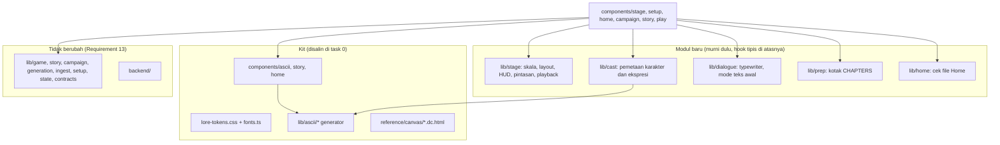
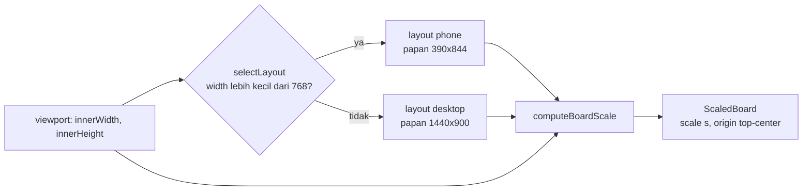

# Design Document: ui-redesign

## Overview

Dokumen ini merancang penggantian seluruh tampilan web LORE dengan Kit "Black Cat Gold" (`lore-design-kit/lore-design-kit/`). Lingkup hanya UI. Logika game, generasi AI, persistensi, Kontrak_AI, dan `backend/` tidak berubah (Requirement 13, Requirement 1.7).

Dasar rancangan: pembacaan `docs/DESIGN-SYSTEM.md`, `AGENTS.md`, `README.md`, komponen dan generator Kit, serta kode `frontend/src` saat ini (StoryViewer, StageCharacter, ChatBox, StagePuzzle, HomeComposer, halaman `/create`, dan layar kampanye). Tidak ada kode yang diubah oleh dokumen ini.

### Keputusan rancangan utama

| # | Keputusan | Alasan | Requirement |
|---|---|---|---|
| D1 | Stage dirender pada papan tetap (1440x900 desktop, 390x844 phone) lewat satu pembungkus `ScaledBoard` dengan `transform: scale(s)`, `s = min(vw/W, vh/H)`, origin top-center. Anak elemen memakai px desain absolut dan tidak pernah di-reflow. | Spesifikasi §4.1 dan AGENTS.md mewajibkannya. Fungsi skala murni, sehingga bisa diuji. | 7.1, 8.1 |
| D2 | Titik pisah phone/desktop: lebar viewport ≤ 767 px adalah phone, ≥ 768 px adalah desktop. Satu konstanta `DESKTOP_MIN_WIDTH = 768`. | Sama dengan breakpoint `md` Tailwind (768 px) yang sudah dipakai kelas `md:` pada `DialogueBox` dan `CanvasFrame` Kit. JS dan CSS tidak boleh berbeda satu piksel pun. | 8.5 |
| D3 | Pergantian layout phone/desktop tidak me-remount state. Pohon komponen Stage punya bentuk yang sama di kedua layout (hanya tabel koordinat dan `z-index` yang berbeda), dan state puzzle, typewriter, dan log di-hoist di atas pemilih layout. | Requirement 8.6 menuntut HP, posisi story, dan jawaban tetap utuh saat rotasi. | 8.6 |
| D4 | Pemetaan karakter dan ekspresi StoryBlueprint ke Kit ada di `lib/cast/` (fungsi murni, union hasil). Karena AI memberi nama bebas, jalur "tanpa padanan" adalah jalur umum, bukan kasus tepi, sehingga fallback dirancang sebagai alokasi cast deterministik per kampanye. | `Character.character_id` dan `name` bebas (dummy: `eldric`, `lyra`). | 6.5, 6.6, 6.7 |
| D5 | Zod: Kit tidak memerlukan Zod 4 dan tidak memerlukan Zod 3. Kit memakai `z.enum`, `z.object().strict()`, `z.discriminatedUnion`, `.regex`, `.default`, `z.union`, yang sama di kedua versi. Perubahan `package.json` yang sudah ada di working tree tidak disentuh. | OQ-2 (lihat bagian Zod). | 2.10, 1.4 |
| D6 | Home: tiga opsi A/B/C disajikan dengan rekomendasi. User yang memutuskan. Task Home tidak dimulai sebelum keputusan. | OQ-1. | 11.1 |
| D7 | Ikon lucide diganti SVG inline (stroke 2, `square`, `currentColor`). Paket `lucide-react` tetap di `package.json` (tidak disentuh) dan menjadi dependensi tak terpakai. | Requirement 3.4, 1.4. | 3.4 |
| D8 | Tidak ada warna bahaya/sukses di palet Kit. Pesan galat memakai pola chip `ERROR` (latar `ember`, teks `ink`) diikuti teks `cream`. Status sukses memakai `gold`. | Requirement 3.1 melarang warna di luar token. | 3.1, 9.11 |
| D9 | Warna dan dekorasi komposisi Remotion (konstanta `GOLD`, `VOID`, `TONE_COLORS`, gradient, `boxShadow`) diganti ke token (`var(--color-*)`, `color-mix()` untuk alfa). Geometri, data, label, dan angka `LessonVisual` tidak berubah. | Requirement 3.1 dan 3.3 berlaku untuk `frontend/src/components`, sedangkan Requirement 7.4 meminta `LessonVisual` digambar seperti sekarang. Ditafsirkan: bentuk dan isi sama, permukaan mengikuti token. Perlu konfirmasi user (lihat OQ-9). | 3.1, 3.3, 7.4 |

### Pertanyaan terbuka yang ditemukan saat merancang

Tabel ini melengkapi OQ-1 sampai OQ-5 di requirements.md. Semua punya perilaku bawaan yang aman, tetapi user perlu menyetujuinya sebelum task terkait dimulai.

| ID | Pertanyaan | Perilaku bawaan di design | Task terdampak |
|---|---|---|---|
| OQ-1 | Home A, B, atau C? | Belum ada. Rekomendasi: C (lihat bagian Home). | Task Home |
| OQ-2 | Zod 3 atau 4? | Kit cocok dengan keduanya. Working tree dibiarkan apa adanya. Tes dijalankan pada versi yang terpasang (`frontend/node_modules` = 4.6.7, `node_modules` akar = 3.25.28). | Task 0 |
| OQ-6 | Canvas Prep punya lima kotak CHAPTERS (1 sampai 5, bawaan 3), sedangkan `lib/setup` hanya mengenal `StoryLength` = `short` (3 bab) atau `medium` (5 bab), dan `lib/setup` tidak boleh berubah (Requirement 13.1). | Lima kotak digambar persis. Kotak 3 dan 5 aktif (memetakan ke `short` dan `medium`). Kotak 1, 2, dan 4 ditampilkan nonaktif (`aria-disabled`). Penyimpangan dicatat di Ringkasan_Penyimpangan. Alternatif: perluas `StoryLength` (butuh requirement baru dan dukungan backend). | Task Prep desktop, Prep phone |
| OQ-7 | Requirement 8.4 dan 8.8 membatasi pilihan jawaban phone maksimum 3, tetapi `StagePuzzle` saat ini menerima sampai 4 pilihan (`choices.slice(0, 4)`), dan menjatuhkan pilihan keempat bisa membuat puzzle tak terselesaikan. | Phone menampilkan semua pilihan (sampai 4) sebagai tombol `flex 1`. Perlu amandemen Requirement 8.4 dan 8.8 menjadi "maksimal 4". | Task Stage phone |
| OQ-8 | Pustaka property-based testing: `fast-check` belum ada di `frontend/package.json`. Menambahkannya mengubah `package.json` dan `package-lock.json`, yang sedang berisi perubahan Zod dan harus byte-identik (Requirement 1.4). | Properti ditulis dengan `fast-check`. Sebelum itu user menyetujui `npm i -D fast-check` (perubahan lockfile dipisah dari perubahan Zod). Bila ditolak, properti dijalankan sebagai tes Vitest tabel lengkap untuk ruang masukan terbatas dan loop berbenih tetap untuk sisanya, dengan keterbatasan dicatat. | Task 0 |
| OQ-9 | Penafsiran "LessonVisual digambar seperti sekarang" terhadap larangan warna, gradient, dan shadow di luar token (D9). | Ditafsirkan sebagai: geometri dan isi sama, permukaan mengikuti token. | Task Stage desktop |
| OQ-10 | Requirement 12.1 menyebut tepat 11 Layar_Tanpa_Frame, tetapi `SavedStories` (Requirement 11.7) juga disebut sebagai Layar_Tanpa_Frame dan tidak masuk daftar. | `SavedStories` dirancang di bagian Home dan disetujui bersama task Home. Tidak diberi label tersendiri agar hitungan 11 + 1 (mode dua karakter) di Requirement 12.2 dan 12.9 tetap benar. Usul: tambahkan `SavedStories` ke daftar Requirement 12.1. | Task Home |
| OQ-11 | Steering `product`, `ai-pipeline`, dan `game-engine` memuat deskripsi komponen yang dihapus (`HomeComposer`, `StageCharacter`, `ChatBox`, glass). Requirement 4.5 sampai 4.7 hanya mencakup `theme-halloween`, `conventions`, `tech`, dan `structure`. | Task penutup memperbarui fakta di tiga steering itu dengan perubahan minimal setelah user menyetujui. | Task penutup |
| OQ-12 | "Beat tanpa canvas" (Requirement 12.7) tidak punya definisi di kode: `StageCanvas` selalu merender sesuatu, termasuk komposisi `ambient`. | Beat tanpa canvas = scene `ambient` (dialog atau narasi tanpa lesson, visual, atau puzzle). CanvasFrame hanya hadir untuk `lesson`, `visual`, dan `decision`. Konsekuensinya satu tes di `story-viewer.test.tsx` (baris 101, `canvasKind` = `ambient`) diperbarui. Perlu persetujuan. | Task Stage desktop |

## Architecture

### Peta lapisan



Aturan arah ketergantungan: `components` boleh mengimpor `lib`; `lib` tidak mengimpor `components`. Komponen tidak menghitung HP atau benar-salah. `usePuzzleInteraction` dan `validateMultipleChoice` tetap satu-satunya penentu jawaban.

### Task 0: pasang Kit

Sumber: `lore-design-kit/lore-design-kit/` (35 file). Dari 35 file itu 33 disalin. `README.md` Kit tidak disalin (dokumen pemasangan, bukan bagian aplikasi). `backend/app/schemas/visual.py` tidak disalin karena Requirement 1.7 melarang perubahan di `backend/`, dan Requirement 2.3 tidak mencantumkannya.

Hasil pemeriksaan bentrokan terhadap repo (diperiksa dengan `Test-Path` pada setiap tujuan): **0 file ditimpa**. Semua tujuan belum ada.

| # | File Kit (relatif ke akar Kit) | Tujuan di repo | Status |
|---|---|---|---|
| 1 | `AGENTS.md` | `AGENTS.md` (akar) | baru. Steering `tech` menyebut "lihat AGENTS.md" tetapi file ini belum ada di repo. |
| 2 | `docs/DESIGN-SYSTEM.md` | `docs/DESIGN-SYSTEM.md` | baru |
| 3 | `frontend/src/app/fonts.ts` | `frontend/src/app/fonts.ts` | baru |
| 4 | `frontend/src/app/lore-tokens.css` | `frontend/src/app/lore-tokens.css` | baru |
| 5 to 6 | `frontend/src/components/ascii/AsciiArt.tsx`, `PumpkinField.tsx` | `frontend/src/components/ascii/` | baru (folder baru) |
| 7 | `frontend/src/components/home/PumpkinMouthInput.tsx` | `frontend/src/components/home/` | ditambahkan ke folder yang ada. Tidak menimpa `HomeComposer.tsx`, `PumpkinMark.tsx`, `SavedStories.tsx`. |
| 8 to 9 | `frontend/src/components/story/CanvasFrame.tsx`, `DialogueBox.tsx` | `frontend/src/components/story/` | ditambahkan ke folder yang ada. Tidak menimpa `EndingDisplay`, `StoryComplete`, `StoryFailure`, `StoryViewer`, `use-puzzle-interaction`. `CanvasFrame.tsx` juga mengekspor `PlayerBar`; `DialogueBox.tsx` juga mengekspor `ChoiceButton`. |
| 10 to 16 | `frontend/src/lib/ascii/{core,figure,index,pumpkin,recipes,scene,wordmark}.ts` | `frontend/src/lib/ascii/` | baru. Berdampingan dengan `lib/ascii-field/` tanpa nama file yang sama. |
| 17 | `frontend/src/lib/schemas/visual.ts` | `frontend/src/lib/schemas/visual.ts` | baru. Nama mirip `lib/contracts/schemas/visual.schema.ts` dan `lib/types/visual.ts` (milik `LessonVisual`), tetapi path berbeda. `SceneBlueprintSchema` tidak boleh diimpor dari alur AI (Requirement 13.7). |
| 18 to 19 | `frontend/tests/ascii-golden.test.ts`, `frontend/tests/fixtures/ascii-golden.json` (±1 MB) | `frontend/tests/`, `frontend/tests/fixtures/` | baru (OQ-5: tetap di akar `tests/`) |
| 20 to 30 | `reference/canvas/*.dc.html` (Cast, HomeA, HomeAMobile, HomeB, HomeBMobile, HomeC, HomeCMobile, Main, Prep, PrepMobile, StageMobile) | `reference/canvas/` | baru. Isi tidak diubah (Requirement 11.3). |
| 31 to 32 | `reference/generators/figure.js`, `gen.js` | `reference/generators/` | baru |
| 33 | `scripts/export-ascii-golden.cjs` | `scripts/` | baru. `scripts/` sudah berisi `ci/` dan `verify/`, tanpa bentrokan. |

Perubahan pada file yang sudah ada:

| File | Perubahan | Requirement |
|---|---|---|
| `docs/DESIGN.md` | Tambah tepat satu baris "Visual identity: see DESIGN-SYSTEM.md". | 2.4 |
| `frontend/src/app/globals.css` | Tambah `@import "./lore-tokens.css";` tepat setelah `@import "tailwindcss";`, hanya jika belum ada. Sisa isi (gaya lama) tidak disentuh di task 0. | 2.5 |
| `frontend/src/app/layout.tsx` | Ganti `Geist` dan `Geist_Mono` dengan `spaceGrotesk` dan `jetbrainsMono` dari `./fonts` pada `<html className>`. Hapus semua rujukan Geist. `GlassFilter`, `PumpkinBackdrop`, dan skrip `LIQUID_GLASS_CHECK` tetap sampai task penutup. | 2.6 |

Urutan task 0:

1. Tampilkan tabel di atas (daftar 33 file, 0 ditimpa) kepada user dan tunggu persetujuan eksplisit. Tidak ada file yang disalin sebelum itu (Requirement 2.1).
2. Periksa `git status`. Jika ada perubahan di luar redesign (saat ini `frontend/package.json` dan `frontend/package-lock.json`), tampilkan path-nya, minta konfirmasi, lalu buat branch `feat/redesign-black-cat-gold` dari `dev` (Requirement 1.1 sampai 1.4). Saat ini branch aktif adalah `dev`.
3. Salin 33 file, laporkan jumlah disalin (33) dan ditimpa (0).
4. Terapkan tiga perubahan file yang ada di atas.
5. Pastikan alias `@/*` ke `./src/*` di `frontend/tsconfig.json` ada (sudah ada) dan `tsc --noEmit` meresolusi impor `@/lib/ascii` dari file Kit.
6. Jalankan `npx vitest run tests/ascii-golden.test.ts`: harus 40 dari 40. Jalankan `npm run lint` dan `npx tsc --noEmit`. Jika gagal, berhenti dan laporkan (Requirement 2.9).
7. Jalankan Verifikasi_Task penuh dan laporkan hasil per perintah (Requirement 2.11).

Keadaan transisi: setelah task 0, `lore-tokens.css` menambah aturan `* { border-radius: 0 !important }`, `:focus-visible`, dan latar `html`. Layar lama yang belum dimigrasi akan tampil campuran (sudut persegi, font baru) sampai task penutup. Branch dikerjakan tunggal dan tidak dirilis per task, sehingga ini diterima. `PumpkinBackdrop` tetap berjalan di belakang layar baru (layar baru berlatar `ink` opak, jadi tidak terlihat) dan hanya membuang CPU sampai task penutup.

Folder `lore-design-kit/` (belum dilacak git) tetap ada setelah penyalinan. Menghapusnya berada di luar path yang diizinkan Requirement 1.5, sehingga task penutup menanyakannya ke user.

### Zod 3 atau 4 (OQ-2)

Temuan: `frontend/package.json` di working tree memuat `zod ^4.6.7` (belum di-commit), `frontend/node_modules/zod` adalah 4.6.7, dan `node_modules` akar memuat 3.25.28. Steering `tech` masih menyebut Zod 3 dan "618 test dengan Zod 3".

Analisis `lib/schemas/visual.ts` Kit: API yang dipakai (`z.enum`, `z.object`, `.strict()`, `.optional()`, `.default()`, `.regex()`, `.min/.max/.int()`, `z.array`, `z.union`, `z.discriminatedUnion('kind', [...])`, `z.literal`, `z.infer`) ada dan berperilaku sama di Zod 3.25 dan 4.x. Kit tidak memakai API khusus Zod 4 (misalnya `z.email()`, `z.strictObject`, `z.treeifyError`). Jadi:

- Requirement 2.10 tidak terpicu: tidak ada ketidakcocokan yang harus dilaporkan.
- Task 0 tidak mengubah `package.json` atau `package-lock.json` untuk Zod.
- Golden_Test dijalankan pada versi yang terpasang di `frontend/node_modules` (4.6.7). Jika user mengembalikan Zod 3, tes yang sama harus lulus; ini diperiksa dengan menjalankan tes sekali dengan `node_modules` akar bila user memintanya.
- Keputusan versi (pertahankan, kembalikan, atau pisahkan perubahan Zod) tetap milik user dan di luar redesign. Redesign hanya menjaga file itu byte-identik (Requirement 1.4). Steering `tech` baru diperbarui soal versi Zod bila user memutuskan.

Catatan terkait: bila user menyetujui `fast-check` (OQ-8), `package.json` berubah lagi. Perubahan itu dibuat dalam langkah terpisah setelah user memutuskan nasib perubahan Zod, agar diff keduanya tidak tercampur.

### Pembungkus skala Stage dan titik pisah phone/desktop



`ScaledBoard` (`components/stage/ScaledBoard.tsx`):

- Wadah luar: `position: fixed; inset: 0; overflow: hidden; background: ink`. Papan: `position: absolute; top: 0; left: calc(50% - W/2); width: W; height: H; transform: scale(s); transform-origin: top center`. Anak papan memakai `position: absolute` dengan koordinat dari tabel `STAGE_BOXES` di bawah. Tidak ada `flex`, persen, atau `vw` di dalam papan.
- `s` dihitung oleh `computeBoardScale({width, height}, {W, H})` = `min(width/W, height/H)`. Tidak memakai CSS `calc()` pembagian panjang (dukungan browser belum merata).
- `useBoardMetrics` (hook tipis) membaca `window.innerWidth/innerHeight` lewat `useSyncExternalStore` (snapshot server: 1440x900, sama pola `useIsClient` di `StageCanvas`) dan `matchMedia('(min-width: 768px)')` untuk layout. `matchMedia` dan `md:` Tailwind memakai ambang yang sama persis sehingga tidak ada rentang abu-abu pada lebar pecahan seperti 767,5.
- Layout berganti saat event `change` `matchMedia`, segera (jauh di bawah 300 ms, Requirement 8.6). Skala diperbarui di `requestAnimationFrame` setelah `resize`.
- Hasil `{ ok: false }` dari `computeBoardScale` (lebar atau tinggi 0, bukan angka) membuat papan mempertahankan skala terakhir yang valid.
- Resolusi canvas ASCII: `AsciiArt` Kit memakai `devicePixelRatio` maksimum 2. Pada skala di atas 1 (monitor 2560 atau 3840 lebar) canvas akan buram. `ScaledBoard` menyediakan `BoardScaleContext`, dan `AsciiArt` diperluas dengan props opsional `pixelRatio` (bawaan perilaku Kit tidak berubah). Pembagi di dalam papan: `min(devicePixelRatio * s, 4)`. Perluasan ini didokumentasikan di DESIGN-SYSTEM.md pada task Stage desktop (Requirement 5.11).
- Modal (log chat, konfirmasi keluar) dirender di luar papan sebagai `position: fixed` agar teksnya berukuran asli, bukan ikut skala.

Keterbatasan yang diketahui (di luar kendali design karena Requirement 8.5 menetapkan lebar sebagai satu-satunya titik pisah):

- Tablet potret (768 sampai 1023 px lebar) memakai papan desktop pada skala sekitar 0,53 sampai 0,71 dan menyisakan ruang kosong di bawah. Layout phone akan lebih terbaca di sana. Jika ini terasa buruk, perlu requirement baru (misalnya menambah syarat rasio aspek).
- Ponsel lanskap (lebar ≥ 768, tinggi sekitar 390) memakai papan desktop pada skala sekitar 0,43 sehingga teks dialog 17 px menjadi sekitar 7 px. Papan phone juga kecil (skala 0,46). Layar lanskap ponsel dianggap di luar lingkup.

### Modul baru dan lokasinya

Satu domain per folder `lib/`, hook tipis `use-*.ts` di atasnya, tes di `tests/<domain>/`.

| Modul | Isi | Tes |
|---|---|---|
| `lib/stage/board-scale.ts` | `DESKTOP_MIN_WIDTH`, `BOARD_SIZE`, `selectLayout`, `computeBoardScale`, `designRectToViewport`, `viewportRectToDesign` | `tests/stage/board-scale.test.ts` |
| `lib/stage/stage-boxes.ts` | Tabel `STAGE_BOXES` (koordinat §4.1 dan §4.2), `visibleSprites(layout, active, other)` | `tests/stage/stage-boxes.test.ts` |
| `lib/stage/hud.ts` | `hpSquares(hp)` | `tests/stage/hud.test.ts` |
| `lib/stage/shortcuts.ts` | `resolveShortcut(event-like, context)` | `tests/stage/shortcuts.test.ts` |
| `lib/stage/playback.ts` | `progressPercent`, `formatClock`, `canvasLabel` | `tests/stage/playback.test.ts` |
| `lib/cast/cast-mapping.ts` | `mapCharacter`, `mapExpression`, `emotionToExpression`, `resolveCampaignCast`, `pickOtherCharacter`, `fallbackCastNote` | `tests/cast/cast-mapping.test.ts` |
| `lib/dialogue/typewriter.ts` | `revealPrefix`, `revealedCount`, `initialTextMode` | `tests/dialogue/typewriter.test.ts` |
| `lib/prep/chapter-choices.ts` | `chapterSquares(length)`, `lengthForChapters(n)` | `tests/setup/chapter-choices.test.ts` |
| `lib/home/file-check.ts` | `validateHomeFile` | `tests/home/file-check.test.ts` |
| `components/ui/*` | `Icon` (SVG inline), `ErrorLine`, `Button`, `SectionLabel`, `StatusBadge`, `Modal` | `tests/ui/*.test.tsx` (`@vitest-environment jsdom`) |

Hook: `use-board-metrics.ts`, `use-typewriter.ts`, `use-stage-shortcuts.ts`, `use-canvas-playback.ts`, masing-masing hanya memanggil fungsi murni dan mengelola state React. Tidak ada aturan HP atau penilaian jawaban di hook.

Perubahan file di `lib/`: hanya file **baru**. Tidak ada file non-test di `lib/game`, `story`, `campaign`, `generation`, `ingest`, `setup`, `state`, atau `contracts` yang berubah (Requirement 13.1). Karena itu logika "mode teks awal" memakai pembacaan langsung `localStorage["lore:pacing"]` di hook baru (`loadPacing` tidak membedakan nilai tersimpan dari bawaan, dan `lib/story/pacing.ts` tidak boleh diubah). `savePacing` tetap dipakai apa adanya untuk menyimpan pilihan.

## Components and Interfaces

### Perluasan komponen Kit (extend, bukan fork)

AGENTS.md melarang fork komponen Kit. Perluasan berikut berbentuk props opsional, tidak mengubah perilaku bawaan, dan didokumentasikan di DESIGN-SYSTEM.md pada task yang memperkenalkannya (Requirement 5.11, dicatat di Ringkasan_Penyimpangan):

| Komponen | Props baru | Alasan | Task |
|---|---|---|---|
| `AsciiArt` | `pixelRatio?: number` | Ketajaman pada skala papan di atas 1 | Stage desktop |
| `DialogueBox` | `askDisabled?`, `onAdvance?`, `testIds?: { root, text, name, pacing, log }`, `nameTag?: ReactNode` | Input `type something` harus disabled dengan "coming soon" (Requirement 7.10), klik kotak memajukan baris (7.8), `data-testid` yang ada dipertahankan (7.14), narasi dan lesson memakai label `NARRATION`/`LESSON` | Stage desktop |
| `ChoiceButton` | `letter?`, `selected via state`, teks hingga 2 baris (`line-clamp-2`), `title` berisi teks penuh, `testId?`, `ariaPressed?`, `disabled?` | Teks pilihan puzzle bebas panjang (hanya `min(1)` di skema) | Stage desktop |
| `CanvasFrame` | `footerless?`, `bodyClassName?` | Isi mode puzzle memakai area di bawah canvas | Stage desktop |
| `PumpkinField` | Konstanta `PUMPKINS_STAGE_PHONE`, `PUMPKINS_PREP_PHONE`, dan konstanta Home phone (nilai disalin dari `StageMobile.dc.html`, `PrepMobile.dc.html`, `HomeAMobile/BMobile/CMobile.dc.html`) | Kit hanya mengekspor placement desktop | Stage phone, Prep phone, Home |

### Komponen bersama baru (`components/ui/`)

Dipakai Stage, Prep, Home, dan 11 layar lain agar tidak ada gaya baru di tiap layar.

- `Icon`: SVG inline 24x24 viewBox, `stroke="currentColor"`, `strokeWidth=2`, `strokeLinecap="square"`. Nama: `back`, `exit`, `file-up`, `paperclip`, `arrow-up`, `file`, `close`, `check`, `play`, `alert`. Menggantikan semua impor `lucide-react`.
- `Button`: varian `primary` (latar `ember`, teks `ink`, mono 14/700, tinggi 48 desktop dan 52 phone), `outline` (border 2px `cream`, teks `cream`, tinggi 44), `disabled` (latar `smoke`, teks `muted`). Mendukung `href` (render `<a>`) agar tidak ada tautan bergaya tombol yang berbeda.
- `ErrorLine`: chip `ERROR` (latar `ember`, teks `ink`, mono 11/700, `px-1.5 py-[3px]`) diikuti teks `cream` mono 12 sampai 13. `role="alert"`. Satu-satunya pola galat (D8).
- `SectionLabel`: `NN TITLE` + garis 1px `smoke` (nomor `gold`, judul `cream`, mono 12/700, tracking 0.2em), memakai kelas `.lore-eyebrow` Kit.
- `StatusBadge`: chip persegi mono 11/700 huruf besar. Varian: `done` (border dan teks `gold`), `current` (latar `ember`, teks `ink`), `available` (border dan teks `cream`), `locked` (border `smoke`, teks `muted`).
- `Modal`: pola M (lihat bagian Layar_Tanpa_Frame). Fokus pertama ke tombol tutup, `Esc` menutup, fokus dikembalikan ke pemicu.

### Stage: perancangan bersama desktop dan phone

Satu pohon komponen untuk dua layout (D3):

```
StoryViewer (state: useStoryPlayer, pacing, log, overlay, usePuzzleInteraction di-hoist)
└─ ScaledBoard layout=desktop|phone
   ├─ StageBackdrop   (lore-grid-bg + PumpkinField)
   ├─ StageHud        (z 50)
   ├─ StageSceneBoard (papan stage 1200x675 desktop; seluruh papan phone)
   │   ├─ AsciiArt scene     (renderScene, opacity 0.85)
   │   ├─ CanvasSlot         (CanvasFrame | karakter lain 40% | kosong)
   │   ├─ StageSprite aktif  (z berbeda per layout)
   │   └─ StageDialogue      (DialogueBox + ChoiceButton)
   ├─ StageOverlay    (ending, selesai, gagal, galat navigasi)
   └─ KeyHints        (desktop saja, y 800)
Modal di luar papan: ChatLog, konfirmasi keluar
```

`z-index` menggantikan urutan DOM untuk sprite: desktop sprite di depan kotak dialog (z 20 di atas z 10), phone sprite di belakang (z 5 di bawah z 10). Dengan itu elemen tetap berada di posisi pohon yang sama saat layout berganti.

State yang di-hoist di atas pemilih layout: `usePuzzleInteraction` (pilihan terpilih, hasil), jumlah karakter yang sudah diketik, `showLog`, `showExitConfirm`, `pacing`, `reaction`. `useStoryPlayer` sudah berada di StoryViewer.

#### Tabel koordinat `STAGE_BOXES` (px desain, toleransi 0)

Desktop 1440x900, sumber DESIGN-SYSTEM §4.1 dan `Main.dc.html`:

| Elemen | x, y | Ukuran | Catatan |
|---|---|---|---|
| Latar | 0,0 | 1440x900 | `.lore-grid-bg` + `PUMPKINS_STAGE_DESKTOP` |
| HUD | 0,0 | 1440x64 | `ink`, garis bawah 1px `smoke`, padding `0 24` |
| Papan stage | 120,92 | 1200x675 | `ink`, `outline 2px solid smoke`, `overflow hidden` |
| Scene ASCII (di papan) | 0,0 | 167x57 sel, 12 px | `renderScene({biome, seed}, 'stageDesktop')`, opacity 0.85 |
| CanvasFrame (di papan) | 432,32 | 736x414 | |
| DialogueBox (di papan) | 300,470 | 876x181 | name tag `left 96`, `top -18` |
| Sprite aktif (di papan) | 20,99 | 317x576 | 44x48 sel, 12 px, z di atas kotak |
| Petunjuk tombol | pusat, y 800 | 1440 lebar | `SPACE next line · F fast/animate · L log chat`, tombol `cream`, mono 12 `muted` |

Phone 390x844, sumber §4.2 dan `StageMobile.dc.html`:

| Elemen | x, y | Ukuran | Catatan |
|---|---|---|---|
| HUD | 0,0 | 390x56 | tombol kembali 44 px, judul 14/700, `Ch 1/2 · <tempat>` mono 11, 5 kotak 7 px + `n/5` |
| Scene ASCII | 0,56 | 82x99 sel, 8 px | `renderScene(..., 'stagePhone')`, opacity 0.85 |
| CanvasFrame | 12,68 | 366x246 | PlayerBar 38 px, tick sudut 10 px |
| Sprite aktif | 6,318 | 211x384 | 44x48 sel, 8 px, z di bawah kotak |
| DialogueBox | 12,582 | 366x250 | pilihan di dalam kotak, bar bawah 46 px |

Tinggi scene phone 99x8 = 792 px, mulai y 56, melampaui 844 dan dipotong oleh `overflow hidden` papan.

Konstanta ini hidup di `lib/stage/stage-boxes.ts` sebagai objek `as const` dan diuji terhadap angka di atas (tes contoh), sehingga perubahan tidak sengaja terdeteksi.

#### HUD

Komponen `StageHud` menggantikan `StageNavbar`. Isi (desktop): tombol kembali 44x44 border 2px `smoke` dengan ikon `exit` (`data-testid="sidebar-exit-button"`, `aria-label="Exit story"`); `LORE` (mono 14/700, tracking 0.4em, `gold`); tengah: judul story 16/700 (`sidebar-story-title`) dan baris `Chapter n / m · judul bab · lokasi` mono 12 `muted`, dengan bagian `Chapter n / m` memakai `data-testid="chapter-progress"`; pembungkus tengah memakai `data-testid="story-header"`; kanan: `HP` mono 11 `muted`, 5 kotak 12 px (terisi `ember`, kosong `smoke`, jarak 4), dan `data-testid="hp-value"` berisi `n/5` mono 13/700. `hp-display` dipertahankan pada pembungkus kanan. Isi kotak diturunkan dari `hpSquares(hp)`.

Teks `hp-value` berubah dari `4 / 5` ke `4/5` mengikuti canvas. Tes yang menyatakan `toContain("4 / 5")` (`bad-branch.test.tsx` baris 90, 167, 171, 210) diperbarui menjadi `toMatch(/4\s*\/\s*5/)`, jumlah asersi tetap, dan dicatat di Ringkasan_Penyimpangan. Saat gagal (`hp` 0) tidak ada warna bahaya: semua kotak `smoke` dan teks `0/5` tetap `cream`.

Phone: tombol kembali 44 px, judul 14/700, baris `Ch n/m · <lokasi>` mono 11, kotak 7 px.

#### Sprite karakter (`StageSprite`, menggantikan `StageCharacter`)

- Menggambar `renderCharacter(castId, expression)` lewat `AsciiArt` dengan `fontPx` 12 (desktop) atau 8 (phone), `label` = `${name}, ${expression}` (`role="img"`, Requirement 6.8). Seni dekoratif lain `aria-hidden`.
- Pembungkus mempertahankan `data-testid="stage-character"`, `data-character-id` (id karakter kampanye), dan `data-emotion` (nilai `Emotion` lama, diturunkan dari logika yang sama di `StoryViewer`), serta menambah `data-cast-id` dan `data-expression`. Dengan begitu tes `story-viewer.test.tsx` baris 100, 375, 397, 419, dan 422 tidak berubah.
- Tes yang menyatakan `character-expression` (kaomoji) dipindah: ekspresi kini terlihat pada sprite (`aria-label` dan `data-expression`), bukan teks kaomoji di kotak dialog. Tes yang memeriksa `character-name` tetap lewat name tag `DialogueBox` (`testIds.name`). Perubahan dicatat di Ringkasan_Penyimpangan dengan nama tes pengganti (Requirement 14.1, 14.2).
- Nama sprite untuk penutur: nama karakter dari `Character.name`, bukan nama cast Kit.

#### Dialog (`StageDialogue`, menggantikan `ChatBox`)

- Membungkus `DialogueBox`. Teks yang diteruskan sudah dipotong `revealPrefix(text, count)`. `use-typewriter` menaikkan `count` satu karakter per 25 ms pada mode `animate`, dan langsung penuh pada mode `fast`.
- Klik pada kotak atau `SPACE`: jika masih mengetik, tampilkan baris penuh seketika; jika tidak, panggil `advance` (perilaku `ChatBox` sekarang, ditulis ulang di atas fungsi murni).
- Penutur: `Character.name` (huruf besar) dan `role` (desktop). Entry `narration` memakai name tag `NARRATION`, entry `lesson` memakai `LESSON` (judul lesson menjadi baris pertama teks). Keduanya adalah teks baru dan masuk Ringkasan_Penyimpangan.
- Testid dipertahankan lewat `testIds`: `story-main` (root), `scene-content` (teks), `character-name`, `pacing-toggle`, `log-chat-button`. Elemen `narration-block`, `learning-card`, dan `character-bubble` menjadi pembungkus di dalam kolom teks `DialogueBox` (props `nameTag` dan slot teks).
- Input `type something`: `<input disabled>`, `aria-label="Ask a question (coming soon)"`, placeholder `Ask {Nama} something… (coming soon)`. Teks "coming soon" menyimpang dari canvas dan dicatat.
- Mode teks awal: `initialTextMode(stored, reducedMotion)` = `stored` jika ada nilai tersimpan eksplisit; jika tidak, `fast` saat `prefers-reduced-motion: reduce`, selain itu `animate`. Pilihan eksplisit pengguna dipertahankan (Requirement 3.7). Ini sedikit mengubah perilaku lama (`motionAllowed()` memaksa teks langsung muncul meskipun pengguna memilih `animate`), sesuai Requirement 3.7.

#### Pintasan keyboard

`resolveShortcut({ key, code, ctrlKey, metaKey, altKey, targetKind }, ctx)` mengembalikan `'next' | 'toggle-mode' | 'open-log' | null`.

- `null` untuk kombinasi dengan `ctrl`, `meta`, atau `alt` (agar Ctrl+F browser tetap bekerja).
- `null` untuk semua tombol bila fokus di elemen editable (`input`, `textarea`, `select`, `contenteditable`) (Requirement 7.13).
- `SPACE` tambahan `null` bila fokus di elemen yang menangani SPACE sendiri (`button`, `a`, `summary`, `input[type=checkbox|radio]`), supaya menekan SPACE pada tombol pilihan tidak sekaligus memajukan dialog.
- `null` bila modal terbuka.
- `SPACE` → `next`, `F` → `toggle-mode`, `L` → `open-log`. Petunjuk `/ ask` dari canvas dihilangkan karena input ask disabled (Requirement 7.12 hanya mewajibkan SPACE, F, L). Dicatat.

#### Canvas dan puzzle

- `CanvasFrame` ditampilkan hanya untuk scene `lesson`, `visual`, dan `decision` (OQ-12). Untuk scene `ambient` area itu kosong, atau berisi karakter lain pada mode dua karakter.
- `StageCanvas` (pemutar Remotion) tetap dipakai dengan `controls={false}`, di dalam `CanvasFrame`. `use-canvas-playback` memegang `PlayerRef`, mendengarkan `frameupdate`, `play`, `pause`, `ended`, dan memberi `progress` dan `time` ke `PlayerBar`. Rumus di `lib/stage/playback.ts`. Keyframe emas = titik jeda canvas (`decision`: satu keyframe; `lesson` dan `visual`: tanpa).
- Status chip: `paused` saat puzzle belum dijawab benar, `resumed` setelah jawaban benar, selain itu `playing`. Label: `canvasLabel(location ?? title)` (snake_case, maksimum 24 karakter), kebijakan di `lib/stage/playback.ts`.
- Mode puzzle (area isi `CanvasFrame`, 732 px lebar): graph keputusan (komposisi `DecisionGraph`, geometri `choiceBoxes` tetap) dengan huruf A sampai D non-interaktif (`aria-hidden`) di kotak graph; di bawahnya baris pertanyaan (`puzzle-question`, mono 12/1.4, maksimum 2 baris), baris umpan balik (`puzzle-feedback`, `puzzle-explanation`, `puzzle-empty-error`, `aria-live="polite"`), lalu baris tombol: `ChoiceButton` 44 px (lebar min 112, jarak 10) untuk tiap pilihan, dan tombol `puzzle-submit` (`Submit Answer` / `Confirm choice →`, latar `ember`, teks `ink`, disabled = `smoke`/`muted` dengan `aria-disabled`) atau `puzzle-continue` (`Continue →`). Semua `data-testid` dan `aria-pressed` lama dipertahankan (`puzzle-interaction`, `puzzle-choices`, `choice-<id>`).
- Isi tombol pilihan: huruf (A, B, ...) + teks, maksimum 2 baris (`line-clamp-2`), `title` = teks penuh. Pilihan terpilih juga dibacakan lengkap di `puzzle-question` ("Your choice: A, teks penuh") agar teks panjang tidak hilang pada layar sentuh.
- Phone: `DialogueBox` menampilkan pertanyaan sebagai teks dan pilihan di dalam kotak (grup `Choices`, sampai 4 tombol `flex 1`, OQ-7). Tombol submit/continue memakai baris yang sama di bawah pilihan dan menambah satu baris 44 px di dalam kotak; tinggi kotak 250 px cukup (teks 3 baris, pilihan 44, submit 44, bar 46).
- Hasil benar-salah dan HP hanya dari `usePuzzleInteraction` dan `validateMultipleChoice`. HUD diperbarui dari `hp` `useStoryPlayer` pada render yang sama (jauh di bawah 100 ms, Requirement 7.6).
- Warna sukses (`#6fcf97`) dan bahaya dihapus: benar = `ChoiceButton` state `correct` (latar `ember`), terpilih = `picked` (latar `cream`), umpan balik salah memakai `ErrorLine`.

#### Mode dua karakter (kerangka, rincian di bagian Layar_Tanpa_Frame)

`pickOtherCharacter(characters_present, activeId, characters)` mengembalikan karakter lain yang hadir atau `null`. Desktop: sprite aktif 100%, karakter lain 40% di slot CanvasFrame bila beat tanpa canvas. Phone: karakter lain tidak digambar (`visibleSprites('phone', ...)` selalu 1 sprite).

### Pemetaan karakter dan ekspresi (`lib/cast/cast-mapping.ts`)

```ts
type CastId = 'eldric' | 'mira' | 'hazel' | 'varr' | 'nyx';           // dari lib/ascii
type Expression = 'calm' | 'smile' | 'worried' | 'surprised' | 'angry'; // dari lib/ascii

type CastMapping =
  | { ok: true; castId: CastId; matchedBy: 'id' | 'name' }
  | { ok: false; reason: 'unknown_character' | 'empty_character'; value: string };

type ExpressionMapping =
  | { ok: true; expression: Expression }
  | { ok: false; reason: 'unknown_expression' | 'empty_expression'; value: string };

mapCharacter(c: { character_id: string; name: string }): CastMapping
mapExpression(key: string | undefined): ExpressionMapping
emotionToExpression(e: Emotion): Expression               // tabel total, untuk override state
resolveCampaignCast(chars: Character[]): ReadonlyMap<string, { castId: CastId; mapped: boolean }>
pickOtherCharacter(presentIds: string[], activeId: string, chars: Character[]): Character | null
```

Aturan `mapCharacter`: `character_id` yang dinormalisasi (trim, huruf kecil) sama dengan id cast → `matchedBy: 'id'`; jika tidak, `name` ternormalisasi sama dengan nama cast (Eldric, Mira, Hazel, Varr, Nyx) → `matchedBy: 'name'`; jika tidak, `{ ok: false, reason: 'unknown_character', value }`. Kosong/spasi saja → `empty_character`. Tidak ada throw.

Aturan `mapExpression`: kunci dinormalisasi (trim, huruf kecil) lalu dicocokkan ke kelompok kata kunci. Kelompok ini sengaja sejajar dengan `emotionFor` yang ada agar perilaku dan tes lama tidak bergeser:

| Kelompok kata kunci (substring, tanpa membedakan huruf) | Ekspresi Kit |
|---|---|
| `worr`, `nerv`, `anx`, `afraid`, `scare`, `sad`, `concern`, `fear`, `tense` | `worried` |
| `happ`, `approv`, `reliev`, `excit`, `smil`, `joy`, `proud`, `glad`, `cheer` | `smile` |
| `stern`, `serious`, `angr`, `firm`, `strict`, `cold`, `grim` | `angry` (Kit tidak punya `stern`; alis turun paling dekat) |
| `surpri`, `shock`, `amaz`, `astonish`, `startl` | `surprised` |
| `think`, `curio`, `focus`, `ponder`, `wonder`, `puzzl`, `calm`, `expla`, `teach`, `point`, `lectur`, `neutral`, `idle`, `default`, `normal` | `calm` |

Urutan pencocokan sama dengan `KEYWORDS` di `emotion.ts` (worried, happy, stern, surprised, thinking, explaining). Kunci kosong → `empty_expression`; kunci tak cocok dengan kelompok mana pun → `unknown_expression`. Ekspresi tak dikenal tidak menghentikan story: UI memakai `calm`.

Tabel `emotionToExpression` (total): `idle→calm`, `explaining→calm`, `thinking→calm`, `worried→worried`, `happy→smile`, `stern→angry`, `surprised→surprised`. Tabel ini dipakai untuk override state di StoryViewer (puzzle, ending, reaksi jawaban, gagal), sehingga logika emosi yang sudah diuji tetap satu-satunya sumber.

Fallback yang didefinisikan (Requirement 6.7), akan ditambahkan ke DESIGN-SYSTEM.md sebagai §6.1 pada task Stage desktop:

1. `resolveCampaignCast(characters)` dipanggil sekali per kampanye. Karakter yang `mapCharacter`-nya `ok` mendapat cast itu (jika dua karakter memetakan ke cast yang sama, yang pertama menang dan yang kedua diperlakukan sebagai tak terpetakan).
2. Karakter tak terpetakan, berurutan menurut array, mendapat cast bebas pertama mulai dari indeks `stableHash(character_id) mod 5`, mencari maju melingkar dalam urutan `eldric, mira, hazel, varr, nyx`. Hasilnya deterministik dan berbeda antar karakter sampai 5 karakter. Karakter ke-6 dan seterusnya berbagi cast (tidak injektif), dicatat sebagai keterbatasan.
3. Ekspresi tak dikenal → `calm`.
4. Nama tag dan `aria-label` selalu memakai `Character.name` asli. Penutur "narrator" atau id yang tidak ada di kampanye memakai nama tag `NARRATION`.

### Layar Kit: perancangan per layar

Format per layar: bagian DESIGN-SYSTEM, file canvas, struktur, ukuran, komponen. Nilai di Design_System menang atas canvas (Requirement 5.9).

#### Task 1: Stage desktop

- Rujukan: DESIGN-SYSTEM §4.1, §4.3, §4.4, §6, §5; `Main.dc.html`; `Cast.dc.html`.
- Struktur dan koordinat: tabel `STAGE_BOXES` desktop di atas. Teks dialog mono 17/1.6, padding `26px 56px 0 96px`, maks lebar 700. Bar bawah `DialogueBox`: input `>`, segmen `fast | animate`, tombol `log` (`ember`).
- Latar `ink`, `lore-grid-bg`, `PumpkinField` dengan `PUMPKINS_STAGE_DESKTOP`.
- Pekerjaan tambahan di task ini: komposisi Remotion diselaraskan ke token (D9), `AsciiArt.pixelRatio`, ekspor `STAGE_BOXES`, penghapusan `StageNavbar`, `StageCharacter`, `ChatBox` (setelah tes dipindah), dan dokumentasi perluasan Kit.

#### Task 2: Stage phone

- Rujukan: §4.2, §4.3, §4.4; `StageMobile.dc.html`.
- Koordinat: tabel phone di atas. Teks dialog 13/1.55. Pilihan di dalam `DialogueBox` (`md:hidden` pada grup `Choices` Kit sudah menangani ini karena breakpoint JS dan CSS sama). Bar bawah 46 px: `[> Ask…] [fast|animate] [log]`.
- Tepat satu sprite (`visibleSprites('phone', ...)` = 1). Sprite di belakang kotak (z 5, kotak z 10), sehingga 120 px bagian bawah sprite (di bawah y 582) tertutup.
- Pilihan: semua pilihan yang ada, 1 sampai 4 (OQ-7), tinggi 44, `flex 1`, tanpa tombol kosong.
- `PUMPKINS_STAGE_PHONE` ditambahkan dengan nilai dari `StageMobile.dc.html`.

#### Task 3: Preparation desktop

- Rujukan: §4.5, §2, §3; `Prep.dc.html`. Halaman: `app/create/page.tsx`, `components/setup/*`.
- Kolom datar x 380, lebar 680, tinggi penuh, `ink`, border kiri-kanan 1px `smoke`, padding `24px 48px 0`; `PUMPKINS_PREP_DESKTOP` di lapisan 1440 px yang dipusatkan di belakang kolom (`left: calc(50% - 720px)`, `aria-hidden`, `pointer-events: none`). Halaman ini mengalir (fluid): tidak diskalakan, bisa digulir.
- Urutan: baris atas 44 (`← Back` mono 13, `LORE` mono 13/700 tracking 0.4em `gold`), `NEW STORY` (mono 12/700, 0.24em, `ember`, margin-top 36), H1 36 ("Turn your material into a story"), paragraf 15/1.5 `muted` maks 560 (teks canvas: "Upload lecture notes, a chapter, or a slide deck. LORE builds a world around it where every challenge is solved with what you learn."), lalu `01 MATERIAL`, `02 WORLD`, `03 CHAPTERS`, dan bar aksi 80 px menempel di bawah.
- `01 MATERIAL`: `MaterialInput` menjadi dropzone 128 px, border 2px putus-putus `smoke`, padding `0 28`, ikon `file-up` (`ember`), "Drop your document here" 17/700, `PDF · DOCX · PPTX · TXT · MD - up to 25 MB` mono 12 `muted`, tombol `Choose a file` (latar `cream`, teks `ink`, 44 px). Dengan file: border 2px solid `gold`, nama file mono 15/700 (satu baris, elipsis), baris status `Read on this device · ready`, tombol outline `Replace`. Catatan privasi di bawahnya mono 11 `muted` ("Your file is read on this device; only the text you select is sent."). Seluruh label adalah `<label>` yang membungkus `input type=file` (`data-testid` `material-dropzone`, `material-file-input`).
- `DocumentCard` (pemilihan section setelah file dibaca, tidak ada di canvas) mengikuti pola Layar_Tanpa_Frame dan disusun dari token Kit di dalam bagian `01 MATERIAL` (daftar baris dengan garis 1px `smoke`, kotak centang bergaya `ember`). Perilaku, `data-testid` (`document-card`, `document-name`, `document-stats`, `document-remove`, `document-error`, `section-checkbox-*`, `material-budget-count`) dipertahankan.
- `02 WORLD`: grid 3 kolom di dalam border 2px `smoke`, sel 84 px dipisah 2px `smoke`, `radiogroup` "World". Sel terpilih: latar `cream`, teks `ink`, kotak `ember` 8 px; lainnya transparan dengan kotak `smoke` 8 px. Isi sel: nama (FANTASY, NON-FICTION, SCI-FI) dan deskripsi ("Ancient realms, fading magic, old secrets.", "The real world, here and now.", "Research stations and the technology of tomorrow."). Tetap `data-testid="genre-<genre>"` dan radio native tersembunyi (`sr-only`) agar panah keyboard bekerja. Pola CSS latar sel lama dihapus.
- `03 CHAPTERS`: lima kotak 44x44 `radiogroup` "Number of chapters" (bawaan 3), kotak terpilih diisi `ember`, tautan `› Advanced options` (mono 12 `muted`, tinggi sentuh 44). Lihat OQ-6: kotak 3 dan 5 aktif, kotak 1, 2, 4 nonaktif. `lengthForChapters(3)` = `short`, `lengthForChapters(5)` = `medium`, dipanggil lewat `length_set` yang sudah ada. `AdvancedOptions` menyimpan bahasa dan instruksi; pilihan panjang cerita dipindah ke kotak CHAPTERS agar tidak ada dua kontrol untuk state yang sama.
- Bar aksi bawah 80 px, garis atas 1px `smoke`: status (mono 12, `aria-live="polite"`, `data-testid="submit-hint"`) di kiri dan tombol `Build the world →` 48 px di kanan (`data-testid="build-button"`). Status siap: `Ready · {n} chapters · {world}` bila lengkap, selain itu teks `BLOCKER_HINT` yang ada ("Upload a material file to begin." dan seterusnya). Disabled = `smoke`/`muted`, aktif = `ember`/`ink`, `aria-disabled` mengikuti `selectSubmitBlocker`.
- Galat file (tipe tidak didukung, lebih dari 25 MB, baca gagal): `ErrorLine` dengan teks `IngestFailure.message` yang sudah ada, dropzone kembali ke keadaan tanpa file, pilihan world, bab, dan instruksi dipertahankan, tombol tetap disabled.
- Teks yang diketik pengguna hanya menjadi instruksi tambahan (di `AdvancedOptions`), tidak pernah menggantikan file. Logika `create-form` tidak berubah.

#### Task 4: Preparation phone

- Rujukan: §4.6; `PrepMobile.dc.html`. Komponen dan logika sama dengan desktop (Requirement 10.7), hanya CSS `md:` yang berbeda.
- Header 56 px (ikon `back`, `LORE`), padding 20, bagian bertumpuk satu kolom tanpa scroll horizontal. H1 28/1.15, paragraf 14/1.5 ("Upload notes, a chapter, or slides. LORE builds a world where every challenge uses what you learn.").
- Dropzone menumpuk ikon di atas teks ("Add your document", `PDF · DOCX · PPTX · TXT · MD · 25 MB`), tombol `Choose a file` selebar penuh. Opsi world menjadi baris 54 px selebar penuh. CHAPTERS grid 5 kolom lebar sama.
- Bar bawah `position: sticky; bottom: 0`: satu baris status di atas tombol 52 px selebar penuh. Ikon kembali memakai `router.back()`/`Link` tanpa mereset form (state di halaman yang sama).
- Bila belum ada file: tombol disabled, status "Upload a material file to begin.".
- `PUMPKINS_PREP_PHONE` dari `PrepMobile.dc.html`.

#### Task 5: Home

- Rujukan: §4.7 dan frame sesuai opsi terpilih (`HomeA/B/C.dc.html` dan `HomeA/B/CMobile.dc.html`). Halaman: `app/page.tsx`, `components/home/*`.
- Pembagian halaman (semua opsi): bagian hero setinggi 900 px (desktop) atau 844 px (phone) memuat komposisi canvas; di bawahnya, di kolom 680 px (pola kolom datar), `SavedStories` dan keadaan kosongnya. Tautan demo ("Play the demo: The Last Beacon", `data-testid="home-demo-link"`, ke `/game`) berada di hero sesuai canvas.
- Hero memakai koordinat canvas relatif terhadap pusat horizontal 720 px (desktop) atau 195 px (phone), sehingga opsi A dan C (lebar maksimum 760 px) berfungsi tanpa skala di viewport mulai 768 px. Opsi B membutuhkan lebar sekitar 1020 px (Hazel di x 230 sampai 494, kotak di 450 sampai 1230), sehingga hero B harus diskalakan dengan `ScaledBoard`.

Perbandingan opsi (keputusan di tangan user):

| Aspek | A · Pumpkin mouth | B · Greeted by Hazel | C · Terminal |
|---|---|---|---|
| Komponen siap | `PumpkinMouthInput` ada | tidak ada | tidak ada, tetapi hanya `wordmark()` (tercakup golden) dan token |
| Perubahan komponen Kit | tambah `maxLength`, hitung karakter, pilih file | `DialogueBox` perlu mengganti bar bawah (input, `Add file`, `Brew it →`) | tidak ada |
| Tata letak | tetap (724x531 desktop, 348 px phone) di tengah, tanpa skala | koordinat absolut, perlu `ScaledBoard` | bar 760x64, fluid, tanpa skala |
| Kesesuaian aturan "file wajib" | teks canvas: "Type a topic, or feed me your notes…" menyiratkan topik saja cukup. Teks harus diubah. File hanya lewat ikon klip. | baris Hazel: "Tell me a topic, or toss your notes…" juga menyiratkan topik saja. Teks harus diubah. | status "no file yet · PDF DOCX PPTX TXT MD · 25 MB · read on this device" dan tombol `[ + file ]` membuat file tampak wajib |
| Risiko aksesibilitas | input di dalam seni ASCII, bergantung pada kanvas `pointer-events: none` di atasnya | karakter dan kotak bertumpuk, banyak elemen absolut | rendah (satu `<input>`, satu `<label>`) |
| Biaya | sedang | tinggi | rendah |
| Kesan visual | paling khas | paling naratif (visual novel) | paling sederhana, sejalan dengan "tanpa kartu" |

Rekomendasi: **C**. Alasan: biaya dan risiko terendah, tidak mengubah komponen Kit, fluid dari 768 px, dan keadaan file terlihat jelas di bar status. Pilihan kedua: A, bila identitas visual labu lebih penting daripada biaya, dengan syarat teks placeholder diubah. B paling mahal dan membawa dua teks yang menyalahi aturan file wajib.

Perilaku yang sama untuk opsi apa pun, mempertahankan `HomeComposer`:

- Input teks (instruksi tambahan): `<label>` terhubung dengan teks sr-only "Instructions for the storyteller" (sama dengan `aria-label` sekarang, supaya `getByLabelText` di tes tetap lulus), `data-testid="home-input"`, `maxLength` 500, hitung `home-instructions-count`, Enter mengirim dan Shift+Enter menambah baris (textarea satu baris yang tumbuh sampai 220 px dipertahankan).
- File: `home-attach`, `home-file-input` (`accept` = `ACCEPTED_FILE_TYPES`), `home-file-chip` dan `home-file-remove`, `home-send` aktif hanya bila ada file.
- Validasi di Home (Requirement 11.4 dan 11.5), fungsi murni baru `validateHomeFile({ name, size, type })` di `lib/home/file-check.ts`: hasil `{ ok: true } | { ok: false, reason: 'unsupported_format' | 'empty_file' | 'too_large' }`. Memakai `detectFileKind` dan `MAX_FILE_BYTES` dari `lib/ingest` tanpa mengubahnya. Pesan: "Unsupported format. Use PDF, DOCX, PPTX, TXT or MD.", "This file is empty.", "This file is larger than 25 MB." dalam `ErrorLine`. File ditolak tidak menggantikan file valid yang sudah terpasang, dan teks tetap.
- Kirim: `setPendingMaterial({ file, instructions })` lalu `router.push("/create")` (kontrak sama). Tanpa file: tetap di Home dan tampilkan `home-file-required` ("Attach a material file first. What you type here is used as extra instructions, not as material.") dengan `ErrorLine`.
- Setelah kirim, teks dan file dikosongkan (pola `cacheComponents` yang ada).
- Demo dan `SavedStories`: lihat di bawah.

Opsi C secara rinci (jika dipilih): `wordmark()` pada sel 22 px (660x132) di (390,170), `h1 aria-label="LORE"` membungkusnya; bar perintah (340,384) 760x64, border 2px `cream`: `lore ›` (mono 15/700 `gold`), `<input>`, kursor blok `ember` 10x20 (dekoratif, `aria-hidden`), tombol `[ + file ]` (mono 13/700, berlatar `cream` bila ada file), tombol `build ↵` (`ember`, `ink`). Di bawah bar, baris status mono 12 `muted` ("no file yet · PDF DOCX PPTX TXT MD · 25 MB · read on this device" atau "attached  nama-file  ×"), "or drop a file anywhere", dan tautan demo. Phone: `wordmark` sel 8,8 px, bar selebar penuh dengan tombol pada baris kedua setinggi 50 px. Karena viewport 768 menyisakan 8 px margin, lebar bar `min(760px, 100% - 32px)` (di bawah 792 px lebar viewport ini menyimpang dari canvas dan dicatat).

Opsi A (jika dipilih): `PumpkinMouthInput size="desktop"` di y 140, `LORE` mono 30/700 tracking 0.5em dan tagline di y 44, chip file (border 2px `gold`), baris format, tombol demo outline di y 708. Phone: `size="phone"` di y 190, tombol demo 52 px menempel bawah 32. Komponen diperluas dengan `maxLength`, `onInvalid`, dan `inputTestId`. Opsi B: Hazel `renderCharacter('hazel', ...)` sel 10 px di (230,300), kotak 780x212 di (450,548), nama `HAZEL` berwarna `--color-cloth-hazel`, baris input 56 px + `Add file` + `Brew it →`; menambah file menukar ekspresi ke `surprised` dan teks ke "Ooh, lecture notes! Into the cauldron they go. Add a word or two about what to focus on, then let's brew."; menghapus semua file mengembalikannya (Requirement 11.11 dan 11.12).

Setelah keputusan: komponen dan referensi opsi yang tidak dipilih dihapus dari `frontend/src` dan `frontend/tests` (Requirement 11.2; untuk A tidak dipilih: `PumpkinMouthInput`). `reference/canvas` tidak diubah.

`SavedStories` (OQ-10; disetujui bersama task Home): kolom 680 px, label `01 YOUR STORIES` memakai `SectionLabel` (bukan kartu), baris per project dipisah garis 1px `smoke`: judul 15/700 `cream` (satu baris, elipsis), meta mono 12 `muted` (`Genre · nama-file · Completed` atau `n/m stories`), tombol `Continue`/`Replay` (primer 44) dan `Delete` (outline 44). Konfirmasi dua langkah: `Delete` berubah menjadi `Delete` (primer) dan `Keep` (outline). `data-testid` tetap (`saved-stories`, `saved-story-<id>`, `continue-<id>`, `delete-<id>`, `confirm-delete-<id>`). Keadaan kosong: tidak merender apa pun (sama dengan sekarang), tanpa error. Phone: tombol di baris kedua selebar penuh.

### Layar_Tanpa_Frame

Status seluruh bagian ini: **Menunggu persetujuan user**. Sesuai Requirement 12.4 dan 12.5, tidak ada file implementasi layar ini yang diubah sebelum user menyetujui rancangan layar itu. Layar yang sudah disetujui dapat dikerjakan sementara layar lain menunggu.

Pola bersama (hanya komponen dan token Kit):

- **Pola K (kolom datar)**: sama dengan kolom Prep. Desktop (≥ 768): lebar 680, tinggi penuh, `ink`, border kiri-kanan 1px `smoke`, padding `24px 48px`, `lore-grid-bg` di belakang. Baris atas 44 px (kiri tautan atau tombol, kanan `LORE` mono 13/700 tracking 0.4em `gold`). Phone (≤ 767): lebar penuh, padding 20, baris atas 56 px, tanpa border samping. Eyebrow `lore-eyebrow` mono 12/700 `ember`. H1 36/1.15 (desktop) atau 28/1.15 (phone), display 700 `cream`. Paragraf 15/1.5 (14/1.5 phone) `muted`. Garis pemisah 1px `smoke`. Tombol primer 48 px (phone 52) `ember`/`ink`, tombol outline 44 px.
- **Pola M (modal)**: lapisan `fixed inset-0 z-50` dengan `bg-ink/90`. Panel `ink`, border 2px `smoke`, tick sudut `gold` 14 px (seperti `CanvasFrame`). Desktop: lebar 720 (maks `100% - 32px`), tinggi maks 80dvh. Phone: panel memenuhi layar. Header 44 px (phone 56) dengan judul mono 11/700 tracking 0.18em `gold` dan tombol `Close` outline 44. Fokus awal ke `Close`, `Esc` menutup, klik di luar menutup. Dirender di luar `ScaledBoard`.
- **Pola P (panel stage)**: lapisan di atas papan Stage di bawah HUD, `bg-ink/90`. Desktop: panel tengah lebar 720, tinggi maks 600, isi digulir di dalam panel dan rata atas (`items-start`, memperbaiki bug "bagian atas terpotong" di `known-issues`). Phone: panel inset 12 px, dari y 68 sampai 832.
- **Galat**: `ErrorLine`. **Badge status**: `StatusBadge`. Tidak ada kartu, radius, bayangan, dan emoji.

#### 6.1 GenerationScreen (`components/setup/GenerationScreen.tsx`) — [tanpa frame canvas]

- Struktur (Pola K, tengah halaman `/create` saat `generating`): baris atas 44 (tombol `← Back to edit` hanya saat `reviewing` atau gagal; `LORE`), eyebrow `BUILDING YOUR WORLD`, baris sumber ("Read from your material: {sourceLabel}", mono 12 `muted`), daftar langkah `ol` (empat baris 44 px, `data-testid="generation-steps"`), lalu bagian sesuai tahap: review konsep, pratinjau dunia, galat, atau petunjuk.
- Baris langkah (`step-<stage>`, `data-status`): penanda 12 px (selesai = `gold` terisi, aktif = `ember` terisi, gagal = `ember` kerangka dengan tanda `!`, menunggu = `smoke`), label mono 14 (`cream`; menunggu = `muted`), keterangan kanan mono 12 `muted` (`n found`, `n kept`, judul kampanye; maks 45% lebar, elipsis). Label: "Finding the key concepts", "Your review of the concepts", "Designing the world and characters", "Writing the story".
- Review (`concept-review`): `SectionLabel` `REVIEW`, H2 17/700 "These are the concepts your story will teach", paragraf 15 `muted` "Untick anything that is wrong or not worth learning. Each concept becomes one chapter.", baris konsep minimal 56 px dengan kotak centang kustom 20 px (border 2px `cream`, terpilih = `ember` dengan tanda `ink`; `concept-checkbox-<id>` tetap `input` native), nama 15/700, definisi mono 12 `muted` (2 baris). Konsep tak dipilih: nama dan definisi `muted` (tanpa opasitas). Tombol `Back to edit` (outline) dan `Write the story →` (`confirm-concepts`, primer; disabled bila nol terpilih). Galat: `ErrorLine` "Keep at least one concept."
- Pratinjau dunia (`world-preview`): `SectionLabel` `YOUR WORLD`, judul kampanye 17/700 `gold`, premis 15/1.5 `muted`, daftar karakter mono 12 (`Nama · Peran` + kaomoji pertama).
- Galat (`generation-error`): `ErrorLine` dengan `state.error`, tombol `Try again` (`generation-retry`, primer) dan `Back to edit` (outline).
- Berjalan: "This usually takes a few seconds per step." mono 11 `muted`, `aria-live="polite"`.
- Ukuran: desktop kolom 680; phone padding 20, tombol selebar penuh 52. Tanpa animasi putar (`animate-spin` dihapus); penanda aktif statis.

#### 6.2 ChatLog dan ChatBox (`components/stage/ChatLog.tsx`; kotak dialog tercakup di bagian Stage) — [tanpa frame canvas]

- `ChatBox` digantikan `StageDialogue` (bagian Stage). Yang dirancang di sini adalah log chat (Pola M, `data-testid="chat-log"`, `role="dialog"`, `aria-modal`, `aria-labelledby`).
- Struktur: header `STORY LOG` + `Close`; daftar `ol` yang bisa digulir dan otomatis menggulir ke bawah.
- Item dialog: nama mono 12/700 `gold` + teks 15/1.5 `cream`. Item narasi: teks 15 `muted` (tanpa miring). Item lesson: batang kiri 2px `gold`, label `LESSON · {judul}` mono 11/700 `gold`, teks `cream`. Kosong: "Nothing yet." `muted`.
- Ukuran: desktop 720 lebar, maks 80dvh; phone penuh layar. Tinggi sentuh `Close` 44.

#### 6.3 AdvancedOptions (`components/setup/AdvancedOptions.tsx`) — [tanpa frame canvas]

- Berada di dalam bagian `03 CHAPTERS` Prep sebagai `details` (`data-testid="advanced-options"`), `summary` berupa `› Advanced options` (mono 12 `muted`, tinggi 44). Terbuka: wilayah di bawah kotak CHAPTERS.
- Isi: label `STORY LANGUAGE` (mono 11/700 tracking 0.12em `muted`) dan `radiogroup` dua segmen 44 px (`English`, `Bahasa Indonesia`; terpilih = `cream`/`ink`); label `INSTRUCTIONS FOR THE STORYTELLER` (terhubung ke `<textarea id="story-instructions">`, 3 baris, mono 14, latar `ink`, border 2px `smoke`, placeholder `muted` "e.g. Set it in a coastal town. Keep the tone light."), hitung `n / 500` mono 11 `muted` rata kanan.
- Panjang cerita (Short/Medium) dihapus dari komponen ini karena pindah ke kotak CHAPTERS (OQ-6). Tidak ada tes yang menyentuh `story-length` atau `advanced-options`.
- Ukuran: lebar kolom (desktop 584 dalam padding, phone selebar penuh).

#### 6.4 CampaignLobby (`components/campaign/CampaignLobby.tsx`) — [tanpa frame canvas]

- Struktur (Pola K, `data-testid="campaign-lobby"`): baris atas 44 (`← All stories` bila `homeHref`, `data-testid="lobby-home-link"`; `LORE`), eyebrow `CAMPAIGN`, H1 judul kampanye (`campaign-title`), garis, tombol `Campaign complete — see your results →` bila `onViewResults` (`lobby-view-results`, primer penuh lebar), daftar cerita (`story-list`, `role="list"`, `aria-label="Campaign stories"`).
- Baris cerita (`story-entry-<id>`, `role="listitem"`): garis 1px `smoke`; kiri indeks `01` mono 12 `gold`, judul 15/700 (`cream`; terkunci `muted`), kanan `StatusBadge` (`story-badge-<id>`; teks `Locked`, `Available`, `Current`, `Completed`). Baris `Current` dibalik (latar `cream`, teks `ink`, badge `current`). Tombol `Start Story` atau `Continue` (`start-story-<id>`, primer 44) hanya untuk cerita terbuka dan belum selesai. Terkunci: "Complete previous stories to unlock" mono 12 `muted` (`aria-live="polite"`).
- Ukuran: desktop kolom 680; phone padding 20, tombol selebar penuh.

#### 6.5 CampaignPlayer (`components/campaign/CampaignPlayer.tsx`) — [tanpa frame canvas]

- Tidak punya UI sendiri. Pembungkus sekarang `h-screen` dan `overflow-hidden`/`overflow-y-auto` menjadi: lobby dan summary dalam wadah `min-h-dvh` berlatar `lore-grid-bg` yang menggulir; stage dalam `ScaledBoard` yang mengisi viewport. `StoryViewer` tetap di-`key` dengan `story_id`.
- Struktur: `CampaignSummary` | `CampaignLobby` | `StoryViewer` (tiga cabang sama seperti sekarang). Tidak ada teks sendiri.
- Ukuran: desktop dan phone mengikuti anaknya.

#### 6.6 CampaignSummary (`components/campaign/CampaignSummary.tsx`) — [tanpa frame canvas]

- Struktur (Pola K, `data-testid="campaign-summary"`): baris atas 44, eyebrow `EPILOGUE`, H1 judul kampanye, bagian epilog per cerita (`epilogue-<id>`: judul ending 17/700 `gold`, narasi paragraf 15/1.5 `muted`), garis, `SectionLabel` `01 WHAT YOU LEARNED` (`learning-evaluation`), kalimat ringkasan (`evaluation-headline`: "No concepts were tested in this campaign." atau "You mastered N of M concept(s) on the first try."), daftar konsep (`concept-result-<id>`, `data-outcome`), lalu tombol: `Back to your stories` (primer, bila `homeHref`), `Create a new story` (outline, `/create`), `Campaign lobby` (outline).
- Baris konsep: penanda teks (`●` mastered `gold`, `◐` developing `cream`, `○` practice `ember`, `·` unseen `muted`), nama 15/700, di kanan label hasil mono 12 ("Mastered", "Developing", "Needs practice", "Not tested") dengan keterangan mono 11 `muted` ("Right on the first try", "Right after a mistake", "Not answered correctly yet", "Taught, but never tested"). Untuk `developing` dan `practice`: "Recap: {definisi}" dan "Watch out for: {watch_out}" mono 12 `muted`.
- Ukuran: desktop kolom 680; phone padding 20, tombol bertumpuk selebar penuh.

#### 6.7 EndingDisplay (`components/story/EndingDisplay.tsx`) — [tanpa frame canvas]

- Struktur (Pola P, `data-testid="ending-display"`, `role="region"`, `aria-label="Story ending: {judul}"`): badge tipe (`ending-type-badge`: `Success` = badge `done`, `Failed` = badge `locked`, `Partial Success` = badge `available`), judul H2 display 700 20 (phone 18) `gold`, narasi 15/1.5 `muted` rata tengah, dengan scroll di dalam panel.
- Ukuran: desktop panel 720; phone panel 366 lebar di dalam inset 12.

#### 6.8 StoryComplete (`components/story/StoryComplete.tsx`) — [tanpa frame canvas]

- Struktur (Pola P, `data-testid="story-complete-screen"`, `role="region"`, `aria-label="Story complete: {judul}"` atau `Campaign complete: ...`): badge `Story Complete` atau `Campaign Complete` (`StatusBadge` `done`), judul (`story-complete-title`, 17/700 `cream`), pesan ("The story has ended. Your progress has been recorded." atau "You have completed the full campaign." dengan `campaign-complete-message`), tombol: `See your results →` (`view-results-button`, primer, hanya kampanye selesai dengan `onViewResults`), `Continue Campaign →` (`continue-campaign-button`, primer, hanya bila kampanye belum selesai), `Exit Story` atau `Return to Lobby` (`exit-button`, outline).
- Ukuran: tombol 44 sampai 48, selebar penuh panel pada phone dan 320 px di desktop.

#### 6.9 StoryFailure (`components/story/StoryFailure.tsx`) — [tanpa frame canvas]

- Struktur (Pola P, `data-testid="story-failure"`, `role="alert"`): badge `Story Failed` (`StatusBadge` `locked` dengan teks `cream`), judul cerita (`story-failure-title`), "You have run out of HP." dan `HP: 0 / 5` (`story-failure-hp`, teks tetap `HP: 0 / 5` karena tes yang ada tidak tercakup perubahan `hp-value`), penjelasan "You can retry from the beginning. Your HP will be restored to 5. Progress from earlier stories is preserved." mono 12 `muted`, tombol `Retry Story` (`retry-button`, primer penuh lebar).
- Ukuran: panel 560 desktop; phone sesuai Pola P.

#### 6.10 StoryViewer: overlay galat dan dialog keluar (`components/story/StoryViewer.tsx`) — [tanpa frame canvas]

- Stage-nya sendiri dirancang di Task 1 dan Task 2. Bagian ini mencakup lapisan di luar kanvas.
- Galat navigasi (Pola P, `data-testid="story-viewer-error"`, `role="alert"`, `aria-live="assertive"`): `ErrorLine` dengan label `Navigation Error` dan `navigationError.message`.
- "Puzzle not found for {id}." dan "Ending not found for {id}.": `ErrorLine` dengan `data-testid="scene-error"` dan `role="alert"`.
- Dialog keluar (Pola M kecil, lebar 480, `data-testid="exit-confirm-dialog"`, `role="dialog"`, `aria-modal`, `aria-labelledby="exit-confirm-title"`): judul `Exit Story?` mono 11/700 `gold`, teks "Your progress in this story will be lost. You can retry the story later, but you'll start from the beginning." 15 `muted`, tombol `Cancel` (outline) dan `Exit Anyway` (primer). Fokus awal ke `Cancel`.
- Tombol `↩ Try a different choice` (`bad-branch-return-btn`, `bad-ending-return-btn`): tombol outline 44 dengan ikon `back`, di dalam `DialogueBox` (slot aksi) atau panel ending.

#### 6.11 PlayProject (`components/play/PlayProject.tsx`) — [tanpa frame canvas]

- Memuat (`data-testid="play-loading"`, juga diekspor sebagai `PlayLoading`): layar `ink` penuh, di tengah satu kotak `ember` 8 px dan teks "Opening your story…" mono 14 `cream` (tanpa animasi).
- Tidak ditemukan (`data-testid="play-missing"`, Pola K ringkas): baris atas 44, eyebrow `NOT FOUND`, H2 17/700 "This story isn't saved in this browser.", paragraf 15 `muted` "Stories are stored on the device where they were created. It may have been deleted, or created in another browser.", tombol `Back to your stories` (primer, `href="/"`).
- Galat simpan (`data-testid="play-save-error"`, `role="alert"`): pita tetap di atas, tinggi 44, selebar penuh, latar `ember`, teks `ink` mono 12/700 rata tengah. `create-save-error` di `/create` memakai pita yang sama dengan tambahan " This story will be lost when you leave the page.".
- Ukuran: desktop dan phone sama (pusat), tombol 48 atau 52.

#### 6.12 Mode dua karakter di Stage — [tanpa frame canvas]

- Pemicu: `scene.characters_present` memuat sedikitnya dua karakter yang ada di kampanye. Penutur aktif = penutur dialog terakhir (logika `speakerFor` yang ada). Karakter lain = `pickOtherCharacter(...)` (karakter pertama di `characters_present` yang bukan penutur aktif).
- Desktop: sprite aktif di slot sprite (20,99, 317x576) opacity 100%. Bila beat tanpa canvas (OQ-12), karakter lain digambar `renderCharacter(castId, 'calm')` pada sel 8 px (211x384) di tengah slot CanvasFrame: x = 432 + (736 − 211)/2 = 694, y = 32 + (414 − 384)/2 = 47, opacity 40%, `role="img"` dengan label `{Nama}, calm`. Bila beat punya canvas, karakter lain tidak digambar (slot dipakai CanvasFrame).
- Teks tampilan: tidak ada teks baru. Nama karakter lain tidak ditampilkan di luar `aria-label`.
- Phone: tidak ada karakter lain (`visibleSprites('phone', ...)` = 1 sprite, Requirement 8.7 dan 12.8).
- Alternatif untuk disetujui: bust 9 px (`renderBust`, 238x279) bila figur penuh dianggap terlalu besar. Rekomendasi tetap figur penuh 8 px agar konsisten dengan sprite aktif.

### Pekerjaan lanjutan: SceneBlueprint

`SceneBlueprintSchema` (TS, `lib/schemas/visual.ts`) dan `SceneBlueprint` (Python, `backend/app/schemas/visual.py`) disalin/ditinggalkan sebagai berikut dan tidak dipasang ke alur AI sekarang (Requirement 13.7):

- TS: file disalin (task 0) dan hanya dipakai `ascii-golden.test.ts`. Tes pagar baru `tests/contracts/scene-blueprint-boundary.test.ts` memeriksa bahwa tidak ada file di `src/lib/generation` yang mengimpor `lib/schemas/visual`.
- Python: tidak disalin (Requirement 1.7). Pekerjaan lanjutan akan menyalinnya setelah ada requirement untuk menyentuh `backend/`.
- Rencana adopsi (di luar spec ini): (1) requirement baru untuk keluaran Story Generator berbentuk `SceneBlueprint` atau adaptor `StoryBlueprint` ↔ `SceneBlueprint`; (2) Story Generator memilih `CharacterDef.look` dari cast Kit sehingga pemetaan `lib/cast` jadi cadangan; (3) tes kontrak bersama fixture di `backend/tests/fixtures/ai/`; (4) tidak pernah menerima gambar atau koordinat dari model (Requirement 13.8; `SceneBlueprintSchema` bersifat `strict` pada part, dan UI hanya membaca field yang dikenal).

### Rencana penghapusan gaya lama (task penutup)

Dikerjakan hanya setelah semua layar pindah (Requirement 4.1 sampai 4.4). Setiap penghapusan didahului pencarian pemakai di `frontend/src` dan `frontend/tests`, dan hasilnya dicatat.

> **Catatan keputusan user (2026-11-21):** labu ASCII beranimasi (`PumpkinBackdrop` dan `lib/ascii-field`) tetap ada di SEMUA layar. Ini pengecualian yang disetujui dari "tanpa gaya lama" karena berupa animasi ASCII. Konsekuensinya: latar opak `body` dan layar lain harus transparan agar animasi terlihat, kelas `.lore-ascii-field` di `globals.css` dipertahankan di task 18.3, dan `PumpkinMark` (tanda statis) tetap dihapus.

| Target | Tindakan |
|---|---|
| `components/backdrop/GlassFilter.tsx` | Hapus. Hapus impor dan pemakaian di `layout.tsx`. |
| `components/backdrop/PumpkinBackdrop.tsx` | **Dipertahankan** (keputusan user 2026-11-21). Tetap dipasang di `layout.tsx`. Tidak bergantung pada `GlassFilter`. |
| `components/home/PumpkinMark.tsx` | Hapus (dipakai `app/page.tsx` lama). |
| `lib/ascii-field/*` (termasuk `LICENSE`) | **Dipertahankan** (dipakai `PumpkinBackdrop`). |
| Skrip `LIQUID_GLASS_CHECK`, `suppressHydrationWarning`, `<head>` di `layout.tsx` | Hapus. Kelas `h-full antialiased` pada `<html>` tetap bila masih dibutuhkan. |
| `app/globals.css` | Ganti isi dengan `@import "tailwindcss";` dan `@import "./lore-tokens.css";`. Semua `:root` variabel `--hw-*`, `--glass-*`, `--accent-gold`, `--background-panel`, `--foreground-muted`, kelas `lore-glass*`, `lore-pill*`, `lore-tile`, `lore-well`, `lore-halo`, `lore-divider`, `chat-divider`, `story-exit-btn`, keyframes `fade-in-up`, `pulse-gold`, `stage-breathe`, `stage-blink`, `stage-talk`, `lore-candle`, dan `.liquid` dihapus. |
| `components/stage/StageCharacter.tsx`, `StageNavbar.tsx`, `ChatBox.tsx` | Dihapus pada task Stage setelah tes pindah. `ChatEntry` pindah ke `components/stage/chat-entry.ts`. |
| `components/stage/emotion.ts` | Tetap (tipe `Emotion` dan `emotionFor` masih dipakai logika override dan tes). |
| Impor `lucide-react` | Diganti `Icon`. Paket dibiarkan di `package.json` (Requirement 1.4) dan dilaporkan sebagai dependensi tak terpakai. |
| Warna literal tersisa (`#6fcf97`, `rgba(...)`, `var(--danger)`, dan seterusnya) | Hapus. Pemeriksaan: pencarian regex hex/`rgb(`/`hsl(`/kelas warna bawaan Tailwind di `frontend/src/components` dan `frontend/src/app` menghasilkan nol di luar `CAST`. |
| Pencarian penutup | `--hw-`, `--glass-`, `--background-panel`, `--accent-gold`, `--foreground-muted`, `liquid` di `frontend/src` dan `frontend/tests` → 0 kecocokan (Requirement 4.1). |
| Folder `lore-design-kit/` | Tanyakan user (di luar path Requirement 1.5). |

### Pembaruan steering (task penutup)

| Steering | Perubahan | Requirement |
|---|---|---|
| `theme-halloween` | Isi diganti seluruhnya dengan aturan Kit: token, tipografi, bentuk, ASCII, larangan, plus rujukan ke `AGENTS.md` dan `docs/DESIGN-SYSTEM.md`. Kata `--hw-`, `--glass-`, `liquid`, `Halloween` tidak muncul sebagai aturan gaya. Nama file dipertahankan (rujukan di `product` memakainya). Mengganti nama menjadi `theme-black-cat-gold` adalah opsional dan butuh persetujuan karena `product` memetakannya. | 4.5 |
| `conventions` | Hanya butir gaya ("Styling memakai CSS variable semantik ... lewat `style` inline") diganti: "Styling memakai kelas Tailwind token Kit (`bg-ink`, `text-cream`, `border-smoke`, `font-mono`, ...). Tidak ada hex. Aturan lengkap: `AGENTS.md` dan `docs/DESIGN-SYSTEM.md`." Butir lain tidak berubah. | 4.6 |
| `tech` | Font (Space Grotesk + JetBrains Mono lewat `next/font`), folder `components/ascii` dan `lib/ascii`, jumlah file dan jumlah tes frontend dari hasil `npx vitest run` terakhir. Versi Zod hanya bila user memutuskannya. Bila `fast-check` disetujui (OQ-8), ditambahkan ke daftar test. | 4.7 |
| `structure` | `components/` tambah `ascii` dan `ui`, hapus `backdrop`; `lib/` tambah `ascii`, `cast`, `stage`, `dialogue`, `prep`, `home`, `schemas`, hapus `ascii-field`; `tests/` tambah domain baru. Baris lain tidak berubah. | 4.7 |
| `product`, `ai-pipeline`, `game-engine` | Usulan (OQ-11): perbarui deskripsi Home (tidak lagi "field chat dengan ikon klip"), stage (sprite ASCII Kit, `DialogueBox`, bukan SVG berlapis dan `ChatBox`), dan hapus catatan glass. Hanya fakta yang berubah. | di luar 4.5 sampai 4.7, butuh persetujuan |

## Data Models

Semua tipe berikut baru dan hidup di `lib/`. Tidak ada perubahan pada tipe `lib/types/*`, skema `lib/contracts/*`, atau model Pydantic.

```ts
// lib/stage/board-scale.ts
export const DESKTOP_MIN_WIDTH = 768;                 // satu-satunya titik pisah
export type StageLayout = 'phone' | 'desktop';
export const BOARD_SIZE = {
  desktop: { width: 1440, height: 900 },
  phone: { width: 390, height: 844 },
} as const;

export type Viewport = { width: number; height: number };
export type ScaleResult =
  | { ok: true; scale: number }
  | { ok: false; reason: 'invalid_viewport' | 'invalid_design' };

export function selectLayout(viewportWidth: number): StageLayout;   // width >= 768 ? 'desktop' : 'phone'
export function computeBoardScale(v: Viewport, design: { width: number; height: number }): ScaleResult;

export type Rect = { x: number; y: number; width: number; height: number };
export function designRectToViewport(r: Rect, scale: number, viewportWidth: number, designWidth: number): Rect;
export function viewportRectToDesign(r: Rect, scale: number, viewportWidth: number, designWidth: number): Rect;

// lib/stage/stage-boxes.ts
export const STAGE_BOXES: { desktop: StageBoxes; phone: StageBoxes };    // tabel koordinat di atas
export function visibleSprites(layout: StageLayout, activeId: string, otherId: string | null): string[];

// lib/stage/hud.ts
export function hpSquares(hp: number): boolean[];     // panjang 5, true = terisi, hp dijepit ke 0..5

// lib/stage/shortcuts.ts
export type ShortcutAction = 'next' | 'toggle-mode' | 'open-log';
export type TargetKind = 'editable' | 'activatable' | 'other';
export type KeyInput = { key: string; ctrlKey: boolean; metaKey: boolean; altKey: boolean; targetKind: TargetKind };
export function resolveShortcut(e: KeyInput, ctx: { modalOpen: boolean }): ShortcutAction | null;

// lib/stage/playback.ts
export function progressPercent(frame: number, durationInFrames: number): number;   // 0..100
export function formatClock(frame: number, fps: number): string;                    // "0:03"
export function canvasLabel(source: string): string;                                // /^[a-z0-9_]{1,24}$/

// lib/dialogue/typewriter.ts
export type TextMode = 'fast' | 'animate';
export const CHAR_INTERVAL_MS = 25;
export function revealedCount(elapsedMs: number, length: number, mode: TextMode): number;
export function revealPrefix(text: string, count: number): string;                  // aman terhadap surrogate pair
export function initialTextMode(stored: string | null, reducedMotion: boolean): TextMode;

// lib/prep/chapter-choices.ts
export type ChapterSquare = { n: 1 | 2 | 3 | 4 | 5; selected: boolean; enabled: boolean };
export function chapterSquares(length: StoryLength): ChapterSquare[];               // 5 elemen, tepat satu selected
export function lengthForChapters(n: number): StoryLength | null;                   // 3 -> short, 5 -> medium, lainnya null

// lib/home/file-check.ts
export type HomeFileResult =
  | { ok: true }
  | { ok: false; reason: 'unsupported_format' | 'empty_file' | 'too_large'; message: string };
export function validateHomeFile(f: { name: string; size: number; type: string }): HomeFileResult;
```

`designRectToViewport` memetakan rect desain ke viewport: `x' = (viewportWidth − designWidth × scale)/2 + x × scale`, `y' = y × scale`, lebar dan tinggi dikali `scale`. `viewportRectToDesign` adalah inversnya.

Nilai bawaan dan batas: `MAX_HP` dari `lib/game/hp-manager`, `MAX_FILE_BYTES` (25 × 1024 × 1024) dari `lib/ingest/limits`, `MAX_INSTRUCTIONS_CHARS` (500) dari `lib/setup/create-form`. Tidak ada literal ganda.

## Correctness Properties

*A property is a characteristic or behavior that should hold true across all valid executions of a system-essentially, a formal statement about what the system should do. Properties serve as the bridge between human-readable specifications and machine-verifiable correctness guarantees.*

Pengujian berbasis properti hanya berlaku untuk logika murni baru (`lib/stage`, `lib/cast`, `lib/dialogue`, `lib/prep`, `lib/home`) dan generator ASCII. Tampilan (tata letak, warna, bentuk), operasi git, penyalinan file, dan konfigurasi tidak punya pernyataan "untuk semua masukan" yang bermakna, sehingga memakai tes contoh, tes pagar statis, dan tinjauan screenshot (lihat Testing Strategy).

Refleksi redundansi: kriteria 7.1 dan 8.1 (skala papan) digabung menjadi satu properti skala yang berlaku untuk kedua ukuran desain. Kriteria 3.7 dan 7.15 (mode teks awal) menjadi satu properti. Kriteria 2.8, 5.5, 6.2, dan 14.5 (kesetaraan dengan canvas) menjadi satu properti golden. Kriteria 8.7 dan 12.8 (satu sprite di phone) menjadi satu properti. Kriteria 11.4 dan 11.5 (terima dan tolak file) menjadi satu properti "jika dan hanya jika". Properti determinisme pemetaan (6.6) digabung dengan totalitas dan bentuk galat (6.7, 13.3) karena satu generator masukan menguji ketiganya.

### Property 1: Skala papan memuat penuh dan menyentuh satu batas

*For any* viewport dengan lebar 320 sampai 3840 dan tinggi 240 sampai 2160, dan *for any* ukuran desain `BOARD_SIZE` (1440x900 atau 390x844), `computeBoardScale` mengembalikan `{ ok: true, scale }` dengan `scale = min(lebar/W, tinggi/H)`, sehingga `W × scale ≤ lebar` dan `H × scale ≤ tinggi` (papan tidak terpotong dan tidak perlu scroll), dan setidaknya satu dari kedua kesamaan itu berlaku (papan sebesar mungkin). Rasio `W × scale : H × scale` sama dengan `W : H`.

**Validates: Requirements 7.1, 8.1**

### Property 2: Posisi relatif elemen invarian terhadap viewport

*For any* rect desain di dalam papan, *for any* viewport valid, memetakan rect itu ke viewport dengan `designRectToViewport` lalu kembali dengan `viewportRectToDesign` menghasilkan rect semula, dan rect yang dipetakan, dinormalkan terhadap kotak papan yang diskalakan, sama dengan rect desain dinormalkan terhadap papan desain. Dengan kata lain posisi dan ukuran anak elemen terhadap kanvas desain tidak bergantung pada ukuran viewport.

**Validates: Requirements 7.1**

### Property 3: Satu titik pisah phone dan desktop

*For any* lebar viewport bilangan bulat tak negatif, `selectLayout` mengembalikan tepat satu kategori: `phone` bila lebar ≤ 767 dan `desktop` bila lebar ≥ 768. Fungsi ini monoton: jika `selectLayout(w1) = desktop` dan `w2 ≥ w1` maka `selectLayout(w2) = desktop`.

**Validates: Requirements 8.5**

### Property 4: Phone menggambar tepat satu sprite

*For any* id penutur aktif dan *for any* id karakter lain (atau tidak ada), `visibleSprites('phone', aktif, lain)` mengembalikan daftar berisi tepat satu id, yaitu penutur aktif. `visibleSprites('desktop', ...)` selalu memuat penutur aktif dan memuat karakter lain paling banyak sekali.

**Validates: Requirements 8.7, 12.8**

### Property 5: Karakter lain berbeda dari penutur aktif

*For any* daftar karakter kampanye, *for any* daftar `characters_present`, dan *for any* id penutur aktif, `pickOtherCharacter` mengembalikan `null` atau karakter yang id-nya anggota `characters_present`, ada di kampanye, dan tidak sama dengan penutur aktif. Hasilnya `null` bila tidak ada kandidat. Pemanggilan ulang dengan masukan sama menghasilkan karakter sama.

**Validates: Requirements 12.6, 12.7**

### Property 6: Id dan nama cast selalu dipetakan ke dirinya

*For any* id cast dalam `{eldric, mira, hazel, varr, nyx}` dan *for any* variasi huruf besar-kecil dan spasi di tepi, `mapCharacter({ character_id: variasi, name: bebas })` mengembalikan `{ ok: true, castId: id, matchedBy: 'id' }`; dan `mapCharacter({ character_id: bebas yang tidak dikenal, name: variasi dari nama cast })` mengembalikan `{ ok: true, castId, matchedBy: 'name' }`. Hasil `ok: true` selalu memuat `castId` yang anggota daftar cast.

**Validates: Requirements 6.4, 6.5**

### Property 7: Pemetaan karakter dan ekspresi deterministik, total, dan tanpa throw

*For any* string (termasuk kosong, spasi, Unicode, dan teks panjang) sebagai `character_id`, `name`, dan kunci ekspresi, `mapCharacter` dan `mapExpression` tidak melempar exception, mengembalikan objek dengan `ok` bertipe boolean, dan dua pemanggilan dengan masukan yang sama menghasilkan nilai yang sama secara deep-equal. Bila `ok: false`, hasil memuat `reason` dari daftar alasan yang didefinisikan dan `value` yang sama dengan masukan yang tidak dikenali.

**Validates: Requirements 6.6, 6.7, 13.3**

### Property 8: Pemetaan ekspresi setia pada lima ekspresi Kit dan konsisten dengan `emotionFor`

*For any* ekspresi Kit dalam `{calm, smile, worried, surprised, angry}`, kunci kanoniknya (misalnya `calm`, `smile`, `worried`, `surprised`, `angry`) dipetakan ke ekspresi itu sendiri, dengan perubahan huruf besar-kecil dan spasi tepi tidak mengubah hasil. *For any* kunci yang `emotionFor` kenali (hasil bukan `idle`), `mapExpression(kunci)` mengembalikan `ok: true` dengan `expression = emotionToExpression(emotionFor(kunci))`. Hasil `ok: true` selalu ada di lima ekspresi Kit.

**Validates: Requirements 6.4, 6.5**

### Property 9: Alokasi cast kampanye deterministik dan tidak bertabrakan sampai lima karakter

*For any* daftar karakter kampanye dengan id unik, `resolveCampaignCast` mengembalikan entri untuk setiap karakter (total), memberi karakter yang `mapCharacter`-nya `ok` cast hasil pemetaan itu bila tidak bertabrakan dengan karakter terpetakan sebelumnya, dan, untuk daftar berisi hingga 5 karakter, memberi cast yang berbeda satu sama lain. Dua pemanggilan dengan daftar yang sama menghasilkan alokasi yang sama. Untuk daftar lebih dari 5 karakter hasilnya tetap total dan deterministik.

**Validates: Requirements 6.7, 12.6**

### Property 10: Kotak HP mengikuti HP yang dijepit

*For any* bilangan bulat `hp` (termasuk negatif dan lebih besar dari `MAX_HP`), `hpSquares(hp)` mengembalikan tepat 5 elemen, dengan jumlah elemen `true` sama dengan `min(max(hp, 0), 5)`, dan semua `true` berada di sebelah kiri semua `false`.

**Validates: Requirements 7.6**

### Property 11: Jumlah karakter yang tampil mengikuti waktu dan mode

*For any* panjang teks `n ≥ 0` dan waktu berlalu `t ≥ 0` ms, `revealedCount(t, n, 'animate') = min(n, floor(t / 25))`, nilainya monoton naik terhadap `t`, dan `revealedCount(t, n, 'fast') = n` untuk semua `t`.

**Validates: Requirements 7.7, 7.9**

### Property 12: Prefiks teks aman dan lengkap

*For any* string teks (termasuk emoji dan pasangan surrogate) dan *for any* hitungan `c ≥ 0`, `revealPrefix(teks, c)` adalah prefiks dari `teks`, panjangnya (dalam code point) tidak melebihi `c`, tidak memotong pasangan surrogate, monoton naik terhadap `c`, dan sama dengan `teks` untuk `c` sama dengan atau lebih besar dari jumlah code point. Dengan demikian menampilkan baris penuh seketika selalu mungkin.

**Validates: Requirements 7.8**

### Property 13: Mode teks awal menghormati pilihan eksplisit dan gerak berkurang

*For any* nilai tersimpan (`'fast'`, `'animate'`, atau tidak ada) dan *for any* nilai `reducedMotion`, `initialTextMode` mengembalikan nilai tersimpan bila `'fast'` atau `'animate'`, dan bila tidak ada nilai tersimpan mengembalikan `'fast'` jika `reducedMotion` benar serta `'animate'` jika salah.

**Validates: Requirements 3.7, 7.15**

### Property 14: Pintasan memetakan tombol ke aksi yang benar

*For any* event tombol tanpa `ctrl`, `meta`, atau `alt` pada target netral dengan modal tertutup, `resolveShortcut` mengembalikan `next` untuk `SPACE`, `toggle-mode` untuk `F` dan `f`, `open-log` untuk `L` dan `l`, dan `null` untuk setiap tombol lain.

**Validates: Requirements 7.12**

### Property 15: Pintasan ditekan pada elemen editable, pengubah, atau modal diabaikan

*For any* tombol, jika target adalah elemen editable, atau salah satu dari `ctrl`, `meta`, `alt` aktif, atau modal terbuka, maka `resolveShortcut` mengembalikan `null`. *For any* event `SPACE` pada elemen yang mengaktifkan dirinya sendiri (tombol, tautan, ringkasan), hasilnya `null`.

**Validates: Requirements 7.13**

### Property 16: Kotak CHAPTERS tepat satu terpilih dan bolak-balik dengan panjang cerita

*For any* nilai `StoryLength`, `chapterSquares` mengembalikan tepat 5 kotak bernomor 1 sampai 5 dengan tepat satu `selected`, dan kotak terpilih itu `enabled`. `lengthForChapters` pada nomor kotak terpilih mengembalikan nilai `StoryLength` semula. `lengthForChapters(n)` mengembalikan `null` untuk setiap `n` yang bukan 3 atau 5.

**Validates: Requirements 9.6**

### Property 17: Home menerima file jika dan hanya jika format dan ukuran valid

*For any* nama file, tipe MIME, dan ukuran bilangan bulat tak negatif, `validateHomeFile` mengembalikan `ok: true` jika dan hanya jika ekstensi atau MIME termasuk PDF, DOCX, PPTX, TXT, atau MD dan `1 ≤ ukuran ≤ 26214400`. Selain itu mengembalikan `ok: false` dengan `reason` `unsupported_format` (format tidak didukung), `empty_file` (ukuran 0), atau `too_large` (di atas batas), dan `message` yang tidak kosong dan menyebut alasan tersebut.

**Validates: Requirements 11.4, 11.5**

### Property 18: Generator ASCII identik dengan canvas dan murni

*For any* kombinasi id cast dan ekspresi, `renderCharacter(id, ekspresi)` sama deep-equal dengan `figure(CAST[id], ekspresi)` dan dengan nilai di `ascii-golden.json`, dan dua pemanggilan berurutan (termasuk satu yang terkena cache) menghasilkan hasil yang sama. `renderBust` selalu menghasilkan tepat 31 baris yang merupakan potongan baris `renderCharacter` yang sama. Keluaran generator lain (scene, labu, mulut labu, wordmark) sama dengan fixture karakter demi karakter.

**Validates: Requirements 2.8, 5.5, 6.2, 14.5**

### Property 19: Fungsi murni baru tidak pernah melempar

*For any* masukan sembarang (nilai `NaN`, `Infinity`, negatif, nol, string kosong, string sangat panjang) ke `computeBoardScale`, `selectLayout`, `hpSquares`, `revealedCount`, `revealPrefix`, `chapterSquares`, `lengthForChapters`, dan `validateHomeFile`, fungsi mengembalikan nilai (atau union `ok`/`ok:false` pada fungsi yang memakainya) tanpa melempar exception. `computeBoardScale` mengembalikan `{ ok: false }` untuk viewport atau desain dengan dimensi non-positif atau non-hingga, dan `{ ok: true }` dengan `scale > 0` untuk sisanya.

**Validates: Requirements 13.3**

## Error Handling

Prinsip: union `{ ok: true } | { ok: false, ... }` di batas modul, tanpa throw (Requirement 13.3). Galat ke pengguna memakai satu pola (`ErrorLine`, D8). Tidak ada warna baru.

| Situasi | Penanganan | Sumber |
|---|---|---|
| Viewport berukuran 0 atau tidak valid (tab tersembunyi, iframe) | `computeBoardScale` → `{ ok: false }`; `ScaledBoard` mempertahankan skala terakhir yang valid, atau `visibility: hidden` sebelum ukuran pertama diketahui | Property 19 |
| Karakter atau ekspresi dari story tak punya padanan Kit | `mapCharacter`/`mapExpression` → `ok: false`; UI memakai alokasi cast fallback (`resolveCampaignCast`) dan ekspresi `calm`; story tetap berjalan | 6.7 |
| Penutur "narrator" atau id tidak ada di kampanye | Name tag `NARRATION`, sprite penutur terakhir atau karakter pertama yang hadir (logika `speakerFor` yang ada) | 6.7 |
| File Home ditolak (format, kosong, terlalu besar) | `validateHomeFile` → `ErrorLine` dengan alasan; teks dan file valid yang sudah ada dipertahankan; tidak berpindah ke `/create` | 11.5 |
| Kirim Home tanpa file | Tetap di Home, `home-file-required` (`ErrorLine`) | 11.10 |
| File Prep gagal dibaca atau ditolak ingest | `IngestFailure.message` yang ada dalam `ErrorLine`; dropzone kembali kosong; pilihan world, bab, dan instruksi dipertahankan; tombol Build tetap disabled | 9.11, 9.12 |
| Puzzle tanpa pilihan terpilih, atau pilihan tak dikenal | Pesan dari `validateMultipleChoice` yang ada dalam `ErrorLine` (`puzzle-empty-error`) | 7.6 |
| Pilihan puzzle lebih dari 3 di phone | Semua pilihan ditampilkan (OQ-7); tidak ada yang dibuang | 8.8 |
| Teks pilihan puzzle sangat panjang | Dua baris di tombol, `title` penuh, dan baris `puzzle-question` membacakan pilihan terpilih secara utuh | 7.5 |
| Data dari IndexedDB, localStorage, atau backend gagal validasi Zod | Tidak berubah: `readProject` membuang state tidak valid, `PlayLoading` atau `play-missing` ditampilkan, tidak menimpa data tersimpan | 13.4, 13.5 |
| Simpan gagal (`saveCampaignState`, atau error server di mode `http`) | Pita `play-save-error` / `create-save-error` (latar `ember`, teks `ink`) | 12.12 |
| Respons AI memuat gambar atau koordinat | Diabaikan: skema Zod yang ada hanya membaca field yang dikenal; `SceneBlueprintSchema` tidak dipakai di alur AI | 13.7, 13.8 |
| Font gagal dimuat | `next/font` `display: swap` dan fallback sistem dari variabel font di `lore-tokens.css`; teks tidak disembunyikan | 15.10 |
| `localStorage` tidak tersedia | `savePacing` sudah diam-diam gagal; `initialTextMode` menerima `null` | 3.7 |
| Ketidaksesuaian nilai Design_System dan canvas | Pakai Design_System; catat di Ringkasan_Penyimpangan | 5.9 |
| Verifikasi gagal di task mana pun | Task berstatus belum selesai, hasil perintah yang gagal dicatat | 5.4, 2.9 |

Kerentanan tindakan: pintasan `SPACE` tidak boleh memicu dua aksi pada tombol yang difokus (lihat Property 15); modal mengembalikan fokus ke pemicu; elemen dekoratif `aria-hidden`.

## Testing Strategy

### Pendekatan ganda

- **Tes contoh dan tes komponen** (Vitest 3, Testing Library, `@vitest-environment jsdom` untuk DOM) untuk interaksi, atribut, urutan, dan teks.
- **Tes properti** untuk 19 properti di atas, hanya pada logika murni.
- **Tes pagar statis** (Vitest membaca file di `src/`) untuk aturan yang tidak bisa dinyatakan sebagai fungsi: tanpa hex, `rgb()`, atau `hsl()` di `src/components` dan `src/app` di luar `CAST`; tanpa `rounded-`, `shadow-` (kecuali `.lore-dialog`), `backdrop-`, `blur`, gradient (kecuali `.lore-grid-bg`) atau emoji; tanpa `font-family` selain dua font; komentar header di baris pertama file baru; `'use client'` pada komponen yang memakai API browser; `lib/generation` tidak mengimpor `lib/schemas/visual` (Requirement 13.7).
- **Tes golden Kit** (`ascii-golden.test.ts`, 40 tes) dipertahankan apa adanya dan dijalankan di setiap task.
- **Tinjauan screenshot** per layar pada 1440x900 dan 390x844 dibandingkan dengan Canvas_Frame_File, dengan Ringkasan_Penyimpangan di akhir task (Requirement 5.6 sampai 5.8). Tata letak, warna, dan ukuran sentuh tidak diuji otomatis karena jsdom tidak menghitung tata letak.

### Pustaka dan konfigurasi properti

- Pustaka: `fast-check` (belum ada di `frontend/package.json`; penambahannya menunggu persetujuan user, OQ-8). Properti tidak ditulis dari nol. Bila user menolak, ruang masukan terbatas (cast x ekspresi, lima kotak, nilai `StoryLength`) diuji dengan tabel lengkap, dan sisanya dengan loop berbenih tetap, dengan keterbatasan itu dicatat di Ringkasan_Penyimpangan.
- Minimum 100 iterasi per tes properti (`numRuns: 100`).
- Satu tes properti untuk satu properti. Setiap tes diberi komentar dengan format: `Feature: ui-redesign, Property {nomor}: {teks properti}`.
- Generator: viewport bilangan bulat pada rentang 320 sampai 3840 dan 240 sampai 2160; string `fc.string({ unit: 'binary' })` untuk id, nama, dan kunci ekspresi (mencakup Unicode); kunci ekspresi kanonik dan variasi kata kunci dari tabel; daftar karakter dengan id unik 0 sampai 8 elemen; `fc.integer()` untuk `hp`, `elapsedMs`, dan ukuran file; `fc.fullUnicodeString()` untuk teks dialog.

### Peta tes ke lokasi

| Area | Berkas tes | Isi |
|---|---|---|
| Skala papan, pemilih layout | `tests/stage/board-scale.test.ts` | Property 1, 2, 3, 19 dan contoh batas 767/768 |
| Koordinat Stage | `tests/stage/stage-boxes.test.ts` | Contoh: semua angka §4.1 dan §4.2; Property 4 |
| HUD | `tests/stage/hud.test.ts` | Property 10, contoh `4/5` |
| Pintasan | `tests/stage/shortcuts.test.ts` | Property 14, 15 |
| Playback dan label | `tests/stage/playback.test.ts` | Contoh: `progressPercent`, `formatClock`, `canvasLabel` (bentuk `^[a-z0-9_]{1,24}$`) |
| Pemetaan cast | `tests/cast/cast-mapping.test.ts` | Property 5 sampai 9; contoh `ok: true` dan satu contoh `ok: false` per alasan: `unknown_character`, `empty_character`, `unknown_expression`, `empty_expression` (Requirement 14.4) |
| Typewriter dan mode teks | `tests/dialogue/typewriter.test.ts` | Property 11, 12, 13 |
| Kotak CHAPTERS | `tests/setup/chapter-choices.test.ts` | Property 16 |
| File Home | `tests/home/file-check.test.ts` | Property 17 |
| ASCII | `tests/ascii-golden.test.ts` (Kit) dan `tests/ascii/ascii-properties.test.ts` | Golden 40 tes; Property 18 |
| `ScaledBoard`, `StageShell` | `tests/stage/scaled-board.test.tsx` (jsdom) | Transform `scale(s)` dan `top center`; layout berganti tanpa kehilangan HP, posisi, dan pilihan puzzle (Requirement 8.6); satu sprite di phone |
| Stage | `tests/story/story-viewer.test.tsx` dan lainnya (diperbarui) | Perilaku yang sama, testid dipertahankan; pembaruan terdaftar di Ringkasan_Penyimpangan |
| Komponen `ui` | `tests/ui/*.test.tsx` (jsdom) | `Icon` (stroke 2, `square`), `ErrorLine` (`role="alert"`), `Modal` (fokus, `Esc`) |
| Home | `tests/home/home-composer.test.tsx` dan `tests/home/home-page.test.tsx` (diperbarui) | 13 tes yang ada tetap diuji dengan elemen baru |
| Prep | `tests/setup/create-page.test.tsx` (diperbarui) | Lima kotak CHAPTERS, status, tombol Build, galat file |

### Pembaruan tes yang ada (Requirement 14.1 dan 14.2)

Jumlah asersi pada tes yang diperbarui tidak berkurang. Perubahan yang sudah terlihat dari pembacaan kode:

| Tes | Perubahan | Alasan |
|---|---|---|
| `story-viewer.test.tsx` baris 98 sampai 102 | Asersi `stage-canvas` `canvasKind` = `ambient` diganti asersi `stage-scene` ada dan `stage-canvas` tidak ada pada scene `ambient` | OQ-12 |
| `story-viewer.test.tsx` baris 166 sampai 175 | Asersi `character-expression` (kaomoji) diganti asersi `aria-label` sprite memuat nama dan ekspresi, dan `data-expression` | Kit tidak menampilkan kaomoji di kotak dialog |
| `bad-branch.test.tsx` baris 90, 167, 171, 185, 210 dan `hp-failure-retry.test.tsx` | `toContain("4 / 5")` menjadi `toMatch(/4\s*\/\s*5/)` | Teks HUD `n/5` mengikuti canvas |
| Tes yang memeriksa `stage-character` `data-emotion` | Tidak berubah | `data-emotion` dipertahankan |
| `tests/stage/stage-puzzle.test.tsx` | Selektor `choice-<id>`, `puzzle-submit`, `puzzle-continue`, `aria-pressed`, `aria-disabled` dipertahankan; tidak berubah | testid dipertahankan |
| Tes yang menyentuh 11 Layar_Tanpa_Frame | Tidak boleh mengubah asersi `data-testid` atau perilaku (Requirement 12.12) | |

### Verifikasi per task

Dari `frontend/`: `npm run lint` (0 error, 0 warning), `npx tsc --noEmit`, `npx vitest run --testTimeout=60000` (0 gagal, golden 40 dari 40), dan `npm run build` tanpa `GOOGLE_API_KEY` dan `GEMINI_API_KEY`. `npx next typegen` dijalankan sebelum `tsc` seperti di CI. Di akar: `git diff --name-only dev -- backend/` kosong, `frontend/package.json` dan `frontend/package-lock.json` byte-identik dengan sebelum task (kecuali langkah `fast-check` yang disetujui).

### Pemeriksaan manual yang tersisa

- Font dilayani dari origin sendiri dan fallback saat gagal (Requirement 15.9, 15.10): periksa panel jaringan pada build produksi.
- Perbandingan visual dengan canvas pada dua viewport per layar.
- Perilaku lanskap ponsel dan tablet potret (keterbatasan yang tercatat di bagian skala).

### Catatan lingkup

Di luar spec ini: pengadopsian `SceneBlueprint` ke alur AI, Grilling dan estimasi kredit (OQ-3), dan perubahan versi Zod. Jika celah requirements yang disebut OQ-6, OQ-7, OQ-10, dan OQ-11 dianggap perlu diperbaiki, requirements.md sebaiknya diperbarui dahulu; design ini siap kembali ke tahap requirements bila diminta.
