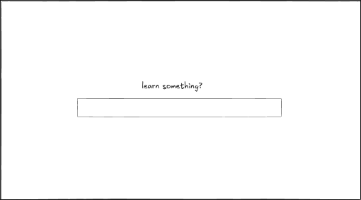
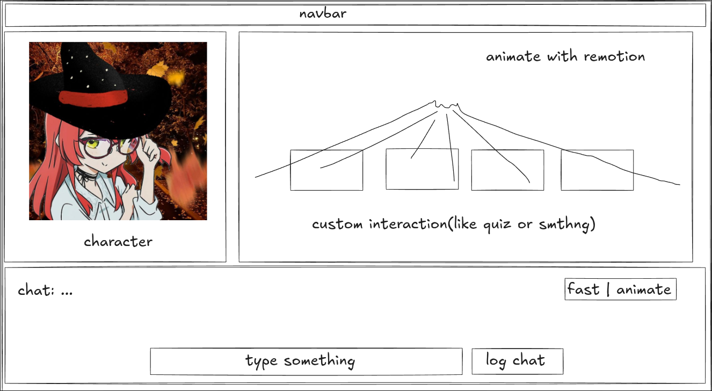

# LORE — Design System & UI/UX Specification (v2 Overhaul)

> **Status:** v2.0 Architecture Overhaul Draft  
> **Fokus:** Preparation & Scoping Flow (`learn something?`) + 3-Pane Interactive Visual Novel Stage  
> **Visual Engine:** React 19 + `@remotion/player` (Interactive Client-Side Canvas)  
> **Tema:** Modern Dark Editorial / Dark Sci-Fi Gold

---

## 1. Design Philosophy

LORE adalah aplikasi pembelajaran interaktif berbasis cerita (*Interactive Learning Visual Novel*). Tujuan utama antarmuka LORE adalah menyatukan **penjelasan visual yang hidup**, **karakter yang ekspresif**, dan **tantangan interaktif berbasis cerita** dalam satu panggung (*stage*) yang kohesif.

### Prinsip Utama UI/UX
1. **Show, Don't Just Tell:** Konsep tidak hanya dijelaskan lewat dinding teks, tetapi divisualisasikan secara dinamis di kanvas menggunakan **Remotion** sementara karakter menjelaskannya.
2. **Learn by Solving World Conflicts:** Kanvas visual bukan sekadar tontonan pasif—pada momen krusial cerita, kanvas berhenti (*pause*) dan berubah menjadi instrumen interaktif yang harus dioperasikan pemain untuk menyelesaikan masalah cerita.
3. **Pacing Control (`fast | animate`):** Pemain memegang kendali penuh atas ritme belajar—bisa menikmati animasi penjelasan langkah demi langkah (`animate`) atau langsung melompat ke inti konsep/interaksi (`fast`).
4. **Scoped Before Generated:** Sebelum menjalankan proses pembuatan materi & cerita yang panjang (ala NotebookLM), UI memfasilitasi dialog singkat (*AI Grilling*) agar cakupan materi pas dengan jumlah chapter yang diinginkan.

---

## 2. Core User Flows & Wireframes

Aplikasi berfokus pada dua layar utama:
1. **Preparation & Scoping Page (`learn something?`)** — Input topik/materi, konfigurasi chapter, *AI Grilling*, estimasi *credit*, dan *background synthesis*.
2. **Main Story & Learning Stage** — Panggung utama 3-panel (Character Stage, Remotion Interactive Canvas, dan Dialogue/Chat Controller).

---

## 3. Page 1: Preparation & Scoping Page (`learn something?`)

### 3.1. Minimalist Entry State
Saat pertama kali dibuka, halaman menampilkan fokus tunggal yang bersih:
- **Prompt Input Utama (`learn something?`):** Pengguna mengetik topik apa pun yang ingin dipelajari, menempelkan catatan, atau melampirkan dokumen referensi.
- **Konfigurasi Eksplorasi (Collapsible / Pill Bar di bawah input):**
  - **Target Chapter Count:** Pilihan jumlah chapter (misal: `1–2 Chapter (Quick)`, `3–5 Chapter (Standard)`, atau angka kustom).
  - **Genre / World Tone:** `Fantasy`, `Sci-Fi`, `Mystery`, atau `Modern/Realistic`.
  - **Simulated Credit Balance:** Menampilkan sisa *credit* pengguna di pojok kanan atas.

### 3.2. State 2: AI Scope Grilling (Jika Konteks Terlalu Luas)
Jika pengguna memasukkan topik yang sangat luas (misal: *"Pelajari seluruh Kalkulus dan Aljabar Linear"*) tetapi memilih jumlah chapter yang sedikit (misal: `2 Chapter`), UI **tidak langsung menjalankan background generation**, melainkan membuka panel percakapan singkat (**Scope Grilling Card**):
- AI mengajukan 1–3 pertanyaan tajam (atau opsi fokus) untuk mengerucutkan ruang lingkup materi.
- Pengguna dapat memilih chip fokus yang disarankan AI atau mengetik batasan spesifik.
- Setiap perubahan ruang lingkup langsung memperbarui **Estimasi Credit** secara *real-time*.

### 3.3. State 3: Credit Confirmation & NotebookLM-Style Background Process
Setelah ruang lingkup disepakati:
1. **Credit Breakdown Preview:** Menampilkan rincian pemakaian *credit* (misal: `3 Chapters × 10 cr + 4 Interactive Canvases × 5 cr = 50 Credits`).
2. **Background Generation Dashboard (NotebookLM-style):**
   - Karena proses persiapan di backend (LangGraph) menyusun kurikulum, naskah emosi karakter, *keyframes* Remotion, dan validasi puzzle secara mendalam, UI menampilkan *progress stage* yang informatif:
     - `[1/4] Extracting Core Concepts & Misconceptions...`
     - `[2/4] Architecting Story Chapters & World Conflicts...`
     - `[3/4] Choreographing Remotion Visuals & Character Emotions...`
     - `[4/4] Validating Interactive Checkpoints...`
   - Begitu Chapter 1 siap (atau seluruh campaign siap), tombol **"Enter Stage"** aktif.

---

## 4. Page 2: Main Story & Learning Stage (3-Pane Layout)

Antarmuka permainan utama dibagi menjadi **Navbar di bagian atas** dan **3 Panel Utama** yang mengisi layar penuh (`h-screen overflow-hidden`):

| Area | Posisi | Fungsi Utama |
|---|---|---|
| **Navbar** | Top (Full Width) | Menampilkan judul Campaign/Chapter, indikator **HP (5/5)**, sisa **Simulated Credits**, dan tombol navigasi keluar. |
| **1. Character Stage (`char`)** | Tengah-Kiri (~30–35% lebar) | Menampilkan karakter pendamping/mentor yang bergerak, berganti ekspresi/emosi, dan memberikan gestur penjelasan. |
| **2. Remotion Canvas** | Tengah-Kanan (~65–70% lebar) | Kanvas `@remotion/player` tempat visualisasi materi dianimasikan dan tempat interaksi/puzzle kustom berlangsung. |
| **3. Chat & Control Box** | Bawah (Full Width, ~25–30% tinggi) | Menampilkan teks dialog/narasi, toggle `fast \| animate`, kolom `type something`, dan tombol `log chat`. |

---

### 4.1. Panel 1: Character Stage (Kiri Atas)

Panel ini adalah jangkar emosional dari cerita.
- **Peran Visual:** Karakter tidak hanya berupa gambar statis, melainkan memiliki *state* emosi dan gerakan penjelasan (*idle*, *explaining/pointing*, *thinking*, *worried*, *excited*, *stern*, *damaged/shocked*).
- **Sinkronisasi dengan Cerita & Kanvas:**
  - Ketika kanvas Remotion di sebelah kanan menampilkan diagram baru, karakter berubah ke pose `explaining` atau `pointing`.
  - Ketika pemain salah menjawab tantangan di kanvas dan HP berkurang, karakter bereaksi dengan ekspresi `worried` atau `shocked`.
- **Pendekatan Implementasi (TBD / Bertahap):**
  - *Tahap Awal (MVP v2):* Layered SVG / Sprite dengan transisi *spring* CSS/Framer Motion (efek *breathing*, *talking bounce*, dan pergantian ekspresi wajah).
  - *Tahap Lanjut:* Rive / Lottie state machine atau Live2D ringan yang dikontrol lewat prop `emotion` dan `gesture` dari JSON *beat*.

---

### 4.2. Panel 2: Interactive Remotion Canvas (Kanan Atas)

Panel ini menggunakan **`@remotion/player`** di sisi klien (bukan file video `.mp4`), sehingga ukurannya sangat ringan (hanya digerakkan oleh JSON dari backend) dan **elemen di dalamnya bisa diklik/diinteraksikan langsung sebagai komponen React**.

#### Dua Mode Kanvas:
1. **Mode Explain (Synced Animation):**
   - Saat karakter menjelaskan konsep atau situasi cerita, `@remotion/player` memutar animasi (misal: node yang saling terhubung, garis vektor yang bergeser, atau simulasi sistem).
   - Animasi terikat pada *beat* dialog saat ini (misal: `frame 0` sampai `frame 150`).
2. **Mode Interactive Checkpoint / Puzzle (Paused Frame + Custom Interaction):**
   - Saat cerita mencapai masalah/tantangan, `@remotion/player` berhenti otomatis pada frame target, dan *overlay* / komponen di dalam kanvas aktif menerima input pemain.
   - Setelah pemain menyelesaikan aksi di kanvas, kanvas memutar animasi konsekuensi (berhasil atau gagal).

#### Katalog Interactive Canvas Primitives (Standar Awal v2):
Agar hasil generate AI selalu konsisten, responsif, dan bebas *bug* layout, kanvas Remotion dibangun di atas kumpulan *primitive* yang dikontrol lewat JSON Schema:
1. **`ConceptMap / NodeGraphPrimitive` (Sesuai Wireframe):**
   - *Explain:* Menganimasikan hubungan hierarki/jaringan antar konsep atau komponen sistem dunia cerita.
   - *Interact:* Pemain mengklik node yang tepat, melengkapi node yang hilang, atau memilih jalur koneksi yang benar untuk memulihkan sistem.
2. **`SimulationControlPrimitive`:**
   - *Explain:* Menampilkan rumus/sistem dinamis (seperti keseimbangan energi, vektor, atau grafik).
   - *Interact:* Pemain menggeser *slider* atau mengubah nilai parameter hingga visualisasi di kanvas mencapai target yang diminta cerita.
3. **`ArtifactInspectorPrimitive`:**
   - *Explain:* Menampilkan skema mesin kuno, potongan kode, atau dokumen arsip dengan sorotan (*spotlight*) bertahap.
   - *Interact:* Pemain mengklik bagian yang mengandung kesalahan/anomali (*spot the flaw*) berdasarkan konsep yang baru dipelajari.
4. **`TacticalDecisionPrimitive`:**
   - *Explain:* Menampilkan situasi konflik cerita secara visual.
   - *Interact:* Menampilkan kartu keputusan/puzzle di dalam kanvas dengan umpan balik langsung (*feedback* akademik + konsekuensi dunia cerita).

---

### 4.3. Panel 3: Dialogue, Pacing & Chat Controller (Bawah)

Panel bawah menggabungkan gaya *Visual Novel Textbox* dengan kontrol interaktif modern:

1. **Area Teks Dialog (`chat: ...`):**
   - Menampilkan nama karakter, indikator emosi, serta teks dialog atau narasi cerita saat ini.
   - Klik pada area dialog (ketika tidak sedang berada di tengah puzzle wajib) akan memajukan cerita ke *beat* berikutnya.
2. **Toggle `fast | animate` (Pojok Kanan Atas Kotak Chat):**
   - **`animate` (Default):** Teks muncul dengan efek ketikan halus (*typewriter*) dan kanvas Remotion memutar transisi animasi secara penuh dari awal hingga akhir *beat*.
   - **`fast`:** Teks langsung tampil penuh dan `@remotion/player` langsung melompat (`seekTo`) ke frame akhir penjelasan *beat* tersebut (atau langsung ke frame interaksi puzzle). Sangat berguna saat pemain mengulang cerita (*retry*) atau ingin membaca cepat.
3. **Input `type something` (Bagian Bawah Tengah):**
   - Memungkinkan pemain mengetik pertanyaan bebas kepada karakter tentang materi yang sedang dibahas di kanvas (*"Kenapa tadi koefisien keduanya harus dikali 2?"*) atau mengetik jawaban alasan pada tantangan terbuka.
   - Pertanyaan bebas di luar skrip utama akan diproses oleh backend LangGraph (dengan konteks *scene* & materi saat ini) dan memotong sedikit *Interaction Credit*.
4. **Tombol `log chat` (Sebelah Kanan Input):**
   - Membuka panel/modal riwayat seluruh dialog, narasi, dan ringkasan konsep (`learning_info`) yang sudah dilewati pada chapter tersebut agar pemain bisa meninjau ulang materi sebelum menjawab puzzle.

---

## 5. Visual Identity & Color Tokens

LORE mempertahankan estetika **Modern Dark Editorial / Dark Sci-Fi Gold** agar kanvas Remotion dan karakter terlihat menonjol di atas latar gelap yang nyaman di mata.

| Token | Hex | Penggunaan |
|---|---|---|
| `--color-void` | `#0a0a0c` | Latar belakang utama kanvas Remotion & area dialog |
| `--color-sci-panel` | `#1a1410` | Latar panel karakter, navbar, dan kartu kontrol |
| `--color-sci-border` | `#3a2d20` | Garis pembatas tegas antar panel (Character, Canvas, Chat) |
| `--color-gold` | `#e8c547` | Aksen interaktif utama, node aktif di Remotion, tombol aktif (`fast \| animate`) |
| `--color-text` | `#f0ebe0` | Teks utama dialog dan label kanvas |
| `--color-text-dim` | `#a8a090` | Narasi sekunder dan keterangan |
| `--color-danger` | `#d84a3a` | Indikator pengurangan HP, konflik kritis, dan jawaban salah |
| `--color-success` | `#6fcf97` | Indikator *concept demonstrated* dan keberhasilan puzzle |

---

## 6. Status Keputusan Desain (Design Decisions Checklist)

### Sudah Ditetapkan (Locked for v2)
- [x] Dua halaman utama: **Preparation Page (`learn something?`)** dan **3-Pane Main Stage**.
- [x] Mekanisme **AI Grilling** ketika cakupan topik terlalu besar dibanding jumlah chapter yang diminta.
- [x] **Background Process** ala NotebookLM setelah ruang lingkup disepakati.
- [x] Tata letak panggung utama terdiri dari **Navbar**, **Character Panel (Kiri)**, **Remotion Interactive Canvas (Kanan)**, dan **Chat/Control Panel (Bawah)**.
- [x] Penggunaan `@remotion/player` berbasis JSON di sisi klien (bukan video `.mp4` statis) agar mendukung interaksi langsung dan ukuran data minimal.
- [x] Kontrol `fast | animate`, input `type something`, dan tombol `log chat` di panel bawah.

### Masih Dapat Dikembangkan (Open / TBD)
- [ ] Format aset final untuk **Character Panel** (apakah Sprite SVG berlapis, Rive, atau Lottie).
- [ ] Daftar lengkap variasi *Interactive Primitives* di Remotion untuk berbagai mata pelajaran (eksakta vs sosial/humaniora).
- [ ] Rumus final dan angka keseimbangan untuk **Credit Simulation**.
- [ ] Tata letak adaptif untuk layar vertikal (*mobile portrait*—apakah Character dan Canvas ditumpuk atau menggunakan tab switch).
