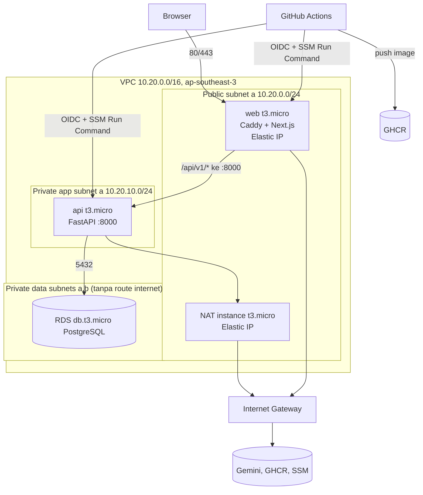

# Infrastruktur AWS dan CI/CD untuk lore: ikhtisar

**Tujuan dokumen.** Halaman masuk untuk memahami seluruh rencana memindahkan sebagian fitur lore ke backend persisten dan men-deploy-nya di AWS dengan pola CI/CD proyek acuan `zero-to-prod`. Dokumen ini memuat arsitektur, keputusan beserta alasannya, konvensi nama yang dipakai semua dokumen lain, ringkasan biaya, dan indeks dokumen. Semua isi adalah spesifikasi untuk implementasi nanti. Belum ada file Terraform, workflow, atau Dockerfile yang dibuat.

Status: draft v1

## 1. Latar dan tujuan

Kondisi sekarang:

- Lore adalah web app visual novel pembelajaran (Next.js 16, React 19, TypeScript, Zod).
- Data pemain (project, campaign state) hanya ada di IndexedDB browser (`src/lib/state/project-store.ts`, `idb.ts`). Tidak ada akun dan tidak ada auth.
- Pipeline AI (Gemini) berjalan di route handler Next.js `/api/ai/*`. Tidak ada tempat hosting.
- `README.md` dan `docs/DOCS.md` merencanakan backend Python (FastAPI + LangGraph). Folder `backend/` belum ada.

Tujuan:

1. Membangun fondasi AWS yang seluruhnya dikelola lewat Terraform dan pipeline GitHub Actions: VPC, subnet public dan private, NAT, IAM, security group, EC2, dan RDS.
2. Menjalankan frontend dan backend di instance terpisah, dengan RDS PostgreSQL untuk data persisten.
3. Memakai layanan gratis GitHub sebanyak mungkin (Actions, GHCR, Environments). Dependabot sengaja tidak dipakai. AWS hanya untuk yang tidak bisa ditangani GitHub.
4. Menjaga biaya AWS tetap terkendali lewat guardrail berlapis, dan memberi tag pada semua resource.
5. Menaikkan timeout AI menjadi 5 menit agar model punya waktu untuk reasoning.

## 2. Lingkup dan non-goal

Dalam lingkup:

- Terraform untuk jaringan, IAM, security group, 3 instance EC2 (web, api, nat), dan RDS.
- Pipeline `ci`, `infra`, `release-web`, `release-api`.
- Guardrail biaya dan skema tagging.
- Pemisahan struktur kode `frontend/` (Next.js) dan `backend/` (FastAPI), kontrak container, health check, timeout AI 5 menit, serta sketsa migrasi persistensi.

Di luar lingkup (sengaja tidak dikerjakan):

- Stack observability (Prometheus, node exporter, Grafana) dan layanan observability berbayar AWS.
- Lebih dari satu environment (staging). Hanya `prod`.
- High availability: Multi-AZ RDS, lebih dari satu instance per komponen, load balancer.
- WAF, CloudFront, Route 53 hosted zone.
- Implementasi migrasi persistensi aplikasi (Phase B). Hanya disketsakan di [06-app-changes.md](./06-app-changes.md).

## 3. Arsitektur

Aliran utama:

- Browser mengakses Elastic IP instance `web`. Caddy menerima request, meneruskan `/api/v1/*` ke instance `api` (private IP `10.20.10.10`, port 8000), dan sisanya ke Next.js di container yang sama (port 3000).
- Instance `api` tidak punya IP publik. Egress ke internet (Gemini, GHCR, SSM) lewat instance `nat`.
- RDS berada di subnet data tanpa route ke internet. Hanya instance `api` yang boleh mengakses port 5432.
- Tidak ada SSH. Akses admin dan deploy memakai AWS Systems Manager (Session Manager dan Run Command).

## 4. Keputusan

| ID | Keputusan | Alasan | Alternatif | Dokumen |
|---|---|---|---|---|
| D1 | Image di GHCR (`ghcr.io/nnaory/lore-web`, `lore-api`), build dan push memakai `GITHUB_TOKEN` | Gratis dan sudah dipakai di `zero-to-prod`. Tidak perlu ECR | ECR (berbiaya, keluar dari prinsip gratis) | [03](./03-compute.md), [05](./05-cicd.md) |
| D2 | Frontend dan backend di dua instance terpisah | Permintaan user. Backend bisa dibuat private | Satu instance dengan dua container | [03](./03-compute.md) |
| D3 | Caddy di instance web, ALB dihapus | ALB dengan satu target tidak memberi HA dan menambah biaya tetap. Caddy mengurus TLS Let's Encrypt gratis jika ada domain | ALB (sekitar +US$20 per bulan) [belum diverifikasi] | [03](./03-compute.md), [07](./07-cost-guardrails.md) |
| D4 | NAT instance `t3.micro`, variabel `nat_mode = "instance" \| "gateway"` | NAT Gateway US$0,045/jam sekitar US$33 per bulan ditambah US$0,045/GB [terverifikasi: aws.amazon.com/vpc/pricing, us-east-2] | NAT Gateway, fck-nat, NAT di instance web | [01](./01-network.md) |
| D5 | Semua EC2 `t3.micro` dengan `cpu_credits = "standard"` | Sesuai permintaan. Default T3 adalah unlimited dan bisa menagih surplus credit | Mode unlimited | [03](./03-compute.md) |
| D6 | RDS PostgreSQL 16, `db.t3.micro`, single-AZ, 20 GB gp3 | Mengikuti instruksi "t3 micro". Cukup untuk beban awal | `db.t4g.micro`, Postgres 17, Multi-AZ | [04](./04-database.md) |
| D7 | Config dan secret runtime di SSM Parameter Store (tier standard). Secret dibuat manual, tidak lewat Terraform | Gratis. Nilai secret tidak boleh masuk tfstate | Secrets Manager untuk semua (US$0,40 per secret per bulan) | [03](./03-compute.md), [02](./02-iam-and-oidc.md) |
| D8 | Akses dan deploy lewat SSM Session Manager dan Run Command, tanpa SSH | Tanpa port 22, tanpa key pair, sama seperti `zero-to-prod` | SSH dengan bastion | [02](./02-iam-and-oidc.md), [09](./09-runbook.md) |
| D9 | Tiga role OIDC: `lore-gh-plan`, `lore-gh-apply`, `lore-gh-deploy` | Role per tujuan dengan izin terbatas, bukan `FullAccess` | Satu role luas seperti `zero-to-prod` | [02](./02-iam-and-oidc.md) |
| D10 | Guardrail biaya lima lapis dan Budget US$70 per bulan | AWS tidak punya batas pengeluaran keras, jadi harus berlapis | Hanya alert email | [07](./07-cost-guardrails.md) |
| D11 | File `deploy/**` ditanam ke `user_data` lewat Terraform, tanpa `git clone` | Tetap berfungsi jika repo menjadi privat | `git clone` seperti `zero-to-prod` | [03](./03-compute.md) |
| D12 | Tag image hanya `sha-<7 char>` (immutable secara konvensi), tanpa `latest` | Rilis bisa dilacak ke commit dan rollback jelas | Tag `latest` | [03](./03-compute.md), [05](./05-cicd.md) |

## 5. Pembagian: GitHub gratis dan AWS

| Kebutuhan | GitHub (gratis) | AWS |
|---|---|---|
| Source, PR, review | Repo publik | - |
| CI, build, push image | Actions dan GHCR | - |
| Persetujuan sebelum apply | Environment `production` | - |
| Update dependensi | Dikelola manual (Dependabot tidak dipakai) | - |
| Deploy | Job Actions | SSM Run Command (gratis) |
| Config dan secret runtime | - | SSM Parameter Store tier standard |
| State Terraform | - | S3 (sen per bulan) |
| Compute dan database | - | EC2 dan RDS |
| Batas biaya | - | AWS Budgets, Cost Anomaly Detection |

Dasar fakta:

- Paket GHCR publik gratis. Docs GitHub menyatakan penyimpanan dan bandwidth Container registry "currently free", dengan pemberitahuan minimal sebulan sebelum berubah [terverifikasi: docs.github.com/en/billing/concepts/product-billing/github-packages].
- Runner standar Actions di repo publik gratis [terverifikasi: docs.github.com/en/billing/concepts/product-billing/github-actions].
- Environments di plan GitHub Free hanya untuk repo publik [terverifikasi: docs.github.com/en/actions/how-tos/deploy/configure-and-manage-deployments/manage-environments].

## 6. Konvensi (sumber kebenaran tunggal)

Semua dokumen memakai nilai di tabel ini.

| Item | Nilai |
|---|---|
| Project, env, prefix | `lore`, `prod`, `lore-prod` |
| Region | `ap-southeast-3` (Jakarta, region opt-in, butuh STS `v2Token`). AZ `ap-southeast-3a` dan `3b` (verifikasi nama AZ saat implementasi) |
| VPC | `lore-prod-vpc`, `10.20.0.0/16`, DNS support dan hostnames aktif |
| Subnet | `lore-prod-public-a` `10.20.0.0/24` (AZ a), `lore-prod-app-a` `10.20.10.0/24` (AZ a), `lore-prod-data-a` `10.20.20.0/24`, `lore-prod-data-b` `10.20.21.0/24`. Dicadangkan dan belum dibuat: `10.20.1.0/24` (public-b), `10.20.11.0/24` (app-b) |
| Instance | `lore-prod-web` (Component=web, public subnet, EIP), `lore-prod-api` (Component=api, app subnet, private IP tetap `10.20.10.10`), `lore-prod-nat` (Component=nat, public subnet, EIP, `source_dest_check=false`), RDS `lore-prod-db` (Component=db) |
| Tipe | EC2 semua `t3.micro`. RDS `db.t3.micro`. Root EBS gp3 terenkripsi (kunci AWS-managed): web 12 GB, api 12 GB, nat 8 GB |
| Security group | `lore-prod-web`, `lore-prod-api`, `lore-prod-nat`, `lore-prod-rds` |
| Port | Caddy 80 dan 443 (web). Next.js 3000 (hanya di jaringan docker web). FastAPI 8000. PostgreSQL 5432 |
| Prefix API publik | `/api/v1/*` diteruskan Caddy ke api (termasuk pipeline AI `/api/v1/ai/*`). Selain itu ke Next.js |
| Image | `ghcr.io/nnaory/lore-web`, `ghcr.io/nnaory/lore-api` (huruf kecil wajib). Tag `sha-<7 char>` saja. Label OCI `org.opencontainers.image.source=https://github.com/Nnaory/lore` |
| Terraform | `>= 1.10` (pin CI 1.10.x), provider AWS `~> 5.80`, `.terraform.lock.hcl` di-commit. File datar per concern di `infra/`, tanpa modul: `backend.tf`, `variables.tf`, `network.tf`, `security.tf`, `iam.tf`, `compute.tf`, `database.tf`, `ssm.tf`, `outputs.tf` |
| State | Bucket `lore-tfstate-<ACCOUNT_ID>`, key `lore/prod/terraform.tfstate`, `use_lockfile = true`, versioning, SSE-S3, block public access, lifecycle noncurrent version 90 hari |
| Folder repo target | `infra/` (Terraform), `infra/bootstrap/` (script idempotent dan `policies/*.json`), `deploy/web/{compose.yml,Caddyfile}`, `deploy/api/compose.yml`, `deploy/common/{render-env.sh,deploy.sh}`, `backend/` (FastAPI), `Dockerfile` (web, di root), `backend/Dockerfile` (api), `scripts/ci/` (pemeriksa tag dan biaya) |
| Role GitHub (OIDC) | `lore-gh-plan`, `lore-gh-apply`, `lore-gh-deploy` |
| Role instance | `lore-prod-web-instance`, `lore-prod-api-instance`, `lore-prod-nat-instance` (instance profile bernama sama) |
| Parameter SSM | Env per komponen: `/lore/prod/web/env/*`, `/lore/prod/api/env/*` (nama variabel = segmen terakhir path). Secret = SecureString dibuat manual. Non-secret dikelola Terraform. Tag rilis: `/lore/prod/web/release/image_tag`, `/lore/prod/api/release/image_tag` (dikelola job deploy, bukan Terraform). Konfigurasi non-env: `/lore/prod/api/config/db_secret_arn` |
| Env AI (api saja) | `AI_PROVIDER=google`, `AI_MODEL`, `AI_TIMEOUT_MS=300000`, `AI_DEADLINE_MS=300000`, `GOOGLE_API_KEY` (SecureString) |
| Env DB (api) | `PGHOST`, `PGPORT=5432`, `PGDATABASE=lore`, `PGSSLMODE=require` (non-secret, Terraform). `PGUSER`, `PGPASSWORD` dari Secrets Manager (RDS-managed), dirender oleh `render-env.sh` |
| Workflow | `.github/workflows/{ci.yml,infra.yml,release-web.yml,release-api.yml}` (tanpa Dependabot). GitHub Environment `production` (job `apply` infra, reviewer wajib, hanya branch `main`) dan `production-release` (job `deploy` aplikasi, tanpa reviewer, hanya branch `main`). Dua Environment dipakai karena satu Environment hanya punya satu konfigurasi proteksi |
| `vars` GitHub | `AWS_REGION`, `AWS_ROLE_PLAN_ARN`, `AWS_ROLE_APPLY_ARN`, `AWS_ROLE_DEPLOY_ARN`, `APP_URL`. Tidak ada secret GitHub untuk infra |
| Tag AWS wajib | `Project=lore`, `Environment=prod`, `ManagedBy=terraform` (bootstrap: `ManagedBy=bootstrap`; secret SSM manual: `manual`; parameter tag rilis: `github-actions`), `Repo=Nnaory/lore`, `Component` (`network`, `web`, `api`, `nat`, `db`, `iam`, `budget`, `bootstrap`), `Name=lore-prod-<component>[-detail]` |
| Budget | `lore-prod-monthly` US$70 per bulan: email di 50%, 80%, 100% ACTUAL dan 100% FORECAST. `lore-prod-guardrail` (action-enabled, satu dari dua yang gratis): pada 100% ACTUAL menempelkan policy `lore-deny-new-spend` ke role `lore-gh-apply`. Aksi stop instance default OFF |

## 7. Biaya dan batas

Perkiraan kasar per bulan, basis harga us-east-2 dari ingatan (harga EC2 dan RDS [belum diverifikasi]). Harga Jakarta kemungkinan lebih tinggi dan belum dihitung. Rincian ada di [07-cost-guardrails.md](./07-cost-guardrails.md).

| Komponen | Perkiraan |
|---|---|
| 3 instance t3.micro (web, api, nat) | sekitar US$23 |
| RDS db.t3.micro dan 20 GB gp3 | sekitar US$15 sampai 16 |
| EBS sekitar 32 GB | sekitar US$3 |
| 2 IPv4 publik (US$0,005 per jam) | US$7,3 [terverifikasi: aws.amazon.com/vpc/pricing, tarif per jam] |
| Secrets Manager (1 secret) | US$0,4 [belum diverifikasi] |
| S3 state, SSM, lain-lain | di bawah US$1 |
| **Total** | **sekitar US$50** |

Batas: alert Budget di US$70 per bulan. AWS tidak punya batas pengeluaran keras. Yang disediakan adalah pencegahan resource mahal (validasi Terraform dan IAM Deny), peringatan dini (Budgets dan Cost Anomaly Detection), dan satu aksi otomatis. Detail di dokumen biaya.

## 8. Perbedaan dengan `zero-to-prod`

Dipertahankan: state S3 dengan `use_lockfile`, OIDC tanpa access key statis, EC2 AL2023 tanpa SSH, SSM Run Command untuk deploy, tag image `sha-*`, `infra.yml` dengan plan di PR dan apply saat merge, region `ap-southeast-3`.

| Di `zero-to-prod` | Di lore | Alasan |
|---|---|---|
| Role pipeline memakai `AmazonEC2FullAccess` dan `AmazonSSMFullAccess` | Tiga role dengan izin per service dan prefix nama, plus explicit Deny | Least privilege dan guardrail biaya |
| Komentar plan memasukkan `${{ steps.plan.outputs.stdout }}` langsung ke template JS | Plan ditulis ke `plan.txt`, dibaca lewat `fs` di `actions/github-script` | Backtick di output plan merusak template. Interpolasi ke script adalah risiko injeksi |
| Deploy memakai `sleep 20` dan tidak mengecek status | Polling `get-command-invocation`, smoke test, rollback otomatis | Deploy yang gagal harus menggagalkan job |
| `.terraform.lock.hcl` di-ignore | Di-commit | Versi provider sama di laptop dan CI |
| `user_data` melakukan `git clone` repo publik | `deploy/**` ditanam ke `user_data` | Tidak bergantung pada visibilitas repo |
| Data source AMI terbaru bisa memicu penggantian instance | `ignore_changes = [ami]` dan refresh AMI lewat `-replace` | Mencegah penggantian tak sengaja |
| Plan dan apply dalam satu job tanpa gerbang | Job `apply` terpisah, memakai artifact plan yang sama, di Environment `production` | Persetujuan sebelum perubahan |
| Satu EC2 di default VPC dengan IP publik | VPC sendiri, subnet public dan private, NAT, RDS | Tujuan proyek ini |
| Secret berupa variabel Terraform (password Grafana di tfvars) | Secret tidak pernah lewat Terraform | Nilai tidak boleh masuk tfstate |
| Tidak ada guardrail biaya dan tag | Budget, IAM Deny, skema tag, pemeriksa CI | Batasi budget dan mudahkan manajemen |
| ALB idle timeout 60 detik tidak dibahas (tidak ada ALB di sana) | Tanpa ALB. Jika ALB dipakai nanti, idle timeout harus dinaikkan di atas 300 detik (maksimum 4000) | Timeout AI 5 menit [terverifikasi: docs.aws.amazon.com/elasticloadbalancing/latest/application/edit-load-balancer-attributes.html] |

## 9. Fase kerja

- **Fase A: infra dan CI/CD.** Roadmap R1 sampai R12 di [10-implementation-roadmap.md](./10-implementation-roadmap.md). Hasilnya: frontend dan backend skeleton ter-deploy otomatis, RDS terhubung, biaya terpantau.
- **Fase B: migrasi persistensi aplikasi.** R13, rencana terpisah setelah [open-questions.md](./open-questions.md) dijawab, terutama soal identitas pemilik data.

Urutan prinsip: budget dan guardrail dibuat pertama. Infra hanya berubah lewat PR dengan komentar plan. Resource berbiaya dibuat saat benar-benar dipakai.

## 10. Indeks dokumen

| Dokumen | Isi |
|---|---|
| [00-overview.md](./00-overview.md) | Halaman ini |
| [01-network.md](./01-network.md) | VPC, subnet, route table, NAT instance, security group |
| [02-iam-and-oidc.md](./02-iam-and-oidc.md) | Bootstrap, role OIDC GitHub, role instance, izin per role |
| [03-compute.md](./03-compute.md) | EC2, user_data, compose, Caddy, parameter SSM, alur deploy, GHCR |
| [04-database.md](./04-database.md) | RDS PostgreSQL, akses, backup, migrasi schema, sketsa tabel |
| [05-cicd.md](./05-cicd.md) | Workflow GitHub Actions, Environments, branch protection, rollback |
| [06-app-changes.md](./06-app-changes.md) | Kontrak container, timeout AI 5 menit, sketsa migrasi persistensi |
| [07-cost-guardrails.md](./07-cost-guardrails.md) | Estimasi biaya, allowlist dan denylist, lima lapis penegakan |
| [08-tagging.md](./08-tagging.md) | Skema tag dan penegakannya |
| [09-runbook.md](./09-runbook.md) | First-run, operasi harian, teardown, tabel insiden |
| [10-implementation-roadmap.md](./10-implementation-roadmap.md) | Tugas implementasi R1 sampai R13 |
| [open-questions.md](./open-questions.md) | Keputusan yang masih dibutuhkan, dengan default yang dipakai dokumen |

## 11. Asumsi

Asumsi berikut dipakai di semua dokumen. Masing-masing punya entri di [open-questions.md](./open-questions.md).

- Backend adalah Python FastAPI sesuai README (Q1).
- Repo `Nnaory/lore` publik dan paket GHCR dibuat publik (Q12).
- Region `ap-southeast-3` (Q7).
- Satu environment `prod`, tanpa staging (Q13).
- Tanpa domain dulu, HTTP lewat Elastic IP (Q3).
- Pemilik data persisten belum diputuskan, kolom `owner_id` nullable (Q4).

## 12. Fakta terverifikasi dan belum

Terverifikasi (sumber):

- Paket GHCR publik gratis, Container registry "currently free". Paket privat punya kuota (GitHub Free: 500 MB storage, 1 GB transfer per bulan, storage dibagi dengan artifact Actions). Pull dengan `GITHUB_TOKEN` dari Actions gratis [terverifikasi: docs.github.com/en/billing/concepts/product-billing/github-packages].
- Runner standar di repo publik gratis. Plan Free untuk repo privat: compute termasuk US$12 per bulan. Cache 10 GB per repo, artifact 500 MB. Dependabot gratis [terverifikasi: docs.github.com/en/billing/concepts/product-billing/github-actions].
- Environments plan Free hanya repo publik [terverifikasi: docs.github.com/en/actions/how-tos/deploy/configure-and-manage-deployments/manage-environments].
- AWS Budgets: monitoring gratis, dua budget pertama yang punya action gratis, berikutnya US$0,10 per hari per budget [terverifikasi: aws.amazon.com/aws-cost-management/aws-budgets/pricing].
- NAT Gateway US$0,045 per jam dan US$0,045 per GB (us-east-2). IPv4 publik US$0,005 per jam baik in-use maupun idle. Gateway VPC endpoint S3 tanpa biaya [terverifikasi: aws.amazon.com/vpc/pricing].
- ALB idle timeout default 60 detik, rentang 1 sampai 4000 detik [terverifikasi: docs.aws.amazon.com/elasticloadbalancing/latest/application/edit-load-balancer-attributes.html].
- Repo `Nnaory/lore` publik: halaman terbuka tanpa login [terverifikasi: github.com/Nnaory/lore]. README menulis "License: Private. All rights reserved" (lihat Q12).
- Perilaku timeout di kode lore dan lokasi persistensi dijelaskan di [06-app-changes.md](./06-app-changes.md) [terverifikasi: pembacaan kode `src/lib/ai/providers/gemini-client.ts`, `src/lib/state/project-store.ts`].
- Acuan `zero-to-prod` dibaca langsung dari repo (`infra/*.tf`, `.github/workflows/*.yml`, `explanation.md`).

Belum diverifikasi (ditandai `[belum diverifikasi]` di dokumen terkait): harga EC2, RDS, ALB per jam dan pengali harga Jakarta, default timeout undici, Firefox, dan Cloudflare, kunci kondisi IAM, semantik beberapa target SSM, perilaku RDS yang di-stop, mode kredit RDS T3, nama parameter `rds.force_ssl`, `KEEP_ALIVE_TIMEOUT` di server standalone Next, ketersediaan tipe instance dan versi Postgres di Jakarta.
