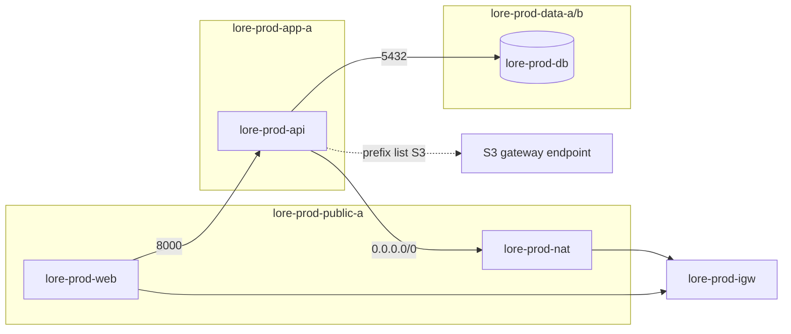

# 01 Jaringan: VPC, subnet, NAT, security group

**Tujuan dokumen.** Spesifikasi lengkap jaringan AWS untuk lore: VPC, subnet, route table, NAT instance, S3 gateway endpoint, dan security group. Semua angka dan nama di sini bisa dipindah langsung ke `infra/network.tf` dan `infra/security.tf`. Nilai yang dipakai semua dokumen ada di [00-overview.md](./00-overview.md) bagian 6.

Status: draft v1

## 1. VPC dan subnet

| Resource | Nama | CIDR | AZ | Isi |
|---|---|---|---|---|
| VPC | `lore-prod-vpc` | `10.20.0.0/16` | - | DNS support dan hostnames aktif |
| Subnet public | `lore-prod-public-a` | `10.20.0.0/24` | `ap-southeast-3a` | `lore-prod-web`, `lore-prod-nat` |
| Subnet app (private) | `lore-prod-app-a` | `10.20.10.0/24` | `ap-southeast-3a` | `lore-prod-api` (IP tetap `10.20.10.10`) |
| Subnet data (private) | `lore-prod-data-a` | `10.20.20.0/24` | `ap-southeast-3a` | RDS |
| Subnet data (private) | `lore-prod-data-b` | `10.20.21.0/24` | `ap-southeast-3b` | RDS (syarat subnet group) |
| Dicadangkan | public-b | `10.20.1.0/24` | `3b` | Belum dibuat. Untuk load balancer atau instance kedua nanti |
| Dicadangkan | app-b | `10.20.11.0/24` | `3b` | Belum dibuat |
| Internet Gateway | `lore-prod-igw` | - | - | Terpasang ke VPC |

Alasan bentuk ini:

- RDS subnet group mewajibkan subnet di minimal dua AZ, sehingga ada `data-a` dan `data-b`.
- Load balancer tidak dipakai (keputusan D3), jadi `public-b` ditunda. Subnet kosong gratis, tetapi tidak dibuat agar tidak ada resource yang tidak terpakai.
- Semua komputasi berada di AZ a. Ini single-AZ dan disengaja (lihat bagian 7).
- Nama AZ `ap-southeast-3a` dan `3b` harus dicek saat implementasi (`aws ec2 describe-availability-zones`). Nama AZ bisa dipetakan berbeda per akun.
- Ketersediaan tipe instance di AZ terpilih juga dicek saat implementasi [belum diverifikasi].

## 2. Route table

| Route table | Dipakai oleh | Route | Catatan |
|---|---|---|---|
| `lore-prod-public-rt` | `lore-prod-public-a` | `10.20.0.0/16` local, `0.0.0.0/0` ke `lore-prod-igw` | Web dan NAT punya IP publik (EIP) |
| `lore-prod-app-rt` | `lore-prod-app-a` | `10.20.0.0/16` local, `0.0.0.0/0` ke ENI NAT instance (`network_interface_id`), prefix list S3 ke gateway endpoint | Egress api lewat NAT |
| `lore-prod-data-rt` | `lore-prod-data-a`, `lore-prod-data-b` | Hanya `10.20.0.0/16` local | Tanpa default route. RDS tidak punya jalan keluar ke internet |

Ilustrasi (verifikasi saat implementasi):

```hcl
resource "aws_route" "app_default_via_nat_instance" {
  count                  = var.nat_mode == "instance" ? 1 : 0
  route_table_id         = aws_route_table.app.id
  destination_cidr_block = "0.0.0.0/0"
  network_interface_id   = aws_instance.nat[0].primary_network_interface_id
}

resource "aws_route" "app_default_via_nat_gateway" {
  count                  = var.nat_mode == "gateway" ? 1 : 0
  route_table_id         = aws_route_table.app.id
  destination_cidr_block = "0.0.0.0/0"
  nat_gateway_id         = aws_nat_gateway.this[0].id
}
```

## 3. VPC endpoint

- Satu gateway endpoint S3 (`lore-prod-s3-endpoint`) dipasang ke `lore-prod-app-rt`. Gateway endpoint tidak punya biaya jam maupun biaya data [terverifikasi: aws.amazon.com/vpc/pricing]. Gunanya mengurangi trafik lewat NAT, misalnya untuk repo paket AL2023 yang disajikan dari S3 regional [belum diverifikasi].
- Tidak ada interface endpoint (PrivateLink). Interface endpoint berbayar per jam per AZ dan per GB, jadi masuk denylist (lihat [07-cost-guardrails.md](./07-cost-guardrails.md)).
- Tidak ada VPC Flow Logs (biaya log). NACL dibiarkan default (allow all). Kontrol akses dilakukan di security group.

## 4. NAT instance

Spesifikasi `lore-prod-nat`:

| Atribut | Nilai |
|---|---|
| AMI | AL2023 x86_64 (parameter SSM publik, sama dengan instance lain) |
| Tipe | `t3.micro`, `cpu_credits = "standard"` |
| Subnet | `lore-prod-public-a` |
| `source_dest_check` | `false` (wajib agar bisa meneruskan paket) |
| IP | Elastic IP `lore-prod-nat-eip` |
| Security group | `lore-prod-nat` |
| Root volume | 8 GB gp3 terenkripsi |
| Role | `lore-prod-nat-instance` (hanya `AmazonSSMManagedInstanceCore`) |
| `metadata_options` | `http_tokens = "required"`, `http_put_response_hop_limit = 1` |
| Tag | `Component=nat`, `Name=lore-prod-nat` |

Konfigurasi di `user_data` (ilustrasi, verifikasi saat implementasi, terutama perbedaan iptables dan nftables di AL2023):

```bash
#!/bin/bash
set -euxo pipefail
dnf install -y iptables-services

cat >/etc/sysctl.d/90-nat.conf <<'EOF'
net.ipv4.ip_forward = 1
EOF
sysctl --system

IFACE="$(ip -o route show default | awk '{print $5}' | head -n1)"
iptables -t nat -A POSTROUTING -o "$IFACE" -s 10.20.10.0/24 -j MASQUERADE
service iptables save
systemctl enable --now iptables
```

Catatan:

- Aturan MASQUERADE hanya untuk `10.20.10.0/24` (subnet app).
- Alternatif yang dicatat: AMI komunitas fck-nat. Tidak dipilih sebagai default agar tidak bergantung pada AMI pihak ketiga.
- Variabel `nat_mode`:

| `nat_mode` | Resource | Dampak biaya |
|---|---|---|
| `instance` (default) | `aws_instance.nat[0]`, EIP, route ke ENI | Satu t3.micro dan satu IPv4 publik |
| `gateway` | `aws_nat_gateway`, EIP, route ke gateway | Sekitar +US$25 per bulan bersih. NAT Gateway US$0,045 per jam dan US$0,045 per GB [terverifikasi: aws.amazon.com/vpc/pricing, us-east-2] |

Mode `gateway` hanya boleh dipakai jika guardrail IAM dilonggarkan lewat bootstrap (lihat [02-iam-and-oidc.md](./02-iam-and-oidc.md)), karena `ec2:CreateNatGateway` ada di Deny.

## 5. Security group

Semua aturan dibuat sebagai resource terpisah (`aws_vpc_security_group_ingress_rule` dan `aws_vpc_security_group_egress_rule`), tanpa blok `ingress` atau `egress` inline. Dengan begitu referensi antar security group tidak membuat siklus dependensi. Security group tanpa rule egress eksplisit berarti semua egress ditolak. Terraform menghapus rule egress allow-all bawaan AWS saat membuat `aws_security_group`, jadi `lore-prod-rds` tanpa rule egress benar-benar tanpa egress (verifikasi saat implementasi dengan `aws ec2 describe-security-group-rules`).

| SG | Arah | Protokol dan port | Sumber atau tujuan | Alasan |
|---|---|---|---|---|
| `lore-prod-web` | ingress | TCP 80 | `0.0.0.0/0` | HTTP, ACME HTTP-01, redirect ke HTTPS |
| `lore-prod-web` | ingress | TCP 443 | `0.0.0.0/0` | HTTPS dari Caddy |
| `lore-prod-web` | egress | TCP 443 | `0.0.0.0/0` | GHCR, SSM, Let's Encrypt, Gemini (selama route AI masih di Next) |
| `lore-prod-web` | egress | TCP 8000 | SG `lore-prod-api` | Proxy ke api |
| `lore-prod-api` | ingress | TCP 8000 | SG `lore-prod-web` | Hanya dari web |
| `lore-prod-api` | egress | TCP 443 | `0.0.0.0/0` (lewat NAT) | Gemini, GHCR, SSM |
| `lore-prod-api` | egress | TCP 5432 | SG `lore-prod-rds` | PostgreSQL |
| `lore-prod-nat` | ingress | TCP 443 | `10.20.10.0/24` | Egress HTTPS dari subnet app |
| `lore-prod-nat` | egress | TCP 443 | `0.0.0.0/0` | Ke internet |
| `lore-prod-rds` | ingress | TCP 5432 | SG `lore-prod-api` | Hanya dari api |
| `lore-prod-rds` | egress | - | - | Tidak ada egress |

Catatan:

- Port 22 tidak dibuka di mana pun. Akses admin lewat SSM Session Manager.
- Trafik DNS ke resolver VPC dan layanan link-local (Amazon Time Sync, IMDS) tidak difilter security group [belum diverifikasi]. Karena itu tidak ada rule DNS.
- Jika suatu paket atau agen butuh HTTP port 80 lewat NAT, rule `lore-prod-nat` dan `lore-prod-api` harus ditambah secara eksplisit. Saat ini tidak diperlukan karena repo AL2023, GHCR, dan SSM memakai HTTPS.
- Mode `gateway` tidak butuh `lore-prod-nat` (NAT Gateway tidak memakai security group).

## 6. Diagram aliran dan route



## 7. Risiko dan mitigasi

| Risiko | Dampak | Mitigasi |
|---|---|---|
| NAT instance adalah single point of failure | Api kehilangan egress ke Gemini dan GHCR, dan SSM agent api menjadi Offline | Pulihkan lewat `terraform apply -replace='aws_instance.nat[0]'` dari pipeline. Ini memakai API AWS, jadi tidak butuh SSM. Lihat [09-runbook.md](./09-runbook.md) |
| Api menyala sebelum NAT siap | `user_data` api gagal mengunduh paket | `user_data` api dan web memakai loop retry `until curl -sSf https://github.com >/dev/null; do sleep 5; done` dengan batas waktu. Web punya IP publik sendiri, tetapi tetap memakai retry |
| Single-AZ | Gangguan AZ a mematikan web, api, dan NAT | Diterima di fase ini (non-goal HA) |
| Instance NAT kehabisan CPU credit | Throughput turun | `cpu_credits = "standard"` membatasi biaya. Trafik Gemini kecil, jadi risiko rendah |

Yang berubah untuk HA nanti: subnet `public-b` dan `app-b`, satu NAT per AZ, Multi-AZ RDS, dan load balancer. Semua itu berbiaya dan keluar dari lingkup saat ini.

## 8. Perintah verifikasi

Perintah berikut read-only dan dijalankan setelah R3 dan R4 (ilustrasi):

```bash
# Route table: subnet data tidak boleh punya default route
aws ec2 describe-route-tables \
  --filters Name=tag:Project,Values=lore Name=tag:Name,Values=lore-prod-data-rt \
  --query 'RouteTables[].Routes[].DestinationCidrBlock'
# Harapan: hanya 10.20.0.0/16

# Route table app: default route menuju network interface NAT
aws ec2 describe-route-tables \
  --filters Name=tag:Name,Values=lore-prod-app-rt \
  --query 'RouteTables[].Routes[?DestinationCidrBlock==`0.0.0.0/0`]'

# NAT: source/dest check harus false
aws ec2 describe-instances --filters Name=tag:Name,Values=lore-prod-nat \
  --query 'Reservations[].Instances[].SourceDestCheck'

# Egress dari api harus keluar lewat EIP NAT (dijalankan via SSM Run Command pada instance api)
curl -sS https://checkip.amazonaws.com   # harus sama dengan <EIP_NAT>
```
