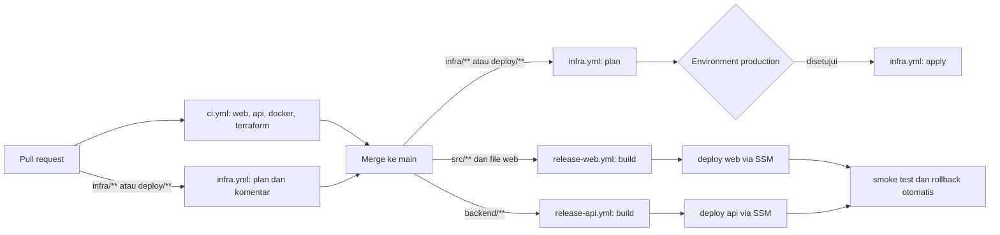

# 05 CI/CD dengan GitHub Actions

**Tujuan dokumen.** Spesifikasi pipeline lore: pembagian tugas GitHub dan AWS, pengaturan repo, empat workflow (`ci`, `infra`, `release-web`, `release-api`), variabel, rollback, dan batas gratis yang harus dijaga. Pola mengikuti `zero-to-prod` dengan perbaikan yang dijelaskan di [00-overview.md](./00-overview.md) bagian 8.

Status: terimplementasi (R2, R5, R7–R10)

## 1. Prinsip

- GitHub dulu. Build, test, push image, dan persetujuan dikerjakan oleh layanan gratis GitHub. AWS hanya menerima perintah deploy dan perubahan infra.
- Tidak ada secret GitHub untuk infra. Autentikasi ke AWS lewat OIDC ([02-iam-and-oidc.md](./02-iam-and-oidc.md)).
- Build image tidak memerlukan AWS. Job `build` hanya memakai `GITHUB_TOKEN`.
- Satu tugas roadmap satu PR. Perubahan infra hanya lewat PR dengan komentar plan.

## 2. Pembagian tugas

| Tugas | Dikerjakan oleh | Gratis? |
|---|---|---|
| Lint, type check, test, build | Actions (`ci.yml`) | Ya, runner standar di repo publik [terverifikasi: docs.github.com/en/billing/concepts/product-billing/github-actions] |
| Build dan push image | Actions dan GHCR (`release-*.yml`) | Ya, container registry saat ini gratis [terverifikasi: docs.github.com/en/billing/concepts/product-billing/github-packages] |
| Plan dan apply Terraform | Actions (`infra.yml`) dengan role OIDC | Ya (Actions). State di S3 berbiaya sen |
| Persetujuan apply | Environment `production` | Ya di repo publik [terverifikasi: docs.github.com/en/actions/how-tos/deploy/configure-and-manage-deployments/manage-environments] |
| Update dependensi | Dikelola manual (Dependabot tidak dipakai) | - |
| Deploy ke instance | Job Actions memanggil SSM Run Command | SSM Run Command gratis [belum diverifikasi] |
| Config dan secret runtime | SSM Parameter Store standard | Ya |

## 3. Pengaturan repo

| Pengaturan | Nilai |
|---|---|
| Permission `GITHUB_TOKEN` default | Read. Setiap workflow menulis `permissions:` eksplisit |
| Workflow dari fork | Wajib persetujuan untuk kontributor baru |
| `pull_request_target` | Tidak dipakai |
| Branch protection `main` | PR wajib. Force push dan penghapusan dilarang. Status check wajib: `ci / web`, `ci / api`, `ci / docker`, `ci / terraform` (verifikasi nama konteks saat mengatur) |
| Check yang TIDAK diwajibkan | `infra / plan`. Workflow dengan path filter yang tidak dipicu membuat check menggantung dan memblokir merge |
| Job yang dilewati | Job yang di-skip lewat `if` pada langkahnya tetap sukses sebagai status check. Job `api` memakai pola ini selama `backend/` belum ada |
| Environment `production` | Reviewer wajib pada job `apply`. Deployment branch hanya `main` |
| Environment `production-release` | Tanpa reviewer (Q22). Deployment branch hanya `main` |
| Dependabot | Tidak dipakai (sengaja dinonaktifkan sesuai keputusan proyek) |
| Secret scanning dan push protection | Aktif (gratis di repo publik) [belum diverifikasi] |

Branch protection di repo privat plan Free tidak tersedia [belum diverifikasi]. Environments di repo privat butuh Pro atau Team [terverifikasi: docs.github.com/en/actions/how-tos/deploy/configure-and-manage-deployments/manage-environments]. Lihat Q12.

## 4. Alur pipeline



## 5. `ci.yml`

Pemicu: `pull_request` dan `push` ke `main`. Izin: `contents: read`. `concurrency` per ref dengan `cancel-in-progress: true`.

| Job | Langkah |
|---|---|
| `web` | `actions/setup-node` dengan `node-version-file: .nvmrc` dan cache npm. `npm ci`. `npm run lint`. `npx tsc --noEmit`. `npx vitest run --testTimeout=60000`. `npm run build` dengan `AI_PROVIDER=dummy` |
| `api` | Dilewati jika `backend/` belum ada. Python 3.12 dengan cache pip. `ruff check`. `ruff format --check`. `pytest`. Service container Postgres untuk test DB nanti |
| `docker` | Build image web dan api dengan `push: false` memakai cache `type=gha`. Menangkap Dockerfile yang rusak sebelum merge |
| `terraform` | `terraform fmt -check -recursive`. `terraform init -backend=false`. `terraform validate`. Pemeriksa biaya statis (`scripts/ci/check-cost-static`, memindai file `.tf` untuk tipe resource denylist) |

Alasan `--testTimeout=60000`: test yang merender `StoryViewer` dan `CampaignPlayer` timeout acak di batas 5 detik pada full run (juga di `main` yang bersih). Dengan timeout 60 detik semuanya lulus. Mengubah `vitest.config.ts` adalah keputusan terpisah dan tidak dilakukan di sini.

Ilustrasi (potongan):

```yaml
name: ci
on:
  pull_request:
  push:
    branches: [main]
permissions:
  contents: read
concurrency:
  group: ci-${{ github.ref }}
  cancel-in-progress: true
jobs:
  web:
    runs-on: ubuntu-latest
    steps:
      - uses: actions/checkout@v4
      - uses: actions/setup-node@v4
        with:
          node-version-file: .nvmrc
          cache: npm
      - run: npm ci
      - run: npm run lint
      - run: npx tsc --noEmit
      - run: npx vitest run --testTimeout=60000
      - run: npm run build
        env:
          AI_PROVIDER: dummy
  api:
    runs-on: ubuntu-latest
    steps:
      - uses: actions/checkout@v4
      - id: detect
        run: echo "present=$([ -f backend/pyproject.toml ] && echo true || echo false)" >> "$GITHUB_OUTPUT"
      - if: steps.detect.outputs.present == 'true'
        uses: actions/setup-python@v5
        with:
          python-version: "3.12"
          cache: pip
      - if: steps.detect.outputs.present == 'true'
        working-directory: backend
        run: |
          pip install -r requirements-dev.txt
          ruff check . && ruff format --check .
          pytest -q
```

`hashFiles()` tidak dipakai di `if` tingkat job karena fungsinya tidak tersedia di sana [belum diverifikasi], jadi deteksi dilakukan di langkah pertama.

## 6. `infra.yml`

Pemicu:

- `pull_request` dan `push` ke `main` dengan filter path `infra/**`, `deploy/**`, `.github/workflows/infra.yml`.
- `workflow_dispatch` dengan input `allow_destroy` (boolean, default `false`) dan `replace` (string alamat resource untuk `-replace`, default kosong).

Izin: `contents: read`, `id-token: write`, `pull-requests: write`. `concurrency: lore-prod-infra` tanpa cancel. Terraform dipin ke 1.10.x dengan `terraform_wrapper: false`.

### 6.1 Job `plan`

Role `lore-gh-plan`. Dijalankan di PR (hanya dari repo yang sama, lihat `if` di bawah), push ke `main`, dan dispatch.

Langkah:

1. Checkout dan `aws-actions/configure-aws-credentials` dengan `role-to-assume: ${{ vars.AWS_ROLE_PLAN_ARN }}`.
2. Mask ID akun di log: ambil `aws sts get-caller-identity --query Account`, lalu `echo "::add-mask::<id>"`. Action konfigurasi kredensial biasanya sudah menyamarkan ID akun secara default [belum diverifikasi], tetapi plan Terraform memuat ARN sehingga masking eksplisit tetap dipasang.
3. `terraform fmt -check -recursive`, `terraform init -input=false`, `terraform validate`.
4. Plan dengan exit code terdeteksi:

```bash
set +e
terraform plan -detailed-exitcode -input=false -no-color -out=tfplan ${TF_REPLACE:+-replace="$TF_REPLACE"} 2>&1 | tee plan.txt
code=${PIPESTATUS[0]}
set -e
[ "$code" = "1" ] && exit 1
echo "changes=$([ "$code" = "2" ] && echo true || echo false)" >> "$GITHUB_OUTPUT"
```

5. `terraform show -json tfplan > plan.json`.
6. Pemeriksa tag (`scripts/ci/check-tags`, lihat [08-tagging.md](./08-tagging.md)) dan pemeriksa biaya (`scripts/ci/check-cost`: tipe instance, resource terlarang, ukuran volume pada `plan.json`).
7. Destroy-guard: gagalkan job jika ada aksi `delete` pada `aws_db_instance`, `aws_eip`, atau bucket, kecuali `allow_destroy` bernilai true:

```bash
jq -e '[.resource_changes[]
        | select(.change.actions | index("delete"))
        | select(.type | IN("aws_db_instance","aws_eip","aws_s3_bucket"))] | length == 0' plan.json
```

   Penggantian instance EC2 (aksi `delete` dan `create`) sengaja tidak diblokir, tetapi tercantum jelas di komentar plan.
8. Redaksi ID akun dari `plan.txt` (ganti dengan `<ACCOUNT_ID>`) sebelum diposting.
9. Komentar PR sticky (hanya `pull_request`), dengan marker `<!-- lore-tf-plan -->`: cari komentar yang diawali marker lalu update, jika tidak ada baru buat. Isi dibaca dari `plan.txt` lewat `fs` di `actions/github-script`, dipotong sekitar 60.000 karakter. Tidak ada interpolasi `${{ }}` dari output plan ke dalam JS (kelemahan `zero-to-prod`). Pakai pagar kode dengan jumlah backtick lebih banyak dari yang ada di isi plan.
10. Pada push `main` dan dispatch: unggah artifact `tfplan` (retensi 1 hari). Plan tidak memuat secret karena tfstate tidak boleh memuat secret, tetapi artifact di repo publik bisa dilihat publik (Q12).

Ilustrasi pembaca plan di `github-script`:

```javascript
const fs = require("fs");
const marker = "<!-- lore-tf-plan -->";
let plan = fs.readFileSync("infra/plan.txt", "utf8");
if (plan.length > 60000) plan = plan.slice(0, 60000) + "\n... dipotong ...";
const body = `${marker}\n### Terraform plan\n\n\`\`\`\`\n${plan}\n\`\`\`\``;
const { data: comments } = await github.rest.issues.listComments({
  owner: context.repo.owner, repo: context.repo.repo, issue_number: context.issue.number,
});
const existing = comments.find((c) => c.body && c.body.startsWith(marker));
if (existing) {
  await github.rest.issues.updateComment({
    owner: context.repo.owner, repo: context.repo.repo, comment_id: existing.id, body,
  });
} else {
  await github.rest.issues.createComment({
    owner: context.repo.owner, repo: context.repo.repo, issue_number: context.issue.number, body,
  });
}
```

Kondisi job: `if: github.event_name != 'pull_request' || github.event.pull_request.head.repo.full_name == github.repository`.

### 6.2 Job `apply`

- `needs: plan`. Jalan hanya jika `github.ref == 'refs/heads/main'`, event `push` atau `workflow_dispatch`, dan `needs.plan.outputs.changes == 'true'`.
- `environment: production` (reviewer wajib). Role `lore-gh-apply`.
- Unduh artifact `tfplan`, `terraform init`, `terraform apply -input=false tfplan`. Plan yang basi otomatis ditolak Terraform karena state sudah berubah.
- Perubahan ke `deploy/**` menyebabkan penggantian instance. Persetujuan reviewer menjadi titik untuk menyadarinya.

## 7. `release-web.yml` dan `release-api.yml`

Pemicu:

| Workflow | Path filter push ke `main` |
|---|---|
| `release-web.yml` | `src/**`, `public/**`, `package.json`, `package-lock.json`, `next.config.ts`, `tsconfig.json`, `Dockerfile`, file workflow itu sendiri |
| `release-api.yml` | `backend/**`, file workflow itu sendiri |

Keduanya juga punya `workflow_dispatch` dengan input `tag` (rollback, melewati build). `concurrency: lore-prod-deploy-<komponen>` tanpa cancel. Perubahan yang hanya menyentuh `infra/**`, `deploy/**`, `docs/**`, atau `*.md` tidak memicu rilis.

Job `build` (jalan jika `inputs.tag` kosong). Izin job: `contents: read`, `packages: write`.

1. `docker/setup-buildx-action`.
2. `docker/login-action` ke `ghcr.io` dengan `github.actor` dan `GITHUB_TOKEN`.
3. Tag `sha-${GITHUB_SHA::7}`. Nama image huruf kecil: `ghcr.io/nnaory/lore-web` atau `lore-api`.
4. `docker/build-push-action` dengan `push: true`, label OCI (`source`, `revision`, `created`), `cache-from` dan `cache-to` bertipe `gha`.
5. Output `tag` untuk job berikutnya.

Job `deploy`. Izin job: `contents: read`, `id-token: write`. Environment `production-release`. Role `lore-gh-deploy`.

1. Konfigurasi kredensial AWS.
2. Jalankan alur deploy dari [03-compute.md](./03-compute.md) bagian 7. Logikanya dipakai bersama oleh kedua workflow lewat `scripts/ci/ssm-deploy.sh <komponen> <tag>`.
3. Tag yang dipakai: `needs.build.outputs.tag`, atau `inputs.tag` pada rollback.
4. Smoke test dan rollback otomatis.

Ilustrasi (potongan `release-web.yml`):

```yaml
name: release-web
on:
  push:
    branches: [main]
    paths: ["src/**", "public/**", "package.json", "package-lock.json",
            "next.config.ts", "tsconfig.json", "Dockerfile",
            ".github/workflows/release-web.yml"]
  workflow_dispatch:
    inputs:
      tag:
        description: "Tag sha-xxxxxxx untuk rollback (melewati build)"
        required: false
        default: ""
concurrency:
  group: lore-prod-deploy-web
  cancel-in-progress: false
env:
  IMAGE: ghcr.io/nnaory/lore-web
jobs:
  build:
    if: ${{ inputs.tag == '' }}
    runs-on: ubuntu-latest
    permissions:
      contents: read
      packages: write
    outputs:
      tag: ${{ steps.meta.outputs.tag }}
    steps:
      - uses: actions/checkout@v4
      - uses: docker/setup-buildx-action@v3
      - uses: docker/login-action@v3
        with:
          registry: ghcr.io
          username: ${{ github.actor }}
          password: ${{ secrets.GITHUB_TOKEN }}
      - id: meta
        run: echo "tag=sha-${GITHUB_SHA::7}" >> "$GITHUB_OUTPUT"
      - uses: docker/build-push-action@v6
        with:
          context: .
          push: true
          tags: ${{ env.IMAGE }}:${{ steps.meta.outputs.tag }}
          labels: |
            org.opencontainers.image.source=https://github.com/${{ github.repository }}
            org.opencontainers.image.revision=${{ github.sha }}
          cache-from: type=gha
          cache-to: type=gha,mode=max
  deploy:
    needs: [build]
    if: ${{ always() && (needs.build.result == 'success' || needs.build.result == 'skipped') }}
    runs-on: ubuntu-latest
    environment: production-release
    permissions:
      contents: read
      id-token: write
    steps:
      - uses: actions/checkout@v4
      - uses: aws-actions/configure-aws-credentials@v4
        with:
          role-to-assume: ${{ vars.AWS_ROLE_DEPLOY_ARN }}
          aws-region: ${{ vars.AWS_REGION }}
      - run: scripts/ci/ssm-deploy.sh web "${{ needs.build.outputs.tag || inputs.tag }}"
        env:
          APP_URL: ${{ vars.APP_URL }}
```

Semantik `inputs` pada event `push` (kosong) dan ekspresi `needs.build.outputs.tag || inputs.tag` diverifikasi saat implementasi [belum diverifikasi].

## 8. Workflow opsional

Workflow terjadwal (cron) yang `curl` ke `APP_URL` dan membuka issue jika gagal. Gratis di repo publik dan menjadi pengganti alarm dasar tanpa CloudWatch (Q14). Tidak termasuk default.

## 9. Variabel dan secret

| Nama | Jenis | Nilai |
|---|---|---|
| `AWS_REGION` | `vars` | `ap-southeast-3` |
| `AWS_ROLE_PLAN_ARN` | `vars` | ARN `lore-gh-plan` |
| `AWS_ROLE_APPLY_ARN` | `vars` | ARN `lore-gh-apply` |
| `AWS_ROLE_DEPLOY_ARN` | `vars` | ARN `lore-gh-deploy` |
| `APP_URL` | `vars` | `http://<EIP_WEB>` atau `https://<DOMAIN>` |

Tidak ada secret GitHub untuk infra. ARN role bukan secret, tetapi `vars` repo tidak ditampilkan publik.

## 10. Dependabot (tidak dipakai)

Sesuai keputusan implementasi (Q20), `.github/dependabot.yml` sengaja **tidak** digunakan; pembaruan dependensi dikelola manual melalui PR agar tidak menghasilkan PR otomatis berkala.

## 11. Konvensi branch dan commit

- Nama branch: `infra/*`, `ci/*`, `feat/*`, `fix/*`, `docs/*`.
- Conventional Commits dengan scope: `feat(infra)`, `ci(release)`, `docs(infra)`, `fix(deploy)`.
- Kode dan test masuk di commit terpisah (konvensi repo).
- Satu tugas roadmap satu PR. Merge dengan squash.

## 12. Batas gratis yang harus dijaga

| Batas | Nilai | Sumber |
|---|---|---|
| Runner standar repo publik | Gratis | [terverifikasi: docs.github.com/en/billing/concepts/product-billing/github-actions] |
| Compute repo privat plan Free | Termasuk US$12 per bulan | [terverifikasi: docs.github.com/en/billing/concepts/product-billing/github-actions] |
| Cache Actions | 10 GB per repo | [terverifikasi: docs.github.com/en/billing/concepts/product-billing/github-actions] |
| Artifact dan Packages | 500 MB di plan Free, dibagi bersama (relevan terutama untuk repo privat) | [terverifikasi: docs.github.com/en/billing/concepts/product-billing/github-packages] |
| Paket privat | 500 MB storage dan 1 GB transfer per bulan di plan Free | [terverifikasi: docs.github.com/en/billing/concepts/product-billing/github-packages] |
| Environments di repo privat | Butuh Pro atau Team | [terverifikasi: docs.github.com/en/actions/how-tos/deploy/configure-and-manage-deployments/manage-environments] |

Jika repo berubah menjadi privat, Environments yang sudah dikonfigurasi diabaikan dan pull GHCR dari instance butuh kredensial (Q12). Cache buildx dibatasi 10 GB. Artifact `tfplan` berretensi 1 hari agar tidak memakan kuota.

## 13. Troubleshooting

| Gejala | Penyebab umum | Tindakan |
|---|---|---|
| `Not authorized to perform sts:AssumeRoleWithWebIdentity` | STS belum `v2Token` untuk region opt-in, atau `sub` tidak cocok (huruf besar atau kecil, nama Environment) | Cek `v2Token`. Cetak klaim `sub` di job "whoami" lalu samakan dengan trust policy |
| 403 saat push ke GHCR | Izin `packages: write` tidak ada, atau pengaturan "Workflow permissions" repo terlalu ketat | Periksa `permissions` di job `build` dan pengaturan repo |
| Pull dari instance ditolak (`denied`) | Paket GHCR masih privat | Ubah ke Public lewat UI paket ([03-compute.md](./03-compute.md) bagian 9) |
| Command SSM tidak menemukan target | Instance Offline di SSM (misalnya NAT mati), atau tag target salah | Cek `aws ssm describe-instance-information`. Cek status `lore-prod-nat` |
| Plan tidak muncul sebagai komentar | PR dari fork (tidak ada OIDC), atau job dilewati oleh `if` | Buat branch di repo yang sama |
| Plan gagal dengan state lock | Run apply sebelumnya masih berjalan atau file `.tflock` tertinggal | Tunggu concurrency group selesai. Hapus lock hanya setelah memastikan tidak ada run aktif |
| Caddy gagal ACME | DNS belum mengarah ke `<EIP_WEB>`, atau port 80 tertutup | Cek A record dan SG. Lihat [09-runbook.md](./09-runbook.md) |
| Deploy sukses tetapi versi tidak berubah | Parameter `image_tag` tidak terbarui, atau `docker compose pull` gagal | Baca output command SSM dan nilai parameter |
