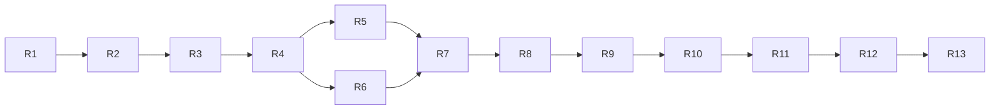

# 10 Roadmap implementasi

**Tujuan dokumen.** Memecah pekerjaan implementasi menjadi tugas R1 sampai R13. Tiap tugas punya tujuan, panduan (file yang dibuat dan dokumen rujukan), pengujian, demo yang bisa dicek, dampak biaya, dan rencana PR. Tidak ada tugas di sini yang dikerjakan oleh dokumen ini. Tugas baru dikerjakan setelah [open-questions.md](./open-questions.md) ditinjau.

Status: R1–R12 selesai (2026-11-19); R13 siap berikutnya

## 1. Prinsip

- Budget dan guardrail dibuat pertama (R1), sebelum resource berbayar mana pun.
- Infra hanya berubah lewat PR dengan komentar plan. Bootstrap (R1) satu-satunya yang dijalankan manual dari laptop.
- Resource berbiaya (NAT instance, EC2, RDS) baru dibuat saat dibutuhkan oleh tugas yang memakainya.
- Tiap tugas menghasilkan demo yang bisa dicek, dan satu tugas satu PR (R11 & R12 digabung dalam satu PR atas konfirmasi pemilik proyek).
- Kode dan test masuk di commit terpisah. Commit memakai Conventional Commits dengan scope (`feat(infra)`, `ci(release)`, `test(api)`).
- Pengujian untuk infra berupa `terraform fmt`, `validate`, dan `plan`, `shellcheck`, `docker build` dan `docker run`, vitest dan pytest, `curl`, dan perintah `aws` read-only.

## 2. Ringkasan

| ID | Tugas | Bergantung pada | Status | Biaya mulai |
|---|---|---|---|---|
| R1 | Bootstrap, budget, guardrail | - | Selesai | Sen (bucket state) |
| R2 | Skeleton Terraform dan `infra.yml` | R1 | Selesai | Tidak ada |
| R3 | Network | R2 | Selesai | Tidak ada |
| R4 | NAT instance, IAM instance, parameter SSM | R3 | Selesai | Sekitar US$8 sampai 12 per bulan (t3.micro, EBS, 1 IPv4) |
| R5 | Container web dan `ci.yml` (+ restrukturisasi `frontend/`) | R4 | Selesai | Tidak ada |
| R6 | Skeleton backend FastAPI | R4 | Selesai | Tidak ada |
| R7 | Release ke GHCR | R5, R6 | Selesai | Tidak ada |
| R8 | Instance web, Caddy, deploy | R7 | Selesai | Sekitar US$10 sampai 12 (t3.micro, EBS, 1 IPv4) |
| R9 | Instance api, deploy | R8 | Selesai | Sekitar US$8 (t3.micro, EBS) |
| R10 | RDS (`backup_retention_period=1`) dan wiring secret + Alembic | R9 | Selesai | Sekitar US$15 sampai 16 |
| R11 | Timeout AI 5 menit (`300000`) dan audit hardening | R10 | Selesai (uji sleep 270s live & Dependabot dilewati sesuai kesepakatan) | Tidak ada |
| R12 | Cek biaya baseline & laporan audit | R11 | Selesai (teardown destruktif dilewati atas persetujuan; biaya baseline di [07-cost-guardrails.md](./07-cost-guardrails.md)) | Tidak ada |
| R13 | Migrasi persistensi aplikasi | R12, Q1, Q4, Q5 | Kode dan test selesai di branch (PR 1–4), belum di-merge dan belum di-deploy | Tidak ada |

Angka biaya adalah perkiraan basis us-east-2 [belum diverifikasi], lihat [07-cost-guardrails.md](./07-cost-guardrails.md).

## 3. Tugas

### R1 Bootstrap, budget, guardrail

- **Tujuan.** Menyiapkan semua yang tidak boleh dikelola pipeline: bucket state, OIDC provider, tiga role GitHub, guardrail IAM, budget, dan anomaly monitor.
- **Panduan.**
  - File: `infra/bootstrap/bootstrap.sh` (idempotent), `infra/bootstrap/policies/*.json` (trust, izin tiga role, `lore-guardrail-deny`, `lore-deny-new-spend`, trust `lore-budgets-action`), workflow `whoami` (`workflow_dispatch`, sementara atau tetap sebagai alat diagnosa).
  - Isi dan urutan: [02-iam-and-oidc.md](./02-iam-and-oidc.md) bagian 2 sampai 5 dan [07-cost-guardrails.md](./07-cost-guardrails.md) bagian 6 dan 7.
  - Buat Environment `production` dan `production-release` (runbook langkah 5) sebelum job whoami untuk role apply dan deploy.
  - Semua resource diberi tag `ManagedBy=bootstrap`.
- **Pengujian.**
  - `shellcheck` dan `bash -n` pada script.
  - Jalankan bootstrap dua kali, hasil kedua kali tidak mengubah apa pun.
  - `aws iam simulate-principal-policy` membuktikan `ec2:RunInstances` bertipe `t3.small` dan `rds:CreateDBInstance` kelas `db.t3.small` ditolak untuk `lore-gh-apply`.
  - `aws budgets describe-budgets` dan `describe-notifications-for-budget` menampilkan dua budget dengan notifikasi yang benar.
- **Demo.** Job `whoami` men-assume tiap role dan mencetak klaim `sub` yang cocok dengan trust policy. Dua budget dan satu anomaly monitor terlihat di console.
- **Biaya.** Sen (bucket state). Budgets dan anomaly gratis.
- **PR.** `feat(infra): bootstrap state bucket, oidc roles, budgets`. Script, policy, dan workflow dalam commit kode. Bootstrap dijalankan manual dari laptop setelah PR direview.

### R2 Skeleton Terraform dan `infra.yml`

- **Tujuan.** Pipeline plan dan apply yang berfungsi pada konfigurasi minimal, termasuk pemeriksa tag, pemeriksa biaya, dan destroy-guard.
- **Panduan.**
  - File: `infra/backend.tf` (blok `terraform`, backend S3 dengan `use_lockfile = true`, provider dengan `default_tags`), `infra/variables.tf` (dengan validasi tipe instance, kelas DB, `nat_mode`), `infra/outputs.tf`, `.terraform.lock.hcl` (di-commit), `.gitignore` untuk `infra/.terraform/`, `*.tfstate*`, dan `*.tfvars` yang berisi nilai lokal.
  - `scripts/ci/check-tags`, `scripts/ci/check-cost`, `scripts/ci/check-cost-static` dengan fixture `plan.json` yang valid dan yang melanggar.
  - `.github/workflows/infra.yml` ([05-cicd.md](./05-cicd.md) bagian 6) dan `.github/dependabot.yml`.
  - Aturan repo ([05-cicd.md](./05-cicd.md) bagian 3), kecuali status check wajib pada branch protection `main`. Check itu baru dikenal GitHub setelah `ci.yml` ada, jadi diaktifkan di R5.
- **Pengujian.**
  - `terraform fmt -check`, `init`, `validate` di lokal dan CI.
  - Script pemeriksa dijalankan terhadap fixture: exit 0 untuk yang valid, exit non-nol untuk yang melanggar.
  - `shellcheck` pada script.
- **Demo.** PR dengan perubahan kecil menampilkan satu komentar plan sticky (di-update pada push berikutnya). Merge memicu job `apply` yang menunggu persetujuan Environment `production`.
- **Biaya.** Tidak ada.
- **PR.** `ci(infra): terraform plan and gated apply`. Script dan fixture dalam commit terpisah dari workflow.

### R3 Network

- **Tujuan.** VPC, subnet, route table, S3 gateway endpoint, dan security group.
- **Panduan.** `infra/network.tf` dan `infra/security.tf`, mengikuti [01-network.md](./01-network.md) bagian 1 sampai 5. Route default subnet app belum ada sampai R4. Resource Group `lore-prod` ([08-tagging.md](./08-tagging.md) bagian 6).
- **Pengujian.** `plan` ditinjau. Script `scripts/verify/network.sh` (read-only) memeriksa: CIDR VPC dan subnet, subnet data tanpa default route, endpoint S3 ada, aturan SG sesuai tabel.
- **Demo.** Setelah apply, script verifikasi lulus. Semua resource memuat tag wajib (pemeriksa tag hijau).
- **Biaya.** Tidak ada.
- **PR.** `feat(infra): vpc, subnets, routes, security groups`.

### R4 NAT instance, IAM instance, parameter SSM

- **Tujuan.** Egress privat siap sebelum ada instance yang membutuhkannya.
- **Panduan.**
  - `infra/iam.tf` (tiga role instance dan instance profile), `infra/compute.tf` (hanya `aws_instance.nat[0]`, EIP, `ignore_changes = [ami]`), `infra/user_data_nat.sh.tftpl`, `infra/ssm.tf` (parameter non-secret), route default subnet app ke ENI NAT.
  - Rujukan: [01-network.md](./01-network.md) bagian 4, [02-iam-and-oidc.md](./02-iam-and-oidc.md) bagian 6, [03-compute.md](./03-compute.md) bagian 2 dan 4.
  - Setelah tag muncul di resource, aktifkan cost allocation tag ([08-tagging.md](./08-tagging.md) bagian 5).
- **Pengujian.** `plan` ditinjau, pemeriksa biaya hijau. Setelah apply: `aws ec2 describe-instances` menunjukkan `SourceDestCheck=false`, `aws ssm describe-instance-information` menunjukkan NAT Online.
- **Demo.** Instance `lore-prod-nat` Online di SSM dan route table app mengarah ke ENI NAT.
- **Biaya.** Mulai: satu t3.micro, 8 GB EBS, dan satu IPv4 publik.
- **PR.** `feat(infra): nat instance and instance roles`.

### R5 Container web dan `ci.yml`

- **Tujuan.** Image web yang berjalan secara lokal dan CI untuk repo.
- **Panduan.**
  - `next.config.ts` (tambah `output: "standalone"`), `Dockerfile`, `.dockerignore`, `.nvmrc` (versi diambil dari versi dev yang dicek, Q15), `src/app/api/health/route.ts`, test vitest untuk health, `.github/workflows/ci.yml` (job `web`, `docker`, `terraform`, dan `api` yang dilewati selama `backend/` belum ada).
  - Rujukan: [06-app-changes.md](./06-app-changes.md) bagian 1, [05-cicd.md](./05-cicd.md) bagian 5.
  - Verifikasi masalah `cacheComponents` pada route health dan env `KEEP_ALIVE_TIMEOUT`.
- **Pengujian.** `npx vitest run --testTimeout=60000` hijau. `docker build -t lore-web:dev .`, lalu `docker run --rm -p 3000:3000 lore-web:dev` dan `curl -fsS localhost:3000/api/health`. CI hijau di PR.
- **Demo.** Container lokal menjawab 200 pada `/api/health` dan halaman utama. CI hijau.
- **Biaya.** Tidak ada.
- **PR.** `feat(web): standalone docker image and health route` dan `ci: lint, test, build, docker, terraform`. Test dalam commit terpisah dari kode.

### R6 Skeleton backend FastAPI

- **Tujuan.** Backend minimal yang bisa dibangun dan dites.
- **Panduan.** `backend/` ([06-app-changes.md](./06-app-changes.md) bagian 2): `app/main.py` dengan `/health`, `/health/db` (tanpa DB: mengembalikan 503 atau diaktifkan di R10), `/api/v1/health`. `pyproject.toml` (ruff, pytest), `requirements*.txt`, `Dockerfile` multi-stage non-root. Job `api` di `ci.yml` aktif karena `backend/pyproject.toml` ada.
- **Pengujian.** `ruff check`, `ruff format --check`, `pytest -q`. `docker build` dan `docker run`, lalu `curl` ke `/health` dan `/api/v1/health`.
- **Demo.** Container lokal menjawab 200. Job `api` hijau di CI.
- **Biaya.** Tidak ada.
- **PR.** `feat(api): fastapi skeleton with health endpoints`.

### R7 Release ke GHCR

- **Tujuan.** Image web dan api ter-publish di GHCR dengan tag `sha-*`.
- **Panduan.** `release-web.yml` dan `release-api.yml` dengan job `build` ([05-cicd.md](./05-cicd.md) bagian 7). Job `deploy` ditambahkan di R8 dan R9. Label OCI `source`. Ubah paket menjadi Public lewat UI setelah publish pertama (runbook langkah 12).
- **Pengujian.** Lint workflow dengan `actionlint` secara lokal. Setelah publish: `docker logout ghcr.io`, lalu `docker pull ghcr.io/nnaory/lore-web:sha-<7 char>`.
- **Demo.** `docker pull` anonim dari laptop berhasil untuk kedua image.
- **Biaya.** Tidak ada (paket publik gratis).
- **PR.** `ci(release): build and push images to ghcr`.

### R8 Instance web, Caddy, deploy

- **Tujuan.** Frontend tampil di internet dan ter-deploy otomatis.
- **Panduan.**
  - `deploy/web/compose.yml`, `deploy/web/Caddyfile`, `deploy/common/render-env.sh`, `deploy/common/deploy.sh`, `infra/user_data_web.sh.tftpl`, `infra/compute.tf` (web, EIP), parameter web di `infra/ssm.tf`.
  - `scripts/ci/ssm-deploy.sh`, job `deploy` di `release-web.yml`, variabel `APP_URL`.
  - Isi secret runtime manual sebelum rilis (runbook 3.5).
  - Rujukan: [03-compute.md](./03-compute.md) bagian 3 sampai 8.
- **Pengujian.** `shellcheck` pada semua script. `docker compose -f deploy/web/compose.yml config`. Validasi Caddyfile dengan `caddy validate` di container. Perbaikan `plan` ditinjau.
- **Demo.** `http://<EIP_WEB>` menampilkan frontend. Merge perubahan kecil ter-deploy otomatis dengan smoke test hijau. Rollback lewat `workflow_dispatch` dengan tag sebelumnya berhasil. `/api/v1/*` memberi 502 sampai R9 (normal).
- **Biaya.** Mulai: satu t3.micro, 12 GB EBS, dan satu IPv4 publik.
- **PR.** `feat(infra): web instance with caddy` dan `ci(release): deploy web via ssm`.

### R9 Instance api, deploy

- **Tujuan.** Backend berjalan di subnet privat dan dijangkau lewat Caddy.
- **Panduan.** `deploy/api/compose.yml`, `infra/user_data_api.sh.tftpl`, instance api dengan IP `10.20.10.10`, parameter api, job `deploy` di `release-api.yml`. `deploy.sh api` memeriksa `/health/db` hanya jika `PGHOST` terisi.
- **Pengujian.** `shellcheck`, `docker compose config`, `plan`.
- **Demo.** `curl "$APP_URL/api/v1/health"` mengembalikan 200 lewat Caddy. Dari api via SSM, `curl https://checkip.amazonaws.com` mengembalikan `<EIP_NAT>`, membuktikan egress lewat NAT.
- **Biaya.** Mulai: satu t3.micro dan 12 GB EBS.
- **PR.** `feat(infra): api instance` dan `ci(release): deploy api via ssm`.

### R10 RDS dan wiring secret

- **Tujuan.** Database persisten terhubung ke api.
- **Panduan.** `infra/database.tf` ([04-database.md](./04-database.md) bagian 1), parameter `PG*` dan `db_secret_arn`, izin `secretsmanager:GetSecretValue` pada role api, `render-env.sh` untuk `PGUSER` dan `PGPASSWORD`. Di backend: koneksi pool kecil, `/health/db`, inisialisasi Alembic dengan migrasi awal kosong dan service `migrate`.
- **Pengujian.** pytest dengan service container Postgres di CI. Migrasi dijalankan dari kosong. Guardrail diuji (`db.t3.small` ditolak).
- **Demo.** `/health/db` ok via SSM. `psql` lewat port-forward berhasil. Drill restore snapshot berhasil dan instance sementara dihapus.
- **Biaya.** Mulai: RDS `db.t3.micro` dengan 20 GB gp3 dan satu secret.
- **PR.** `feat(infra): rds postgres` dan `feat(api): database connection and migrations`.

### R11 Timeout AI 5 menit dan hardening

- **Tujuan.** Timeout 5 menit bekerja dari ujung ke ujung dan semua hardening terpasang.
- **Panduan.**
  - Ubah default di `src/lib/ai/providers/gemini-client.ts` (`30_000` dan `90_000` menjadi `300_000`) dan `.env.example`. Parameter SSM `AI_TIMEOUT_MS` dan `AI_DEADLINE_MS` sudah bernilai `300000`.
  - Tambahkan test vitest untuk pembacaan konfigurasi env (kode dan test commit terpisah).
  - Putuskan Q11: deadline, margin terhadap timeout undici, dan `thinkingConfig`.
  - Uji ujung ke ujung dengan endpoint debug sementara yang menahan respons lebih dari 4 menit (aktif hanya lewat env dan dihapus setelah uji).
  - Audit hardening: `ignore_changes = [ami]` pada tiga instance, destroy-guard aktif, `.terraform.lock.hcl` ter-commit, Dependabot aktif, IMDSv2 hop limit 1, tfstate tidak memuat secret (cari nilai uji di `terraform state pull`), keluaran log tidak memuat secret.
- **Pengujian.** Test timeout terhadap server tiruan yang menunda respons. `curl --max-time 330 "$APP_URL/api/v1/debug/sleep?seconds=270"` lewat Caddy berhasil tanpa 502 atau 504.
- **Demo.** Request panjang lewat Caddy selesai tanpa terputus. Daftar audit hardening seluruhnya centang.
- **Biaya.** Tidak ada.
- **PR.** `feat(ai): five minute default timeout` (kode), `test(ai): timeout config` (test), `chore(infra): hardening audit`.

### R12 Drill teardown dan rebuild, cek biaya

- **Tujuan.** Membuktikan seluruh lingkungan bisa dibongkar dan dibangun ulang, dan biaya sesuai.
- **Panduan.** Jalankan teardown ([09-runbook.md](./09-runbook.md) bagian 4) tanpa menghapus bootstrap, lalu bangun ulang lewat pipeline. Catat durasi dan masalah. Setelah 7 hari berjalan, bandingkan biaya nyata di Cost Explorer (filter `Component`) dengan estimasi dan Budget.
- **Pengujian.** Daftar verifikasi sisa teardown kosong. Setelah rebuild, instance naik langsung di tag rilis terakhir.
- **Demo.** Lingkungan kembali berjalan dari nol. Laporan biaya 7 hari dicatat di [07-cost-guardrails.md](./07-cost-guardrails.md).
- **Biaya.** Biaya normal selama drill. Data RDS hilang saat teardown, jadi drill dilakukan sebelum ada data nyata.
- **PR.** `docs(infra): teardown drill results and cost report`.

### R13 Migrasi persistensi aplikasi

- **Tujuan.** Memindahkan penyimpanan project, story, dan campaign state dari IndexedDB ke FastAPI + PostgreSQL, dengan IndexedDB tetap sebagai cache lokal. Pipeline AI tidak termasuk (tetap di Next.js, lihat Q5).
- **Panduan.** Spesifikasi di `.kiro/specs/r13-persistence-migration/` (`requirements.md`, `design.md`, `tasks.md`, ringkasan per task di `summaries/`). Hasil akhir diringkas di [06-app-changes.md](./06-app-changes.md) bagian 4 dan [04-database.md](./04-database.md) bagian 7-8.
- **Status (21 Nov 2026).** Semua task kode dan test selesai dan di-push ke branch; belum ada yang di-merge ke `main` dan belum ada yang di-deploy.

  | PR | Branch | Isi | Catatan saat merge |
  |---|---|---|---|
  | 1 `feat(api)` | `feat/r13-api` | T0-T11: migrasi `7c1d9e4a52b8`, cookie, rate limiter, router, batas | `release-api.yml` menjalankan `migrate` lalu deploy api |
  | 2 `feat(infra)` | `feat/r13-infra` | T12: `request_body max_size 5MB` di Caddyfile | **Mengganti instance web** (downtime singkat, butuh approval `production`) |
  | 3 `feat(state)` | `feat/r13-state` | F1-F8: repository, `HttpRepository`, sync check, flag build | Flag tetap `idb`; perilaku pengguna tidak berubah |
  | 4 `docs(infra)` | `feat/r13-docs` | D1: dokumen ini, Q4, Q5, roadmap | Tidak ada efek runtime |
  | 5 `ci(release)` | belum dibuat | D5: build web dengan `NEXT_PUBLIC_PROJECT_STORE=http` | **Ini saklar ke production** |

- **Pengujian.** Backend: pytest dengan Postgres 16 (108 test). Frontend: vitest (`tests/state/*` untuk repository, sync, mode http, banner error, dan contract test). Smoke test di lingkungan deploy (D3) dan cek perilaku Caddy (D4) dilakukan setelah PR 1 dan PR 2 di-deploy.
- **Demo.** Setelah cutover (D5): project yang sudah ada di IndexedDB terimport otomatis saat beranda dibuka, progres tersimpan ke server, dan tetap bisa dibuka setelah IndexedDB dikosongkan.
- **Biaya.** Tidak ada tambahan (tidak ada perubahan ukuran instance, IOPS, storage, atau retensi).
- **Catatan.** Tiga test di `frontend/tests/ai/provider-cache.test.ts` (dari commit `85a997e` di `chore/kiro-config`) gagal karena perilaku yang diuji belum diimplementasikan; tidak terkait R13, tetapi membuat `ci/web` merah di semua branch R13 sampai diperbaiki.

## 4. Risiko dan mitigasi

| Risiko | Dampak | Mitigasi |
|---|---|---|
| NAT instance mati | Api kehilangan egress dan SSM | `replace` lewat `infra.yml` ([09-runbook.md](./09-runbook.md)). Diterima di fase ini |
| Perubahan `deploy/**` mengganti instance | Downtime beberapa menit, sertifikat Caddy diterbitkan ulang | Lewat PR dan persetujuan. Opsi volume data (Q18) |
| State Caddy hilang saat replace | Rate limit penerbitan sertifikat | Hindari replace berulang. Pakai volume data bila sering |
| Deploy ke versi dengan kontrak API berbeda | Frontend dan backend tidak cocok | Rilis api lebih dulu, perubahan backward-compatible (expand dan contract) |
| Kuota GitHub terlampaui (jika repo menjadi privat) | Pipeline berhenti, pull GHCR gagal | Pantau kuota ([07-cost-guardrails.md](./07-cost-guardrails.md) bagian 9). Q12 |
| Lonjakan biaya | Tagihan di atas budget | Lima lapis guardrail dan ritual mingguan |
| Secret masuk tfstate | Role plan bisa membacanya | Secret tidak pernah dikelola Terraform. Audit di R11 |
| Plan dan log di repo publik membuka detail infra | ARN dan ID akun terlihat publik | Masking ID akun dan redaksi plan ([05-cicd.md](./05-cicd.md) bagian 6). Q12 |
| Guardrail menolak perubahan yang sah | Pipeline gagal dengan `AccessDenied` | Ubah batas lewat bootstrap dengan PR terpisah, bukan melonggarkan role apply |
| Timeout 5 menit tidak tembus di salah satu lapisan | Request putus sebelum selesai | Tabel lapisan di [06-app-changes.md](./06-app-changes.md) bagian 3.3 dan uji ujung ke ujung di R11 |
