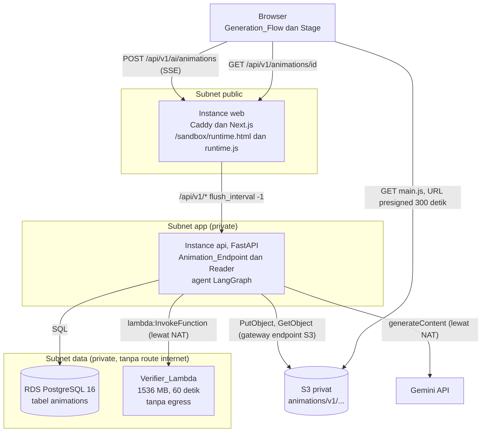
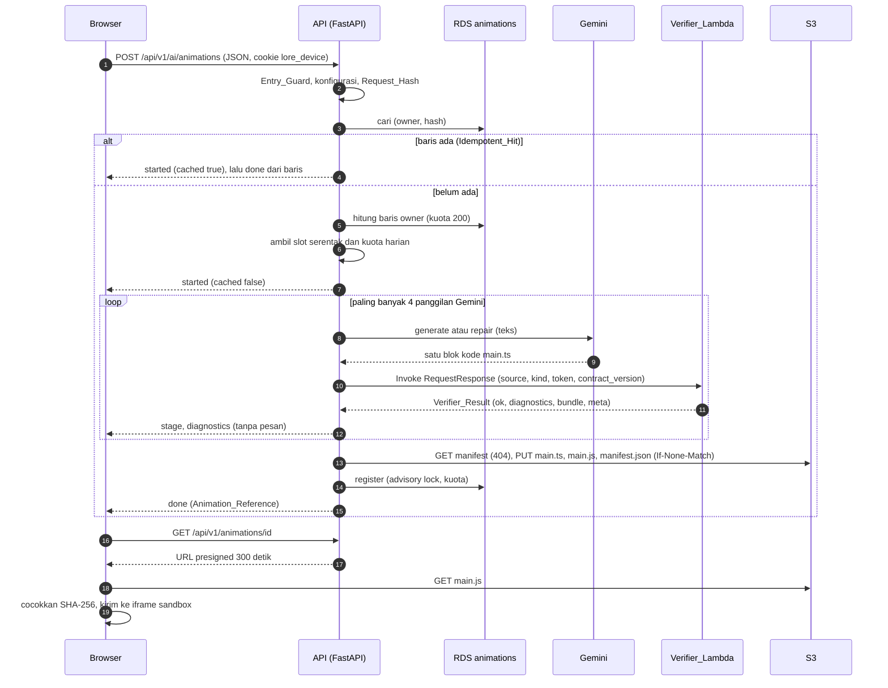

# 12 Animasi Remotion buatan AI

**Tujuan dokumen.** Satu tempat untuk memahami, merilis, mengoperasikan, dan memecahkan masalah fitur animasi Remotion buatan AI: arsitektur, kontrak, env, protokol, penyimpanan, infra dan IAM, urutan rilis, runbook, langkah manual admin, daftar periksa browser, biaya, risiko, dan tabel pemecahan masalah. Spesifikasinya ada di `.kiro/specs/ai-remotion-animation/` (`requirements.md`, `design.md`, `tasks.md`). Kode adalah sumber kebenaran: bila dokumen ini berbeda dari kode, kodenya yang benar dan dokumen ini diperbaiki.

Dokumen ini tidak memuat id akun AWS, key, atau URL presigned asli. Id akun ditulis `<ACCOUNT_ID>`. Harga atau perilaku AWS yang belum terbukti diberi `[belum diverifikasi]`, seperti dokumen lain di folder ini.

## Tujuan dan status

Tujuan: AI menulis satu berkas Remotion `main.ts` untuk sebuah langkah pelajaran (`lesson`) atau puzzle. Sebuah agent memeriksa berkas itu (ukuran, kebijakan AST, ESLint, `tsc`, bundle, uji render, kesetiaan data) dan meminta AI memperbaikinya sampai lolos atau gagal dengan kode yang jelas. Berkas yang lolos disimpan di S3 privat. Frontend mengambilnya lewat URL presigned lalu menjalankannya di iframe bersandbox yang terkunci CSP, di kanvas Stage. Jalur lama (JSON `visual` yang digambar komposisi buatan manusia) tetap ada sebagai `Fallback_Scene` untuk setiap kegagalan jalur baru, sehingga cerita selalu bisa dimainkan.

Status:

- Kode fitur sudah ditulis (verifier, backend, frontend, infra, CI) dan diuji dengan fake (Gemini, Lambda, S3, iframe) di sandbox tanpa jaringan. Belum di-merge ke `main` dan belum dirilis.
- Default aman: `ANIMATION_ENABLED=false` di api (Flag_Api) dan `NEXT_PUBLIC_ANIMATIONS=off` di web (Flag_Web). Selama keduanya begitu, perilaku production tidak berubah dan api tidak mengimpor `langgraph` atau `boto3`.
- Banyak hal hanya bisa dibuktikan online atau di akun AWS dan browser asli. Daftarnya ada di bagian "Langkah manual admin" (subbagian "Verifikasi yang belum dijalankan"). Selama daftar itu belum selesai, fitur tidak boleh dinyalakan.
- Estimasi biaya kotor tanpa free tier Lambda melewati US$5 per bulan. PR infra pertama tidak boleh di-merge tanpa persetujuan pengguna (bagian "Biaya").

Istilah yang dipakai:

| Istilah | Arti |
|---|---|
| Flag_Api | env `ANIMATION_ENABLED` di api. Hanya nilai `true` (huruf besar-kecil bebas) yang menyalakan fitur |
| Flag_Web | build arg `NEXT_PUBLIC_ANIMATIONS`. Hanya nilai persis `on` yang menyalakan fitur di web |
| Main_File | berkas `main.ts` tulisan AI |
| Verifier_Lambda | fungsi Lambda `lore-prod-animation-verifier` (container image Node 22) |
| Animation_Reference | pointer kecil di cerita (`animation_id`, dua hash, ukuran, durasi) |
| Fallback_Scene | scene `visual` JSON lama yang dipakai bila animasi gagal atau fitur mati |
| Owner | pemilik data anonim = cookie `lore_device` |

## Arsitektur



Komponen baru dan alasannya:

| Komponen | Lokasi | Alasan |
|---|---|---|
| Verifier | `animation-verifier/` (Node/TypeScript, Lambda container image) | Kode tulisan AI tidak dijalankan di api. Lambda terpisah tanpa egress dan tanpa secret membatasi dampak kode jahat. Pemeriksaan butuh `tsc`, ESLint, esbuild, dan jsdom yang terlalu besar untuk instance api 1 GiB |
| Agent dan endpoint | `backend/app/ai/animation/` | Graf `generate -> verify -> repair -> publish/fail`, batas 4 panggilan Gemini, deadline 240 detik, SSE |
| Registry | tabel `animations` (Alembic `725515cc1581`) | Idempotensi per Owner dan kuota 200 per Owner |
| Penyimpanan | bucket S3 `lore-prod-animations-<ACCOUNT_ID>` | Objek immutable. Browser mengunduh langsung lewat URL presigned, jadi api tidak melayani bundle |
| Sandbox | `frontend/sandbox-runtime/` dan `frontend/scripts/` (build ke `public/sandbox/`) | Satu-satunya tempat bundle AI dieksekusi di browser: iframe `sandbox="allow-scripts"` tanpa `allow-same-origin`, CSP `default-src 'none'` |
| Frontend | `frontend/src/lib/animation/`, `frontend/src/components/animation/` | Tahap `animating` di generation, klien SSE, loader dengan cek SHA-256, scene `animation` di Stage |
| Kontrak | `animation-verifier/contract/animation-contract.json` | Satu sumber kebenaran. Salinan byte-identik di `backend/app/ai/animation/` dan `frontend/src/lib/animation/` dijaga `scripts/sync-animation-contract.py --check` |

Keputusan penting:

- **SSE, bukan JSON biasa.** Satu animasi bisa makan sampai 4 menit. Stream memberi progres dan `: ping` tiap 15 detik. Caddy sudah memakai `flush_interval -1` untuk `/api/v1/*` dan header `Cache-Control: no-store, no-transform` mencegah kompresi, jadi `deploy/**` tidak diubah.
- **Lambda dua kali apply.** Fungsi container image tidak bisa dibuat sebelum image ada di ECR. Terraform membuat Lambda hanya bila `animation_verifier_image_tag` terisi.
- **Batas serentak di api, bukan di Lambda.** Akun baru bisa punya kuota eksekusi serentak kecil sehingga `reserved_concurrent_executions` ditolak. Batasnya `ANIMATION_MAX_CONCURRENT_GLOBAL`.
- **Impor tertunda.** `langgraph` dan `boto3` hanya dimuat saat run animasi pertama. Dengan flag mati, memori tambahan nol secara desain (ditegaskan tes subproses).

## Alur data



Langkah rinci:

1. Setelah cerita selesai ditulis, tahap `animating` memilih sampai 4 target (langkah pelajaran lebih dulu, lalu puzzle) dan membuat satu request per target. Nilai `NEXT_PUBLIC_ANIMATIONS` bukan `on` berarti tahap ini dilewati tanpa request.
2. `POST /api/v1/ai/animations` melewati `entry_guard` bersama (rate per menit, batas body 64 KiB, JSON, model request, key Gemini), lalu pemeriksaan konfigurasi animasi, pencarian idempoten, kuota 200 per Owner, slot serentak, dan kuota harian. Request yang ditolak dijawab envelope JSON non-200 dan tidak memakai Gemini, Lambda, S3, slot, atau kuota harian.
3. Agent memanggil Gemini (mode teks, `max_output_tokens` 12000, temperatur 0,3 untuk `generate` dan 0,2 untuk `repair`), mengekstrak satu blok kode, lalu memanggil Verifier_Lambda. Teks materi dan cerita masuk prompt sebagai blok data dengan penanda yang dinetralkan.
4. Verifier menjalankan tujuh langkah: ukuran dan encoding, kebijakan AST, ESLint, `tsc`, bundle esbuild, uji render di Worker (`vm` dan jsdom, tanpa jaringan), dan gerbang kesetiaan (teks dan angka dari request harus muncul, jawaban terlarang tidak boleh tampil sebelum `pauseAtFrame`).
5. Gagal: diagnostics (maksimal 50) dipakai untuk prompt `repair` pada percobaan berikut. Berhenti dengan galat bila percobaan habis, waktu habis, atau verifier tidak tersedia (tanpa memakai Gemini lagi).
6. Lolos: Animation_Store menulis `main.ts`, `main.js`, lalu `manifest.json` (terakhir, bersyarat `If-None-Match: *`), lalu registry menyisipkan baris. Event `done` membawa Animation_Reference.
7. Saat cerita dimainkan, `AnimationScene` menampilkan Fallback_Scene dulu, memuat bundle lewat Reader, mencocokkan SHA-256 dengan referensi, memasang iframe tersembunyi, dan baru menukar ke animasi setelah runtime mengirim `loaded`.
8. Pemain menjawab puzzle di mesin game seperti biasa. Animasi berhenti di `pause_at_frame` dan hanya jalan lagi setelah jawaban benar. Benar atau salah selalu ditentukan `validateMultipleChoice`, tidak pernah oleh animasi.
9. Kegagalan di fase mana pun (loader, sandbox, timeout, `error` dari runtime) mengembalikan Fallback_Scene tanpa mengubah HP, pilihan jawaban, atau hasil validasi.

## Kontrak

**Animation_Contract** (`animation-verifier/contract/animation-contract.json`, `contract_version` 1) memuat semua angka dan daftar yang dipakai verifier, backend (prompt), dan runtime sandbox. Menyunting salah satu salinan tanpa menyalin ke yang lain menggagalkan job CI `contracts`.

| Isi kontrak | Nilai |
|---|---|
| Nama berkas | `main.ts`, UTF-8 tanpa BOM, tanpa JSX (elemen lewat `createElement`) |
| Kanvas | 1280 x 720, 30 fps |
| `durationInFrames` | bilangan bulat 30 sampai 900 |
| `pauseAtFrame` | wajib untuk `puzzle` (1 sampai `durationInFrames - 1`), dilarang untuk `lesson` |
| Ekspor | hanya `export const meta` (literal numerik) dan `export default function Main()` tanpa parameter |
| Impor | hanya `react` (`createElement`, `Fragment`, `useMemo`) dan `remotion` (`AbsoluteFill`, `Sequence`, `Series`, `Freeze`, `Easing`, `interpolate`, `spring`, `random`, `useCurrentFrame`, `useVideoConfig`) |
| Batas | sumber 32768 byte, bundle 131072 byte, 600 elemen DOM, 2000 ms per frame, deadline verifier 50000 ms, Diagnostic maksimal 50 |
| Warna | hanya `var(--color-<token>)` untuk sembilan token Kit (`ink`, `smoke`, `gold`, `ember`, `cream`, `muted`, `ink-soft`, `candle`, `candle-ink`) dan kata kunci `transparent`, `currentColor`, `none`, `inherit` |
| Font | `var(--font-display)` dan `var(--font-mono)`. Font lain hanya memberi peringatan `ESLINT_LORE_KIT_STYLE` |
| Terlarang | `eval`, `fetch`, `window`, `document`, `Date`, `Math.random`, `setTimeout`, `import()`, `constructor`, elemen `img`/`video`/`iframe`/`script`, atribut `src`/`href`/`on*`, URL dengan skema apa pun, `url(`, `animate*` SVG, kunci gaya `animation*` dan `transition*` |

Keluaran Main_File hanya boleh bergantung pada nomor frame dari `useCurrentFrame()` dan konstanta di berkas. Gaya Kit (sudut membulat, bayangan, gradient, blur, emoji) hanya memberi peringatan, bukan galat.

**Request ke verifier** (payload Lambda, tepat lima kunci): `source`, `kind` (`lesson` atau `puzzle`), `required_tokens`, `forbidden_tokens`, `contract_version`. **Hasil**: `{ok, diagnostics[], summary}` ditambah `bundle` dan `meta` bila `ok` true. Tiap Diagnostic: `tool`, `code`, `severity`, `line?`, `column?`, `message` (maksimal 200 karakter). Kode berawalan `SIZE`, `ENCODING`, `POLICY`, `META`, `ESLINT`, `TSC`, `BUNDLE`, `RENDER`, `FIDELITY`, `VERIFIER` (dari verifier) atau `AGENT` (dari agent backend). Kode `VERIFIER_*` berarti verifier sendiri yang bermasalah, bukan kode AI.

**Request ke api** (`CreateAnimationRequest`): `kind`, `title` (1 sampai 200 unit UTF-16 setelah trim), `text` (1 sampai 2000), `concepts` (maksimal 5, masing-masing maksimal 80), `visual` (salah satu dari lima jenis `LessonVisual`), `language` (`en` atau `id`), `forbidden_tokens` (maksimal 8, masing-masing maksimal 80, hanya untuk `puzzle`). Request_Hash = SHA-256 dari JSON kanonik (kunci terurut, tanpa spasi, `2.0` sama dengan `2`, tanpa normalisasi Unicode) ditambah `contract_version`. Request yang identik dari Owner yang sama dijawab dari registry tanpa Gemini, Lambda, atau S3.

**Animation_Reference** (disimpan di cerita; `pause_at_frame` dihilangkan, bukan `null`, bila tidak ada):

```json
{
  "animation_id": "3f8e2b1c-6d4a-4e5f-9a7b-0c1d2e3f4a5b",
  "source_sha256": "<64 heksadesimal huruf kecil>",
  "bundle_sha256": "<64 heksadesimal huruf kecil>",
  "width": 1280, "height": 720, "fps": 30,
  "duration_in_frames": 210,
  "pause_at_frame": 180,
  "contract_version": 1
}
```

Di cerita, `learning_info.animation` tidak boleh punya `pause_at_frame` dan `puzzle.animation` wajib punya. Nilai `animation` yang tidak valid dibuang tanpa menggagalkan blok atau puzzle (sama seperti `visual`), dan cerita lama tanpa `animation` tetap valid. `generate-story` tidak pernah mengeluarkan `animation`.

**Reader** (`GET /api/v1/animations/{animation_id}`): respons 200 `{"ok": true, "data": {"animation", "manifest", "urls": {"bundle", "manifest"}, "expires_in": 300}}` dengan `Cache-Control: no-store`. `manifest` hanya ringkasan (`contract_version`, `runtime_version`, `source_bytes`, `bundle_bytes`, `meta`, `verifier_version`, `model`, `attempts`). Id yang bukan UUID, tidak ada, atau milik Owner lain dijawab 404 `{"detail": "animation not found"}` yang identik byte demi byte. Batas 429 `{"detail": "rate limit exceeded"}` memakai `limit_ip` yang sama dengan endpoint projects.

## Variabel lingkungan

Nilai env masuk container lewat `.env` yang dirender `render-env.sh` dari parameter SSM `/lore/prod/api/env/*` saat deploy api. Mengubah parameter SSM tanpa redeploy api tidak berpengaruh. Setelah itu, flag, bucket, nama fungsi, region, `ANIMATION_MAX_ATTEMPTS`, dan `ANIMATION_DEADLINE_MS` dibaca pada setiap request, sedangkan empat batas limiter (`ANIMATION_RATE_PER_MINUTE_IP`, `ANIMATION_DAILY_PER_IP`, `ANIMATION_MAX_CONCURRENT_PER_IP`, `ANIMATION_MAX_CONCURRENT_GLOBAL`) dibaca sekali saat proses api start.

| Env | Default | Diset oleh | Arti |
|---|---|---|---|
| `ANIMATION_ENABLED` | `false` | Terraform (`var.animation_enabled`, parameter terpisah dengan `precondition`) | Flag_Api. Hanya teks `true` (huruf besar-kecil bebas) yang menyalakan fitur |
| `ANIMATION_BUCKET` | `lore-prod-animations-<ACCOUNT_ID>` | Terraform | Bucket S3 animasi. Kosong berarti fitur tidak terkonfigurasi |
| `ANIMATION_VERIFIER_FUNCTION` | `lore-prod-animation-verifier` | Terraform | Nama fungsi Lambda (diisi juga selagi fungsi belum dibuat). Reader sengaja tidak memeriksanya |
| `AWS_REGION` | `ap-southeast-3` | Terraform (`var.region`) | Region klien `boto3`. Wajib karena `boto3` membaca `AWS_DEFAULT_REGION`, bukan `AWS_REGION`, jadi kode memberi `region_name` eksplisit |
| `ANIMATION_RATE_PER_MINUTE_IP` | 4 | Terraform | Request per menit per IP. Batas per Owner memakai angka yang sama. Dihitung untuk setiap request, termasuk yang gagal validasi dan Idempotent_Hit |
| `ANIMATION_DAILY_PER_IP` | 30 | Terraform | Run per hari UTC per IP. Hanya run yang benar-benar dimulai yang dihitung |
| `ANIMATION_MAX_CONCURRENT_PER_IP` | 1 | Terraform | Run animasi serentak per IP |
| `ANIMATION_MAX_CONCURRENT_GLOBAL` | 2 | Terraform | Run animasi serentak di satu proses api. Turunkan ke 1 bila RSS melewati 600 MiB |
| `ANIMATION_MAX_ATTEMPTS` | 4 | Terraform | Panggilan Gemini per run. 1 sampai 4 dipakai apa adanya, di atas 4 menjadi 4 |
| `ANIMATION_DEADLINE_MS` | 240000 | Terraform | Deadline total run. Dijepit ke 1 sampai 240000 (di bawah batas Caddy 330 detik) |
| `AI_ANIMATION_MODEL` | tidak diset | tidak dibuat Terraform | Opsional. Daftar model dipisah koma, dicoba berurutan. Kosong berarti jatuh ke `AI_MODEL`, lalu `gemini-3.5-flash-lite` |
| `NEXT_PUBLIC_ANIMATIONS` | `off` | variabel repositori GitHub `NEXT_PUBLIC_ANIMATIONS`, build arg `release-web` | Flag_Web, dibaca saat build. Hanya persis `on` yang menyalakan. `ON`, `true`, `1`, dan kosong dibaca `off` |

Aturan baca nilai angka: hanya string digit ASCII bernilai 1 atau lebih (setelah trim) yang sah. Tanda `+`, pemisah `_`, desimal, digit non-ASCII, nol, dan teks kosong memakai default. Parser ini sengaja bukan `_positive_int` dari `limits.py` karena `int()` Python menerima bentuk-bentuk tadi.

Env lama yang tetap berlaku: `GOOGLE_API_KEY` (atau `GEMINI_API_KEY`), `AI_PROVIDER=google`, `AI_MODEL`, `AI_TIMEOUT_MS`, `AI_DEADLINE_MS`. Timeout satu panggilan Gemini untuk animasi dijepit ke yang terkecil dari `AI_TIMEOUT_MS`, `AI_DEADLINE_MS`, dan sisa waktu run. Verifier_Lambda tidak punya env dari Terraform dan Worker render dijalankan dengan `env: {}`.

Menyetel `AI_ANIMATION_MODEL`: lewat PR (tambahkan ke `animation_ssm_params` di `infra/animation.tf`) atau manual sebagai parameter `String` di `/lore/prod/api/env/AI_ANIMATION_MODEL` dengan tag `ManagedBy=manual` seperti secret lain, lalu redeploy api. Tidak ada kebutuhan untuk menyetelnya sebelum ada bukti bahwa model default kurang baik untuk kode Remotion.

Frontend: `frontend/.env.example` memuat `NEXT_PUBLIC_ANIMATIONS=off` beserta komentar syarat `on`. `frontend/Dockerfile` memuat `ARG NEXT_PUBLIC_ANIMATIONS=off` diikuti `ENV NEXT_PUBLIC_ANIMATIONS=${NEXT_PUBLIC_ANIMATIONS}`. Nilai ini ikut ke bundle klien saat `next build`, jadi mengubahnya butuh build baru.

## Protokol SSE

Request: `POST /api/v1/ai/animations`, body JSON `CreateAnimationRequest`, cookie `lore_device` ikut otomatis. Request yang lolos semua pemeriksaan dijawab HTTP 200 dengan `Content-Type: text/event-stream; charset=utf-8`, `Cache-Control: no-store, no-transform`, dan `X-Accel-Buffering: no`. Request yang ditolak sebelum stream dijawab envelope JSON non-200 (`{"ok": false, "error": {"code", "message", "detail"}}`), bukan `text/event-stream`.

Setiap event: `event: <nama>`, `data: <JSON satu baris>`, baris kosong. JSON tanpa baris baru, karakter non-ASCII tidak di-escape, maksimal 8192 byte per event. Komentar `: ping` ditulis tiap 15 detik tanpa penulisan lain, tidak pernah setelah event akhir. Klien mengabaikan komentar dan boleh menerima pemisah `\n`, `\r\n`, atau `\r`.

| Event | Payload | Kapan |
|---|---|---|
| `started` | `{max_attempts, deadline_ms, cached}` | Paling awal, tepat sekali |
| `stage` | `{stage, attempt}`, `stage` salah satu dari `generating`, `verifying`, `repairing`, `publishing` | Per percobaan: `generating` (1) atau `repairing` (lebih dari 1), lalu `verifying`, lalu `publishing` hanya setelah `ok` true |
| `diagnostics` | `{attempt, ok, error_count, warning_count, items}`, `items` maksimal 10 `{tool, code, line?}` tanpa pesan | Setelah setiap verifikasi, atau satu event `{tool: "agent", code}` bila verifier dilewati |
| `done` | `{animation, cached, attempts}` | Akhir sukses |
| `error` | `{code, message, attempts}`, `message` kalimat tetap per kode | Akhir gagal |

Aturan:

- Tepat satu event akhir (`done` atau `error`) dan tidak ada event sesudahnya. Event akhir tiba paling lambat `deadline_ms` ditambah 10000 ms setelah `started`. Klien membatasi setiap target 270000 ms.
- Idempotent_Hit: hanya `started` (`cached: true`) lalu `done` (`cached: true`, `attempts` dari baris registry). Tanpa `stage`.
- `error.code` dari himpunan tertutup: `ANIMATION_VERIFICATION_FAILED`, `ANIMATION_TIMEOUT`, `ANIMATION_VERIFIER_UNAVAILABLE`, `ANIMATION_STORAGE_FAILED`, `ANIMATION_QUOTA_EXCEEDED`, `PROVIDER_UNAVAILABLE`, `RATE_LIMITED`, `UNKNOWN`. Arti dan tindakannya ada di tabel pemecahan masalah.
- Tidak ada kode sumber, prompt, token, key, nilai cookie, URL presigned, atau pesan Diagnostic di event mana pun.
- Klien putus: agent dibatalkan, slot serentak dilepas, tidak ada unggahan S3 atau penyisipan registry sesudahnya, dan stream berhenti menulis.
- Fixture bersama `backend/tests/fixtures/animation/sse-stream.txt` (termasuk `: ping`, karakter non-ASCII, dan `\r\n`) dibaca tes backend dan frontend. Parser tidak boleh memakai `str.splitlines()` karena U+2028 sengaja ada di fixture.

## Tata letak S3

Bucket: `lore-prod-animations-<ACCOUNT_ID>` (`ap-southeast-3`). Privat penuh, tanpa versioning, tanpa ACL, tidak pernah dihapus atau dikosongkan oleh aplikasi.

```
animations/v1/<dua heksadesimal pertama source_sha256>/<source_sha256>/main.ts
animations/v1/<dua heksadesimal pertama source_sha256>/<source_sha256>/main.js
animations/v1/<dua heksadesimal pertama source_sha256>/<source_sha256>/manifest.json
```

| Objek | Isi | Content-Type |
|---|---|---|
| `main.ts` | sumber yang sudah dinormalkan | `text/typescript; charset=utf-8` |
| `main.js` | bundle CommonJS hasil verifier (maksimal 131072 byte) | `application/javascript; charset=utf-8` |
| `manifest.json` | `schema_version` 1, `contract_version`, `runtime_version` (`react`, `remotion`), dua hash, dua ukuran, `meta`, `verification` (versi verifier, `checks`, `warnings`), `skipped_tokens`, `model`, `attempts`, `request_hash`, `created_at` (UTC, akhiran `Z`) | `application/json; charset=utf-8` |

Aturan tulis:

- Kunci ditentukan oleh `source_sha256` (SHA-256 byte UTF-8 sumber ternormalisasi), jadi dua run yang menerbitkan sumber sama memakai objek yang sama. `bundle_sha256` dihitung atas byte UTF-8 teks bundle.
- Urutan: baca `manifest.json` dulu (hanya 404 berarti belum ada), lalu `main.ts`, `main.js`, dan `manifest.json` paling akhir. Ada manifest berarti dua objek lain ada.
- Setiap `PutObject` memakai checksum SHA-256 dan `If-None-Match: *`. Jawaban 412: baca ulang manifest dan adopsi bila ada, atau bandingkan SHA-256 objek yang ada. Jawaban 409: ulang sekali. Jawaban 501 untuk header itu: pakai `head_object` sebelum menulis. Penulisan bersyarat di `ap-southeast-3` `[belum diverifikasi]` sampai langkah O-7.
- Aplikasi tidak pernah memanggil `delete_object`, menimpa objek, atau mendaftar isi bucket. Tidak ada kedaluwarsa objek (immutable dan dirujuk registry). Satu-satunya aturan lifecycle membatalkan multipart upload tak selesai setelah 7 hari.
- Bucket policy menolak `s3:*` bila `aws:SecureTransport` false.
- CORS: tepat satu aturan, metode `GET`, tanpa `allowed_headers`, tanpa `*`. Origin yang diizinkan: `https://<site_address>` (bila diatur), `http://<Elastic IP web>`, dan `animation_cors_extra_origins` (maksimal 5).
- Pembacaan oleh browser hanya lewat URL presigned SigV4 (`X-Amz-Expires=300`) yang dibuat Reader secara lokal tanpa panggilan S3, pada host `<bucket>.s3.ap-southeast-3.amazonaws.com`. Browser mengunduh tanpa cookie dan tanpa referrer. Jangan menyalin URL itu ke log, tiket, atau dokumen.

## Tabel database

Tabel `animations`, revisi Alembic `725515cc1581` (`down_revision` `7c1d9e4a52b8`), expand-only supaya image api sebelumnya tetap jalan setelah `alembic upgrade head` di service `migrate`. Tidak ada kunci asing ke `projects`: referensi dari cerita ke `animation_id` bersifat longgar (404 berarti Fallback_Scene).

| Kolom | Tipe | Aturan |
|---|---|---|
| `id` | `text` primary key | UUID huruf kecil (`CHECK` regex) |
| `owner_id` | `uuid` not null | cookie `lore_device` |
| `request_hash` | `text` not null | 64 heksadesimal. Unik bersama `owner_id` (`uq_animations_owner_request`) |
| `source_sha256`, `bundle_sha256` | `text` not null | 64 heksadesimal huruf kecil |
| `s3_prefix` | `text` not null | harus sama dengan `animations/v1/<2 hex>/<source_sha256>/` (`CHECK`) |
| `kind` | `text` not null | `lesson` atau `puzzle` |
| `meta` | `jsonb` not null | `Main_Meta` (kunci camelCase) |
| `attempts` | `integer` not null | 1 sampai 4 |
| `model` | `text` not null | model Gemini yang menghasilkan sumber terbit |
| `verifier_version` | `text` not null | versi paket verifier |
| `contract_version` | `integer` not null | versi kontrak |
| `runtime_version` | `jsonb` not null | `react` dan `remotion` |
| `source_bytes` | `integer` not null | 1 sampai 32768 |
| `bundle_bytes` | `integer` not null | 1 sampai 131072 |
| `created_at` | `bigint` not null | milidetik sejak epoch, seperti `projects` |

Indeks `idx_animations_owner_created (owner_id, created_at DESC)`.

- `register` berjalan dalam satu transaksi dengan `pg_advisory_xact_lock` per Owner: cari `(owner, hash)` dulu (baris yang ada dikembalikan tanpa cek kuota), hitung baris Owner (200 atau lebih berarti ditolak), lalu `INSERT ... ON CONFLICT DO NOTHING`. Dua request identik serentak berakhir dengan `animation_id` yang sama.
- Batas 200 per Owner seumur cookie. Tidak ada penghapusan animasi. Kehilangan cookie berarti semua referensi lama menjadi 404 dan memakai Fallback_Scene.
- `downgrade()` menjalankan `DROP TABLE` (data animasi hilang). Itu hanya untuk lingkungan dev. Rollback rilis tidak menjalankan downgrade (lihat [04-database.md](./04-database.md) bagian 6).
- 30 dari 32 tes di `backend/tests/test_animation_migration.py` membutuhkan Postgres dan di-skip tanpa `PGHOST`. Migrasi belum pernah dijalankan di Postgres asli selama implementasi (lihat "Verifikasi yang belum dijalankan").

## Infra dan IAM

Semua resource ada di `infra/animation.tf`, ditambah variabel di `infra/variables.tf` dan `metadata_options` di `infra/compute.tf`. Tag: tag umum dari `default_tags`, `Component = "animation"`, `Name = "lore-prod-animation-<detail>"`. Parameter SSM memakai `Component = "api"` dan `Name = "lore-prod-api-env-<nama huruf kecil>"`. Tidak ada output baru dan tidak ada nilai yang memuat id akun. `deploy/**` tidak diubah (perubahannya mengganti instance, lihat [03-compute.md](./03-compute.md)).

| Resource | Pengaturan penting |
|---|---|
| `aws_s3_bucket.animations` (+ public access block, ownership controls, SSE, policy TLS, CORS, lifecycle) | lihat "Tata letak S3". `force_destroy = false` |
| `aws_ecr_repository.animation_verifier` | `lore-prod-animation-verifier`, tag `IMMUTABLE`, `scan_on_push`, enkripsi `AES256`. Lifecycle menyimpan 5 image terbaru |
| `aws_cloudwatch_log_group.animation_verifier` | `/aws/lambda/lore-prod-animation-verifier`, retensi 7 hari. Satu-satunya log group yang diizinkan guardrail. Tidak bergantung pada tag image |
| `aws_security_group.animation_verifier` | tanpa rule ingress dan egress |
| `aws_iam_role.animation_verifier_exec` | dipercaya `lambda.amazonaws.com`, tanpa managed policy. Inline policy: `logs:CreateLogStream` dan `logs:PutLogEvents` pada ARN log group dengan akhiran `:*` (tanpa `logs:CreateLogGroup`), dan lima aksi `ec2` untuk network interface VPC dengan `Resource` `*` (aksi itu tidak mendukung pembatasan per resource untuk interface yang belum ada) |
| `aws_lambda_function.animation_verifier` | dibuat hanya bila `animation_verifier_image_tag` tidak kosong. `Image`, `x86_64`, 1536 MB, 60 detik, subnet `data_a` dan `data_b`, `logging_config` ke log group di atas. Tanpa `reserved_concurrent_executions`, tanpa function URL, tanpa `environment`. `ignore_changes = [image_uri]` |
| `aws_iam_role_policy.api_animation` (role `lore-prod-api-instance`) | `s3:PutObject` dan `s3:GetObject` pada `<bucket>/animations/*`, `s3:ListBucket` pada bucket dengan kondisi `s3:prefix` `StringLike` `animations/*`, dan `lambda:InvokeFunction` pada satu ARN fungsi (dibangun dari nama, jadi sah sebelum fungsi ada). HEAD memakai `s3:GetObject`, dan `s3:ListBucket` membuat objek yang tidak ada menjawab 404, bukan 403 `[belum diverifikasi]` |
| `aws_ssm_parameter.animation_env` (9) dan `aws_ssm_parameter.animation_enabled` | di bawah `/lore/prod/api/env/`, tipe `String`. `animation_enabled` punya `precondition`: `animation_enabled` true tanpa `animation_verifier_image_tag` menggagalkan plan |
| `aws_instance.api` `metadata_options` | `http_put_response_hop_limit = 2` (hanya `api`), `http_tokens = "required"` tetap |

Variabel (`infra/variables.tf`; diubah dengan mengedit `default` lewat PR karena CI tidak memakai tfvars): `animation_enabled` (bool, default `false`), `animation_verifier_image_tag` (kosong atau `sha-xxxxxxx`), `animation_cors_extra_origins` (maksimal 5, bentuk `https://host`, tanpa wildcard dan path).

**Hop limit 2 pada `api`.** Container api berjalan di jaringan bridge Docker, yang menambah satu hop. Dengan `http_put_response_hop_limit = 1`, `boto3` di dalam container tidak bisa mengambil kredensial role instance dari IMDSv2 untuk S3 dan Lambda. IMDSv2 tetap wajib. Instance `web` dan `nat` tetap hop limit 1. Perubahan ini update in-place (`ModifyInstanceMetadataOptions`) tanpa mengganti instance. Bahwa `boto3` memang mendapat kredensial dari dalam container `[belum diverifikasi]` sampai smoke pertama lolos.

**Jaringan.** Verifier_Lambda ada di subnet data (tanpa route internet) dengan security group tanpa rule, jadi tidak bisa membuka koneksi keluar. Api memanggil API Lambda lewat NAT instance. Akses S3 dari api lewat gateway endpoint S3 yang sudah ada pada route table subnet app (tanpa biaya).

**Bootstrap manual (menunggu persetujuan pengguna, selesai sebelum PR infra di-merge).** Perubahan di `infra/bootstrap/policies/*.json` dan `infra/bootstrap/README.md`, dijalankan admin lewat `./infra/bootstrap/bootstrap.sh` (idempoten: run kedua melaporkan `[ok]`). Agen dan CI tidak menjalankannya.

| Berkas | Perubahan |
|---|---|
| `lore-gh-apply-policy.json` | Pernyataan `AnimationBucket`, `AnimationEcr`, `AnimationLambda`, `AnimationLogGroup`, `AnimationLogsDescribe`, dan `PassRoleToLambda` (`role/lore-prod-animation-*`, hanya bila `iam:PassedToService` sama dengan `lambda.amazonaws.com`). `PassRoleToEc2` tidak berubah. `AnimationEcr` juga memuat `ecr:SetRepositoryPolicy`, `ecr:GetRepositoryPolicy`, `ecr:BatchGetImage`, dan `ecr:GetDownloadUrlForLayer` pada satu repositori, karena Lambda membutuhkannya untuk membuat fungsi dari image |
| `lore-guardrail-deny.json` | `logs:CreateLogGroup` dibuang dari `DenyExpensiveServices`. Ditambah satu Deny `DenyLogGroupsOtherThanVerifier` ber-`NotResource` log group verifier. `NotResource` memuat ARN dengan dan tanpa akhiran `:*` (menyimpang dari teks requirement demi menghindari Deny yang memblokir log group verifier sendiri) |
| `lore-gh-deploy-policy.json` | `EcrAuthToken` (satu-satunya pernyataan baru ber-`Resource` `*`), `EcrPushVerifier`, dan `LambdaVerifierRelease`. `SsmReleaseImageTag` yang sudah ada mencakup `/lore/prod/verifier/release/image_tag` |

Ukuran terbesar `lore-gh-apply-policy.json` 5529 dari batas 6144 karakter tanpa spasi putih. Pernyataan tambahan berikutnya berarti memindahkan pernyataan animasi ke managed policy kedua pada role yang sama. Tidak ada id akun literal di berkas policy.

**Guardrail biaya dan tag** (`scripts/ci/`): `animation` masuk `ALLOWED_COMPONENTS`. `aws_lambda_function`, `aws_ecr_repository`, dan `aws_s3_bucket` wajib punya `Name`. `aws_lambda_provisioned_concurrency_config`, `aws_lambda_function_url`, dan `aws_apigatewayv2_api` masuk denylist. `check-cost` dan `check-cost-static` menolak Lambda dengan memori di atas 1536, timeout di atas 60, `package_type` bukan `Image`, atau reserved concurrency di atas 0, ECR tanpa scan atau dengan tag mutable, public access block dengan flag false, dan `aws_s3_bucket_acl`. `aws_cloudwatch_log_group` tetap di denylist; satu pengecualian dicek lebih dulu: alamat `aws_cloudwatch_log_group.animation_verifier`, nama `/aws/lambda/lore-prod-animation-verifier`, retensi 7. `strip_hcl_comments` sadar string supaya `//` di dalam `"https://..."` tidak merusak penghitung kurung kurawal.

**CI/CD.** Job `verifier` dan `contracts` di `ci.yml` dan workflow `release-verifier.yml` dijelaskan di [05-cicd.md](./05-cicd.md). Ringkas: `release-verifier.yml` membangun image `linux/amd64` tanpa provenance dan SBOM, mendorongnya ke ECR dengan tag `sha-<7 karakter>`, memperbarui fungsi, memanggil satu fixture bagus dan satu fixture buruk, dan baru menulis tag ke `/lore/prod/verifier/release/image_tag`. Gagal berarti fungsi dikembalikan ke tag sebelumnya. Bila fungsi belum ada, skrip mencetak `[warn]`, tetap menulis tag, dan keluar 0. `ci/verifier` dan `ci/contracts` harus ditambahkan ke required checks ruleset `protection-main` (langkah manual, O-2).

**Ekspektasi plan** (dihitung dari membaca kode, bukan dari `terraform plan` nyata `[belum diverifikasi]`):

| PR | Perubahan | Yang tidak boleh muncul |
|---|---|---|
| 1 (`animation_verifier_image_tag = ""`, `animation_enabled = false`) | tambah 24 resource (bucket dan enam turunannya, ECR dan lifecycle, log group, security group, role dan policy eksekusi, policy role `api`, sepuluh parameter SSM) dan satu update in-place `aws_instance.api` (`metadata_options`) | `delete` atau replace pada `aws_instance`, `aws_db_instance`, `aws_eip`. Fungsi Lambda |
| 2 (`animation_verifier_image_tag = "sha-xxxxxxx"`) | tambah `aws_lambda_function.animation_verifier[0]` saja | perubahan lain |
| 3 (`animation_enabled = true`) | update in-place parameter `ANIMATION_ENABLED` saja | perubahan pada instance, RDS, EIP. Perubahan `deploy/**` |

## Urutan rilis

Tujuh langkah, berurutan. Tiap langkah punya bukti selesai yang dicatat di PR atau di dokumen ini.

| Langkah | Tindakan | Pelaksana | Bukti selesai |
|---|---|---|---|
| 1 | Bootstrap manual disetujui dan dijalankan. Dua `simulate-principal-policy` | Admin | hasil `allowed` dan `explicitDeny` di PR |
| 2 | PR infra pertama: tag kosong, `animation_enabled = false` | CI apply (environment `production`) | plan tanpa `delete` atau replace, hop limit api 2 |
| 3 | Rilis image verifier pertama (`release-verifier.yml`) | Workflow | image di ECR, tag di SSM, peringatan `[warn]` fungsi belum ada |
| 4 | PR infra kedua: `animation_verifier_image_tag = "sha-xxxxxxx"` | CI apply | Lambda dibuat |
| 5 | Rilis api dan web dengan `ANIMATION_ENABLED=false` dan `NEXT_PUBLIC_ANIMATIONS=off`. Ukur memori api sebelum dan sesudah rilis | Workflow, operator | dua pengukuran memori pertama tercatat di bagian "Batas dan kuota" |
| 6 | PR ketiga: `animation_enabled = true`, redeploy api, cek `/health/ai`, jalankan `animation-smoke.py`, ukur memori | Operator | smoke keluar 0, pengukuran memori selama smoke paling besar 600 MiB |
| 7 | Daftar periksa browser lulus, estimasi biaya tercatat, lalu variabel repositori `NEXT_PUBLIC_ANIMATIONS=on` dan `release-web` dijalankan ulang | Operator | Stage memutar animasi |

**Syarat Flag_Web `on`.** Langkah 7 hanya boleh dilakukan bila semuanya benar: daftar periksa browser Chromium dan Firefox lulus, run `animation-smoke.py` pada langkah 6 keluar 0, pengukuran memori tercatat dan masih dalam batas 600 MiB, dan estimasi biaya tercatat dalam batas yang disetujui (di bawah US$5, atau dengan persetujuan pengguna eksplisit).

**Larangan langkah 7.** Bila smoke pada langkah 6 keluar dengan kode bukan 0, atau RSS (c) (atau puncak dua run serentak) melebihi 600 MiB, langkah 7 dilarang dan `animation_enabled` harus di-rollback ke `false`. RSS yang melebihi batas diatasi dulu dengan menurunkan `ANIMATION_MAX_CONCURRENT_GLOBAL` ke 1, mengukur ulang, dan mencatat pengurangan itu. Flag_Web baru boleh `on` bila RSS (c) terukur ulang paling besar 600 MiB.

**Syarat `/health/ai` sebelum smoke.** Sebelum menjalankan `animation-smoke.py`, di instance api `curl -fsS http://127.0.0.1:8000/health/ai` harus mengembalikan `configured` true, `animation.enabled` true, dan `animation.configured` true. (`/health/ai` tidak diteruskan Caddy, jadi dijalankan lewat Session Manager.) Bila salah satunya false, jangan jalankan smoke: perbaiki dulu (tabel pemecahan masalah, `ANIMATION_NOT_CONFIGURED`).

**Rilis verifier otomatis saat merge.** `release-verifier.yml` berjalan pada setiap push ke `main` yang mengubah `animation-verifier/**`, `scripts/ci/verifier-release.sh`, atau workflow itu sendiri. Karena itu, merge PR kode pertama yang memuat `animation-verifier/` sudah memicu rilis image, tanpa menunggu langkah 3. Run itu gagal bila bootstrap belum dijalankan (role `lore-gh-deploy` belum punya izin ECR dan Lambda) atau repositori ECR belum ada (apply PR infra pertama belum selesai): `ecr describe-images` menjawab `RepositoryNotFoundException` dan skrip berhenti di `fail()` tanpa mengubah apa pun. Jalankan ulang lewat `workflow_dispatch` (input `tag` kosong) setelah langkah 1 dan 2 selesai.

**Mematikan Flag_Web.** Flag_Web dimatikan lewat `release-web` `workflow_dispatch` dengan input `tag` kosong (rebuild dengan variabel repositori `off`). Input `tag` yang terisi memakai ulang image lama dengan flag lama, jadi tidak mematikan apa pun.

**Gerbang rilis.**

- **Gerbang A (kode siap, semua flag mati).** Semua PR kode di-merge dengan `ANIMATION_ENABLED=false` dan `NEXT_PUBLIC_ANIMATIONS=off`. Seluruh tes lama lulus tanpa diubah, `ci/web`, `ci/api`, `ci/docker`, `ci/terraform`, `ci/verifier`, `ci/contracts` hijau, `git diff --stat -- deploy/` kosong, perilaku production tidak berubah. Setara langkah 2 sampai 5.
- **Gerbang B (backend dan verifier hidup, web masih mati).** Lambda ada, `animation_enabled = true`, `/health/ai` melaporkan `animation.configured` true, smoke keluar 0, RSS (c) dan puncak dua run serentak paling besar 600 MiB, dan estimasi biaya tercatat. Bila gagal: rollback `animation_enabled=false`.
- **Gerbang C (web menyala).** Daftar periksa browser lulus, Gerbang B terpenuhi, variabel repositori `on` ditetapkan, `release-web` dijalankan ulang. Kegagalan di titik mana pun mengembalikan Stage ke Fallback_Scene lewat rollback.

Perilaku saat flag tidak seragam (ditegaskan tes):

- Flag_Api `false` dan Flag_Web `on`: Generation_Flow mengirim tepat satu POST, mendapat 503 `ANIMATION_NOT_CONFIGURED`, menandai sisa target `skipped`, dan Stage memutar setiap referensi yang sudah ada lewat Fallback_Scene. Reader menjawab 503 yang sama untuk semua id tanpa query database.
- Flag_Web `off`: tanpa POST dan tanpa GET ke `/api/v1/animations`. Fallback_Scene selalu dirender.

## Runbook

Semua perintah `aws` dan `gh` di bawah dijalankan manusia (admin atau operator), bukan agen. Perintah `aws` yang mengubah resource diberi tanda `(mengubah)`. `gh workflow run` dan `gh variable set` selalu mengubah keadaan repositori. Akses instance lewat Session Manager (lihat [09-runbook.md](./09-runbook.md) bagian 3.1).

### Menyalakan

Ikuti "Urutan rilis" dari atas. Untuk langkah 6 saja:

1. Pastikan langkah 1 sampai 5 selesai dan RSS (a) dan (b) tercatat.
2. PR: ubah `default` `animation_enabled` menjadi `true` di `infra/variables.tf`. Plan harus hanya menampilkan update in-place `aws_ssm_parameter.animation_enabled`. Merge, tunggu apply CI.
3. Redeploy api supaya `render-env.sh` merender env baru: jalankan `release-api.yml` (`workflow_dispatch` dengan `tag` sama dengan rilis saat ini) atau `/opt/lore/deploy.sh api` lewat SSM (lihat [09-runbook.md](./09-runbook.md) bagian 3.2a).
4. Di instance api: `curl -fsS http://127.0.0.1:8000/health/ai`. Harus `{"configured":true,"animation":{"enabled":true,"configured":true}}`.
5. Dari mesin operator: `python3 scripts/verify/animation-smoke.py https://<site_address>` (atau `http://<ELASTIC_IP_WEB>`). Ukur memori selama smoke (lihat "Batas dan kuota"). Bila lulus dan batas terpenuhi, lanjut ke langkah 7.

### Mematikan

Dari yang paling cepat menghentikan biaya:

1. **Matikan api.** PR `animation_enabled = false`, lalu redeploy api. Mulai saat itu endpoint dan Reader menjawab 503 `ANIMATION_NOT_CONFIGURED`, tidak ada Gemini atau Lambda yang dipanggil. Darurat: `aws ssm put-parameter --name /lore/prod/api/env/ANIMATION_ENABLED --type String --value false --overwrite` `(mengubah)` lalu redeploy api. Nilai manual itu akan ditimpa `terraform apply` berikutnya bila variabel masih `true`, jadi susul dengan PR yang memulihkan kesamaan.
2. **Matikan web.** Setel variabel repositori `NEXT_PUBLIC_ANIMATIONS` ke `off` (`gh variable set NEXT_PUBLIC_ANIMATIONS --body off`), lalu jalankan `release-web.yml` lewat `workflow_dispatch` dengan `tag` kosong.

Objek S3 dan baris registry tidak dihapus. Stage tetap memutar cerita lewat Fallback_Scene.

### Rollback

Urut (Requirement 36.8 dan 36.14):

1. `animation_enabled = false` lewat PR (atau perubahan SSM manual darurat yang disusul PR pemulih), lalu redeploy api.
2. Variabel repositori `NEXT_PUBLIC_ANIMATIONS` ke `off` dan jalankan ulang `release-web` tanpa `tag` (rebuild).
3. Verifier: `gh workflow run release-verifier.yml -f tag=sha-<7 karakter sebelumnya>`. Skrip memperbarui kode fungsi, menjalankan dua fixture, dan menulis tag. Tidak perlu PR karena `image_uri` di-`ignore_changes`.
4. Api: `gh workflow run release-api.yml -f tag=sha-<7 karakter sebelumnya>`. Rollback image tidak me-rollback schema; tabel `animations` tetap.

Tag rollback harus sudah ada di ECR (ECR menyimpan 5 image terbaru) dan cocok `^sha-[0-9a-f]{7}$`. Skrip berhenti sebelum `update-function-code` bila tidak.

### Memeriksa verifier

Hanya baca, kecuali invokasi (biayanya satu panggilan Lambda).

```bash
# Status fungsi: State Active dan LastUpdateStatus Successful
aws lambda get-function-configuration --region ap-southeast-3 \
  --function-name lore-prod-animation-verifier \
  --query '[State,LastUpdateStatus,MemorySize,Timeout,PackageType]'

# Tag yang tercatat dan image di ECR
aws ssm get-parameter --region ap-southeast-3 \
  --name /lore/prod/verifier/release/image_tag --query Parameter.Value --output text
aws ecr describe-images --region ap-southeast-3 \
  --repository-name lore-prod-animation-verifier \
  --query 'imageDetails[].[imageTags[0],imagePushedAt]' --output text
```

Invokasi satu fixture bagus dari checkout repo (hasil yang benar: `ok` true, tanpa kode `VERIFIER_*`). Perintah ini memanggil fungsi sungguhan:

```bash
cd animation-verifier
jq -cn --rawfile source fixtures/good/vectors-lesson.ts \
  --slurpfile companion fixtures/good/vectors-lesson.json \
  --argjson contract_version "$(jq .contract_version contract/animation-contract.json)" \
  '($companion[0] // {}) as $c | {source: $source, kind: ($c.kind // "lesson"),
    required_tokens: ($c.required_tokens // []), forbidden_tokens: ($c.forbidden_tokens // []),
    contract_version: $contract_version}' > /tmp/verify-payload.json
aws lambda invoke --region ap-southeast-3 --function-name lore-prod-animation-verifier \
  --cli-binary-format raw-in-base64-out --payload file:///tmp/verify-payload.json /tmp/verify-out.json
jq '{ok, codes: [.diagnostics[].code]}' /tmp/verify-out.json
```

Tanda `FunctionError` pada keluaran `aws lambda invoke` berarti handler crash atau timeout. Kode `VERIFIER_INTERNAL`, `VERIFIER_CONTRACT_MISMATCH`, atau `VERIFIER_BAD_INPUT` berarti masalah di verifier atau kontrak, bukan di kode AI. Sebelum rilis, parity image dengan Vitest dicek `scripts/ci/verifier-rie-check.sh` di CI.

### Membaca log tanpa data sensitif

Log api (JSON satu baris, logger `lore.animation`, level INFO, ke stderr container) sengaja hanya memuat bidang berikut. Tidak ada kode sumber, prompt, token, key, materi, cerita, URL presigned, cookie, atau pesan Diagnostic.

| Event | Bidang |
|---|---|
| `animation.start` | `kind`, `cached` |
| `animation.attempt` | `attempt`, `outcome` (`verified`, `verify_failed`, `extract_failed`, `repair_unchanged`, `gemini_failed`), `error_count`, `warning_count`, `latency_ms` |
| `animation.end` | `code` (`OK`, kode galat, atau `CANCELLED` bila klien putus), `attempts`, `total_ms`, `model`, `cached` |
| `animation.verifier` | `endpoint`, `attempt`, `outcome` (`result`, `function_error`, `unavailable`, `timeout`), `reason` (label tetap bila `unavailable`), `latency_ms`, `ok`, `error_count`, `warning_count`, `items` (maksimal 10 pasang `tool` dan `code`) |

```bash
# Di instance api lewat Session Manager (09-runbook.md bagian 3.1 dan 3.4):
# hanya baris animasi, 200 baris terakhir
cd /opt/lore
docker compose logs --tail 500 api 2>&1 | grep -F '"event":"animation.' | tail -200
```

`attempts` pada `animation.end` adalah jumlah panggilan Gemini yang dimulai di run itu (0 untuk Idempotent_Hit), bukan `attempts` tercatat milik animasi. Level `botocore`, `boto3`, `urllib3`, dan `s3transfer` dipaksa ke `WARNING` saat runtime animasi dibuat, karena pada DEBUG mereka mencatat parameter request. Jangan menurunkannya.

Log Lambda ada di CloudWatch Logs `/aws/lambda/lore-prod-animation-verifier` (retensi 7 hari). Satu baris JSON per invokasi dengan `request_id`, `ok`, `checks`, dan `by_code`, tanpa sumber, bundle, token, atau pesan. Baca dengan `aws logs tail /aws/lambda/lore-prod-animation-verifier --since 1h`. Baris `REPORT` bawaan Lambda memuat memori puncak dan durasi, yang dipakai untuk mengisi angka `[belum diverifikasi]` di bagian "Biaya". Jangan menempelkan keluaran log ke tiket tanpa memeriksa bahwa tidak ada URL presigned atau nilai cookie di dalamnya.

## Langkah manual admin

Langkah di luar tugas coding, dijalankan manusia dengan kredensial AWS atau akses repositori GitHub. Agen coding tidak menjalankan satu pun. Nomor O mengikuti `tasks.md` dan butir 1 sampai 10 daftar operator di design 8.7.

| No | Langkah | Bukti selesai |
|---|---|---|
| O-1 | Tinjau dan setujui perubahan bootstrap, jalankan `./infra/bootstrap/bootstrap.sh` sebagai admin (run kedua melaporkan `[ok]`), lalu dua `aws iam simulate-principal-policy` dari `infra/bootstrap/README.md`: log group verifier harus `allowed`, log group lain `explicitDeny`. Selesai sebelum PR infra di-merge | Hasil `allowed` dan `explicitDeny` dicatat di PR |
| O-2 | Tambahkan `ci/verifier` dan `ci/contracts` ke required checks ruleset `protection-main` | Ruleset menampilkan kedua check |
| O-3 | Merge PR infra pertama setelah meninjau komentar plan (tanpa `delete` atau replace pada `aws_instance`, `aws_db_instance`, `aws_eip`; `metadata_options` `api` satu-satunya perubahan instance). Catat persetujuan pengguna atas estimasi biaya (bagian "Biaya") | `terraform apply` CI sukses |
| O-4 | Jalankan rilis image verifier pertama (`release-verifier.yml`). Peringatan "function does not exist yet" diharapkan | Image di ECR dan tag di SSM |
| O-5 | Merge PR infra kedua (`animation_verifier_image_tag = "sha-xxxxxxx"`). Plan hanya menambah fungsi | Lambda ada |
| O-6 | Rilis api dan web dengan flag mati. Ukur memori api sebelum rilis api dan idle 60 detik sesudahnya (dua baris pertama tabel RSS di "Batas dan kuota") | Nilai, perintah, dan tanggal UTC tercatat |
| O-7 | Buktikan perilaku AWS yang belum terbukti (lihat di bawah). Perbarui label `[belum diverifikasi]` di dokumen ini dan di `07-cost-guardrails.md` | Dokumen diperbarui |
| O-8 | Merge PR infra ketiga (`animation_enabled = true`), redeploy api, cek `/health/ai`, jalankan `animation-smoke.py`. Ukur memori selama smoke dan puncak dua run serentak (dua baris terakhir tabel RSS) | Smoke keluar 0, memori selama smoke paling besar 600 MiB |
| O-9 | Bila memori selama smoke atau puncak dua run serentak melebihi 600 MiB: turunkan `ANIMATION_MAX_CONCURRENT_GLOBAL` ke 1 lewat PR, catat pengurangan, ukur ulang. Bila smoke gagal atau RSS tetap melebihi batas: rollback `animation_enabled=false` dan jangan lanjut ke O-11 | Nilai ukur ulang tercatat |
| O-10 | Jalankan daftar periksa browser Chromium dan Firefox (bagian berikut) | Hasil di dokumen ini |
| O-11 | Setelah O-8 sampai O-10 lulus dan estimasi biaya tercatat: setel variabel repositori `NEXT_PUBLIC_ANIMATIONS=on` dan jalankan ulang `release-web` | Stage memutar animasi |
| O-12 | Latih rollback: `animation_enabled=false` lewat PR dan redeploy api; variabel `off` dan `release-web` rebuild; `release-verifier` dengan tag sebelumnya; `release-api` dengan tag sebelumnya | Stage tetap memutar lewat Fallback_Scene |
| O-13 | Terbitkan lockfile dan pin versi dengan jaringan (lihat di bawah), lalu jalankan `python3 scripts/ci/check-animation-versions.py` | `ci/contracts` hijau |

**Bukti perilaku AWS (O-7).** Semua di `ap-southeast-3`, sebagai admin:

- Penulisan bersyarat S3: dua `aws s3api put-object --if-none-match '*'` ke kunci uji yang sama (`animations/v1/zz/conditional-write-check-<detik>`). Yang pertama harus sukses dan yang kedua harus gagal `PreconditionFailed` (412). Jawaban 501 berarti Animation_Store beralih ke `head_object` sebelum menulis; dua keberhasilan berarti syaratnya diabaikan. Objek uji boleh dihapus admin setelahnya (role `api` tidak pernah menghapus). `[belum diverifikasi]`.
- `head-object` pada kunci yang tidak ada dengan kredensial role `api` harus menjawab 404. Bila 403, ubah `StringLike` menjadi `StringLikeIfExists` pada pernyataan `AnimationList` lewat PR. `[belum diverifikasi]`.
- Status paket Free dan kredit promo: `aws freetier get-account-plan-state`. Harga Lambda, ECR, dan CloudWatch Logs di `ap-southeast-3` dicek di AWS Pricing Calculator atau Cost Explorer. `[belum diverifikasi]`.

**Verifikasi yang belum dijalankan.** Dikumpulkan dari pelaksanaan di sandbox tanpa jaringan. Semuanya `[belum diverifikasi]` sampai dijalankan, dan tidak ada yang boleh dipalsukan atau dilonggarkan untuk meloloskannya.

| Hal | Perintah atau tindakan | Catatan |
|---|---|---|
| Lockfile npm verifier dan frontend, paket `@fontsource/*` | `cd animation-verifier && npm install --save-exact`; lalu `cd frontend && npm install --save-dev --save-exact @fontsource/space-grotesk @fontsource/jetbrains-mono esbuild@0.28.2`; commit `package.json` dan `package-lock.json` | Tanpa paket font, `npm run dev` dan `npm run build` berhenti di `predev` dan `prebuild` (kode 1, disengaja). Itu juga memblokir `ci/web` dan build Docker web. Tanpa lockfile verifier, `npm ci` di job `verifier` dan di `animation-verifier/Dockerfile` gagal. `@types/node` di verifier belum dicek ke registry |
| Pin `langgraph` dan `boto3` | `backend/requirements.txt` sudah memakai `langgraph==1.2.24` dan `boto3==1.44.13` (dari metadata PyPI). Jalankan `cd backend && pip install -r requirements.txt -r requirements-dev.txt && pytest -q -rs` | Tes yang memakai paket asli (`test_real_langgraph_matches_the_driver`, `test_real_botocore_*`) aktif otomatis. Nama parameter `boto3` (`ChecksumSHA256`, `IfNoneMatch`, `ExpiresIn`) dan arti `retries.max_attempts=2` belum dicek terhadap `botocore` asli |
| Postgres lokal untuk tes `[PG]` | `docker run -d --rm --name lore-pg -e POSTGRES_PASSWORD=x -e POSTGRES_DB=lore -p 127.0.0.1:55432:5432 postgres:16-alpine`, lalu `PGHOST=127.0.0.1 PGPORT=55432 PGUSER=postgres PGPASSWORD=x PGDATABASE=lore PGSSLMODE=disable pytest -q tests/test_animation_migration.py tests/test_db.py tests/test_projects_migration.py` | Migrasi `725515cc1581` belum pernah dijalankan di Postgres. `ci/api` menjalankannya dengan service container |
| Image verifier dan paritas RIE | `docker build --platform linux/amd64 --provenance=false --sbom=false -t lore-verifier:ci animation-verifier`, lalu `npx vitest run` di `animation-verifier/` dan `scripts/ci/verifier-rie-check.sh lore-verifier:ci animation-verifier` | Fixture pertama pada cold start (sekitar 2356 ms) bisa melewati watchdog 2000 ms dan menghasilkan `RENDER_FRAME_TIMEOUT` pada `good/diagram-lesson.ts`. `bad/render-resource-limit.ts` punya toleransi sempit antara `RENDER_FRAME_TIMEOUT` dan `RENDER_RESOURCE_LIMIT` |
| Kasus memori 1,4 GB di verifier | `LORE_VERIFIER_HEAVY=1 npx vitest run tests/render-real.test.ts -t "1,4 GB" --testTimeout=60000` di mesin dengan RAM bebas minimal 3 GiB | Tes aktif sendiri bila memori bebas minimal 3 GiB. Kasus pengganti yang diskalakan ada, kasus asli belum dijalankan |
| Terraform | `terraform -chdir=infra init -backend=false`, `fmt -check -recursive`, `validate`, lalu `python3 -B scripts/ci/check-cost-static infra` dan `python3 -B scripts/ci/test-checkers.py -v` | `validate` lulus memakai `.terraform` yang ada. Fixture plan di `scripts/ci/fixtures/` dibuat dari bentuk yang dibaca skrip, bukan dari `terraform plan` nyata. `ci/terraform` yang membuktikan |
| Simulasi IAM | dua `aws iam simulate-principal-policy` (O-1) | Risiko: `NotResource` ber-`:*` harus memberi `allowed`. Bila `terraform apply` PR kedua gagal izin ECR, periksa `AnimationEcr` |
| `shellcheck` | `shellcheck scripts/ci/*.sh scripts/verify/*.sh` | `verifier-release.sh` dan `verifier-rie-check.sh` diuji dengan `docker` dan `aws` tiruan, bukan nyata |
| Browser nyata | daftar periksa browser | `window.origin === "null"`, `event.source`, tata letak Player, `SecurityError` |
| Screenshot UI | `npm run build` lalu bandingkan 1440x900 dan 390x844 dengan kanvas desain | Menunggu paket `@fontsource/*` |
| Prompt pada Gemini asli | satu run animasi pertama atau `scripts/verify/ai-smoke.py` | Prompt `generate` dan `repair` belum dicoba pada model sungguhan |
| Satu tes pra-ada | `tests/test_ai_gemini_client.py::test_key_that_is_not_a_valid_header_is_fatal_and_not_echoed` | Gagal di sandbox hanya karena DNS mati, lulus di mesin dengan internet |

## Daftar periksa browser

Jalankan di **Chromium** dan **Firefox** terhadap situs yang sudah menyajikan `/sandbox/runtime.html` dan `/sandbox/runtime.js` (lingkungan lokal `npm run dev` atau production sebelum Flag_Web `on`). Tujuannya membuktikan dua hal: halaman memuat `runtime.js` di bawah CSP tanpa `allow-same-origin` (temuan T-9), dan kode di dalam sandbox tidak bisa menyentuh cookie, `localStorage`, atau dokumen induk.

Salin versi browser dan tanggal UTC ke tabel hasil. Skrip di bawah belum pernah dijalankan di browser nyata `[belum diverifikasi]`.

1. Buka situs, buka DevTools (tab Network dan Console), lalu jalankan skrip pada langkah 3. Di tab Network, respons `/sandbox/runtime.html` harus berisi header `Content-Security-Policy` yang sama dengan nilai `csp` di `frontend/src/lib/animation/sandbox-policy.json` ditambah `; frame-ancestors 'self'`, dan `X-Content-Type-Options: nosniff`. `/sandbox/runtime.js` harus 200 dan tidak lebih dari 1048576 byte.
2. Pada aplikasi yang sedang memutar animasi, elemen `iframe` yang dibuat aplikasi (`data-testid="sandbox-frame"`) harus punya `sandbox="allow-scripts"` tanpa `allow-same-origin`. Iframe uji pada langkah 3 dibuat dengan atribut yang sama.
3. Di Console halaman situs, tempel skrip berikut. Ia membuat iframe bersandbox, menunggu pesan `ready` dari runtime (bukti bahwa `runtime.js` berjalan di bawah CSP), lalu mengirim bundle uji lewat pesan `load` tanpa Verifier_Lambda dan tanpa S3. Bundle itu mencoba tiga akses terlarang dan melaporkan nama galatnya.

```js
(() => {
  const probe = `"use strict";
var out = {};
var tries = {
  "document.cookie": function () { return document.cookie; },
  "localStorage": function () { return window.localStorage.length; },
  "window.parent.document": function () { return window.parent.document.title; }
};
Object.keys(tries).forEach(function (k) {
  try { tries[k](); out[k] = "NO ERROR"; } catch (e) { out[k] = e.name; }
});
window.parent.postMessage({ lore_probe: out }, "*");
exports.meta = { width: 1280, height: 720, fps: 30, durationInFrames: 30 };
exports.default = function Main() { return null; };`;
  const f = document.createElement("iframe");
  f.setAttribute("sandbox", "allow-scripts");
  f.src = "/sandbox/runtime.html";
  document.body.appendChild(f);
  window.addEventListener("message", (e) => {
    if (e.source !== f.contentWindow) return;
    if (e.data && e.data.type === "heartbeat") return;
    console.log("dari iframe", e.origin, JSON.stringify(e.data));
    if (e.data && e.data.type === "ready") {
      f.contentWindow.postMessage({
        source: "lore-sandbox", version: 1, type: "load",
        session: "0123456789abcdef0123456789abcdef",
        bundle: probe,
        meta: { width: 1280, height: 720, fps: 30, duration_in_frames: 30 },
        contract_version: 1
      }, "*");
    }
  });
})();
```

4. Hasil yang diharapkan di Console: pesan `ready` dari origin `"null"`, lalu `{"lore_probe": {...}}` dengan `SecurityError` untuk ketiga kunci (`document.cookie`, `localStorage`, `window.parent.document`). Satu saja yang `NO ERROR` berarti sandbox bocor: jangan nyalakan Flag_Web, hentikan, dan laporkan. Pesan `loaded` menyusul bila meta valid.
5. Buka `/sandbox/runtime.html` langsung sebagai halaman tingkat atas. Halaman harus kosong dan tidak mengirim pesan apa pun (runtime berhenti bila `window.origin` bukan `"null"`).
6. Hapus iframe uji (`f.remove()`) atau muat ulang halaman.

Tabel hasil (diisi operator; nilai belum terukur):

| Browser | Versi | Tanggal UTC | `ready` diterima di bawah CSP | `document.cookie` | `localStorage` | `window.parent.document` | Header CSP dan `nosniff` | Halaman tingkat atas kosong |
|---|---|---|---|---|---|---|---|---|
| Chromium | `[belum diverifikasi]` | | `[belum diverifikasi]` | `[belum diverifikasi]` | `[belum diverifikasi]` | `[belum diverifikasi]` | `[belum diverifikasi]` | `[belum diverifikasi]` |
| Firefox | `[belum diverifikasi]` | | `[belum diverifikasi]` | `[belum diverifikasi]` | `[belum diverifikasi]` | `[belum diverifikasi]` | `[belum diverifikasi]` | `[belum diverifikasi]` |

Pelengkap yang masuk daftar periksa yang sama dan dicatat di tabel O-7: penulisan bersyarat S3 di `ap-southeast-3` dan 404 (bukan 403) pada objek yang tidak ada.

Tes otomatis memakai jsdom dan iframe palsu (tanpa Playwright), jadi perilaku nyata CSP `script-src 'self'` pada dokumen bersandbox ber-origin buram, `SecurityError`, dan isolasi proses iframe hanya terbukti lewat daftar ini.

## Biaya

Skenario terburuk (Requirement 41.10): 30 animasi per hari selama 30 hari = 900 animasi per bulan, masing-masing 4 invokasi selama 60 detik pada 1536 MB. Region `ap-southeast-3`. Semua harga di bawah basis us-east-1 dari ingatan dan `[belum diverifikasi]` untuk Jakarta.

| Komponen | Masukan | Rumus | Hasil |
|---|---|---|---|
| Lambda compute (kotor) | 900 x 4 x 60 detik x 1,5 GB = 324.000 GB-detik | GB-detik x US$0,0000166667 (harga x86) `[belum diverifikasi]` | US$5,40 |
| Lambda free tier | 400.000 GB-detik per bulan, selalu gratis `[belum diverifikasi]` untuk akun paket Free | max(0, 324.000 - 400.000) x harga | US$0,00 |
| Lambda request | 3.600 request x US$0,20 per juta `[belum diverifikasi]` | | sekitar US$0,0007 |
| ECR | 5 image x sekitar 0,45 GB terkompres = 2,25 GB x US$0,10 per GB per bulan `[belum diverifikasi]` | | sekitar US$0,23 |
| S3 | 150 MB baru per bulan x US$0,025 per GB, 2.700 PUT x US$0,005 per 1000, GET dan transfer keluar sekitar 120 MB `[belum diverifikasi]` | | sekitar US$0,03 |
| CloudWatch Logs | 3.600 invokasi x 1,5 KB = 5,4 MB x US$0,50 per GB `[belum diverifikasi]` | | sekitar US$0,003 |
| Transfer api ke Lambda lewat NAT instance | sekitar 600 MB x US$0,01 sampai US$0,12 per GB `[belum diverifikasi]` | | sampai US$0,07 |
| Total tambahan AWS setelah free tier | jumlah baris di atas | | sekitar US$0,34 |
| Total tanpa free tier Lambda | US$0,34 + US$5,40 | | sekitar US$5,74 (di atas US$5) |
| Gemini | 900 animasi x sampai 4 panggilan, keluaran sampai 12000 token per panggilan | di luar total AWS | dicatat terpisah, harga token `[belum diverifikasi]` |

Pemakaian nyata diperkirakan jauh di bawah skenario ini: satu invokasi biasanya 5 sampai 15 detik dan rata-rata sekitar 1,5 percobaan, sekitar 20.000 GB-detik per bulan. Angka itu `[belum diverifikasi]` sampai ada data CloudWatch.

Akun berada di paket Free dengan kredit promo seperti tercatat di [07-cost-guardrails.md](./07-cost-guardrails.md) bagian 12 (audit R12). Status kredit untuk periode berjalan dan apakah 400.000 GB-detik gratis berlaku untuk akun ini `[belum diverifikasi]` sampai `aws freetier get-account-plan-state` dijalankan (O-7).

Karena angka kotor tanpa free tier (sekitar US$5,74) melewati US$5, **PR infra pertama tidak boleh di-merge tanpa persetujuan pengguna secara eksplisit** (Requirement 41.5). Baris persetujuan ditulis pengguna atau operator di `07-cost-guardrails.md` tepat di bawah baris total AWS (formatnya ditentukan dokumen itu dan dijaga tes `scripts/ci/test-checkers.py`), bukan oleh agen. Fitur ini tidak menaikkan ukuran instance, IOPS, atau retensi backup.

## Keamanan dan sisa risiko

Kode tulisan AI tidak dipercaya sama sekali. Pemindaian kebijakan statis di verifier adalah pertahanan berlapis dan gerbang kualitas, **bukan batas keamanan**. Batas keamanan yang sebenarnya: iframe `sandbox` tanpa `allow-same-origin`, CSP, validasi pesan sandbox, dan isolasi Verifier_Lambda.

| Lapisan | Kontrol |
|---|---|
| Prompt dan keluaran | Teks materi dan cerita masuk blok data dengan penanda yang dinetralkan. Keluaran harus satu blok kode, lalu diverifikasi |
| Verifier statis | Pemindaian AST (tabel simbol, pelipatan konstanta), ESLint tanpa direktif inline, `tsc` tanpa direktif supresi, bundle `external` hanya `react` dan `remotion` |
| Verifier dinamis | Worker dengan `env: {}`, konteks `vm` tanpa `process` dan tanpa `WebAssembly`, jsdom tanpa jaringan, heap 512 MB, RSS 1200 MB, 2000 ms per frame, dua lintasan frame (determinisme) |
| Infra | Lambda tanpa egress dan tanpa secret, role eksekusi minimal, role `api` hanya prefix `animations/` dan satu fungsi, bucket privat, TLS wajib, IMDSv2 wajib |
| Transport dan API | Entry_Guard bersama, limiter animasi terpisah, kuota 200 per Owner, batas body 64 KiB, `Cache-Control: no-store`, tanpa URL presigned di log, 404 identik untuk id tidak ada dan milik orang lain |
| Browser | SHA-256 bundle dicocokkan dengan referensi sebelum dieksekusi, CSP `default-src 'none'` dan `connect-src 'none'`, `frame-ancestors 'self'`, runtime menolak jalan bila `window.origin` bukan `"null"`, skema pesan ketat, `session` 32 heksadesimal baru per mount, batas 50 pesan per 1000 ms, watchdog |
| Game | Iframe tidak punya akses ke HP atau `interaction`. Benar atau salah hanya diputuskan `validateMultipleChoice`. `seek` dijepit ke `pause_at_frame` sampai jawaban benar |
| Rantai pasok | Versi dipin persis (`==` di Python, tanpa `^` atau `~` di npm), lockfile, `check-animation-versions.py` untuk `react`, `react-dom`, `remotion`, `@remotion/player`, action GitHub dipin ke SHA |

**Sisa risiko yang sengaja diterima:**

1. **Loop sinkron tak berujung pada frame yang tidak disampel (T-13).** Verifier menyampel frame. Loop padat di antara frame sampel tidak terdeteksi dan, di browser yang tidak mengisolasi iframe bersandbox ke proses terpisah, bisa membekukan tab. Watchdog heartbeat (3 detik) hanya efektif bila iframe terisolasi. Apakah Chromium dan Firefox mengisolasinya pada konfigurasi pemain `[belum diverifikasi]`.
2. **`unsafe-eval` di dalam sandbox.** Bundle dievaluasi dengan `new Function`. Dibatasi origin buram dan CSP.
3. **Kuota per Owner seumur cookie (A-15).** Kehilangan cookie `lore_device` membuat semua referensi lama menjadi 404 dan memakai Fallback_Scene. Tidak ada penghapusan animasi.
4. **Pemeriksaan koordinat numerik lemah.** Angka yang digambar belum tentu ditulis sebagai teks, jadi tidak selalu tertangkap gerbang kesetiaan.
5. **Forbidden_Token hanya terlihat pada frame sampel.** Jawaban yang tampil singkat di antara dua frame sampel tidak terdeteksi.
6. **jsdom tidak mengukur tata letak piksel.** Konten yang tumpang tindih atau keluar kanvas tidak terdeteksi.
7. **`vm` bukan batas keamanan.** Pertahanannya `env: {}`, tanpa secret, dan Lambda terisolasi. Batas sebenarnya adalah microVM Lambda.
8. **Kecocokan Unicode lintas runtime.** Normalisasi NFKC Python dan Node bisa berbeda untuk karakter baru di versi Unicode terbaru. Dimitigasi fixture 20 vektor, tetapi `ci/api` adalah pembuktian akhir.
9. **Verifier memakai React build development, sandbox memakai production.** Kode yang hanya gagal di salah satu mode tidak tertangkap.

**Perilaku yang diketahui dan keputusan terbuka dari implementasi:**

- Bila `ANIMATION_NOT_CONFIGURED` atau kuota penuh datang di tengah tahap `animating`, sisa target menjadi `skipped` dan `onDone` ditahan sampai pemain menekan Skip atau Try again (layar menjelaskannya). Ini mengikuti Requirement 24.13 dan menggantikan teks Requirement 36.6 yang memanggil `onDone` segera.
- Pesan `animation.verifier` dari thread yang tertinggal setelah batal atau timeout bisa tertulis sesudah `animation.end`, sehingga `animation.end` tidak selalu baris terakhir persis. Perbaikan ketat ada di `verifier_client.py`.
- Setelah `AGENT_REPAIR_UNCHANGED`, prompt `repair` berikutnya hanya membawa temuan agent dan bukan temuan verifier sebelumnya.
- Manifest yang `put`-nya sudah mulai tetap ada di S3 bila run dibatalkan, dan run berikutnya mengadopsinya. Registry yang sedang menulis saat timeout tetap selesai dan percobaan ulang menjadi cache hit.
- Bila halaman disembunyikan lalu tampil lagi lewat `<Activity>` saat animasi tampil, iframe dibuat ulang dan controller baru menunggu `ready` yang tidak datang: status menjadi `failed:timeout` setelah 8 detik lalu Fallback_Scene. Aman, tetapi turun mutu.
- Kasus asli batas RSS 1,4 GB di verifier belum dijalankan (butuh memori bebas minimal 3 GiB). Yang berjalan adalah kasus pengganti yang diskalakan. Tes handler tambahan (nilai batas dan sentinel di baris log, tugas 8.3) bersifat opsional dan belum ditulis.
- `animation-verifier/package-lock.json` belum ada, jadi `check-animation-versions.py` pada repo nyata keluar 1 sampai O-13 selesai.

## Batas dan kuota

| Batas | Nilai |
|---|---|
| Run animasi per menit per IP (dan per Owner) | 4 |
| Run animasi per hari per IP (UTC) | 30 |
| Run serentak per IP / global | 1 / 2 |
| Panggilan Gemini per run | 4 (1 `generate` dan 3 `repair`) |
| Deadline run | 240000 ms. Event akhir SSE paling lambat 250000 ms setelah `started`. Batas klien per target 270000 ms. Batas Caddy 330 detik |
| Animasi per Owner | 200 |
| Body request | 65536 byte |
| Sumber `main.ts` / bundle `main.js` | 32768 / 131072 byte |
| Lambda | 1536 MB, timeout 60 detik, verifier internal 50000 ms, 2000 ms per frame |
| Klien AWS di api (`boto3`) | connect 5 detik, read 75 detik, retry mode `standard`, `max_attempts` 2 |
| URL presigned | 300 detik |
| Unduhan URL dan bundle di browser | 8000 ms masing-masing, bundle paling besar 131072 byte |
| Sandbox | `ready` 8 detik, `loaded` 8 detik, heartbeat 3 detik, `loading` total 48 detik, 50 pesan per 1000 ms |
| `runtime.js` | paling besar 1048576 byte. Cache bundle LRU 16 entri |
| Log dan ECR | log group 7 hari, ECR 5 image, abort multipart 7 hari |

Pengukuran memori container api. Ambang 600 MiB (sekitar 60% dari 1 GiB, menyisakan ruang untuk OS, Docker, dan agent SSM). Nilai belum diukur: isi kolom setelah operator menjalankan perintah, lalu cantumkan perintah yang dipakai dan tanggal UTC berformat `YYYY-MM-DD`.

| Baris | Kapan diukur | Ambang | Nilai (MiB) | Perintah yang dijalankan | Tanggal UTC |
|---|---|---|---|---|---|
| RSS (a) | sebelum rilis api pada langkah 5 | 600 MiB | `[belum diverifikasi]` | | |
| RSS (b) | idle 60 detik setelah rilis api, Flag_Api `false` | 600 MiB | `[belum diverifikasi]` | | |
| RSS (c) | selama satu run `animation-smoke.py` pada langkah 6, Flag_Api `true` | 600 MiB | `[belum diverifikasi]` | | |
| Puncak dua run serentak | dua run dari dua IP publik berbeda (`ANIMATION_MAX_CONCURRENT_GLOBAL` = 2) | 600 MiB | `[belum diverifikasi]` | | |

Metrik: jumlah RSS seluruh proses container api, disampel tiap 1 detik, puncak sama dengan nilai maksimum. Perintah di instance api (via Session Manager) `[belum diverifikasi]`:

```bash
cd /opt/lore
CID=$(docker compose ps -q api)
while true; do
  printf '%s ' "$(date -u +%Y-%m-%dT%H:%M:%SZ)"
  docker top "$CID" -eo rss | awk 'NR>1 {s+=$1} END {printf "%.1f\n", s/1024}'
  sleep 1
done | tee /tmp/api-rss.log
# hentikan dengan Ctrl-C, lalu puncaknya (MiB):
sort -k2 -n /tmp/api-rss.log | tail -1
```

Batas serentak per IP untuk animasi adalah 1, jadi satu IP tidak bisa menjalankan dua run serentak (run kedua dari IP yang sama dijawab 429). Untuk mengukur dua run serentak, mulai dua run dari dua IP berbeda (dua mesin, atau satu lewat hotspot ponsel).

Bila RSS (c) atau puncak dua run serentak melebihi 600 MiB: turunkan `ANIMATION_MAX_CONCURRENT_GLOBAL` dari `"2"` ke `"1"` di `animation_ssm_params` (`infra/animation.tf`) lewat PR, redeploy api, ukur ulang, dan catat pengurangannya di sini. Bila masih melebihi batas, rollback `animation_enabled=false`.

Batas memori Lambda: 1536 MB. Puncak pemakaian sebenarnya (perkiraan 400 sampai 900 MB) `[belum diverifikasi]` sampai ada baris `REPORT` CloudWatch dari smoke.

## Tabel pemecahan masalah

Kolom kedua menyatakan di mana galat itu terlihat: respons JSON sebelum stream (envelope `{"ok": false, "error": {...}}`, `Cache-Control: no-store`) atau event `error` di dalam stream (HTTP tetap 200). Semua kode di bawah membuat Generation_Flow menandai job `failed` dan cerita tetap jadi tanpa animasi itu (gambar `visual` dipakai).

| Kode | Terlihat di | Penyebab | Tindakan |
|---|---|---|---|
| `ANIMATION_NOT_CONFIGURED` | 503 sebelum stream (POST dan Reader) | Flag_Api bukan `true`, atau `ANIMATION_BUCKET`, `ANIMATION_VERIFIER_FUNCTION`, atau `AWS_REGION` kosong, atau salinan Animation_Contract tidak valid, atau engine database tidak ada. Reader tidak memeriksa `ANIMATION_VERIFIER_FUNCTION` | Di instance api jalankan `curl -fsS http://127.0.0.1:8000/health/ai` dan lihat `animation.enabled` dan `animation.configured`. Cek parameter SSM di `/lore/prod/api/env/` dan bahwa api sudah di-redeploy setelah apply (env dirender saat deploy). Jalankan `python3 scripts/sync-animation-contract.py --check`. Bila flag memang sengaja `false`, ini normal dan Stage memakai Fallback_Scene. Klien menghentikan sisa target setelah jawaban pertama |
| `PROVIDER_NOT_CONFIGURED` | 503 sebelum stream, mendahului `ANIMATION_NOT_CONFIGURED` | Key Gemini kosong atau masih placeholder `__SET_ME__`, atau `AI_PROVIDER` bukan `google` | Isi key (runbook [09-runbook.md](./09-runbook.md) bagian 3.2a), redeploy api, pastikan `/health/ai` `configured` true. Menyalakan flag animasi tidak membantu |
| `INVALID_REQUEST` | 400 (413 bila body lebih dari 65536 byte), sebelum stream | Body bukan JSON, bukan `CreateAnimationRequest` yang sah (judul atau teks di luar batas, `visual` tidak valid, `lesson` dengan `forbidden_tokens`, surrogat tunggal), atau model request salah | Bukan masalah infra. Klien yang sah tidak mengirim ini: periksa `buildAnimationRequest` dan fixture `backend/tests/fixtures/animation/request-*.json`. Jangan meminta pengguna mengirim materinya |
| `RATE_LIMITED` | 429 dengan `Retry-After` sebelum stream, atau event `error` bila Gemini 429 | `detail.scope` salah satu dari `ip`, `owner`, `daily`, `concurrency-ip`, `concurrency-global`. `concurrency-*` memberi `Retry-After` 5. Pada event `error`, Gemini yang membatasi | Tunggu `Retry-After`. Scope `daily` baru pulih pada hari UTC berikutnya. Jangan mengulang smoke dalam loop. Menaikkan `ANIMATION_*` lewat PR berarti menaikkan biaya Gemini dan Lambda: minta persetujuan. Klien menghentikan sisa target |
| `ANIMATION_QUOTA_EXCEEDED` | 422 sebelum stream, atau event `error` bila balapan terdeteksi saat publish | Owner (cookie) sudah punya 200 animasi dan request ini bukan pengulangan | Tidak ada penghapusan di aplikasi. Hitung baris (akses database: [09-runbook.md](./09-runbook.md) bagian 3.6): `SELECT count(*) FROM animations WHERE owner_id = '<OWNER_UUID>'`. Cerita tetap main lewat Fallback_Scene. Menaikkan batas butuh perubahan kode (`AnimationLimits.owner_max_animations`). Klien menghentikan sisa target |
| `ANIMATION_VERIFICATION_FAILED` | event `error` | Empat percobaan habis dan verifikasi terakhir masih gagal: kode AI tidak lolos verifier | Lihat event `diagnostics` (`tool`, `code`, `line`) dan baris log `animation.attempt` dan `animation.verifier`. Kode yang sama berulang (mis. `FIDELITY_TOKEN_MISSING` atau `POLICY_*`) menunjuk ke prompt (`backend/app/ai/animation/prompts.py`) atau kontrak. Hasil gagal tidak disimpan, jadi mencoba lagi memanggil Gemini lagi. Bila sering pada satu jenis `visual`, tambahkan fixture ke korpus verifier |
| `ANIMATION_TIMEOUT` | event `error` (deadline 240 detik atau Gemini timeout), atau job gagal di klien (270 detik) | Gemini lambat, cold start Lambda berulang, atau penerbitan S3 lambat | Lihat `latency_ms` di `animation.attempt` dan `animation.verifier`. Coba lagi. Bila konsisten lambat, cek model (`AI_ANIMATION_MODEL`, `AI_MODEL`) dan status Gemini. `ANIMATION_DEADLINE_MS` dijepit 240000 dan tidak boleh dinaikkan (batas Caddy 330 detik) |
| `ANIMATION_VERIFIER_UNAVAILABLE` | event `error` | Fungsi belum dibuat (tag kosong) atau tidak ditemukan, role `api` kurang `lambda:InvokeFunction`, throttling, kredensial IMDS tidak terbaca di container, payload tidak sah, atau verifier melapor `VERIFIER_INTERNAL`, `VERIFIER_CONTRACT_MISMATCH`, `VERIFIER_BAD_INPUT` | Baca `reason` di baris log `animation.verifier` (`throttled`, `access_denied`, `not_found`, `credentials`, `network`, `bad_response`, dan lainnya). Jalankan "Memeriksa verifier". `access_denied` atau `credentials`: cek policy role `api` dan hop limit 2 pada `api`. Tidak ada panggilan Gemini lagi setelah galat ini. Kontrak berbeda antara api dan verifier: jalankan `sync-animation-contract.py --check` dan rilis ulang yang tertinggal |
| `ANIMATION_STORAGE_FAILED` | 503 sebelum stream (galat registry) atau event `error` (galat S3 atau registry) | S3 menjawab 403, manifest rusak atau berbeda dari kunci, 412 yang tidak bisa diselesaikan, 409 berulang, kredensial `boto3` tidak terbaca, atau galat SQL atau koneksi database | Cek policy role `api` (`s3:PutObject`, `s3:GetObject`, `s3:ListBucket` dengan prefix), hop limit 2, `/health/db`, dan nama `ANIMATION_BUCKET`. Manifest yang rusak berarti ada objek asing di kunci itu: periksa manual sebagai admin (jangan dihapus oleh aplikasi). S3 menjawab 501 untuk `If-None-Match`: Animation_Store sudah beralih ke `head_object` |
| `PROVIDER_UNAVAILABLE` | event `error` | Gemini 5xx, jaringan, atau semua model di daftar gagal | Cek status Gemini dan bahwa NAT instance hidup (api keluar lewat NAT). Pastikan key valid dan kuotanya cukup. Coba lagi nanti |
| `UNKNOWN` | 500 sebelum stream, atau event `error` | Exception tak terduga di api, atau keluaran Gemini tidak terurai | Log hanya memuat kelas dan tempat exception (logger `lore.ai`), tidak ada pesannya. Cari baris itu dan `animation.end` dengan `code` `UNKNOWN`. Catat sebagai bug. Pembatalan klien juga berakhir `UNKNOWN` internal yang tidak pernah dikirim |

Kode yang hanya ada di sisi klien (tidak berasal dari server):

| Kode | Penyebab | Tindakan |
|---|---|---|
| `ABORTED` | Pemain menekan Skip, atau timer 270 detik habis | Normal. Job `skipped` atau dilaporkan sebagai `ANIMATION_TIMEOUT` |
| `NETWORK` | `fetch` ditolak (jaringan putus, Caddy tidak terjangkau) | Cek koneksi dan `GET /api/v1/health`. Pemain bisa Try again |
| `STREAM_INTERRUPTED` | Stream berakhir tanpa event akhir (proxy memutus, api restart saat deploy) | Cek log api dan deploy yang sedang jalan. Pemain bisa Try again. Bila konsisten tepat di waktu yang sama, curigai proxy yang memotong atau meng-buffer stream (smoke `started` dalam 5 detik menangkapnya) |
| `UNEXPECTED` | Envelope atau event `done` atau `error` tidak lolos skema Zod | Bandingkan dengan fixture kontrak. Biasanya api dan web berbeda versi |
| `ANIMATION_ATTACH_FAILED`, `REQUEST_INVALID`, `TARGET_NOT_FOUND`, `ANSWER_TOKEN_INVALID` | Pelekatan referensi ke cerita atau pembuatan request di klien gagal | Bug di sisi klien. Tidak ada POST yang dikirim untuk tiga yang terakhir |

Kegagalan di browser saat memutar (`data-animation-status="failed:<fase>"`, satu `console.warn("animation failed:<fase>")`, lalu Fallback_Scene):

| Fase | Penyebab | Tindakan |
|---|---|---|
| `urls` | Reader 404 (cookie hilang atau id milik orang lain), 503 (flag api mati), 429, jaringan, timeout 8 detik, atau URL bukan `https:` | Cek `/health/ai`, cookie `lore_device`, dan flag. 404 massal berarti cookie hilang (diterima, A-15) |
| `fetch` | Unduhan S3 gagal, status bukan sukses (403 diulang sekali), lebih dari 131072 byte, timeout 8 detik | Cek CORS bucket (origin situs ada di daftar), URL kedaluwarsa, dan bahwa objek ada |
| `integrity` | SHA-256 respons Reader atau bundle tidak sama dengan referensi | Bundle tidak dijalankan. Periksa objek S3 (manifest dan hash) sebagai admin |
| `load` | `contract_version` tidak didukung, `meta` tidak sah, ekspor salah, evaluasi melempar | Versi `runtime.js` lebih lama dari kontrak animasi: rilis ulang web |
| `runtime` | Render melempar, error tak tertangkap, lebih dari 50 pesan per detik, pesan `error` dari runtime | Animasi buruk yang lolos verifier. Catat `animation_id` dan perbaiki prompt atau verifier |
| `timeout` | Tanpa `ready` 8 detik, tanpa `loaded` 8 detik, tanpa heartbeat 3 detik, atau `loading` lebih dari 48 detik | Cek CSP dan `/sandbox/runtime.js` (daftar periksa browser), tab yang dibekukan (T-13), dan keterbatasan `<Activity>` di atas |

Kode verifier yang sering dijumpai (muncul di `diagnostics`, bukan sebagai kode galat): `POLICY_*` (pelanggaran kontrak statis), `ESLINT_*`, `TSC_*`, `BUNDLE_*`, `RENDER_*`, `FIDELITY_*`. `RENDER_FRAME_TIMEOUT` pada satu fixture di cold start Lambda adalah risiko yang sudah dicatat. `VERIFIER_DEADLINE` dan `VERIFIER_CRASH` dihitung sebagai percobaan gagal, sedangkan `VERIFIER_INTERNAL`, `VERIFIER_CONTRACT_MISMATCH`, dan `VERIFIER_BAD_INPUT` menghentikan run.

## Catatan smoke

`python3 scripts/verify/animation-smoke.py <base-url>` membuat satu animasi sungguhan lewat URL publik dan memeriksa tiap hop. Python 3.12, pustaka standar. Dijalankan operator sekali setelah rilis (O-8), tidak oleh CI.

- Kode keluar: 0 semua pemeriksaan lulus, 1 pada pemeriksaan gagal pertama (sisanya tidak dijalankan), 2 bila argumen bukan tepat satu URL `http://` atau `https://` (pesan penggunaan ke stderr).
- Stdout: tepat satu baris per pemeriksaan, `<nama>: PASS` atau `<nama>: FAIL`. Skrip tidak mencetak URL presigned, kode sumber, teks bundle, nilai cookie, `animation_id`, atau traceback. Alasan gagal berupa kode pendek dari daftar tetap di stderr.
- Pemeriksaan berurutan: `sandbox-runtime-html` (200, header CSP persis, `nosniff`), `sandbox-runtime-js` (200, paling besar 1048576 byte), `animation-create` (`started` dalam 5 detik dengan `cached` false, sedikitnya satu `stage`, `done` dalam 300 detik dengan `cached` false dan `attempts` 1 sampai 4), `animation-reader` (unduh `main.js` dari URL dan SHA-256 sama dengan `bundle_sha256`), `animation-cached` (request ulang: `cached` true, tanpa `stage`, `done` dalam 5 detik), dan `animation-other-owner` (cookie jar baru: 404 `{"detail": "animation not found"}`).

**Pemakaian sumber daya.** Satu run smoke yang sukses memakai N panggilan Gemini dan N invokasi Lambda, dengan 1 <= N <= 4. Request ulang yang dijawab dari cache memakai 0 panggilan Gemini dan 0 invokasi Lambda. Setiap run meninggalkan satu baris `animations` dan tiga objek S3 (`main.ts`, `main.js`, `manifest.json`). Role `api` tidak pernah menghapus, jadi objek itu tetap sampai admin menghapusnya.

Limiter animasi (4 per menit, 30 per hari, 1 serentak per IP) berlaku untuk smoke juga. Jangan menjalankannya dalam loop. Smoke tidak menguji penulisan bersyarat S3 (O-7) dan tidak menguji perilaku browser (daftar periksa browser).

Syarat sebelum menjalankan: `/health/ai` di instance api melaporkan `configured`, `animation.enabled`, dan `animation.configured` semuanya true (bagian "Urutan rilis"). Hasil dan tanggal UTC smoke dicatat di PR tempat `animation_enabled = true` di-merge.
